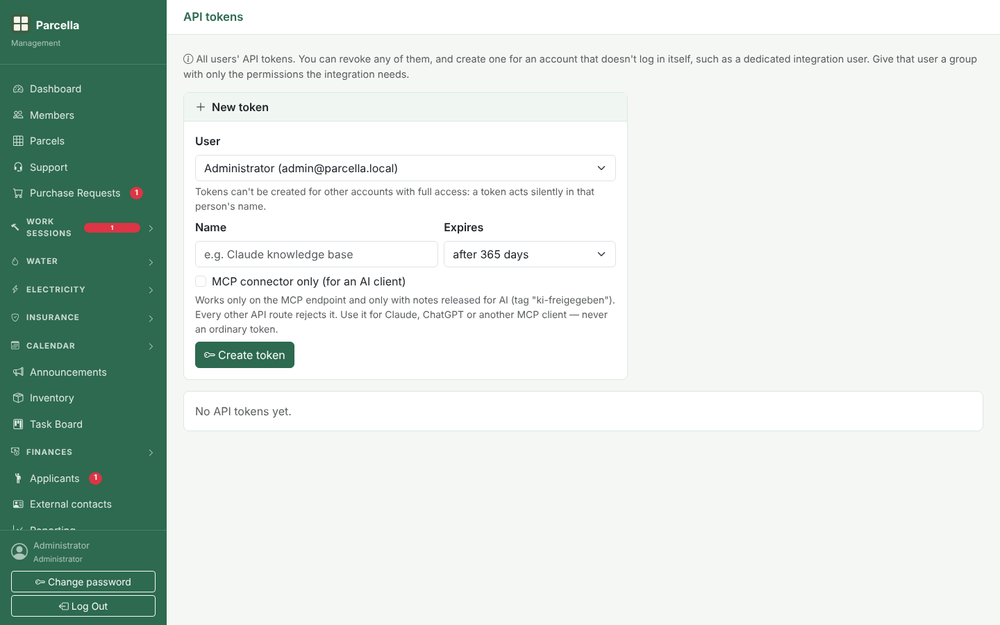

# Tokeny API {#api-tokens}

!!! note "Tłumaczenie maszynowe"
    Ta strona została przetłumaczona maszynowo z języka angielskiego i nie została jeszcze sprawdzona. Jeśli coś jest niejasne, obowiązuje wersja angielska (język zmienisz u góry).

Token API to klucz, który pozwala innemu programowi korzystać z Parcelli
w czyimś imieniu, bez jego hasła -- np. skryptowi eksportującemu dane
albo asystentowi AI, który czyta notatki stowarzyszenia. Większość
stowarzyszeń nigdy go nie potrzebuje.

!!! info "Kto może z tego korzystać"
    Każdy użytkownik może zarządzać **własnymi** tokenami: **Zmień
    hasło** na pasku bocznym → **Tokeny API dla integracji** →
    **Zarządzaj** (strona **Moje tokeny API**). Administratorzy widzą
    też tokeny **wszystkich** w **Administracja → Tokeny API**.

## Jak działa token {#how-a-token-behaves}

- Działa **dokładnie z uprawnieniami konta, do którego należy**. Token
  osoby odczytującej liczniki może tylko to, co ta osoba.
- Jest pokazywany **tylko raz**, zaraz po utworzeniu. Skopiuj go wtedy;
  później nie da się go odczytać.
- Przestaje działać, gdy wygaśnie, gdy zostanie unieważniony albo gdy
  hasło konta zostanie zmienione lub zresetowane. Dezaktywacja konta
  też go wyłącza.

Traktuj token jak hasło. Jeśli mógł wyciec, unieważnij go.

## Nowy token {#new-token}

| Pole / przycisk | Do czego służy |
|---|---|
| **Użytkownik** | *Tylko na stronie administratorów.* Jako czyje konto działa token. Możesz tworzyć tokeny dla siebie i dla kont **bez** pełnego dostępu -- zwykle osobnego konta dla integracji, które samo się nigdy nie loguje. Tokeny dla innych kont z pełnym dostępem nie są możliwe, bo token działałby po cichu w imieniu tej osoby. |
| **Nazwa** | Wymagana, do 100 znaków. Napisz, do czego służy, np. „Baza wiedzy Claude”. |
| **Wygasa** | **po 30 dniach**, **po 90 dniach**, **po 365 dniach** (domyślnie) lub **nigdy**. Lepiej ustawić wygaśnięcie. |
| **Tylko konektor MCP (dla klienta AI)** | Widoczne tylko przy włączonym module **Konektor MCP dla klientów AI**. Taki token działa tylko dla połączenia AI i tylko z notatkami udostępnionymi dla AI; każde inne użycie jest odrzucane. Dla asystenta AI zawsze używaj tego rodzaju. |
| **Utwórz token** | Tworzy token i pokazuje go w zielonym polu: *Skopiuj go teraz: jest wyświetlany tylko ten jeden raz ...* |

## Lista tokenów {#the-token-list}

| Kolumna / przycisk | Co pokazuje lub robi |
|---|---|
| **Nazwa** | Nazwa, pierwsze znaki tokenu (aby go rozpoznać) i w razie potrzeby oznaczenie **Tylko MCP**. |
| **Użytkownik** | *Tylko na stronie administratorów.* Czyj to token. |
| **Utworzono** | Data utworzenia. |
| **Ostatnio użyty** | Kiedy program użył go ostatnio, albo **nigdy**. |
| **Wygasa** | Data wygaśnięcia lub **nigdy**. |
| **Status** | **aktywny**, **wygasły**, **unieważniony** lub **zakończony** (hasło zmieniono po utworzeniu tokenu). |
| **Unieważnij** | Tylko dla aktywnych tokenów. Po potwierdzeniu token od razu przestaje działać. |

**Brak tokenów API.** pojawia się, gdy nie ma żadnych.

## Podłączanie asystenta AI do notatek {#connecting-an-ai-assistant-to-the-notes}

Z modułem **Konektor MCP dla klientów AI** asystent AI, taki jak Claude,
może przeszukiwać i czytać -- a jeśli pozwolisz, także zapisywać --
[notatki](../modules/notes.md), które dla niego udostępniłeś, i nic
więcej. W skrócie:

1. Włącz **Konektor MCP dla klientów AI** (i **Notatki**) w
   [Włączaniu i wyłączaniu modułów](modules.md).
2. [Zaproś](users.md) osobne konto dla asystenta i dodaj je do
   [grupy](groups.md), która nadaje tylko odczyt **Notatki** (i zapis,
   jeśli chcesz).
3. Tutaj utwórz token dla tego konta z zaznaczonym **Tylko konektor
   MCP (dla klienta AI)**.
4. Udostępnij notatki dla AI, nadając im tag udostępnienia opisany w
   rozdziale o notatkach.

Udostępniaj tylko notatki bez danych osobowych: trafiają one do
zewnętrznej usługi AI. Konfigurację krok po kroku dla każdego klienta AI
opisuje
[przewodnik konfiguracji MCP](https://github.com/parcella-garden/parcella/blob/main/docs/mcp-setup.md).

## Dla deweloperów {#for-developers}

Samo REST API -- punkty końcowe, uwierzytelnianie, przykłady -- opisuje
[dokumentacja dla deweloperów](https://github.com/parcella-garden/parcella#rest-api),
a interaktywnie **Administracja → Dokumentacja API (Swagger)**.

## Powiązane {#related}

- [Pierwsze logowanie i Twoje konto](../getting-started/first-login.md#change-password)
- [Użytkownicy i zaproszenia](users.md)
