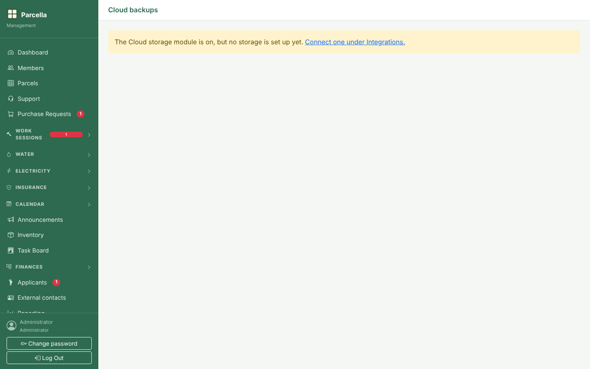

# Backup und Wiederherstellung {#backup-and-restore}

Eine Sicherung ist eine vollständige Kopie der Parcella-Daten deines Vereins
in einer Datei. Mit ihr bekommst du alles zurück, nach einem kaputten
Server, einem Fehler oder einem Umzug zu einem neuen Anbieter. Mach
regelmäßig Sicherungen und bewahr sie woanders auf als auf dem
Parcella-Server.

!!! info "Wer das nutzen kann"
    Nur Administratoren. Alles beginnt unter **Administration → System**.

## Was eine Sicherung enthält {#what-a-backup-contains}

Eine `.zip`-Datei mit:

- der ganzen Datenbank -- jedes Mitglied, jede Parzelle, jeder Zählerstand,
  jede Rechnung, Einstellung und jedes Benutzerkonto,
- den in Parcella gespeicherten hochgeladenen Dateien: Logo, Bilder von
  Mitteilungen, Avatare und Vorgangsdateien,
- dem Schlüssel, mit dem Parcella gespeicherte Passwörter verschlüsselt
  (Mailserver, Website, Cloud-Speicher, Helpdesk).

!!! warning "Behandle eine Sicherung wie ein Passwort"
    Weil sie diesen Schlüssel und alle personenbezogenen Daten deiner
    Mitglieder enthält, kann jeder mit der Datei alles lesen. Bewahr sie
    dort auf, wo nur der Vorstand herankommt.

Dateien in deinem Cloud-Speicher (Parzellenordner, Anhänge von Rechnungen,
Notizdateien) sind **nicht** Teil der Sicherung -- sie liegen schon in der
Cloud, die ihre eigene Sicherung hat.

## Eine Sicherung herunterladen {#download-a-backup}

Unter **Administration → System** hat die Karte **Datensicherung** die
Schaltfläche **Sicherung herunterladen**. Dein Browser lädt die ZIP-Datei
sofort herunter. Auf dem Server wird nichts gespeichert; diese Datei ist
also die einzige Kopie: Leg sie an einen sicheren Ort.

Geht etwas schief, siehst du **Sicherung fehlgeschlagen:** und den Grund.

## Aus einer Sicherung wiederherstellen {#restore-from-backup}

Du öffnest es mit **Aus Sicherung wiederherstellen** auf der Seite System.

!!! danger "Das überschreibt alle aktuellen Daten"
    Die Wiederherstellung ersetzt die **gesamte** Datenbank und alle
    hochgeladenen Dateien durch den Inhalt der Sicherung. Alles, was seit
    dieser Sicherung eingegeben wurde, ist weg, auch seitdem angelegte
    Benutzerkonten und Passwörter. Das lässt sich nicht rückgängig machen.
    Willst du vielleicht zurück, **lade erst eine Sicherung des jetzigen
    Stands herunter**.

| Feld / Schaltfläche | Was es bewirkt |
|---|---|
| **Sicherungsdatei (.zip)** | Wähl eine aus Parcella heruntergeladene Sicherungsdatei (höchstens 200 MB). |
| **RESTORE zur Bestätigung eingeben** | Tipp das Wort `RESTORE` in Großbuchstaben. Das schützt vor versehentlichem Wiederherstellen. |
| **Abbrechen** | Zurück zur Seite System. |
| **Wiederherstellen** | Fragt noch einmal nach und stellt dann wieder her. Das kann einen Moment dauern. |

Danach siehst du **Wiederherstellung erfolgreich abgeschlossen.** Alle --
auch du -- arbeiten jetzt mit den Daten, wie sie beim Erstellen der Sicherung
waren; eventuell musst du dich mit dem damals gültigen Passwort neu
anmelden.

Mögliche Meldungen:

| Meldung | Bedeutung |
|---|---|
| **Bestätigungsphrase stimmte nicht überein -- es wurde nichts geändert.** | Das Wort war nicht genau `RESTORE`. |
| **Die Datei ist zu groß.** | Über 200 MB. |
| **Die Sicherungsdatei hat eine unerwartete Struktur: ...** | Keine Parcella-Sicherung oder eine beschädigte Datei. Es wurde nichts geändert. |
| **Wiederherstellung fehlgeschlagen, es wurde nichts geändert: ...** | Die Wiederherstellung der Datenbank ist gescheitert; deine Daten sind wie vorher. |
| **Datenbank erfolgreich wiederhergestellt, aber die Wiederherstellung der hochgeladenen Dateien ist fehlgeschlagen: ...** | Die Daten sind wiederhergestellt, einige Dateien aber nicht. Die Wiederherstellung noch einmal auszuführen, ist sicher. |

Sicherungen aus einer älteren Parcella-Version lassen sich in eine neuere
einspielen; wer den Server betreut, muss danach eventuell die
Datenbank-Aktualisierung ausführen.

## Cloud-Sicherungen {#cloud-backups}

Du öffnest sie mit **Cloud-Sicherungen** auf der Seite System. Parcella kann
dieselbe Sicherung automatisch erstellen und in deinen Cloud-Speicher
hochladen.

Dafür muss das Modul **Cloud-Speicher** eingeschaltet und unter
[Integrationen](integrations.md#cloud-storage) ein Speicher eingerichtet
sein. Sonst sagt dir die Seite mit einem Link, was fehlt.

### Zeitplan {#schedule}

| Feld / Schaltfläche | Was es bewirkt |
|---|---|
| **Automatisch in die Cloud sichern** | Schaltet automatische Sicherungen ein oder aus. |
| **Zielordner** | Ordner im Cloud-Speicher, z. B. `backups/parcella`. Wird angelegt, wenn es ihn nicht gibt. Wähl einen Ordner, den nur der Vorstand öffnen kann -- jede Sicherung enthält den Schlüssel zu den gespeicherten Passwörtern. |
| **Häufigkeit** | **Stündlich**, **Täglich** (Vorgabe), **Wöchentlich** oder **Monatlich**. |
| **So viele Sicherungen aufbewahren** | Wie viele Sicherungen bleiben, mindestens 1 (Vorgabe 10). Kommt eine neue dazu, werden die ältesten über dieser Zahl gelöscht. Angefasst werden nur Parcellas eigene Sicherungsdateien. |
| **Speichern** | Speichert den Zeitplan (**Gespeichert.**). |
| **Jetzt in die Cloud sichern** | Erstellt sofort eine Sicherung und lädt sie hoch, ob automatische Sicherungen an sind oder nicht. |

Unter den Feldern siehst du das Ergebnis des letzten Laufs: **Letzte
Cloud-Sicherung: … (erfolgreich).**, **… -- fehlgeschlagen:** mit dem Grund
oder **Es wurde noch keine Cloud-Sicherung durchgeführt.** Schau ab und zu
nach -- eine Sicherung, die wochenlang still scheitert, ist keine Sicherung.

### Sicherungen in der Cloud {#backups-in-the-cloud}

Eine Liste der Sicherungen im Zielordner, die neuesten zuerst, mit **Name**,
**Größe** und **Zuletzt geändert**. **In diesem Ordner gibt es noch keine
Sicherungen.**, wenn es keine gibt.

Um eine wiederherzustellen, tipp `RESTORE` in das Feld in ihrer Zeile und
klick auf **Wiederherstellen**. Es gilt dieselbe Warnung wie oben: Das
überschreibt alle aktuellen Daten.

## Gute Praxis {#good-practice}

- Lade vor großen Änderungen eine Sicherung herunter: einem Update, einem
  großen Import, einem Rechnungslauf.
- Bewahr mindestens eine Kopie auch außerhalb des Cloud-Speichers auf, z. B.
  auf einem verschlüsselten USB-Stick im Tresor des Vereins.
- Teste ab und zu eine Sicherung, indem du sie auf einer Test-Installation
  wiederherstellst. Eine Sicherung, die du nie wiederhergestellt hast, ist
  nur eine Hoffnung.

## Siehe auch {#related}

- [Systeminfo und Updates](system.md)
- [Integrationen](integrations.md#cloud-storage)
