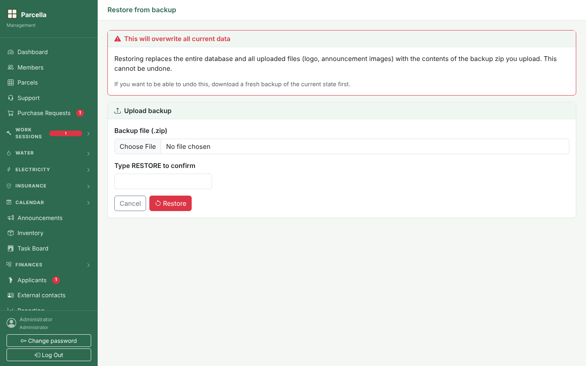

# Zálohovanie a obnova {#backup-and-restore}

!!! note "Strojový preklad"
    Táto stránka bola strojovo preložená z angličtiny a zatiaľ nebola skontrolovaná. Ak je niečo nejasné, platí anglická verzia (jazyk prepnete hore).

Záloha je úplná kópia dát vášho spolku v Parcelle v jednom súbore. S
ňou dostanete všetko späť po pokazenom serveri, chybe alebo presune na
nový hosting. Zálohujte pravidelne a zálohy uchovávajte inde ako na
serveri s Parcellou.

!!! info "Kto to môže používať"
    Len administrátori. Všetko začína v **Administrácia → Systém**.

## Čo záloha obsahuje {#what-a-backup-contains}

Jeden súbor `.zip` s:

- celou databázou -- každým členom, parcelou, odpočtom, faktúrou,
  nastavením a používateľským účtom,
- nahranými súbormi uloženými v Parcelle: logo, obrázky oznamov,
  avatary a súbory procesov,
- kľúčom, ktorým Parcella šifruje uložené heslá (poštový server, web,
  cloudové úložisko, helpdesk).

!!! warning "So zálohou zaobchádzajte ako s heslom"
    Keďže obsahuje tento kľúč a všetky osobné údaje vašich členov,
    ktokoľvek so súborom si môže prečítať všetko. Uchovávajte ju tam,
    kam sa dostane len výbor.

Súbory uložené vo vašom cloudovom úložisku (priečinky parciel, prílohy
faktúr, súbory poznámok) **nie sú** súčasťou zálohy -- sú už v cloude,
ktorý má vlastné zálohovanie.

## Stiahnuť zálohu {#download-a-backup}

V **Administrácia → Systém** má karta **Záloha** tlačidlo **Stiahnuť
zálohu**. Prehliadač hneď stiahne súbor zip. Na serveri sa nič
neukladá, takže tento súbor je jediná kópia: uložte ho na bezpečné
miesto.

Ak sa niečo pokazí, uvidíte **Zálohovanie zlyhalo:** a za tým dôvod.

## Obnoviť zo zálohy {#restore-from-backup}

Otvoríte ju tlačidlom **Obnoviť zo zálohy** na stránke Systém.

!!! danger "Toto prepíše všetky aktuálne dáta"
    Obnova nahradí **celú** databázu a všetky nahrané súbory obsahom
    zálohy. Všetko, čo bolo zadané od tejto zálohy, je preč, vrátane
    používateľských účtov a hesiel vytvorených odvtedy. Nedá sa to
    vrátiť späť. Ak by ste sa možno chceli vrátiť, najprv si **stiahnite
    zálohu aktuálneho stavu**.

| Pole / tlačidlo | Čo robí |
|---|---|
| **Súbor zálohy (.zip)** | Vyberte súbor zálohy stiahnutý z Parcelly (najviac 200 MB). |
| **Napíšte RESTORE na potvrdenie** | Napíšte slovo `RESTORE` veľkými písmenami. Chráni to pred nechcenou obnovou. |
| **Zrušiť** | Späť na stránku Systém. |
| **Obnoviť** | Ešte raz sa opýta a potom obnoví. Môže to chvíľu trvať. |

Potom uvidíte **Obnovenie bolo úspešne dokončené.** Všetci -- vrátane
vás -- teraz pracujú s dátami v stave, v akom boli pri vytvorení zálohy;
možno sa budete musieť znova prihlásiť heslom, ktoré platilo vtedy.

Možné hlásenia:

| Hlásenie | Význam |
|---|---|
| **Potvrdzovacia fráza sa nezhodovala -- nič sa nezmenilo.** | Slovo nebolo presne `RESTORE`. |
| **Súbor je príliš veľký.** | Viac ako 200 MB. |
| **Súbor zálohy má neočakávanú štruktúru: ...** | Nie je to záloha Parcelly alebo je súbor poškodený. Nič sa nezmenilo. |
| **Obnovenie zlyhalo, nič sa nezmenilo: ...** | Obnova databázy zlyhala a vaše dáta sú ako predtým. |
| **Databáza bola úspešne obnovená, ale obnovenie nahraných súborov zlyhalo: ...** | Dáta sú obnovené, ale niektoré súbory nie. Opätovné spustenie obnovy je bezpečné. |

Zálohy zo staršej verzie Parcelly sa dajú obnoviť do novšej; osoba,
ktorá sa stará o server, možno bude musieť potom spustiť aktualizáciu
databázy.
<!-- TODO(verify): whether the app applies pending database migrations by itself after a restore of an older backup, or whether the server admin must always run them (developer docs say a restore doesn't run them). -->

## Zálohy v cloude {#cloud-backups}

Otvoríte ich tlačidlom **Zálohy v cloude** na stránke Systém. Parcella
môže tú istú zálohu robiť automaticky a nahrávať ju do vášho cloudového
úložiska.

Potrebuje to zapnutý modul **Cloudové úložisko** a úložisko nastavené v
časti [Integrácie](integrations.md#cloud-storage). Inak vám stránka
povie, čo chýba, s odkazom.

### Plán {#schedule}

| Pole / tlačidlo | Čo robí |
|---|---|
| **Automaticky zálohovať do cloudu** | Zapína alebo vypína automatické zálohy. |
| **Cieľový priečinok** | Priečinok v cloudovom úložisku, napr. `backups/parcella`. Ak neexistuje, vytvorí sa. Vyberte priečinok, ktorý môže otvoriť len výbor -- každá záloha obsahuje kľúč k uloženým heslám. |
| **Frekvencia** | **Každú hodinu**, **Denne** (predvolené), **Týždenne** alebo **Mesačne**. |
| **Koľko záloh uchovávať** | Koľko záloh ponechať, aspoň 1 (predvolene 10). Keď pribudne nová, najstaršie nad tento počet sa zmažú. Dotkne sa to len vlastných súborov záloh Parcelly. |
| **Uložiť** | Uloží plán (**Uložené.**). |
| **Zálohovať do cloudu teraz** | Okamžite vytvorí a nahrá zálohu, bez ohľadu na to, či sú automatické zálohy zapnuté. |

Pod poľami vidíte výsledok posledného behu: **Posledná záloha do
cloudu: ... (úspešná).**, **... -- zlyhala:** s dôvodom alebo
**Zatiaľ neprebehla žiadna záloha do cloudu.** Občas to skontrolujte --
záloha, ktorá týždne potichu zlyháva, nie je záloha.

### Zálohy v cloude {#backups-in-the-cloud}

Zoznam záloh v cieľovom priečinku, najnovšie navrchu, s **Názov**,
**Veľkosť** a **Naposledy zmenené**. Ak žiadne nie sú, zobrazí sa
**V tomto priečinku zatiaľ nie sú žiadne zálohy.**

Ak chcete niektorú obnoviť, napíšte `RESTORE` do poľa v jej riadku a
kliknite na **Obnoviť**. Platí to isté varovanie ako vyššie: prepíše
všetky aktuálne dáta.

## Osvedčený postup {#good-practice}

- Pred veľkými zmenami si stiahnite zálohu: aktualizácia, veľký import,
  vyúčtovanie.
- Aspoň jednu kópiu majte aj mimo cloudového úložiska, napr. na
  šifrovanom USB kľúči v trezore spolku.
- Občas zálohu otestujte obnovením na náhradnej testovacej inštalácii.
  Záloha, ktorú ste nikdy neobnovili, je len nádej.

## Súvisiace {#related}

- [Informácie o systéme a aktualizácie](system.md)
- [Integrácie](integrations.md#cloud-storage)
