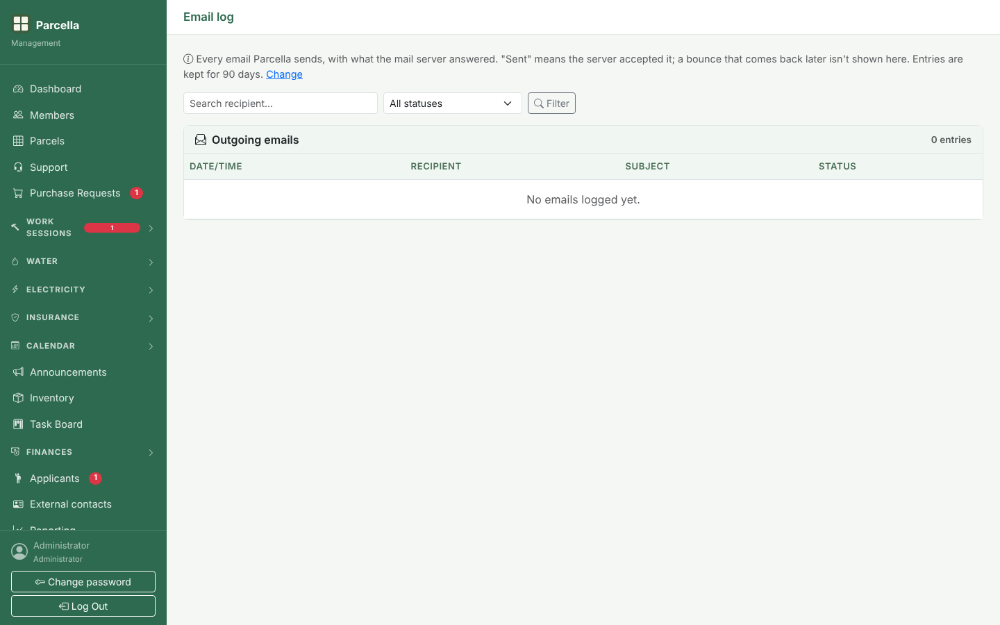

# Protokol e-mailů {#e-mail-log}

!!! note "Strojový překlad"
    Tato stránka byla strojově přeložena z angličtiny a dosud nebyla zkontrolována. Pokud je něco nejasné, platí anglická verze (jazyk přepnete nahoře).

Protokol e-mailů uvádí každý e-mail, který se Parcella pokusila odeslat
-- pozvánky, upozornění, oznámení, faktury, potvrzení přihlášek -- a co
odpověděl poštovní server. Podívejte se sem, když někdo řekne „ten
e-mail mi nikdy nepřišel“.

!!! info "Kdo to může používat"
    Jen administrátoři. Otevřete **Administrace → Protokol e-mailů**.

## Čtení protokolu {#reading-the-log}

Nahoře krátká poznámka vysvětluje stránku a kolik dní se záznamy
uchovávají, s odkazem **Změnit** na
[nastavení](settings.md#email-log).

Karta **Odchozí e-maily** ukazuje počet nalezených záznamů a tabulku,
od nejnovějších, 50 na stránku:

| Sloupec | Co ukazuje |
|---|---|
| **Datum/čas** | Kdy Parcella předala e-mail poštovnímu serveru, v časovém pásmu vašeho spolku. |
| **Příjemce** | Adresa, na kterou šel. |
| **Předmět** | Řádek předmětu. Kancelářská sponka znamená, že měl přílohy; najeďte na ni myší a uvidíte kolik. |
| **Stav** | **Odesláno** nebo **Selhalo**. U **Selhalo** vidíte chybovou zprávu poštovního serveru. |

Tlačítky **Novější** a **Starší** dole listujete protokolem (**Strana
... z ...**).

### Co znamená „Odesláno“ a „Selhalo“ {#what-sent-and-failed-mean}

- **Odesláno** znamená, že váš poštovní server e-mail **přijal**.
  Nedokazuje to, že dorazil: pokud je schránka plná nebo adresa už
  neexistuje, zpráva o nedoručení přijde do odesílací schránky vašeho
  spolku, ne do tohoto protokolu.
- **Selhalo** znamená, že poštovní server e-mail hned odmítl nebo nebyl
  dosažitelný -- například špatné heslo, neznámý příjemce nebo vůbec
  nenastavený poštovní server.

Pokud mnoho e-mailů selže se stejnou chybou, zkontrolujte nastavení
poštovního serveru v [Nastavení spolku](settings.md#email-smtp).

## Hledání a filtrování {#searching-and-filtering}

| Prvek | Co dělá |
|---|---|
| **Hledat příjemce…** | Ukáže jen e-maily, jejichž adresa příjemce obsahuje zadaný text. |
| Seznam stavů | **Všechny stavy**, **Odesláno** nebo **Selhalo**. Změna filtruje okamžitě. |
| **Filtrovat** | Použije hledání. |
| **Zrušit filtr** | Objeví se, když je filtr aktivní; znovu ukáže vše. |

Když nic neodpovídá, zobrazí se **Zatím nebyly zaznamenány žádné e-maily.**

## Jak dlouho se záznamy uchovávají {#how-long-entries-are-kept}

Adresy příjemců jsou osobní údaje, proto se záznamy automaticky mažou
po počtu dní nastaveném v
[Nastavení spolku → Protokol e-mailů](settings.md#email-log) -- 90 dní,
pokud to nezměníte. Protokol ukládá jen příjemce, předmět, stav a chybu
a počet příloh -- ne text e-mailu.

## Související {#related}

- [Nastavení spolku](settings.md#email-smtp)
- [Uživatelé a pozvánky](users.md)
