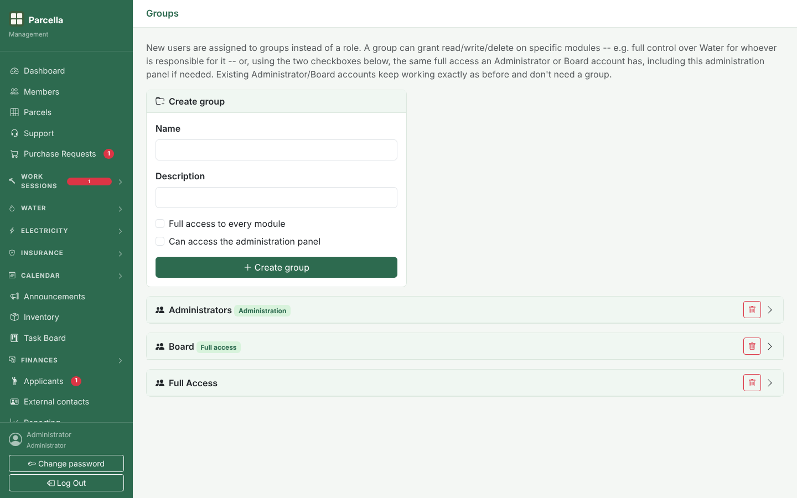

# Skupiny {#groups}

!!! note "Strojový překlad"
    Tato stránka byla strojově přeložena z angličtiny a dosud nebyla zkontrolována. Pokud je něco nejasné, platí anglická verze (jazyk přepnete nahoře).

Skupiny rozhodují, co smí každý člověk vidět a měnit. Pro určitou
funkci ve spolku -- „Výbor“, „Pokladník“, „Vodní tým“ -- vytvoříte
skupinu, zaškrtnete, co tato funkce potřebuje, a zařadíte do ní
správné lidi.

!!! info "Kdo to může používat"
    Jen administrátoři. Otevřete **Administrace → Skupiny**.

Principy skupin -- Čtení, Zápis a Mazání, plný přístup, administrace --
vysvětluje stránka
[Role, skupiny a oprávnění](../getting-started/roles-and-permissions.md).
Tato stránka popisuje obrazovku.

## Vytvoření skupiny {#create-group}

| Pole / tlačítko | Co dělá |
|---|---|
| **Název** | Povinné a musí být jedinečné (**Skupina s tímto názvem již existuje**). |
| **Popis** | Volitelná poznámka, k čemu skupina slouží. |
| **Plný přístup ke každému modulu** | Členové skupiny smějí číst, měnit a mazat vše ve všech zapnutých modulech, jako výbor. |
| **Přístup k administračnímu panelu** | Členové skupiny smějí také otevřít **Administrace**. Tato volba zahrnuje plný přístup, takže políčko pro plný přístup zmizí. |
| **Vytvořit skupinu** | Vytvoří skupinu. Uvidíte **Skupina vytvořena**. |

Nová skupina bez zaškrtnutého některého z políček zatím nedává nic.
Otevřete ji níže a zaškrtněte její oprávnění.

## Karty skupin {#the-group-cards}

Každá skupina se zobrazí jako sbalená karta pod formulářem. Záhlaví
ukazuje její název a odznak **Administrace** nebo **Plný přístup**,
pokud jedno z toho dává. Kliknutím na záhlaví kartu rozbalíte.

Tlačítko s **košem** v záhlaví po potvrzení skupinu smaže. Její členové
ztratí vše, co jim skupina dávala. Parcella odmítne smazat poslední
skupinu, která někomu dává přístup do administrace, pokud ho nemá žádný
jiný účet.

### Nastavení a oprávnění {#settings-and-permissions}

| Pole / tlačítko | Co dělá |
|---|---|
| **Název**, **Popis** | Jako při vytváření. |
| **Plný přístup ke každému modulu**, **Přístup k administračnímu panelu** | Jako při vytváření. Když je některé zaškrtnuté, tabulka oprávnění se skryje, protože není potřeba. |
| Tabulka oprávnění | Jeden řádek pro každý **Modul** se zaškrtávacími políčky **Čtení**, **Zápis** a **Mazání**. Viz seznam modulů níže. |
| **Uložit** | Uloží název, popis, obě políčka a celou tabulku. Uvidíte **Skupina aktualizována**. |

Moduly v tabulce: **Členové a parcely**, **Pracovní sezení**, **Voda**,
**Elektřina**, **Pojištění**, **Žádosti o nákup**, **Kalendář**,
**Inventář**, **Finance**, **Podpora (helpdesk)**, **Uchazeči**,
**Externí kontakty**, **Přehledy**, **Poznámky**, **Procesy**. Moduly,
které má váš spolek vypnuté, jsou v seznamu také; jejich zaškrtnutí se
projeví, jakmile se modul zapne.

!!! tip "Čtení na prvním místě"
    Zaškrtněte **Čtení** všude, kde zaškrtáváte **Zápis** nebo
    **Mazání**. Bez Čtení se modul v postranním panelu dané osoby vůbec
    neobjeví.

Nástěnka úkolů a oznámení v tabulce nejsou: jsou dostupné vždy jen s
plným přístupem.

### Přiřazení uživatelé {#assigned-users}

Uvádí účty ve skupině s avatarem, jménem a e-mailovou adresou.

| Prvek | Co dělá |
|---|---|
| **×** vedle osoby | Okamžitě ji ze skupiny odebere (**Uživatel odebrán**). |
| **Přidat uživatele...** + **Přidat** | Vyberte účet a přidejte ho (**Uživatel přidán**). |

Seznam **Přidat uživatele...** nabízí jen účty, které získávají přístup
přes skupiny. Starší účty s rolí **Správce** nebo **Výbor** už mají plný
přístup a nejsou zde nabízeny; chcete-li je převést na skupiny, přidejte
je ze stránky [Upravit uživatele](users.md#edit-user). Když jsou ve
skupině už všechny vhodné účty, uvidíte místo seznamu krátkou poznámku;
když žádné vhodné účty nejsou, odkaz **Pozvat nyní**.

Změny oprávnění se projeví při dalším kliknutí dané osoby -- nemusí se
znovu přihlašovat.

## Příklad nastavení {#example-set-up}

| Skupina | Zaškrtnuto |
|---|---|
| Administrátoři | **Přístup k administračnímu panelu** |
| Výbor | **Plný přístup ke každému modulu** |
| Pokladník | Finance: Čtení, Zápis, Mazání. Členové a parcely: Čtení, Zápis. Žádosti o nákup: Čtení. Pojištění: Čtení. |
| Odečítači měřidel | Voda: Čtení, Zápis. Elektřina: Čtení, Zápis. |
| Tým pracovních směn | Pracovní sezení: Čtení, Zápis. Kalendář: Čtení. |

Člověk může být ve více skupinách; jeho oprávnění se sčítají.

## Související {#related}

- [Uživatelé a pozvánky](users.md)
- [Role, skupiny a oprávnění](../getting-started/roles-and-permissions.md)
- [Zapínání a vypínání modulů](modules.md)
