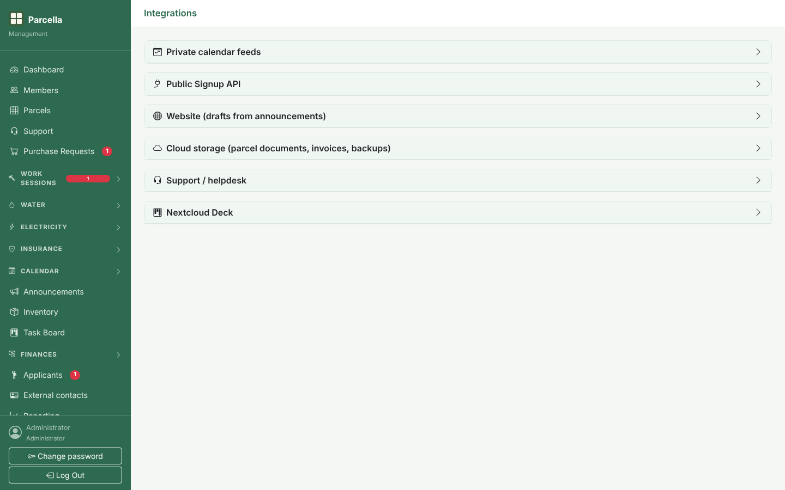

# Integrationen {#integrations}

Integrationen verbinden Parcella mit den anderen Systemen, die dein Verein
nutzt: der Vereinswebsite, einem Cloud-Speicher, einem Helpdesk, Nextcloud
Deck und Kalender-Apps.

!!! info "Wer das nutzen kann"
    Nur Administratoren. Öffne **Administration → Integrationen**.

Die Seite ist eine Spalte von Karten, jede zugeklappt; ein Klick auf eine
Überschrift öffnet sie. Jede Karte speichert für sich mit ihrer eigenen
Schaltfläche.

Die meisten Integrationen brauchen außerdem ein eingeschaltetes Modul unter
[Module ein- und ausschalten](modules.md). Die Karten sagen dir, wenn das
fehlt.

!!! note "Der Mailserver ist woanders"
    Der Server für ausgehende E-Mails (SMTP) wird in den
    [Vereinseinstellungen](settings.md#email-smtp) festgelegt, nicht hier.

## Private Kalender-Feeds {#private-calendar-feeds}

Das Kalendermodul bietet Abo-Links (Kalender-Feeds) für die
Geburtstagsliste und für Vorstandspräsenz und -abwesenheit, damit
Vorstandsmitglieder sie in der Kalender-App ihres Handys sehen. Diese Links
enthalten ein gemeinsames Geheimnis und laufen nie ab.

| Schaltfläche | Was sie bewirkt |
|---|---|
| **Neu erzeugen** | Erzeugt nach der Bestätigung ein neues Geheimnis. **Jedes bestehende Abo dieser Feeds hört auf zu funktionieren**; wer abonniert hat, muss den neuen Link von den Kalenderseiten kopieren. Du siehst **Kalender-Feed-Token neu erzeugt. …** |

Mach das, wenn ein Link in falsche Hände geraten sein könnte oder jemand,
der ihn hatte, den Vorstand verlässt. Siehe [Kalender](../modules/calendar.md).

## Öffentliche Anmelde-API {#public-signup-api}

Mit dieser Karte kann deine Vereinswebsite mit Parcella sprechen: Gärtner
melden sich über Formulare auf der Website zu Arbeitseinsätzen an, schicken
eine Kontaktnachricht oder bewerben sich um einen Garten, ohne
Parcella-Zugang.

Ist das Modul **Öffentliche Anmelde-API** aus, sagt ein Hinweis oben auf der
Seite das, mit einem Link **In den Einstellungen aktivieren**. Einen
ähnlichen Hinweis gibt es in der Karte, solange die **Öffentliche
Kontaktformular-API** aus ist. Das Bewerbungsformular braucht zusätzlich den
Schalter **Öffentliche Bewerbungsformular-API**.

Eine Website kann ihre Formulare auf zwei Wegen schicken, und du kannst beide
nutzen.

### Mit dem API-Token (Website-Plugin auf dem Server) {#with-the-api-token-website-plugin-on-the-server}

Für eine Website mit einem serverseitigen Plugin -- einem „Connector“ --, das
die Formulardaten selbst an Parcella schickt.

| Element | Was es bewirkt |
|---|---|
| **API-Token** | Das Geheimnis, das das Plugin braucht. Klick in das Feld, um es zu markieren, und kopier es dann in die Einstellungen des Plugins. |
| **Neu erzeugen** | Erzeugt nach der Bestätigung ein neues Token. **Jedes Plugin, das noch das alte nutzt, hört sofort auf zu funktionieren**; trag das neue überall ein. Du siehst *Ein neues API-Token wurde erzeugt. …* |
| **Endpunkte** | Eine Tabelle der Webadressen, die die Plugins nutzen, jede mit **Methode**, **URL** und **Authentifizierung** (**Keine (öffentlich lesbar)**, das API-Token oder **Erlaubte Website-Adressen**). Das braucht die Person, die eure Website technisch betreut, nicht du. |

Die Karte endet mit einem Hinweis, dass ein fertiges WordPress-Plugin zum
Parcella-Projekt gehört.

### Website-Formulare (einfaches HTML, WordPress-Plugin) {#website-forms-plain-html-wordpress-plugin}

Für Websites, deren Formulare direkt aus dem Browser der Besucher an Parcella
senden: einfache HTML-Seiten in jedem Website-System und das
WordPress-Plugin ab Version 3.0. Ein Token ist dabei nicht im Spiel; Parcella
nimmt deshalb nur Formulare von den Websites an, die du hier einträgst.
Solange die Liste leer ist, sind diese Formulare geschlossen.

| Feld / Schaltfläche | Was es bewirkt |
|---|---|
| **Erlaubte Website-Adressen** | Eine Webadresse je Zeile, nur Schema und Host, z. B. `https://example.org`. Trag jede Adresse ein, unter der eure Vereinswebsite erreichbar ist, auch die eigene Adresse der WordPress-Seite. Einträge, die keine Webadressen sind, werden verworfen und in einer Warnung gelistet. |
| **ALTCHA verlangen (Rechenaufgabe gegen Spam-Bots)** | Der Browser der Besucher muss eine kleine Rechenaufgabe lösen, bevor ein Formular angenommen wird -- keine Cookies, kein externes Unternehmen, nichts zum Anklicken. Das gilt für **jeden** Weg, auch für Plugins mit dem API-Token. Hak es erst an, wenn alle Formulare eurer Website das ALTCHA-Widget enthalten, sonst wird jede Einsendung abgelehnt. |
| **Adressen speichern** | Speichert beides. Du siehst **Erlaubte Website-Adressen gespeichert.** |

Was Gärtner sehen und bekommen, steht unter [Für Gärtner](../gardeners/index.md).

## Webseite (Entwürfe aus Mitteilungen) {#website-drafts-from-announcements}

Lässt das Modul [Mitteilungen](../modules/announcements.md) mit einem Klick
einen Beitragsentwurf auf eurer Vereinswebsite anlegen. Parcella legt immer
nur **Entwürfe** an; das Veröffentlichen bleibt deine Entscheidung in deinem
Website-System.

| Feld / Schaltfläche | Was es bewirkt |
|---|---|
| **Webseiten-Typ** | **Keiner (keine Webseiten-Entwürfe)**, **WordPress**, **Markdown-Ordner (Cloud-Speicher)** oder **Parcella-Plugin (TYPO3, Contao, Drupal, Joomla, ...)**. Die Wahl zeigt die zugehörigen Felder. Es ist immer nur ein Typ aktiv; beim Wechseln bleiben die Einstellungen des anderen Typs für später erhalten. |
| **Speichern** | Speichert den Typ und seine Felder. Du siehst **Webseiten-Einstellungen gespeichert** oder einen Fehler, der erklärt, was fehlt. |
| **Verbindung testen** | Probiert die Verbindung mit dem, was gerade im Formular steht, ohne zu speichern. Zeigt **Verbindung erfolgreich** oder den Fehler. |

Mit * markierte Felder sind Pflicht. Passwortfelder zeigen, ob etwas
gespeichert ist; lass sie leer, um es zu behalten.

**WordPress**

| Feld | Was du einträgst |
|---|---|
| **WordPress-Adresse** * | Die Adresse deiner Website. |
| **WordPress-Benutzername** * | Der WordPress-Benutzer, als der die Entwürfe angelegt werden. |
| **Anwendungspasswort** * | Nicht das normale WordPress-Passwort: Leg in WordPress unter *Benutzer → Profil → Anwendungspasswörter* ein Anwendungspasswort an. |

**Markdown-Ordner (Cloud-Speicher)** -- für Websites, die aus Textdateien
gebaut werden (Hugo, Jekyll, Eleventy, Astro und ähnliche). Jeder Entwurf
wird eine als Entwurf markierte Datei in einem Ordner in deinem
[Cloud-Speicher](#cloud-storage); das Entfernen der Entwurfszeile
veröffentlicht ihn.

| Feld | Was du einträgst |
|---|---|
| **Ordner für Beiträge** * | Ordner im Cloud-Speicher für die Beiträge, z. B. `website/content/posts`. Er muss schon existieren. |
| **Ordner für Bilder** | Wohin Bilder kommen, in Unterordnern nach Jahr und Monat. Leer: Beiträge ohne Bilder. |
| **Web-Pfad des Bilderordners** | Wie die Website den Bilderordner anspricht, z. B. `/media`. |
| **Adresse der Webseite** | Wird für den QR-Code auf dem gedruckten Aushang genutzt, sobald ein Beitrag veröffentlicht ist. |
| **Muster für Dateinamen** | `{date}` wird zu JJJJMMTT, `{slug}` zum Titel ohne Umlaute und Leerzeichen. |
| **Muster für Beitragsadressen** | Die Webadresse des Beitrags, wird in die Datei geschrieben. Leer lassen, wenn deine Website sie selbst bildet. |
| **Autor** | Wird in jeden Beitrag geschrieben. |
| **Kategorien** | Kommagetrennt, so wie deine Website sie benennt. |

**Parcella-Plugin** -- für TYPO3, Contao, Drupal, Joomla und andere Systeme
mit installiertem Parcella-Plugin. Die Einstellungen des Plugins zeigen beide
Werte.

| Feld | Was du einträgst |
|---|---|
| **Plugin-Adresse** * | Z. B. `https://example.org/parcella/v1`. |
| **Gemeinsamer Schlüssel** * | Wird vom Plugin erzeugt. |

## Cloud-Speicher {#cloud-storage}

Die Überschrift lautet **Cloud-Speicher (Parzellendokumente, Rechnungen,
Sicherungen)**. Hier legst du fest, wo Parcella Dateien aufbewahrt: einen
Ordner je Parzelle (Pachtverträge, Unterlagen), Eingangsrechnungen,
Dokumente von Kontakten, Notizen, Vorgangsdateien, Sicherungen und die
Markdown-Website. Wer sonst einen Ordner sehen darf, wird im Speicher selbst
geregelt, nicht in Parcella.

| Feld / Schaltfläche | Was es bewirkt |
|---|---|
| **Speicher-Typ** | **Keiner (kein Cloud-Speicher)**, **Nextcloud**, **WebDAV (ownCloud, Seafile, HiDrive, Storage Box, ...)** oder **S3-kompatibel (AWS, Hetzner, MinIO, Wasabi, ...)**. Es ist immer nur einer aktiv. Ordnerpfade, die woanders in Parcella eingetragen werden, beziehen sich auf den gewählten Speicher. |
| **Speichern**, **Verbindung testen** | Wie bei der Website-Karte. |

| Speicher | Felder |
|---|---|
| **Nextcloud** | **Nextcloud-Adresse** *, **Nextcloud-Benutzername** *, **App-Passwort** * -- leg in Nextcloud unter *Einstellungen → Sicherheit → Geräte & Sitzungen* ein App-Passwort an; nimm nicht das normale Passwort. |
| **WebDAV** | **WebDAV-Adresse** * (die vollständige Adresse des Ordners, in dem Parcella arbeiten soll, wie dein Anbieter sie angibt), **Benutzername** *, **Passwort** *. |
| **S3-kompatibel** | **Endpunkt** *, **Region** * (lass `us-east-1`, wenn dein Anbieter keine Regionen hat), **Bucket** *, **Zugangsschlüssel-ID** *, **Geheimer Zugangsschlüssel** *, **Pfad im Bucket** (freiwilliger Unterordner für alle Dateien von Parcella). |

Genutzt wird der Speicher erst, wenn das Modul **Cloud-Speicher**
eingeschaltet ist. Dann zeigt die Karte auch die Ordner unten. Jeder hat ein
Pfadfeld (relativ zum Speicher) und eine Schaltfläche **Speichern**; lass
einen Pfad leer, um diese Nutzung abzuschalten.

| Ordner | Wofür |
|---|---|
| **Ordner für Eingangsrechnungen** | Anhänge von [Eingangsrechnungen](../modules/finances/incoming-invoices.md) kommen in diesen einen gemeinsamen Ordner. |
| **Ordner für Dokumente externer Kontakte** | Ein Basisordner mit je einem Unterordner pro [externem Kontakt](../modules/external-contacts.md), den du im Speicher anlegst. Jeder Kontakt wählt dann seinen Unterordner. Leer: Der Dokumentenbereich ist ausgeblendet. |
| **Ordner für gedruckte Mitteilungen** | Jedes Druck-PDF einer [Mitteilung](../modules/announcements.md) wird auch hier gespeichert. Mit **Durchsuchen** klickst du dich durch den Speicher und **übernimmst** einen Ordner. Leer: nur Download. |
| **Notizen-Ordner** | [Notizen](../modules/notes.md) liegen hier als Textdateien, und Änderungen an diesen Dateien in der Cloud erscheinen in Parcella. Unterordner werden zu Notizkategorien. Leer: Notizen gibt es nur in Parcella. |
| **Ordner für Vorgangsdateien** | Dateien, die zu einem [Vorgang](../modules/processes.md) hochgeladen werden, ein Unterordner je Vorgang. Leer: bleiben in Parcella. Schon hochgeladene Dateien bleiben, wo sie sind. |

Den Ordner für automatische Sicherungen legst du auf der Seite
[Cloud-Sicherungen](backup.md#cloud-backups) fest.

## Support / Helpdesk {#support-helpdesk}

Verbindet das Helpdesk, in dem dein Verein Anfragen beantwortet. Parcella
verknüpft dann seine Konversationen mit Mitgliedern, Parzellen und dem
Aufgabenboard (siehe [Support](../modules/support.md)), und das
Kontaktformular der Website legt dort neue Anfragen an.

| Feld / Schaltfläche | Was es bewirkt |
|---|---|
| **Helpdesk** | **Keines (kein Helpdesk)**, **FreeScout**, **Zammad**, **Znuny / OTRS**, **osTicket**, **Zendesk** oder **Freshdesk**. Es ist immer nur eins aktiv; wechselst du später zurück, kommen auch seine Konversationen zurück. Jede Wahl zeigt einen kurzen Hinweis, was damit funktioniert. |
| **Speichern**, **Verbindung testen** | Wie bei der Website-Karte. |

| Helpdesk | Felder | Hinweise |
|---|---|---|
| **FreeScout** | **FreeScout-Adresse** *, **API-Schlüssel** *, **Postfach-ID** (Vorgabe 1) | Alles funktioniert. Braucht das FreeScout-Modul *API & Webhooks*. |
| **Zammad** | **Zammad-Adresse** *, **Zugriffstoken** *, **Gruppe für neue Anfragen** * | Alles funktioniert. |
| **Znuny / OTRS** | **Webservice-Adresse** *, **Agenten-Login** *, **Passwort** *, **Queue für neue Anfragen** *, **Adresse der Agenten-Oberfläche** | Kein Umbenennen von Kunden. Ein Parcella-Webservice muss einmal in Znuny importiert werden. |
| **osTicket** | **osTicket-Adresse** *, **API-Schlüssel** * | Nur das Kontaktformular der Website funktioniert; gelesen und geantwortet wird in osTicket. |
| **Zendesk** | **Zendesk-Adresse** *, **E-Mail-Adresse des Agenten** *, **API-Token** * | Alles funktioniert. |
| **Freshdesk** | **Freshdesk-Adresse** *, **API-Schlüssel** * | Alles funktioniert. |

Der Hinweis unter jedem Feld sagt, wo du den Schlüssel oder das Token in
deinem Helpdesk findest. Schalte außerdem das Modul **Support (Helpdesk)**
ein.

## Nextcloud Deck {#nextcloud-deck}

Kopiert die Karten eines Nextcloud-Deck-Boards auf das
[Aufgabenboard](../modules/tasks.md) von Parcella -- nur in eine Richtung,
schreibgeschützt, automatisch aktuell gehalten. Das ist eine eigene
Verbindung, getrennt vom Cloud-Speicher oben, auch wenn beide dieselbe
Nextcloud nutzen.

| Feld / Schaltfläche | Was es bewirkt |
|---|---|
| **Nextcloud-Server-URL** | Z. B. `https://cloud.example.com`. |
| **Nextcloud-Benutzername** | |
| **Nextcloud-App-Passwort** | Leg eins in Nextcloud unter *Persönliche Einstellungen → Sicherheit* an. Leer lassen, um das gespeicherte zu behalten. |
| **Deck-Board-ID** | Die Zahl am Ende der Webadresse des Boards (`.../apps/deck/board/3` → `3`). Die ganze Adresse einzufügen geht auch. |
| **Speichern** | Speichert die Verbindung (**Deck-Einstellungen gespeichert**). |
| **Verbindung testen** | Prüft die Verbindung mit dem, was im Formular steht. |
| **Jetzt synchronisieren** | Erscheint, sobald eine Board-ID gespeichert ist. Kopiert die Karten sofort, statt zu warten. Daneben: wie viele Aufgaben wann synchronisiert wurden, oder **Noch nicht synchronisiert**. |

Schalte außerdem das Modul **Nextcloud-Deck-Synchronisierung** ein.

## Siehe auch {#related}

- [Module ein- und ausschalten](modules.md)
- [Backup und Wiederherstellung](backup.md)
- [Für Gärtner](../gardeners/index.md) -- wie die Website-Formulare von der
  anderen Seite aussehen
