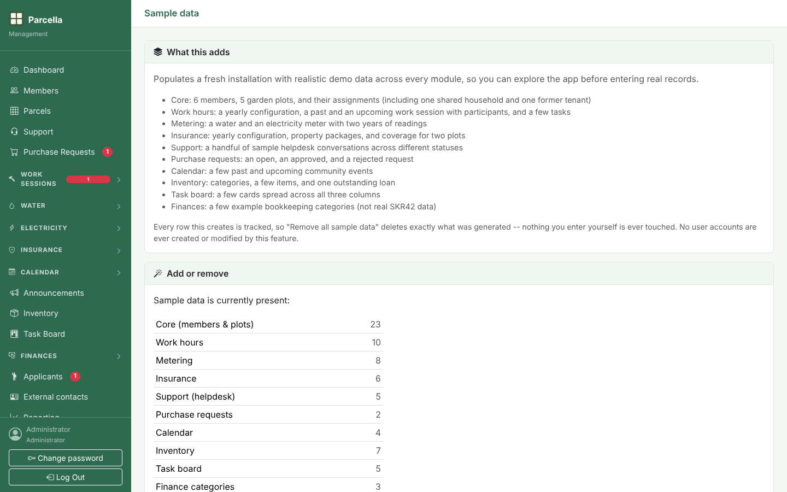

# Sample data

Sample data fills a fresh installation with realistic made-up records
in every module, so you can click through Parcella and try things out
before entering your real club. When you're done, one click removes
it all again.

!!! info "Who can use this"
    Administrators only. Open **Administration → Sample data**.

## What this adds

The left card lists what is created:

- **Core:** 6 members, 5 garden plots and their assignments, including
  one shared household and one former tenant.
- **Work hours:** a yearly configuration, a past and an upcoming work
  session with participants, and a few tasks.
- **Metering:** a water and an electricity meter with two years of
  readings.
- **Insurance:** yearly configuration, property packages and coverage
  for two plots.
- **Support:** a handful of sample helpdesk conversations in different
  states.
- **Purchase requests:** an open, an approved and a rejected request.
- **Calendar:** a few past and upcoming community events.
- **Inventory:** categories, a few items and one item currently lent
  out.
- **Task board:** a few cards spread across all three columns.
- **Finances:** a few example bookkeeping categories.

Parcella remembers every record it created this way. **Remove all
sample data** deletes exactly those records and nothing you entered
yourself. User accounts are never created or changed.

Sample data lands in modules even while they are switched off; switch
a module on to look at it.

## Add or remove

What the right card shows depends on the state of your installation:

| Situation | What you see |
|---|---|
| Fresh installation, no members or parcels yet | *This installation looks fresh -- no member or parcel data yet.* and the button **Add sample data**. After confirming, the data is created (**Sample data added.**). |
| Sample data present | **Sample data is currently present:** with a count per area, and the button **Remove all sample data**. After confirming, it is deleted (**All sample data removed.**). This can't be undone. |
| Real members or parcels already exist | A note that sample data can only be added to a fresh installation. There is no button. |

!!! warning "Remove it before going live"
    Don't mix sample data with real data. Remove it before you start
    entering your club's real members and parcels -- once real data
    exists, sample data can't be added again, and you would have to
    tell the made-up records apart by hand.

## Related

- [Setting up a new club](../guides/new-club-setup.md)
- [Turning modules on and off](modules.md)
