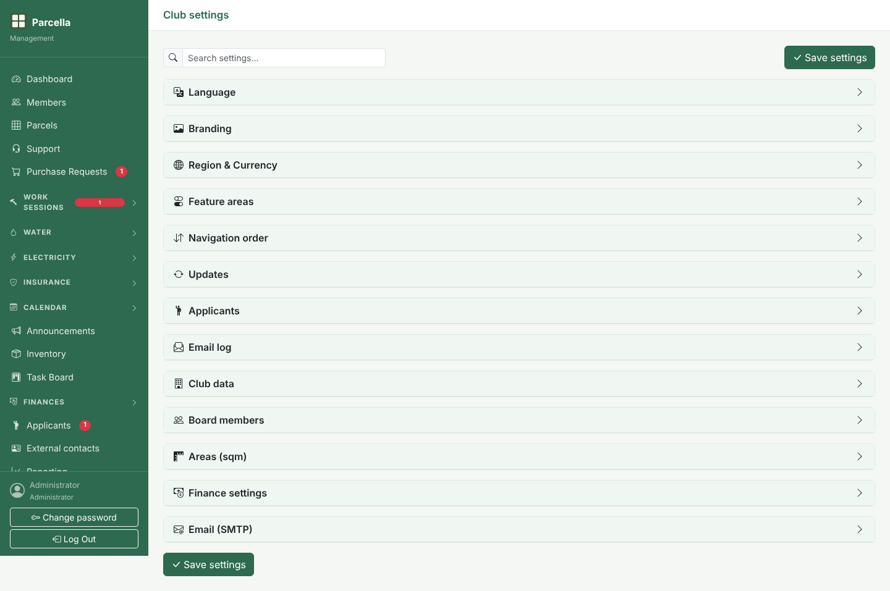

# Vereinseinstellungen {#club-settings}

Die Einstellungsseite enthält die Stammdaten deines Vereins und die
Schalter, die für die ganze Installation gelten: Sprache, Logo, Mailserver,
Finanzangaben und mehr.

!!! info "Wer das nutzen kann"
    Nur Administratoren. Öffne **Administration → Einstellungen**.

## Wie die Seite funktioniert {#how-the-page-works}

Die Seite ist eine Spalte von Karten. Jede Karte ist zugeklappt; ein Klick
auf ihre Überschrift öffnet sie. Öffnest du eine Karte, klappen die anderen
zu.

| Element | Was es bewirkt |
|---|---|
| **Einstellungen durchsuchen...** | Tipp ein Wort, zum Beispiel „Logo“ oder „IBAN“. Karten, die es enthalten, gehen auf, und das Wort wird hervorgehoben; alle anderen Karten werden ausgeblendet. Passt nichts, siehst du **Keine Einstellungen entsprechen deiner Suche.** |
| **Einstellungen speichern** | Oben und unten auf der Seite. Speichert **alle Karten auf einmal**, egal welche du geändert hast. Du siehst **Einstellungen gespeichert.** |

!!! warning "Eine Speichern-Schaltfläche für alles"
    Änderungen werden erst gespeichert, wenn du auf **Einstellungen
    speichern** klickst. Verlässt du die Seite vorher, sind sie weg.

Die Karten, von oben nach unten:

## Sprache {#language}

Die Sprache der ganzen Installation: Menüs, Schaltflächen, Meldungen, die
Anmeldeseite und die E-Mails und PDFs, die Parcella erzeugt. Alle sehen
dieselbe Sprache; eine persönliche Spracheinstellung gibt es nicht.

Zur Wahl stehen **Deutsch**, **English**, **Polski**, **Čeština**,
**Slovenčina**, **Français** und **Nederlands**. Eine neue Installation
beginnt auf Englisch.

Wo ein Text noch nicht in die gewählte Sprache übersetzt ist, zeigt Parcella
stattdessen den englischen Text.

Die Sprache ändert nicht, wie Zahlen, Daten und Geldbeträge aussehen -- das
regelt die Karte **Region & Währung**.

## Branding {#branding}

| Feld | Was es bewirkt |
|---|---|
| **Vereinslogo** | Zeigt dein aktuelles Logo (oder das Parcella-Symbol). Wähl eine neue Datei -- PNG, JPEG, WebP oder SVG, höchstens 2 MB --, um es zu ersetzen. Das Logo erscheint auf der Anmeldeseite, oben in der Seitenleiste und im Kopf erzeugter PDFs. |
| **Logo entfernen (zurück zum Standard-Symbol)** | Erscheint nur, wenn ein Logo hochgeladen ist. Anhaken und speichern, um zum Parcella-Symbol zurückzukehren. |

Ein falscher Dateityp oder eine zu große Datei wird mit einer Meldung
abgelehnt; der Rest der Seite wird trotzdem gespeichert.

## Region & Währung {#region-currency}

| Feld | Was es bewirkt |
|---|---|
| **Region** | Wie Zahlen und Adressen geschrieben werden -- Tausendertrennzeichen, Dezimalkomma oder -punkt, ob die PLZ vor oder nach dem Ort steht. Entscheidet auch die Zeitzone für Kalender-Feeds. Zur Wahl: Deutschland, Vereinigtes Königreich, Frankreich, Niederlande, Polen, Tschechien, Slowakei. Vorgabe: Deutschland. |
| **Währung** | Das Währungssymbol und wo es steht („19,99 €“ oder „£19.99“). Zur Wahl: Euro (€), Britisches Pfund (£), Polnischer Złoty (zł), Tschechische Krone (Kč). Vorgabe: Euro. |

Beide sind von der Sprache unabhängig: Ein niederländischsprachiger Verein
kann niederländische Menüs mit Euro-Beträgen nutzen, eine englischsprachige
Installation deutsche Zahlenformate.

## Funktionsbereiche {#feature-areas}

Die Schalter, mit denen Module ein- und ausgeschaltet werden. Ausführlich
beschrieben unter [Module ein- und ausschalten](modules.md).

## Reihenfolge der Navigation {#navigation-order}

Legt die Reihenfolge der Einträge in der Seitenleiste aller fest. Jeder
Eintrag hat ein Zahlenfeld: **Dashboard**, **Mitglieder**, **Parzellen**,
**Support**, **Einkaufswünsche**, **Arbeitseinsätze**, **Wasser**,
**Strom**, **Versicherungen**, **Kalender**, **Mitteilungen**,
**Inventar**, **Aufgabenboard**, **Finanzen**, **Bewerber**, **Externe
Kontakte**, **Auswertungen**, **Notizen**, **Vorgänge**.

Kleinere Zahlen kommen zuerst. Ab Werk sind die Zahlen 100, 200, 300 ... in
der oben gelisteten Reihenfolge; du kannst einen Eintrag also zwischen zwei
andere schieben, indem du ihm zum Beispiel 150 gibst. Leere Felder fallen
auf die Vorgabe zurück; alles, was keine ganze Zahl ist, wird ignoriert.

Die **Administration** steht nicht in der Liste: Sie ist immer zuletzt.

## Updates {#updates}

| Feld | Was es bewirkt |
|---|---|
| **Automatisch nach Updates suchen** | Standardmäßig an. Parcella fragt dann alle paar Stunden bei GitHub, ob eine neuere Version erschienen ist, und zeigt einen Hinweis auf der Seite [System](system.md). Über deinen Verein wird nichts übertragen. Schalte es aus, wenn dein Server das Internet nicht kontaktieren darf; die Seite System zeigt dann gar keine Update-Informationen. |

## Bewerber {#applicants}

Nur wichtig, wenn du das Modul [Bewerber](../modules/applicants.md) nutzt.

| Feld | Was es bewirkt |
|---|---|
| **Bewerbungen löschen nach (Monaten)** | Jede Bewerbung, deren Status sich so viele Monate nicht geändert hat, wird **endgültig gelöscht**, egal welcher Status, ohne jemandem Bescheid zu geben. Gezählt ab der letzten Statusänderung oder, wenn sich der Status nie geändert hat, ab dem Bewerbungsdatum. Leer lassen oder 0 eingeben, um Bewerbungen zu behalten, bis du sie von Hand löschst. Nützlich für den Datenschutz. |
| **Text der E-Mail an neue Bewerber** | Der Text, den **Bewerber kontaktieren** bei einer neuen Bewerbung nutzt; vor jedem Versand lässt er sich noch ändern. `{name}` wird zum Namen des Bewerbers, `{club}` zum Namen des Vereins. Leer lassen, um den eingebauten, grau angezeigten Text zu nutzen. |

## E-Mail-Protokoll {#email-log}

| Feld | Was es bewirkt |
|---|---|
| **E-Mail-Protokoll aufbewahren (Tage)** | Wie lange das [E-Mail-Protokoll](email-log.md) seine Einträge behält. Ältere werden automatisch gelöscht, weil Empfängeradressen personenbezogene Daten sind. Vorgabe 90 Tage, möglich 1 bis 3650. |

## Vereinsdaten {#club-data}

| Feld | Wofür |
|---|---|
| **Name des Vereins** | Erscheint oben in der Seitenleiste, auf der Anmeldeseite und auf gedruckten Unterlagen. Leer: „Parcella“. |
| **Straße**, **PLZ**, **Ort** | Die Adresse des Vereins in der Fußzeile erzeugter PDFs (Rechnungen, Aushänge, Listen). |
| **Vereinsnummer**, **Registergericht** | Stehen ebenfalls in der Fußzeile der PDFs, weil eingetragene Vereine in Deutschland sie angeben müssen. |

## Vorstandsmitglieder {#board-members}

Welche Mitglieder gerade im Vorstand sind. Ihre Namen stehen in der
Fußzeile erzeugter Unterlagen.

| Element | Was es bewirkt |
|---|---|
| **Vorstandsmitglieder** / **Liste anzeigen** | Klappt die Liste aller aktuellen Mitglieder auf, jedes mit einem Kästchen. **Liste ausblenden** klappt sie wieder zu. |
| **Suchen…** | Grenzt die Liste auf passende Namen ein. **Keine Treffer**, wenn keiner passt. |
| **Alle auswählen** / **Keine auswählen** | Hakt jedes sichtbare Mitglied an oder ab. |

Ein Mitglied, das den Verein verlässt, fällt automatisch von der gedruckten
Liste.

## Flächen (qm) {#areas-sqm}

Das Gelände des Vereins, aufgeteilt so, wie deutsche Kleingartenvereine es
üblicherweise angeben.

| Feld | Was es bewirkt |
|---|---|
| **Gesamtfläche (qm)** | Das ganze Gelände des Vereins. Trägst du selbst ein. |
| **A-Fläche (Parzellen, qm)** | Berechnet, nicht bearbeitbar: die Summe aller Parzellenflächen, verpachtet oder gekündigt. Gelöschte Parzellen und Gemeinschaftsflächen zählen nicht. Dieselbe Zahl wie die Gesamtfläche auf dem [Dashboard](../getting-started/dashboard.md). |
| **B-Fläche (Gemeinschaft, qm)** | Berechnet: Gesamtfläche minus A-Fläche minus C-Fläche. |
| **C-Fläche (Stadt, qm)** | Trägst du selbst ein. |

Diese Zahlen werden genutzt, wenn ein
[Rechnungslauf](../modules/finances/invoice-runs.md) Kosten nach dem Anteil
jeder Parzelle an der Gemeinschaftsfläche aufteilt.

## Finanzeinstellungen {#finance-settings}

Werden vom Modul [Finanzen](../modules/finances/index.md) genutzt.

| Feld | Was es bewirkt |
|---|---|
| **Bankname**, **IBAN**, **BIC**, **Kontoinhaber** | Stehen in der Fußzeile jeder Rechnung, damit Mitglieder wissen, wohin sie zahlen. |
| **Nächste Rechnungsnummer (überschreiben)** | Meist leer: Die Nummern laufen einfach weiter. Gib eine Zahl ein, damit der allernächste Rechnungslauf -- in welchem Jahr auch immer -- stattdessen dort beginnt. Parcella prüft erst beim Abschließen dieses Laufs, ob die Nummer schon vergeben ist. Das Feld leert sich nach der Nutzung von selbst. |
| **Format der Rechnungsnummer** | Wie Rechnungsnummern aussehen. `{number}` ist Pflicht, `{year}` freiwillig; jeder andere Text wird so übernommen, wie er dasteht, z. B. `R-{year}-{number}`. Unter dem Feld siehst du **Aktuell verwendet:** mit einem Beispiel; **(Standard, nichts Eigenes gespeichert)** heißt, es gilt die Vorgabe `{year}/{number}`. Das Feld schlägt ein paar Beispiele vor. |

Das Format wirkt nur auf Rechnungen, die ab jetzt erstellt werden. Schon
vergebene Nummern ändern sich nie. Ein ungültiges Format wird nicht
gespeichert; du siehst einen Hinweis, dass es genau einmal `{number}`
enthalten muss (wahlweise auch `{year}`) und keine anderen Platzhalter.

## E-Mail (SMTP) {#email-smtp}

Jede E-Mail, die Parcella verschickt -- Einladungen, Benachrichtigungen,
Mitteilungen, Rechnungen --, geht über diesen Mailserver raus. Parcella liest
kein Postfach.

| Feld | Was es bewirkt |
|---|---|
| **SMTP-Server** | Die Adresse des Mailservers, von deinem E-Mail-Anbieter. |
| **SMTP-Port** | Meist 587 (oder was dein Anbieter sagt). |
| **SMTP-Benutzer** | Der Login für den Mailserver, oft die E-Mail-Adresse. |
| **SMTP-Passwort** | Wird als **Noch nicht gesetzt** oder **•••••••• (gesetzt – neu eingeben zum Ändern)** angezeigt. Leer lassen, um das gespeicherte Passwort zu behalten; ein neues eintippen, um es zu ersetzen. Wird verschlüsselt gespeichert. |
| **Absender-E-Mail** | Die Adresse, von der die E-Mails kommen. |

!!! tip "Prüfen, ob es funktioniert"
    Lade dich nach dem Speichern mit einer zweiten Adresse ein oder schick
    irgendeine E-Mail und schau dann ins
    [E-Mail-Protokoll](email-log.md). **Fehlgeschlagen** mit einem Fehler
    sagt dir, was dem Mailserver nicht gepasst hat.

Sind diese Felder leer, nutzt Parcella die Mail-Einstellungen, die bei der
Installation eventuell in die Serverkonfiguration eingetragen wurden.

Parcella verschlüsselt die Verbindung zum Mailserver mit STARTTLS, dem
Verfahren, das auf Port 587 üblich ist. Einen Schalter dafür gibt es auf der
Einstellungsseite nicht; ändern lässt es sich nur in der
Serverkonfiguration.

## Siehe auch {#related}

- [Module ein- und ausschalten](modules.md)
- [Integrationen](integrations.md)
- [Einen neuen Verein einrichten](../guides/new-club-setup.md)
