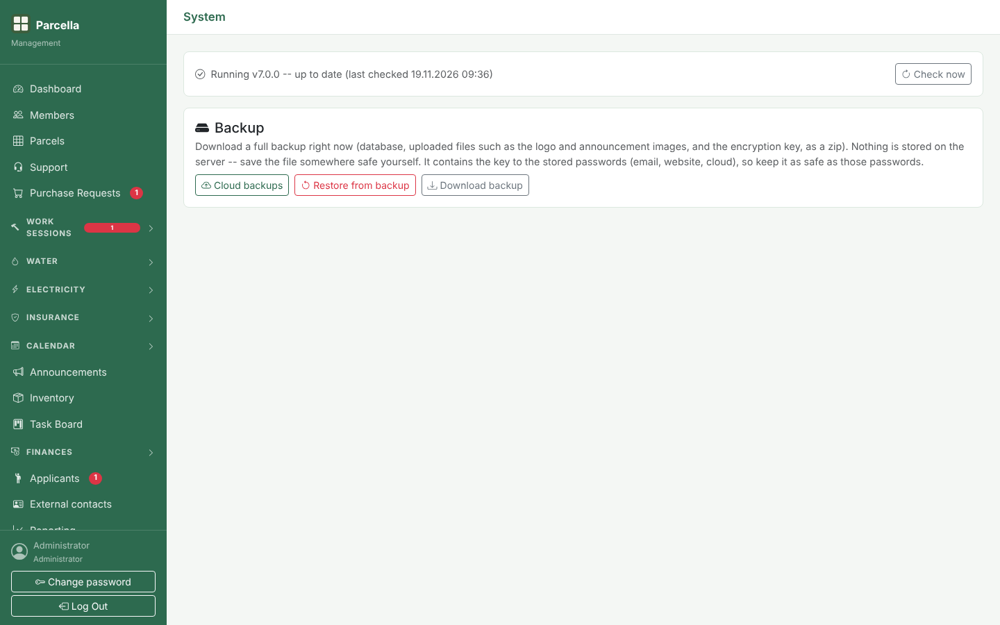

# Informácie o systéme a aktualizácie {#system-information-and-updates}

!!! note "Strojový preklad"
    Táto stránka bola strojovo preložená z angličtiny a zatiaľ nebola skontrolovaná. Ak je niečo nejasné, platí anglická verzia (jazyk prepnete hore).

Stránka Systém ukazuje, ktorú verziu Parcelly používate, či je k
dispozícii novšia, a je východiskom pre zálohy.

!!! info "Kto to môže používať"
    Len administrátori. Otvorte **Administrácia → Systém**.

## Upozornenie na aktualizáciu {#update-notice}

Parcella sa pravidelne pýta GitHubu, kde je zverejnená, či vyšla
novšia verzia. O vašom spolku sa nič neposiela. Vypnúť to môžete v
[Nastaveniach spolku → Aktualizácie](settings.md#updates); upozornenie
na aktualizáciu potom z tejto stránky zmizne.

**Keď máte aktuálnu verziu**, uvidíte

> Verzia v1.2.3 -- aktuálna (naposledy skontrolované: 18.11.2026 14:05)

alebo hneď po inštalácii **... aktualizácie zatiaľ neboli
skontrolované**.

**Keď existuje novšia verzia**, zvýraznené pole ukazuje **K dispozícii
je aktualizácia:** s číslom novej verzie, verziu, ktorú používate, a
štyri príkazy, ktoré aktualizáciu nainštalujú na server.

| Tlačidlo | Čo robí |
|---|---|
| **Skontrolovať teraz** | Opýta sa GitHubu hneď, namiesto čakania na ďalšiu automatickú kontrolu (každých šesť hodín). |

!!! note "Aktualizácia sa robí na serveri"
    Samotná aktualizácia nie je tlačidlo v Parcelle. Kto prevádzkuje
    server, zadá príkazy zobrazené v poli. Ak to nie ste vy, odovzdajte
    mu ich. Najprv si stiahnite [zálohu](backup.md).

    Pole tiež upozorňuje, že prvý príkaz nahradí konfiguračný súbor
    servera aktuálnym. Zmeny, ktoré v ňom urobil správca servera, sa
    stratia, pokiaľ ich nemá v samostatnom súbore s prepísaniami, ako
    vysvetľuje návod na inštaláciu.

Pred aktualizáciou si na GitHube prečítajte poznámky k vydaniu, aby ste
vedeli, čo sa zmenilo.

## Záloha {#backup}

Karta **Záloha** má tri tlačidlá:

| Tlačidlo | Čo robí |
|---|---|
| **Zálohy v cloude** | Otvorí plán automatických záloh do vášho cloudového úložiska. |
| **Obnoviť zo zálohy** | Otvorí stránku obnovy. |
| **Stiahnuť zálohu** | Okamžite stiahne úplnú zálohu. |

Všetky tri sú opísané v časti [Zálohovanie a obnova](backup.md).

## Súvisiace {#related}

- [Zálohovanie a obnova](backup.md)
- [Nastavenia spolku](settings.md#updates)
