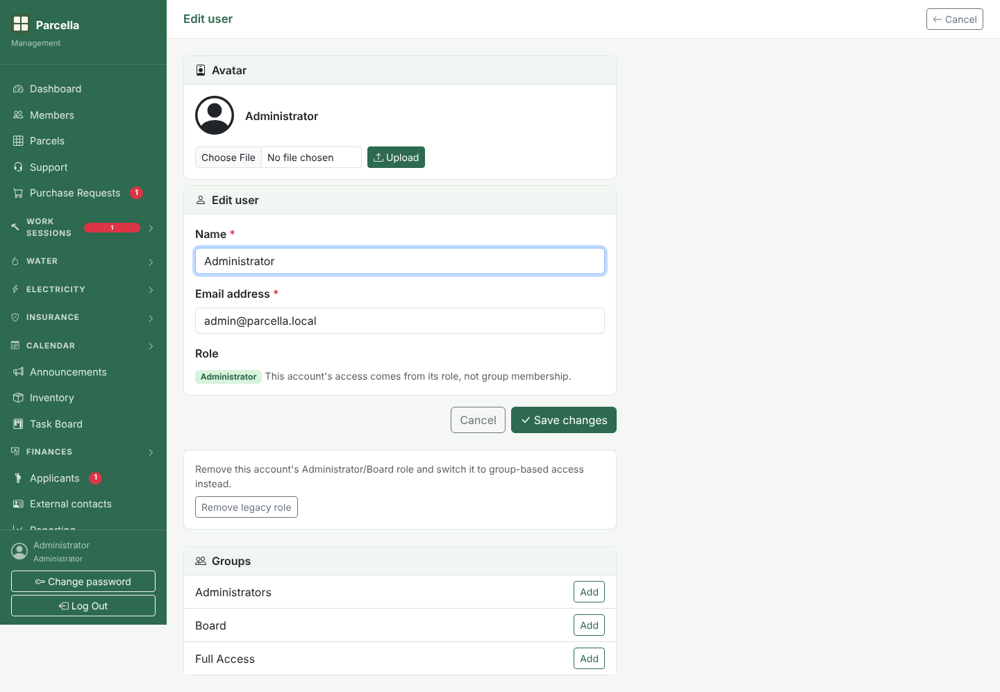

# Users and invitations

Here you decide who can log in to Parcella. New people are invited by
e-mail and set up their own password; you choose which groups they
belong to.

!!! info "Who can use this"
    Administrators only. Open **Administration → Users**.

A *user* is a login account -- a board member, the treasurer, the
person who reads the meters. It is not the same as a club *member*:
most gardeners are members but never get a user account.

## User management

The page has the invitation form on the left and the list of accounts
on the right. Messages about what you just did appear at the top.

### Invite user

| Field / button | What it does |
|---|---|
| **Email address** | The new person's e-mail address. It becomes their login. |
| **Groups** | Tick the groups the person should belong to. Their access comes only from these groups -- see [Groups](groups.md). If no groups exist yet you see **No groups exist yet.** with a link **Create one**. |
| **Send invitation** | Sends an e-mail with a personal link. The link is valid for **7 days**. |

What happens:

- The person receives the e-mail **Invitation to Parcella** with a
  button **Accept invitation**. They choose their name and password
  themselves (see [First login](../getting-started/first-login.md#getting-an-account-the-invitation))
  and are put into the ticked groups.
- If the address already belongs to an account you see **Email already
  registered**.
- If there is already a pending invitation for the address, the old
  one stops working and only the new one counts.
- If you tick no group, the person can only look up members and
  parcels after accepting. You can add groups later.

!!! warning "E-mail must work"
    Invitations need a working mail server (see
    [Club settings](settings.md#email-smtp)). The page says
    **Invitation sent** even when the mail server refused the e-mail.
    If the invited person gets nothing, check the
    [E-mail log](email-log.md) for the invitation.

### Pending invitations

Shown under the form while invitations are waiting to be accepted.
Each line shows the address, the ticked groups (or **No groups
selected**), **Valid until** with the date, and the badge **pending**.

| Button | What it does |
|---|---|
| **Resend invitation** (circular arrows) | Sends the e-mail again and gives the link another 7 days from today. The link from the first e-mail keeps working. You see **Invitation resent**. |
| **Delete invitation** (bin) | After confirming, the invitation is removed and its link stops working. |

Accepted invitations disappear from the list; the person then appears
under **Registered users**.

### Registered users

| Column / button | What it shows or does |
|---|---|
| **Name** | Avatar and name. |
| **Email** | The login address. |
| **Groups** | The groups the account belongs to. Older accounts without groups show their role, **Administrator** or **Board**; otherwise **–**. |
| **Status** | **active** or **inactive**. |
| **Edit** (pencil) | Opens [Edit user](#edit-user). |
| **Deactivate** / **Activate** (switch) | Switches the account off or on again in one click. Not shown for your own account, which is marked **Me** instead. |

**Deactivating** an account locks the person out immediately -- also
on any computer where they are signed in right now. Everything they
created or approved stays, with their name on it. Activate the account
again and they can log in with their old password.

You can't deactivate yourself, and you can't deactivate the last
account that can open the administration area.

## Edit user

**Cancel** at the top returns to the list without saving.

### Avatar

The same as on a user's own profile: choose a PNG, JPEG or WebP file of
at most 2 MB and click **Upload**, or **Remove avatar** to delete it.
Useful for people who don't upload a picture themselves.

### Edit user

| Field / button | What it does |
|---|---|
| **Name** | Required. |
| **Email address** | Required; it is the login, so tell the person when you change it. Must not belong to another account (**Email already registered**). |
| **Role** | Only shown for older accounts that still have the **Administrator** or **Board** role, with the note *This account's access comes from its role, not group membership.* It can't be edited here. |
| **Save changes** | Saves name and e-mail. You see **User updated** in the list. |

### Remove legacy role

Only for accounts with the **Administrator** or **Board** role.
**Remove legacy role** takes the role away; from then on the account's
access comes only from its groups, like every newer account.

!!! warning "Add the groups first"
    Without a group the account drops to basic access (reading members
    and parcels) the moment you click. For a former **Administrator**,
    first add the account to a group with **Can access the
    administration panel**; for **Board**, to a group with **Full
    access to every module**. Parcella refuses to remove the role from
    the last administrator.

### Groups

Lists every group. **Add** puts the account into that group, **Remove**
takes it out. The change applies immediately -- no need to click **Save
changes**.

### Danger zone

Not shown when you edit your own account.

| Button | What it does |
|---|---|
| **Deactivate** / **Activate** | As in the list: locks the person out immediately, nothing is deleted. |
| **Reset password** | For someone who forgot their password. After confirming, Parcella creates a **temporary password** and shows it **once**, with a **Copy** button. Give it to the person (by phone, in person). Their old password stops working, they are signed out everywhere, and at their next login they must choose a new password. If the account is deactivated you are reminded to activate it. |
| **Delete permanently** | Removes the account completely, after confirming. Only possible for accounts that have left no trace anywhere -- typically an account that was created by mistake and never used. |

For your own password use **Change password** in the sidebar instead.

Once a person has done anything in Parcella -- created a record,
approved a request, entered a meter reading -- the account can't be
deleted any more, and you see *This user has activity history ...
Deactivate them instead.* This keeps the club's records complete:
you can still see who did what, years later.

## Related

- [Groups](groups.md)
- [Roles, groups and permissions](../getting-started/roles-and-permissions.md)
- [First login and your account](../getting-started/first-login.md)
- [API tokens](api-tokens.md)
