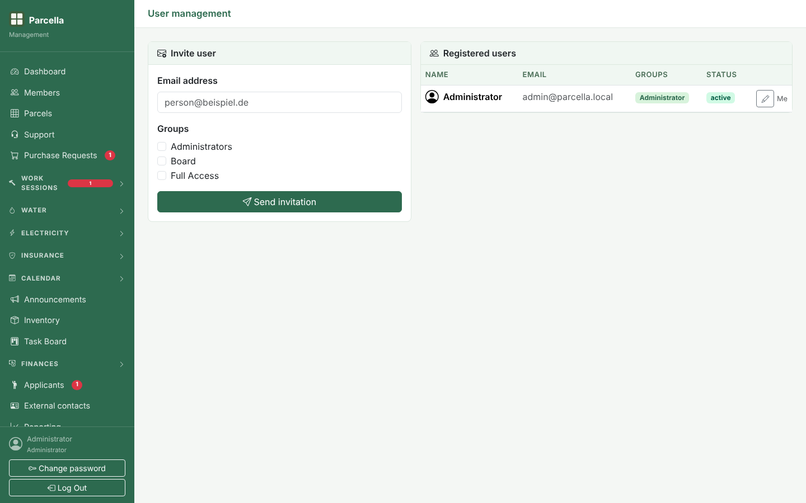

# Gebruikers en uitnodigingen {#users-and-invitations}

!!! note "Machinevertaling"
    Deze pagina is machinaal vertaald uit het Engels en nog niet nagekeken. Als iets onduidelijk is, geldt de Engelse versie (taal wisselt u bovenaan).

Hier bepaalt u wie in Parcella mag inloggen. Nieuwe mensen worden per
e-mail uitgenodigd en kiezen zelf hun wachtwoord; u kiest tot welke
groepen ze behoren.

!!! info "Wie kan dit gebruiken"
    Alleen beheerders. Open **Administratie → Gebruikers**.

Een *gebruiker* is een inlogaccount -- een bestuurslid, de
penningmeester, wie de meters opneemt. Dat is niet hetzelfde als een
*lid* van de vereniging: de meeste tuinders zijn lid maar krijgen nooit
een gebruikersaccount.

## Gebruikersbeheer {#user-management}

De pagina heeft links het uitnodigingsformulier en rechts de lijst met
accounts. Meldingen over wat u net hebt gedaan, verschijnen bovenaan.

### Gebruiker uitnodigen {#invite-user}

| Veld / knop | Wat het doet |
|---|---|
| **E-mailadres** | Het e-mailadres van de nieuwe persoon. Het wordt zijn inlognaam. |
| **Groepen** | Vink de groepen aan waartoe de persoon moet behoren. Zijn toegang komt alleen uit deze groepen -- zie [Groepen](groups.md). Bestaan er nog geen groepen, dan ziet u **Nog geen groepen.** met een link **Maak er een aan**. |
| **Uitnodiging verzenden** | Verstuurt een e-mail met een persoonlijke link. De link is **7 dagen** geldig. |

Wat er gebeurt:

- De persoon ontvangt de e-mail **Uitnodiging voor Parcella** met een
  knop **Uitnodiging accepteren**. Hij kiest zelf zijn naam en
  wachtwoord (zie [Eerste aanmelding](../getting-started/first-login.md#getting-an-account-the-invitation))
  en wordt in de aangevinkte groepen geplaatst.
- Hoort het adres al bij een account, dan ziet u **E-mailadres al
  geregistreerd**.
- Is er voor het adres al een openstaande uitnodiging, dan werkt de oude
  niet meer en telt alleen de nieuwe.
- Vinkt u geen groep aan, dan kan de persoon na het accepteren alleen
  leden en percelen opzoeken. U kunt later groepen toevoegen.

!!! warning "E-mail moet werken"
    Uitnodigingen hebben een werkende mailserver nodig (zie
    [Verenigingsinstellingen](settings.md#email-smtp)). Weigert de
    mailserver de e-mail, dan zegt de pagina dat in plaats van
    **Uitnodiging verzonden**: „De uitnodiging voor … is opgeslagen,
    maar de e-mail kon niet worden verzonden. Controleer de
    e-mailinstellingen en het E-maillogboek en verstuur de uitnodiging
    daarna opnieuw.“ De uitnodiging blijft onder **Openstaande
    uitnodigingen**; gebruik **Uitnodiging opnieuw verzenden** zodra de
    mailinstellingen werken. Het [E-maillogboek](email-log.md) toont de
    reden van de mailserver.

### Openstaande uitnodigingen {#pending-invitations}

Getoond onder het formulier zolang er uitnodigingen wachten om te worden
geaccepteerd. Elke regel toont het adres, de aangevinkte groepen (of
**Geen groepen geselecteerd**), **Geldig tot** met de datum, en de badge
**in afwachting**.

| Knop | Wat het doet |
|---|---|
| **Uitnodiging opnieuw verzenden** (ronde pijlen) | Verstuurt de e-mail opnieuw en geeft de link nog eens 7 dagen vanaf vandaag. De link uit de eerste e-mail blijft werken. U ziet **Uitnodiging opnieuw verzonden**. |
| **Uitnodiging verwijderen** (prullenbak) | Na bevestiging wordt de uitnodiging verwijderd en werkt haar link niet meer. |

Geaccepteerde uitnodigingen verdwijnen uit de lijst; de persoon verschijnt
dan onder **Geregistreerde gebruikers**.

### Geregistreerde gebruikers {#registered-users}

| Kolom / knop | Wat ze toont of doet |
|---|---|
| **Naam** | Avatar en naam. |
| **E-mail** | Het inlogadres. |
| **Groepen** | De groepen waartoe het account behoort. Oudere accounts zonder groepen tonen hun rol, **Beheerder** of **Bestuur**; anders **–**. |
| **Status** | **actief** of **inactief**. |
| **Bewerken** (potlood) | Opent [Gebruiker bewerken](#edit-user). |
| **Deactiveren** / **Activeren** (schakelaar) | Zet het account met één klik uit of weer aan. Niet getoond bij uw eigen account, dat in plaats daarvan is gemarkeerd met **Ik**. |

**Deactiveren** van een account sluit de persoon meteen buiten -- ook op
elke computer waarop hij nu is ingelogd. Alles wat hij heeft aangemaakt
of goedgekeurd blijft, met zijn naam erbij. Activeer het account weer en
hij kan met zijn oude wachtwoord inloggen.

U kunt uzelf niet deactiveren, en u kunt het laatste account dat de
administratie kan openen niet deactiveren.

## Gebruiker bewerken {#edit-user}

**Annuleren** bovenaan brengt u zonder opslaan terug naar de lijst.

### Avatar {#avatar}

Hetzelfde als op het eigen profiel van een gebruiker: kies een PNG-,
JPEG- of WebP-bestand van maximaal 2 MB en klik op **Uploaden**, of op
**Avatar verwijderen** om het weg te halen. Handig voor mensen die zelf
geen afbeelding uploaden.

### Gebruiker bewerken {#edit-user_1}

| Veld / knop | Wat het doet |
|---|---|
| **Naam** | Verplicht. |
| **E-mailadres** | Verplicht; het is de inlognaam, dus laat de persoon weten als u het wijzigt. Mag niet bij een ander account horen (**E-mailadres al geregistreerd**). |
| **Rol** | Alleen getoond bij oudere accounts die nog de rol **Beheerder** of **Bestuur** hebben, met de notitie *De toegang van dit account komt voort uit zijn rol, niet uit groepslidmaatschap.* Hier niet te bewerken. |
| **Wijzigingen opslaan** | Slaat naam en e-mail op. U ziet **Gebruiker bijgewerkt** in de lijst. |

### Oude rol verwijderen {#remove-legacy-role}

Alleen bij accounts met de rol **Beheerder** of **Bestuur**. **Oude rol
verwijderen** neemt de rol weg; vanaf dan komt de toegang van het account
alleen uit zijn groepen, zoals bij elk nieuwer account.

!!! warning "Voeg eerst de groepen toe"
    Zonder groep zakt het account op het moment dat u klikt terug naar
    basistoegang (leden en percelen lezen). Voeg een voormalige
    **Beheerder** eerst toe aan een groep met **Toegang tot het
    administratiepaneel**; een voormalig **Bestuur**-account aan een
    groep met **Volledige toegang tot elke module**. Parcella weigert de
    rol van de laatste beheerder te verwijderen.

### Groepen {#groups}

Toont elke groep. **Toevoegen** plaatst het account in die groep,
**Verwijderen** haalt het eruit. De wijziging geldt meteen -- u hoeft niet
op **Wijzigingen opslaan** te klikken.

### Gevarenzone {#danger-zone}

Niet getoond als u uw eigen account bewerkt.

| Knop | Wat het doet |
|---|---|
| **Deactiveren** / **Activeren** | Als in de lijst: sluit de persoon meteen buiten, er wordt niets verwijderd. |
| **Wachtwoord resetten** | Voor iemand die zijn wachtwoord is vergeten. Na bevestiging maakt Parcella een **tijdelijk wachtwoord** aan en toont het **één keer**, met een knop **Kopiëren**. Geef het aan de persoon (telefonisch, persoonlijk). Het oude wachtwoord werkt niet meer, hij wordt overal uitgelogd, en bij de volgende aanmelding moet hij een nieuw wachtwoord kiezen. Is het account gedeactiveerd, dan wordt u eraan herinnerd het te activeren. |
| **Permanent verwijderen** | Haalt het account na bevestiging volledig weg. Alleen mogelijk bij accounts die nergens een spoor hebben achtergelaten -- meestal een account dat per vergissing is aangemaakt en nooit gebruikt. |

Voor uw eigen wachtwoord gebruikt u in plaats daarvan **Wachtwoord
wijzigen** in de zijbalk.

Heeft een persoon iets in Parcella gedaan -- een record aangemaakt, een
aanvraag goedgekeurd, een meterstand ingevoerd --, dan kan het account
niet meer worden verwijderd, en ziet u *Deze gebruiker heeft ergens in
het systeem activiteitengeschiedenis ... Deactiveer in plaats daarvan.*
Zo blijft de administratie van de vereniging volledig: u kunt jaren later
nog zien wie wat heeft gedaan.

## Gerelateerd {#related}

- [Groepen](groups.md)
- [Rollen, groepen en rechten](../getting-started/roles-and-permissions.md)
- [Eerste aanmelding en uw account](../getting-started/first-login.md)
- [API-tokens](api-tokens.md)
