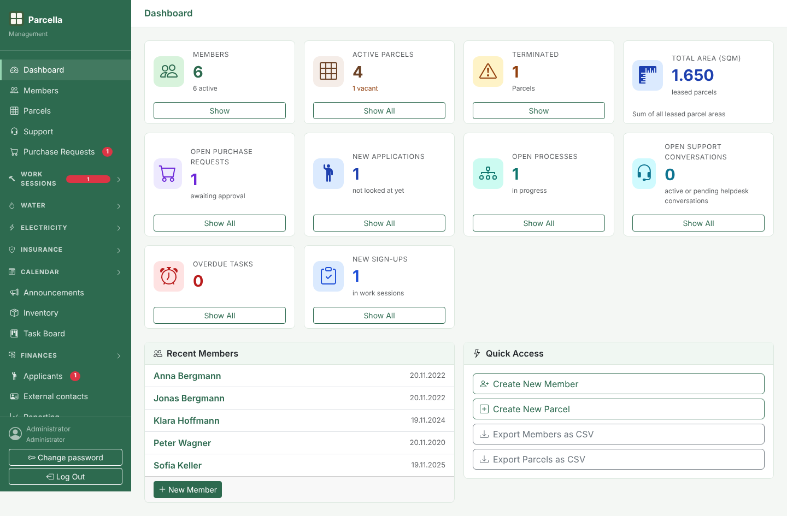

# Tableau de bord {#dashboard}

!!! note "Traduction automatique"
    Cette page a été traduite automatiquement de l'anglais et n'a pas encore été relue. En cas de doute, la version anglaise fait foi (changez de langue en haut de la page).

Le tableau de bord est la page d'accueil que vous voyez après la
connexion. Il vous donne d'un coup d'œil les chiffres clés de
l'association et vous signale ce qui demande votre attention. Cliquez sur
**Tableau de bord** en haut de la barre latérale pour y revenir.

!!! info "Qui peut l'utiliser"
    Toute personne connectée. Certaines tuiles n'apparaissent que si leur
    module est activé, et quelques-unes nécessitent aussi le droit de
    lecture sur ce module (indiqué ci-dessous).

Tous les chiffres sont recalculés à chaque ouverture de la page.

## Les tuiles {#the-tiles}

Les tuiles du haut suivent un ordre fixe. Les quatre premières sont
toujours affichées ; les autres apparaissent selon les modules de votre
association.

| Tuile | Ce qu'elle compte | Quand elle apparaît | Bouton |
|---|---|---|---|
| **Membres** | Grand chiffre : les membres actuels -- non supprimés, adhésion non terminée, et soit déjà commencée, soit sans date **Membre depuis**. En dessous : **... actifs** -- ceux d'entre eux qui ont une date **Membre depuis**. Si au moins un membre actuel a une date de naissance enregistrée : **Âge moyen ... ans**, calculé uniquement à partir de ces membres. | Toujours | **Afficher** ouvre la liste des membres filtrée sur les membres actifs. |
| **Parcelles actives** | Les parcelles au statut *active*. En dessous, en orange : **... vacantes** -- les parcelles actives sans locataire actuel ou à venir (une parcelle dont le dernier bail est terminé compte comme vacante ; une dont le locataire a résilié, ou dont le nouveau locataire arrive plus tard, non) ; ou **toutes occupées** s'il n'y en a aucune. | Toujours | **Afficher tout** ouvre la liste des parcelles. |
| **Résiliées** | Les parcelles au statut *résiliée*. | Toujours | **Afficher** ouvre la liste des parcelles filtrée sur les parcelles résiliées. |
| **Superficie totale (m²)** | La somme des superficies de toutes les parcelles, actives et résiliées. Les parcelles supprimées et les espaces communs ne comptent pas. C'est le même chiffre que **Superficie A** dans les [paramètres de l'association](../administration/settings.md#areas-sqm). | Toujours | -- |
| **Demandes d'achat ouvertes** | Les demandes encore **en attente d'approbation**. | Module **Demandes d'achat** activé et droit de lecture sur les demandes d'achat | **Afficher tout** |
| **Nouvelles candidatures** | Les candidatures au statut *nouvelle*, c'est-à-dire **pas encore traitées**. | Module **Candidats** activé et droit de lecture sur les candidats | **Afficher tout** ouvre la liste des candidats filtrée sur les nouveaux. |
| **Procédures ouvertes** | Les procédures **en cours**. | Module **Procédures** activé et droit de lecture sur les procédures | **Afficher tout** ouvre les procédures en cours. |
| **Conversations d'assistance ouvertes** | Les **conversations actives ou en attente dans le helpdesk** de l'association. | Module **Assistance (helpdesk)** activé et droit de lecture dessus | **Afficher tout** |
| **Tâches en retard** | Les tâches du tableau des tâches dont l'échéance est passée et qui ne sont pas terminées. | Module **Tableau des tâches** activé et accès complet (le tableau des tâches est réservé aux utilisateurs à accès complet) | **Afficher tout** ouvre le tableau des tâches en n'affichant que les tâches en retard. |
| **Nouvelles inscriptions** | Les inscriptions **aux sessions de travail** des 14 derniers jours, pour des sessions ordinaires qui n'ont pas encore eu lieu. Les inscriptions à une session que quelqu'un a marquée comme vérifiée ne comptent plus. | Module **Gestion des heures de travail** activé et droit de lecture sur les heures de travail | **Afficher tout** ouvre **Sessions & Aperçu**. |

Les chiffres de **Demandes d'achat ouvertes**, **Nouvelles candidatures**,
**Conversations d'assistance ouvertes**, **Tâches en retard** et
**Nouvelles inscriptions** sont les mêmes que les badges rouges de la
barre latérale (voir
[S'orienter dans l'application](navigation.md#badges-things-that-need-attention)).
Comme les badges, ils diminuent d'eux-mêmes dès que quelque chose a été
traité.

## Anniversaires cette semaine {#birthdays-this-week}

Cette carte n'apparaît que si au moins un membre actuel a son
anniversaire dans les sept prochains jours, aujourd'hui compris. Elle
liste ces membres, le plus proche en premier :

- le nom du membre, avec un lien vers sa page,
- **aujourd'hui, ... ans** pour un anniversaire aujourd'hui, sinon la
  date et **... ans**,
- un badge mis en évidence **Anniversaire rond** pour les anniversaires
  ronds (30, 40, 50, ...).

Les membres sans date de naissance enregistrée ne sont pas listés. La
carte s'affiche même si le module **Calendrier** est désactivé ; son
bouton **Afficher tout** mène à la liste complète des anniversaires dans
le calendrier, qui nécessite le module calendrier et le droit
correspondant.

## Membres récents {#recent-members}

Les cinq membres actuels **saisis dans Parcella** le plus récemment,
avec leur date **Membre depuis** à droite (– si aucune n'est définie).
Cliquez sur un nom pour ouvrir le membre. **Aucun membre créé.**
apparaît sur une nouvelle installation.

**Nouveau membre** ouvre le formulaire pour un nouveau membre.

## Accès rapide {#quick-access}

Des raccourcis pour les tâches fréquentes :

| Bouton | Ce qu'il fait |
|---|---|
| **Créer un nouveau membre** | Ouvre le formulaire pour un nouveau membre. |
| **Créer une nouvelle parcelle** | Ouvre le formulaire pour une nouvelle parcelle. |
| **Exporter les membres en CSV** | Télécharge la liste des membres sous forme de fichier CSV, par ex. pour un tableur. |
| **Exporter les parcelles en CSV** | Télécharge la liste des parcelles sous forme de fichier CSV. |

Créer des membres et des parcelles nécessite le droit **Écriture** sur
**Membres et parcelles**. Sans lui, le formulaire répond
**Vous n'avez pas la permission de faire cela**.

## Voir aussi {#related}

- [Membres](../modules/members.md) et [Parcelles](../modules/parcels.md)
- [S'orienter dans l'application](navigation.md)
- [Activer et désactiver les modules](../administration/modules.md)
