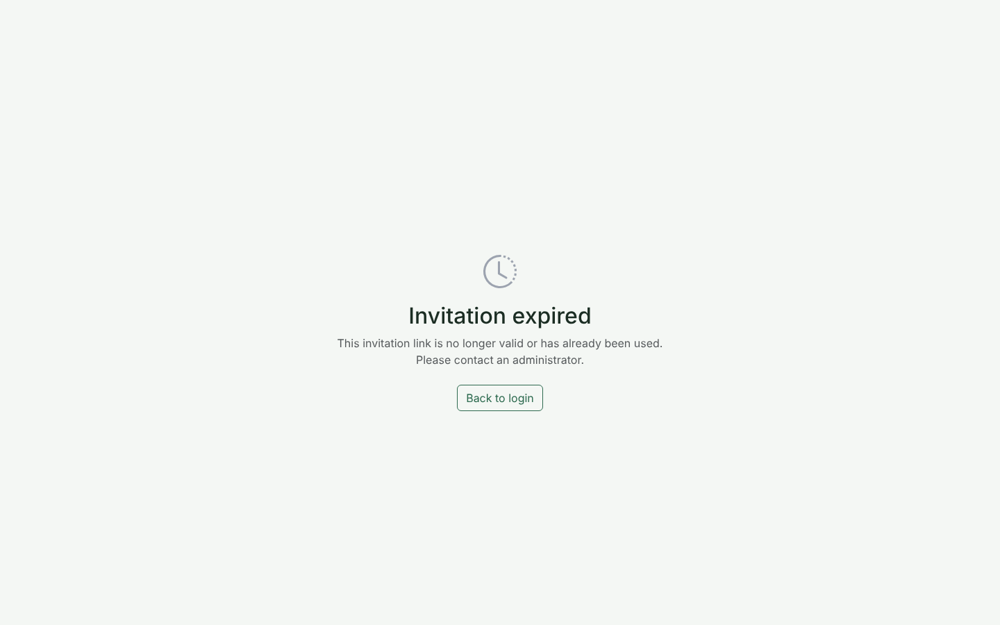
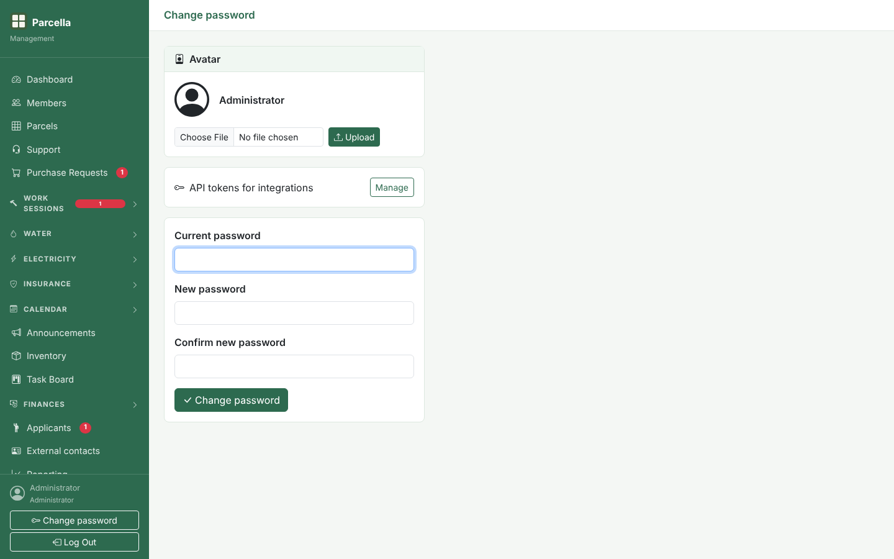

# Erste Anmeldung und Ihr Konto {#first-login-and-your-account}

Diese Seite behandelt alles rund um Ihr eigenes Konto: wie Sie eines
bekommen, wie Sie sich anmelden und wie Sie Passwort und Bild ändern.

!!! info "Wer das nutzen kann"
    Alle mit einem Parcella-Konto. Eine öffentliche Registrierung gibt es
    nicht: Ein Konto entsteht erst, wenn ein Administrator Sie eingeladen
    hat.

## Ein Konto bekommen: die Einladung {#getting-an-account-the-invitation}

Ein Administrator Ihrer Installation lädt Sie per E-Mail ein (siehe
[Benutzer und Einladungen](../administration/users.md)). Sie erhalten eine
E-Mail mit dem Betreff **Einladung zur Parcella** und der Schaltfläche
**Einladung annehmen**. Der Link darin ist **7 Tage** gültig.

!!! tip "Keine E-Mail angekommen?"
    Schauen Sie zuerst in den Spam-Ordner. Ist sie dort nicht, bitten Sie
    den Administrator, das [E-Mail-Protokoll](../administration/email-log.md)
    zu prüfen und die Einladung bei Bedarf erneut zu senden. Das erneute
    Senden gibt dem Link weitere 7 Tage; der Link aus der ersten E-Mail
    funktioniert weiter.

### Einladung annehmen {#accept-invitation}

Der Link öffnet die Seite **Konto einrichten**. Unter der Überschrift steht
die Adresse, an die die Einladung ging (**Einladung für** ...). Diese
Adresse wird Ihre Anmeldung; hier lässt sie sich nicht ändern.

| Feld / Schaltfläche | Was es bewirkt |
|---|---|
| **Name** | Ihr Vor- und Nachname. Andere Vorstandsmitglieder sehen ihn in Listen, bei Aufgaben, Freigaben und im Änderungsverlauf. |
| **Passwort** | Mindestens 8 Zeichen. |
| **Passwort wiederholen** | Dasselbe Passwort noch einmal. Stimmen beide nicht überein, erscheint **Passwörter stimmen nicht überein.** |
| **Konto anlegen** | Legt Ihr Konto an und meldet Sie sofort an. Sie landen auf dem [Dashboard](dashboard.md). |

Was Sie danach sehen, hängt von den Gruppen ab, die der Administrator bei
der Einladung gewählt hat. Hat er keine gewählt, können Sie nur Mitglieder
und Parzellen nachschlagen -- bitten Sie ihn dann, Sie einer Gruppe
hinzuzufügen. Siehe [Rollen, Gruppen und Rechte](roles-and-permissions.md).

### Einladung abgelaufen {#invitation-expired}

Sie sehen **Einladung abgelaufen** -- *Dieser Einladungslink ist nicht mehr
gültig oder wurde bereits verwendet.* --, wenn:

- seit dem Versand (oder dem letzten erneuten Senden) mehr als 7 Tage
  vergangen sind,
- Sie mit diesem Link schon ein Konto angelegt haben oder
- der Administrator die Einladung gelöscht oder dieselbe Adresse erneut
  eingeladen hat (nur die neueste Einladung gilt).

Bitten Sie einen Administrator, Sie erneut einzuladen. **Zur Anmeldung**
führt zur Anmeldeseite; das hilft nur, wenn Sie schon ein Konto haben.

## Anmelden {#signing-in}

Öffnen Sie die Parcella-Adresse Ihres Vereins im Webbrowser. Die
Anmeldeseite zeigt Logo und Namen Ihres Vereins (beides legt ein
Administrator in den [Vereinseinstellungen](../administration/settings.md)
fest).

| Feld / Schaltfläche | Was es bewirkt |
|---|---|
| **E-Mail** | Die Adresse, an die Ihre Einladung ging. Groß- und Kleinschreibung spielen keine Rolle. |
| **Passwort** | Ihr Passwort. |
| **Anmelden** | Meldet Sie an und öffnet das [Dashboard](dashboard.md). |

Mögliche Meldungen:

| Meldung | Bedeutung |
|---|---|
| **E-Mail oder Passwort falsch.** | Eines von beiden stimmt nicht. Zu Ihrem Schutz sagt Parcella nicht, welches. |
| **Ihr Konto ist deaktiviert.** | Ein Administrator hat Ihr Konto abgeschaltet. Ihre Daten sind noch da; bitten Sie ihn, es wieder zu aktivieren. |
| **Zu viele fehlgeschlagene Anmeldeversuche. Bitte einige Minuten warten und erneut versuchen.** | Nach wiederholt falschen Passwörtern sperrt Parcella Anmeldeversuche für dieses Konto für etwa 15 Minuten. |

Sie bleiben **8 Stunden** angemeldet (sofern der Betreiber Ihrer
Installation das nicht geändert hat). Danach fragt Parcella erneut nach der
Anmeldung, auch wenn Sie die ganze Zeit gearbeitet haben.

Zum Abmelden klicken Sie unten in der Seitenleiste auf **Abmelden**. Tun
Sie das an jedem gemeinsam genutzten oder öffentlichen Computer.

!!! note "Passwort vergessen?"
    Einen Link „Passwort vergessen“ gibt es absichtlich nicht. Fragen Sie
    einen Administrator: Er kann Ihr Passwort zurücksetzen und Ihnen ein
    vorläufiges geben (siehe
    [Benutzer und Einladungen](../administration/users.md#reset-password)).
    Bei der nächsten Anmeldung müssen Sie dann ein neues wählen.

## Die allererste Anmeldung nach der Installation {#the-very-first-login-after-installation}

Beim ersten Start legt Parcella selbst ein Administratorkonto an:

- **E-Mail:** `admin@parcella.local`
- **Passwort:** `admin1234`

Diese Daten stehen in Parcellas Installationsanleitung und sind bei jeder
neuen Installation gleich; jeder könnte sie also benutzen. Deshalb bleibt
dieses Konto gesperrt, bis sein Passwort geändert ist: Nach der Anmeldung
landen Sie direkt auf **Passwort ändern**, mit dem Hinweis

> Dieses Konto verwendet noch das Standardpasswort aus der
> Ersteinrichtung. Bitte ein neues vergeben -- bis dahin bleibt der Rest
> der Anwendung gesperrt.

Jede andere Seite schickt Sie hierher zurück, bis Sie ein neues Passwort
gespeichert haben.

!!! warning "Das zuerst erledigen"
    Ändern Sie das Passwort sofort, auch auf einer Testinstallation, die
    aus dem Internet erreichbar ist. Ändern Sie dann unter
    [Benutzer und Einladungen](../administration/users.md) Namen und
    E-Mail-Adresse des Kontos auf die einer echten Person, oder laden Sie
    die echten Administratoren ein und arbeiten Sie mit deren Konten.

Dieselbe Pflicht zur Änderung gilt, nachdem ein Administrator Ihr Passwort
zurückgesetzt hat: Das vorläufige Passwort bringt Sie nur bis zur Seite
**Passwort ändern**.

## Passwort ändern {#change-password}

Sie öffnen sie mit **Passwort ändern** unten in der Seitenleiste. Die Seite
ist Ihr persönliches Profil: Dort finden Sie auch Ihren Avatar und einen
Link zu Ihren API-Tokens.

### Avatar {#avatar}

Ihr Avatar ist das kleine runde Bild neben Ihrem Namen in der Seitenleiste,
in Benutzerlisten und bei Aufgaben. Ohne Bild zeigt Parcella ein einfaches
Personensymbol.

| Feld / Schaltfläche | Was es bewirkt |
|---|---|
| Dateifeld | Ein Bild wählen: PNG, JPEG oder WebP, höchstens 2 MB. |
| **Hochladen** | Speichert das Bild. Sie sehen **Avatar erfolgreich hochgeladen.** Ein falscher Dateityp oder eine zu große Datei wird mit einer Meldung abgelehnt. |
| **Avatar entfernen** | Nur sichtbar, wenn Sie einen haben. Entfernt ihn wieder. |

### API-Tokens für Integrationen {#api-tokens-for-integrations}

**Verwalten** öffnet **Meine API-Tokens**. Das brauchen Sie nur, wenn Sie
ein anderes Programm (zum Beispiel einen KI-Assistenten) mit Parcella
verbinden wollen. Siehe [API-Tokens](../administration/api-tokens.md).

### Das Passwort ändern {#changing-the-password}

| Feld / Schaltfläche | Was es bewirkt |
|---|---|
| **Aktuelles Passwort** | Ihr jetziges Passwort, damit niemand es an einem Computer ändern kann, an dem Sie angemeldet geblieben sind. |
| **Neues Passwort** | Mindestens 8 Zeichen und anders als das aktuelle. |
| **Neues Passwort bestätigen** | Das neue Passwort noch einmal. |
| **Passwort ändern** | Speichert das neue Passwort. Sie sehen **Passwort erfolgreich geändert.** |

Mögliche Fehler: **Aktuelles Passwort ist falsch.**, **Passwörter stimmen
nicht überein.**, **Passwort muss mindestens 8 Zeichen haben.** und **Das
neue Passwort muss sich vom aktuellen unterscheiden.**

Was beim Speichern passiert:

- In diesem Browser bleiben Sie angemeldet.
- **Überall sonst, wo Sie angemeldet waren, werden Sie abgemeldet** --
  auf einem anderen Computer, Ihrem Handy oder in einem Browser, in dem
  jemand anderes Ihr Konto nutzt. Nutzen Sie das, wenn Sie vermuten, dass
  jemand Ihr Passwort kennt.
- Alle Ihre **API-Tokens funktionieren nicht mehr** (sie erscheinen als
  **beendet**). Legen Sie neue an, wenn Sie sie noch brauchen.

## Sprache {#language}

Parcella zeigt allen in Ihrem Verein dieselbe Sprache. Eine Sprachwahl je
Benutzer gibt es nicht. Ein Administrator wählt die Sprache in den
[Vereinseinstellungen](../administration/settings.md#language) -- English,
Deutsch, Polski, Čeština, Slovenčina, Français oder Nederlands. Auch die
Anmeldeseite und die Einladungsseiten verwenden diese Sprache.

Zahlen-, Datums- und Währungsformate sind eine eigene Einstellung
(**Region** und **Währung**); ein Verein kann also zum Beispiel englische
Menüs mit deutschen Zahlenformaten nutzen.

## Siehe auch {#related}

- [Sich zurechtfinden](navigation.md)
- [Rollen, Gruppen und Rechte](roles-and-permissions.md)
- [Benutzer und Einladungen](../administration/users.md) -- für Administratoren
