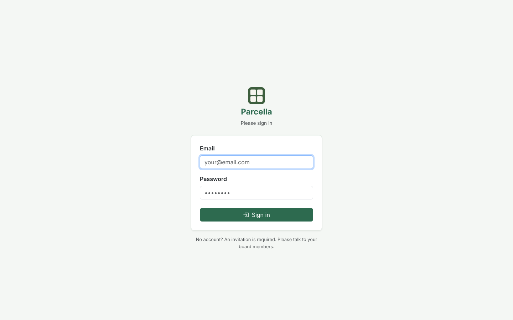

# Prvé prihlásenie a váš účet {#first-login-and-your-account}

!!! note "Strojový preklad"
    Táto stránka bola strojovo preložená z angličtiny a zatiaľ nebola skontrolovaná. Ak je niečo nejasné, platí anglická verzia (jazyk prepnete hore).

Táto stránka opisuje všetko o vašom vlastnom účte: ako ho získate, ako
sa prihlásite a ako zmeníte heslo a obrázok.

!!! info "Kto to môže používať"
    Každý, kto má účet v Parcelle. Verejná registrácia neexistuje: účet
    vznikne až potom, čo vás pozve administrátor.

## Získanie účtu: pozvánka {#getting-an-account-the-invitation}

Administrátor vašej inštalácie vás pozve e-mailom (pozri
[Používatelia a pozvánky](../administration/users.md)). Dostanete
e-mail s predmetom **Pozvánka do Parcella** a tlačidlom **Prijať
pozvánku**. Odkaz v ňom platí **7 dní**.

!!! tip "Neprišiel žiadny e-mail?"
    Najprv sa pozrite do priečinka so spamom. Ak tam nie je, požiadajte
    administrátora, aby skontroloval
    [Protokol e-mailov](../administration/email-log.md) a v prípade
    potreby pozvánku poslal znova. Opätovné odoslanie dá odkazu ďalších
    7 dní; odkaz v prvom e-maile naďalej funguje.

### Prijať pozvánku {#accept-invitation}

<!-- TODO(verify): no screenshot of "Set up your account" -- it needs a valid invitation link, which the screenshot tool can't produce from the sample data. -->

Kliknutím na odkaz sa otvorí stránka **Nastavte si svoj účet**. Pod
nadpisom vidíte adresu, na ktorú bola pozvánka poslaná (**Pozvánka
pre** ...). Táto adresa sa stane vaším prihlasovacím menom; tu ju
zmeniť nemôžete.

| Pole / tlačidlo | Čo robí |
|---|---|
| **Meno** | Vaše meno a priezvisko. Ostatní členovia výboru ho vidia v zoznamoch, pri úlohách, schváleniach a v histórii zmien. |
| **Heslo** | Aspoň 8 znakov. |
| **Potvrdiť heslo** | Zadajte rovnaké heslo ešte raz. Ak sa nezhodujú, uvidíte **Heslá sa nezhodujú.** |
| **Vytvoriť účet** | Vytvorí váš účet a hneď vás prihlási. Ocitnete sa na [Dashboarde](dashboard.md). |

Čo potom uvidíte, závisí od skupín, ktoré administrátor pri pozývaní
vybral. Ak nevybral žiadnu, môžete si len prezerať členov a parcely --
požiadajte ho, aby vás pridal do skupiny. Pozri
[Roly, skupiny a oprávnenia](roles-and-permissions.md).

### Pozvánka vypršala {#invitation-expired}

Hlásenie **Pozvánka vypršala** -- *Tento odkaz na pozvánku už nie je
platný alebo už bol použitý.* -- uvidíte, keď:

- od odoslania pozvánky (alebo posledného opätovného odoslania) uplynulo
  viac ako 7 dní,
- ste si už pomocou tohto odkazu vytvorili účet, alebo
- administrátor pozvánku zmazal alebo pozval tú istú adresu znova
  (funguje len najnovšia pozvánka).

Požiadajte administrátora, aby vás pozval znova. **Späť na
prihlásenie** vás zavedie na prihlasovaciu stránku, čo pomôže len vtedy,
ak už účet máte.

## Prihlásenie {#signing-in}

Otvorte adresu Parcelly vášho spolku vo webovom prehliadači.
Prihlasovacia stránka ukazuje logo a názov vášho spolku (oboje nastavuje
administrátor v [Nastaveniach spolku](../administration/settings.md)).

| Pole / tlačidlo | Čo robí |
|---|---|
| **E-mail** | Adresa, na ktorú bola poslaná vaša pozvánka. Na veľkých a malých písmenách nezáleží. |
| **Heslo** | Vaše heslo. |
| **Prihlásiť sa** | Prihlási vás a otvorí [Dashboard](dashboard.md). |

Hlásenia, ktoré môžete vidieť:

| Hlásenie | Význam |
|---|---|
| **E-mail alebo heslo je nesprávne.** | Jedno z nich je nesprávne. Kvôli vašej ochrane Parcella neprezradí ktoré. |
| **Váš účet bol deaktivovaný.** | Administrátor váš účet vypol. Vaše dáta sú stále uložené; požiadajte ho, aby ho znova aktivoval. |
| **Príliš veľa neúspešných pokusov o prihlásenie. Počkajte niekoľko minút a skúste to znova.** | Po opakovaných nesprávnych heslách Parcella pozastaví pokusy o prihlásenie k tomuto účtu približne na 15 minút. |

Prihlásení zostanete **8 hodín** (ak to ten, kto vašu inštaláciu
prevádzkuje, nezmenil). Potom vás Parcella požiada o nové prihlásenie,
aj keď ste celý čas pracovali.

Odhlásite sa tlačidlom **Odhlásiť sa** v dolnej časti bočného panela.
Urobte to na každom zdieľanom alebo verejnom počítači.

!!! note "Zabudli ste heslo?"
    Odkaz „zabudnuté heslo“ zámerne neexistuje. Požiadajte
    administrátora: môže vám heslo obnoviť a dať vám dočasné (pozri
    [Používatelia a pozvánky](../administration/users.md#reset-password)).
    Pri ďalšom prihlásení si potom musíte zvoliť nové heslo.

## Úplne prvé prihlásenie po inštalácii {#the-very-first-login-after-installation}

Keď sa Parcella spustí prvýkrát, sama si vytvorí jeden administrátorský
účet:

- **E-mail:** `admin@parcella.local`
- **Heslo:** `admin1234`

Tieto údaje sú zverejnené v návode na inštaláciu Parcelly a v každej
novej inštalácii sú rovnaké, takže ich mohol použiť ktokoľvek. Preto je
tento účet zamknutý, kým sa jeho heslo nezmení: po prihlásení sa
ocitnete priamo na stránke **Zmeniť heslo** s upozornením

> Tento účet stále používa predvolené heslo z prvotného nastavenia.
> Zvoľte prosím nové -- dovtedy zostáva zvyšok aplikácie uzamknutý.

Každá iná stránka vás sem vráti, kým neuložíte nové heslo.

!!! warning "Urobte to skôr než čokoľvek iné"
    Heslo zmeňte okamžite, aj v testovacej inštalácii dostupnej z
    internetu. Potom v časti
    [Používatelia a pozvánky](../administration/users.md) zmeňte meno a
    e-mailovú adresu účtu na údaje skutočnej osoby alebo pozvite
    skutočných administrátorov a pracujte s ich vlastnými účtami.

K tej istej vynútenej zmene dôjde, keď vám administrátor obnoví heslo:
dočasné heslo vás dostane len na stránku **Zmeniť heslo**.

## Zmeniť heslo {#change-password}

Otvoríte ju tlačidlom **Zmeniť heslo** v dolnej časti bočného panela.
Stránka je váš osobný profil: obsahuje aj váš avatar a odkaz na vaše
API tokeny.

### Avatar {#avatar}

Váš avatar je malý okrúhly obrázok vedľa vášho mena v bočnom paneli, v
zoznamoch používateľov a pri úlohách. Bez neho Parcella ukazuje
jednoduchú ikonu osoby.

| Pole / tlačidlo | Čo robí |
|---|---|
| Pole pre súbor | Vyberte obrázok: PNG, JPEG alebo WebP, najviac 2 MB. |
| **Nahrať** | Uloží obrázok. Uvidíte **Avatar bol úspešne nahraný.** Nesprávny typ súboru alebo príliš veľký súbor sa odmietne s hlásením. |
| **Odstrániť avatar** | Zobrazí sa len vtedy, keď avatar máte. Znova ho odstráni. |

### API tokeny pre integrácie {#api-tokens-for-integrations}

**Spravovať** otvorí **Moje API tokeny**. Potrebujete to len vtedy, ak
chcete k Parcelle pripojiť iný program (napríklad AI asistenta). Pozri
[API tokeny](../administration/api-tokens.md).

### Zmena hesla {#changing-the-password}

| Pole / tlačidlo | Čo robí |
|---|---|
| **Aktuálne heslo** | Vaše súčasné heslo, aby ho nikto nemohol zmeniť na počítači, na ktorom ste zostali prihlásení. |
| **Nové heslo** | Aspoň 8 znakov a iné ako súčasné. |
| **Potvrďte nové heslo** | Nové heslo ešte raz. |
| **Zmeniť heslo** | Uloží nové heslo. Uvidíte **Heslo bolo úspešne zmenené.** |

Možné chyby: **Aktuálne heslo je nesprávne.**, **Heslá sa
nezhodujú.**, **Heslo musí mať aspoň 8 znakov.** a **Nové heslo sa musí
líšiť od súčasného.**

Čo sa stane, keď uložíte:

- V tomto prehliadači zostanete prihlásení.
- **Všade inde, kde ste boli prihlásení, budete odhlásení** -- na inom
  počítači, v telefóne alebo v prehliadači, ktorý s vaším účtom používa
  niekto iný. Využite to, ak máte podozrenie, že niekto pozná vaše
  heslo.
- Všetky vaše **API tokeny prestanú fungovať** (zobrazia sa ako
  **ukončený**). Ak ich ešte potrebujete, vytvorte si nové.

## Jazyk {#language}

Parcella zobrazuje všetkým vo vašom spolku rovnaký jazyk. Prepínač
jazyka pre jednotlivých používateľov neexistuje. Jazyk vyberá
administrátor v [Nastaveniach spolku](../administration/settings.md#language)
-- English, Deutsch, Polski, Čeština, Slovenčina, Français alebo
Nederlands. Prihlasovacia stránka a stránky s pozvánkou tiež používajú
tento jazyk.

Formáty čísel, dátumov a meny sú samostatné nastavenie (**Región** a
**Mena**), takže spolok môže napríklad používať anglické menu s
nemeckými formátmi čísel.

## Súvisiace {#related}

- [Orientácia v aplikácii](navigation.md)
- [Roly, skupiny a oprávnenia](roles-and-permissions.md)
- [Používatelia a pozvánky](../administration/users.md) -- pre administrátorov
