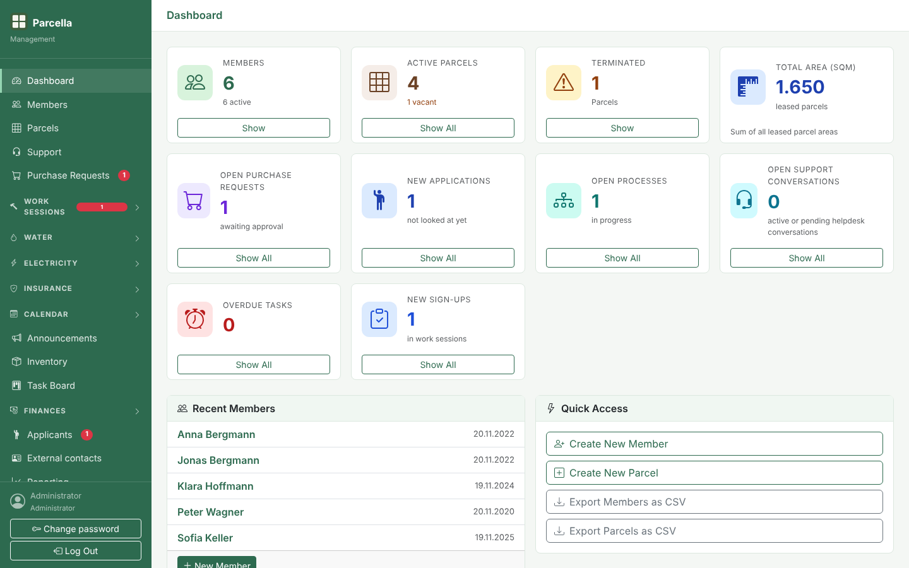

# Orientácia v aplikácii {#finding-your-way-around}

!!! note "Strojový preklad"
    Táto stránka bola strojovo preložená z angličtiny a zatiaľ nebola skontrolovaná. Ak je niečo nejasné, platí anglická verzia (jazyk prepnete hore).

Každá stránka v Parcelle má rovnaký rámec: zelený **bočný panel**
vľavo s navigáciou a biely **horný pruh** nad stránkou s názvom stránky
a tlačidlami pre túto stránku.

!!! info "Kto to môže používať"
    Každý, kto je prihlásený. Ktoré položky uvidíte *vy*, závisí od
    modulov, ktoré má váš spolok zapnuté, a od vašich oprávnení --
    pozri [Prečo sa položky objavujú a miznú](#why-entries-appear-and-disappear).

## Bočný panel {#the-sidebar}

Zhora nadol obsahuje bočný panel:

1. **Názov a logo vášho spolku**, pod nimi slovo **Správa**.
2. **Položky navigácie** -- jedna na každý modul.
3. **Administrácia** -- len pre administrátorov, vždy úplne na konci
   zoznamu.
4. **Pätu** s vaším vlastným účtom.

### Jednotlivé položky a skupiny {#single-entries-and-groups}

Menšie moduly sú jediný odkaz, napríklad **Členovia**, **Parcely**,
**Inventár** alebo **Poznámky**. Kliknite naň a modul sa otvorí.

Väčšie moduly sú **skupina**: nadpis veľkými písmenami s malou šípkou.
Kliknutím na nadpis sa rozbalia jej stránky:

| Skupina | Stránky v nej |
|---|---|
| **Pracovné sedenia** | **Sedenia a prehľad**, **Ročné hodnotenie**, **Sponzorstvá**, **Prevod hodín**, **Úlohy** |
| **Voda** | **Prehľad**, **Meracie body**, **Odpočty**, **Hodnotenie**, **Konfigurácia** |
| **Elektrina** | **Prehľad**, **Meracie body**, **Odpočty**, **Hodnotenie**, **Konfigurácia** |
| **Poistenie** | **Prehľad**, **Parcely**, **Konfigurácia**, **Hodnotenie** |
| **Kalendár** | **Kalendár klubu**, **Narodeniny**, **Prítomnosť výboru**, **Neprítomnosť výboru**, **Vlastné kalendáre** |
| **Financie** | **Prehľad**, **Vydané faktúry**, **Upomienky**, **Prijaté faktúry** |
| **Administrácia** | **Systém**, **Používatelia**, **Skupiny**, **API tokeny**, **Nastavenia**, **Integrácie**, **Protokol e-mailov**, **Ukážkové dáta**, **API dokumentácia (Swagger)** |

Naraz je **otvorená len jedna skupina**: otvorenie skupiny zbalí tú,
ktorá bola otvorená predtým, takže bočný panel zostáva krátky. Skupina,
ktorá obsahuje stránku, na ktorej ste, sa vždy otvorí sama. Inak si váš
prehliadač pamätá, ktorú skupinu ste otvorili naposledy.

Stránka, na ktorej ste, je zvýraznená svetlým pruhom na ľavom okraji.

**API dokumentácia (Swagger)** otvorí v novej karte prehliadača
technický popis programového rozhrania Parcelly. Je určená ľuďom, ktorí
pripájajú iný softvér, inak ju môžete ignorovať.

### Odznaky: veci, ktoré si vyžadujú pozornosť {#badges-things-that-need-attention}

Niektoré položky ukazujú malé červené číslo. Hovorí, koľko vecí tam
čaká. Ak nad ním podržíte myš, uvidíte, čo počíta.

| Položka | Odznak počíta |
|---|---|
| **Pracovné sedenia** a **Sedenia a prehľad** | Nové prihlášky na nadchádzajúce pracovné zmeny za posledných 14 dní, ktoré ešte nikto neoznačil ako skontrolované. |
| **Žiadosti o nákup** | Žiadosti, ktoré ešte čakajú na rozhodnutie. |
| **Uchádzači** | Nové prihlášky, na ktoré sa ešte nikto nepozrel. |
| **Podpora** | Otvorené konverzácie (aktívne alebo čakajúce) v helpdesku spolku. |
| **Nástenka úloh** | Úlohy, ktorých termín uplynul a ktoré nie sú hotové. |

Odznak zmizne sám, keď je vec vybavená -- napríklad keď je žiadosť o
nákup schválená alebo zamietnutá alebo úloha hotová. Funkcia „označiť
ako prečítané“ neexistuje. Tie isté čísla sa zobrazujú ako dlaždice na
[Dashboarde](dashboard.md).

### Päta: váš účet {#the-footer-your-account}

V dolnej časti bočného panela vidíte svoj avatar a meno a pod nimi
skupiny, do ktorých patríte (alebo **Administrátor** / **Výbor** pri
starších účtoch, ktoré majú namiesto skupín rolu -- pozri
[Roly, skupiny a oprávnenia](roles-and-permissions.md)).

| Tlačidlo | Čo robí |
|---|---|
| **Zmeniť heslo** | Otvorí váš profil: heslo, avatar a API tokeny. Pozri [Prvé prihlásenie a váš účet](first-login.md#change-password). |
| **Odhlásiť sa** | Odhlási vás a vráti na prihlasovaciu stránku. |

## Horný pruh {#the-top-bar}

Horný pruh ukazuje vľavo názov aktuálnej stránky. Vpravo sú akcie pre
túto stránku, napríklad **Nový člen**, export alebo tlačidlo späť.
Horný pruh zostáva viditeľný, aj keď v dlhom zozname posúvate nadol.

## Prečo sa položky objavujú a miznú {#why-entries-appear-and-disappear}

Položka sa zobrazí, len keď platí **oboje**:

1. **Modul je zapnutý** pre váš spolok. Administrátori zapínajú a
   vypínajú moduly v časti
   [Zapínanie a vypínanie modulov](../administration/modules.md).
   Vypnutý modul zmizne pre všetkých -- jeho dáta sa zachovajú a vrátia
   sa, keď sa modul znova zapne.
2. **Máte oprávnenie ho čítať.** Členovia výboru a administrátori vidia
   každý zapnutý modul. Všetci ostatní vidia **Členovia** a **Parcely**
   plus moduly, pre ktoré im niektorá z ich skupín dáva **Čítanie**.
   Pozri [Roly, skupiny a oprávnenia](roles-and-permissions.md).

Niekoľko položiek sa riadi vlastným pravidlom:

- **Nástenka úloh** a **Oznamy** sa zobrazujú len ľuďom s plným
  prístupom (členom výboru, administrátorom alebo skupine s **Plný
  prístup ku každému modulu**). Skupiny ich nemôžu povoliť samostatne.
- **Podpora**: s oprávnením na čítanie pre **Podpora (helpdesk)**
  dostanete vlastný zoznam konverzácií v Parcelle. Bez neho sa položka
  napriek tomu zobrazí, ak má helpdesk vášho spolku webovú adresu, a
  potom otvorí samotný helpdesk v novej karte.
- **Administrácia** sa zobrazuje len administrátorom.

Ak otvoríte stránku, ktorú nesmiete vidieť -- zo záložky alebo z
odkazu, ktorý vám poslal kolega --, dostanete hlásenie **Na to nemáte
oprávnenie**. Stránka vypnutého modulu odpovie stránkou „nenájdené“:
„Táto funkcia je v tomto spolku vypnutá.“

### Poradie položiek {#the-order-of-the-entries}

O poradí položiek rozhoduje váš spolok. Administrátor ho nastavuje v
[Nastaveniach spolku](../administration/settings.md#navigation-order).
Poradie je pre všetkých rovnaké.

## Klávesová skratka pre stránky detailu {#keyboard-shortcut-for-detail-pages}

Na stránkach detailu, ktoré majú tlačidlá **Predchádzajúci** a
**Ďalší** -- členovia, parcely, meracie body, stránka poistenia parcely
a externé kontakty --, skáču **Ctrl + ←** a **Ctrl + →** na
predchádzajúci a ďalší záznam, rovnako ako tieto tlačidlá. Skratka nič
nerobí, kým píšete do poľa.

!!! note "Používatelia Macu"
    Na Macu Ctrl + šípky zvyčajne prepínajú medzi plochami („Spaces“),
    takže systém skratku zachytí skôr, než ju uvidí Parcella. Použite
    namiesto toho tlačidlá na stránke alebo túto systémovú skratku
    vypnite.

## V telefóne alebo malom tablete {#on-a-phone-or-small-tablet}

Na úzkych obrazovkách je bočný panel skrytý, aby uvoľnil miesto pre
stránku.

- Ťuknite na tlačidlo **☰** vľavo hore v hornom pruhu a bočný panel sa
  vysunie.
- Ťuknite na položku a prejdete na ňu; bočný panel sa sám zatvorí.
- Ak ho chcete zatvoriť bez presunu, ťuknite na stmavenú stránku vedľa
  neho alebo stlačte na klávesnici **Esc**.

Tlačidlá a vstupné polia sú na dotykových obrazovkách o niečo väčšie a
rady tlačidiel filtrov sa zalamujú do viacerých riadkov, namiesto aby
pretekali mimo obrazovku. Široké tabuľky môžete posúvať prstom do
strany.

## Súvisiace {#related}

- [Dashboard](dashboard.md)
- [Roly, skupiny a oprávnenia](roles-and-permissions.md)
- [Zapínanie a vypínanie modulov](../administration/modules.md)
