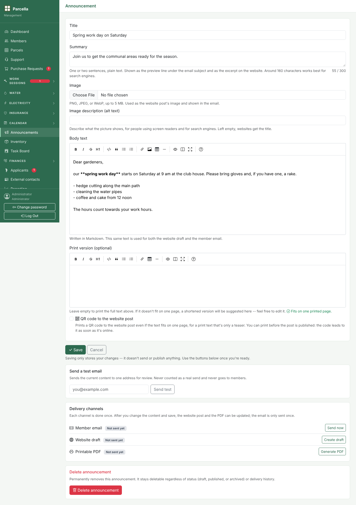

# Oznámení {#announcements}

!!! note "Strojový překlad"
    Tato stránka byla strojově přeložena z angličtiny a dosud nebyla zkontrolována. Pokud je něco nejasné, platí anglická verze (jazyk přepnete nahoře).

Napište zprávu jednou a rozešlete ji až čtyřmi kanály: e-mailem, jako
koncept příspěvku na webu spolku, jako jednostránkové oznámení k
vytištění a vyvěšení v zahrádkové osadě a jako osobní dopisy do obálek s
okénkem. Platí to pro novinky spolku i pro zprávy vybraným členům,
nájemcům parcel nebo uchazečům (uchazeči dopisy nedostávají, protože u
nich není uložena poštovní adresa).

!!! info "Kdo to může používat"
    - Přepínač modulu je **Oznámení** v **Administrace → Zapínání a
      vypínání modulů**. Ve výchozím stavu je **vypnutý**, protože může
      poslat e-mail všem členům a ukládá přihlašovací údaje k vašemu
      webu.
    - **Oznámení** v menu vidí a mohou používat jen role **Výbor** a
      **Správce** a členové skupiny s **Plný přístup ke každému
      modulu**. Žádné oprávnění skupiny neumožní přístup dalším
      uživatelům.
    - Kanál webu potřebuje propojení s webem v **Administrace → Integrace
      → Webové stránky (koncepty z oznámení)**. Viz
      [Integrace](../administration/integrations.md).

## Tři druhy oznámení {#three-kinds-of-announcement}

| Druh | Jak ho zahájíte | Kanály |
|---|---|---|
| Novinky spolku | **Nové oznámení** v seznamu oznámení. | E-mail, koncept na webu, vývěska, dopisy |
| Zpráva vyfiltrovaným členům | **Napsat těmto členům ({count})** ve vyfiltrovaném [seznamu členů](members.md), nebo zaškrtněte členy a klikněte na **Napsat vybraným**. | E-mail, koncept na webu, vývěska, dopisy |
| Oznámení nájemcům vybraných parcel | Zaškrtněte parcely v [seznamu parcel](parcels.md#picking-parcels) a klikněte na **Napsat nájemcům**. Týká se nájmu, ne členství: jedno oznámení na parcelu, s jejím uvedením; e-mail jen nájemcům, kteří ho povolují, ostatním jeden dopis na adresu. | E-mail, koncept na webu, vývěska, dopisy |
| Zpráva vybraným uchazečům | Zaškrtněte uchazeče v [seznamu uchazečů](applicants.md) a klikněte na **Napsat vybraným uchazečům**. | E-mail, koncept na webu, vývěska |

Všechny se píší ve stejném formuláři a jsou uvedeny na stejné stránce.

## Seznam oznámení {#announcement-list}

Otevřete **Oznámení** v menu. Seznam ukazuje všechna oznámení, nejnovější
první.

| Sloupec / tlačítko | Co ukazuje |
|---|---|
| **Nové oznámení** | Otevře prázdný formulář pro novinky spolku. |
| Obrázek | Obrázek oznámení jako náhled, nebo ikona megafonu, pokud žádný nemá. |
| **Název** | Název s odkazem na stránku úprav. Odznak označuje zprávy **Vybraní členové** nebo **Uchazeči**. |
| **Kanály** | Jedna ikona na kanál: obálka (e-mail), zeměkoule (web), tiskárna (vývěska) a poštovní schránka (dopisy; ne u uchazečů). Zeleně znamená **hotovo**, červeně **selhalo**, modře **odesílá se**, šedě **zatím ne**. Najetím myší na ikonu zjistíte její stav. |
| **Vytvořeno** | Datum vytvoření oznámení. |
| Tužka | Otevře stránku úprav. |

Pokud zatím žádná oznámení nejsou, seznam uvádí **Zatím žádná
oznámení.**

Celkový stav „koncept / zveřejněno“ neexistuje. Co kam odešlo, se
sleduje jen po kanálech.

## Psaní oznámení {#writing-an-announcement}

Formulář je stejný pro nová i existující oznámení.

| Pole / tlačítko | Co dělá |
|---|---|
| **Název** | Povinné. Používá se jako předmět e-mailu, název příspěvku a nadpis vytištěného oznámení. |
| **Shrnutí** | Volitelné, prostý text, nejvýše 300 znaků. Zobrazuje se jako řádek náhledu pod předmětem e-mailu a jako úryvek na webu. Počítadlo ukazuje, kolik znaků jste použili; nad 160, což je zhruba to, co ukazují vyhledávače, zoranžoví. |
| **Obrázek** | Volitelné. PNG, JPEG nebo WebP, nejvýše 5 MB. Používá se jako obrázek příspěvku na webu, zobrazuje se v e-mailu a na vytištěném oznámení. Větší soubor se hned odmítne a **Uložit** je neaktivní, dokud nevyberete jiný. |
| **Odstranit obrázek** | Zobrazí se, až je obrázek uložen. Zaškrtněte a uložte, chcete-li ho odstranit. |
| **Popis obrázku (alternativní text)** | Volitelné, nejvýše 255 znaků. Popište, co obrázek ukazuje, pro lidi používající čtečky obrazovky a pro vyhledávače. Pokud zůstane prázdný, weby dostanou název. |
| **Text** | Povinné. Píše se v Markdownu. Tentýž text se používá pro koncept na webu i pro e-mail členům. |
| **Tisková verze (volitelné)** | Jen u oznámení, které už bylo jednou uloženo. Viz [Vytištěné oznámení](#the-printed-notice). |
| **QR kód k příspěvku na webu** | Na stejném místě jako tisková verze. Viz [Vytištěné oznámení](#the-printed-notice). |
| **Uložit** | Uloží změny a otevře stránku úprav. Uložení jen ukládá vaše změny -- nic neodesílá ani nezveřejňuje. |
| **Zrušit** | Zpět na seznam bez uložení. |

Pokud chybí název nebo text, formulář ukáže **Zadejte prosím název i
text.** a ponechá, co jste napsali.

### Textový editor {#the-text-editor}

Pole **Text** je editor Markdownu s panelem nástrojů: tučné písmo,
kurzíva, přeškrtnutí, nadpis, kód, citace, odrážkové a číslované
seznamy, odkaz, obrázek, tabulka a vodorovná čára. Ikona oka přepne na
náhled, ikona rozdělení ukáže text a náhled vedle sebe a šipky otevřou
editor přes celou obrazovku. Otazník otevře v nové záložce krátký návod
k Markdownu.

Tlačítko obrázku vkládá obrázek *podle jeho webové adresy*; soubor
nenahrává. Pro hlavní obrázek oznámení použijte pole **Obrázek**.

## Stránka úprav {#the-edit-page}

Po prvním uložení se ocitnete na stránce úprav. Obsahuje formulář výše a
pod ním tři další karty.

### Odeslat testovací e-mail {#send-a-test-email}

Pošle aktuální obsah ke kontrole na jednu adresu. Nikdy se nepočítá jako
skutečné odeslání a nikdy nejde členům. Zadejte adresu a klikněte na
**Odeslat test**. Testovací e-mail nese viditelnou poznámku, že jde o
test.

Stránka pak ukáže **Testovací e-mail byl úspěšně odeslán** s adresou,
nebo **Testovací e-mail se nepodařilo odeslat -- zkontrolujte konfiguraci
SMTP v Administrace -> Nastavení.**

!!! tip "Tip"
    Nejprve uložte. Test používá uložený obsah, ne to, co je ještě ve
    formuláři.

### Distribuční kanály {#delivery-channels}

Každý kanál má řádek se stavem a, když je co dělat, jedno tlačítko.
Každý kanál se provede jednou. Po změně obsahu a uložení lze příspěvek
na webu a PDF aktualizovat; e-mail se posílá jen jednou.

| Stav | Význam |
|---|---|
| **Zatím neodesláno** | Na tomto kanálu se zatím nic nestalo. |
| **Odesláno** / **PDF vytvořeno** | Hotovo, s datem a časem. |
| **Odesílá se...** | E-mail právě odchází. |
| **Selhalo** / **Příliš dlouhé na jednu stránku** | Poslední pokus nevyšel. Důvod je uveden pod tím a tlačítko se znovu nabídne k opakování. |
| **Obsah se od té doby změnil.** | Oznámení jste upravili poté, co byl tento kanál hotový. |

#### E-mail členům {#member-email}

**Odeslat nyní** pošle oznámení všem současným členům, kteří mají
zapnutá e-mailová upozornění (nastavení „souhlas s e-mailem“ u člena). Dostanou
ho členové, jejichž členství trvá, ať mají zahrádku, nebo ne. Členové
bez e-mailové adresy se přeskočí.

Nejprve potvrdíte: **Odeslat toto oznámení e-mailem všem aktuálním
členům s povolenými e-mailovými upozorněními? Lze to provést pouze
jednou.**

- E-maily odcházejí po malých dávkách s pauzou mezi nimi, aby se
  poštovní server nezahltil. Pro několik set členů to trvá desítky
  minut. Stránku můžete opustit; odesílání pokračuje.
- Během odesílání řádek ukazuje **Odesílá se...** a průběžný počet.
  Nejnovější počet uvidíte po opětovném načtení stránky.
- Pokud některé adresy selžou, kanál přesto ukazuje **Odesláno** s
  poznámkou o počtu selhání. Pokud nešel odeslat ani jeden e-mail,
  ukazuje **Selhalo** a můžete to zkusit znovu.
- Po odeslání se tlačítko už nikdy nevrátí, ani po úpravě. Pokud potom
  text změníte, stránka uvádí **Obsah byl změněn po odeslání e-mailu.
  Členové obdrželi dřívější verzi.**

#### Koncept na webu {#website-draft}

Vedle **Koncept na webu** vidíte, který web je propojen: **WordPress**,
**Složka Markdown (cloudové úložiště)** nebo **Plugin Parcella (TYPO3,
Contao, Drupal, Joomla, ...)**.

- **Vytvořit koncept** pošle název, text, shrnutí a obrázek na web jako
  nezveřejněný koncept. Parcella nikdy nic nezveřejňuje; o tom
  rozhodujete vy v administraci vlastního webu.
- Po úspěšném odeslání odkazuje **Otevřít koncept** na koncept v
  editoru vašeho webu (WordPress, pluginy). U složky Markdown se místo
  toho ukáže cesta k souboru; zveřejníte ho odstraněním řádku
  `draft: true` ze souboru.
- Poté co změníte název, text, shrnutí nebo obrázek a uložíte, se
  tlačítko změní na **Aktualizovat koncept na webu**. Přepíše stejný
  příspěvek, místo aby vytvořil druhý, a zachová jeho stav zveřejnění,
  takže zveřejněný příspěvek zůstane zveřejněný. Nejprve potvrdíte,
  protože úpravy textu provedené přímo na webu se ztratí.
- Pokud byl příspěvek mezitím na webu smazán, vytvoří se nový koncept.
- Bez propojení s webem pokus selže se zprávou, že zatím není nastaven
  žádný web a že ho lze vybrat v Admin -> Integrace -> Web.

#### Tisknutelné PDF {#printable-pdf}

**Vytvořit PDF** vytvoří jednostránkové oznámení a stáhne ho. Viz
[Vytištěné oznámení](#the-printed-notice). Poté řádek nabízí
**Stáhnout** pro uložené PDF. **Vytvořit PDF** se vrátí, když změníte
název, text, tiskovou verzi, nastavení QR nebo obrázek, nebo když bylo
oznámení zkráceno bez QR kódu a příspěvek na webu mezitím mohl být
zveřejněn.

### Smazat oznámení {#delete-announcement}

Trvale odstraní toto oznámení, bez ohledu na to, co už bylo odesláno.
Nejprve potvrdíte: **Opravdu smazat toto oznámení? Tuto akci nelze vrátit
zpět.** Obrázek a uložené tiskové PDF se smažou s ním. Již odeslaných
e-mailů a již vytvořených příspěvků na webu se to netýká.

## Vytištěné oznámení {#the-printed-notice}

Kanál **Tisknutelné PDF** vytvoří jednu stránku A4 pro vývěsku, s
hlavičkovým papírem spolku, obrázkem, názvem, řádkem „Zveřejněno
<datum>, autor: <jméno>“ (datum vytvoření PDF a jméno autora) a textem.

| Pole | Co dělá |
|---|---|
| **Tisková verze (volitelné)** | Ponechte prázdné, chcete-li vytisknout celý text výše. Pokud se nevejde na jednu stránku, zde bude navržena zkrácená verze -- můžete ji upravit. Pod ním formulář uvádí **Vejde se na jednu tištěnou stránku.** nebo **Pravděpodobně příliš dlouhé na jednu stránku -- zvažte zkrácení.** Editor je stejný jako u textu, bez tlačítka obrázku. |
| **QR kód k příspěvku na webu** | Vytiskne QR kód k příspěvku na webu, i když se text vejde na jednu stránku, pro tiskový text, který je jen upoutávkou. Ve výchozím stavu vypnuto. |

Co se stane při **Vytvořit PDF**:

1. Parcella zkusí tiskovou verzi, nebo celý text, pokud je prázdná.
2. Pokud se vejde na jednu stránku, hotovo.
3. Pokud ne, odebírá odstavce od konce, dokud se nevejde, a přidá QR kód
   s textem „Celé oznámení si přečtěte online:“. Zkrácený text se uloží
   do **Tisková verze (volitelné)**, abyste ho mohli zkontrolovat a
   upravit.
4. Pokud se ani jeden odstavec nevejde vedle obrázku a hlavičky, PDF se
   nevytvoří. Kanál ukáže **Příliš dlouhé na jednu stránku** a tiskovou
   verzi musíte zkrátit sami.

QR kód vede na krátký odkaz v Parcelle, ne přímo na příspěvek. Jakmile
je příspěvek na vašem webu zveřejněn, odkaz tam přesměruje. Do té doby
kdokoli, kdo ho naskenuje, uvidí malou stránku s textem **Toto oznámení
zatím není na webu. Zkuste to prosím později.** -- bez názvu a jakýchkoli
dalších podrobností. Oznámení tak můžete vytisknout a vyvěsit dřív, než
je příspěvek online. Bez propojení s webem QR kód vůbec není.

Pokud bylo zkrácené oznámení vytištěno, dokud byl příspěvek ještě
konceptem, stránka uvádí **Text byl zkrácen bez QR kódu, protože
příspěvek na webu ještě nebyl veřejný. Jakmile bude zveřejněn, vytvořte
PDF znovu a QR kód se přidá.**

!!! tip "Uložení PDF do cloudu"
    Se zapnutým modulem cloudového úložiště a **Složka pro tištěná
    oznámení** nastavenou v **Administrace → Integrace** se každé
    vytvořené PDF uloží i tam, pojmenované podle názvu a data. Druhé PDF
    ve stejný den nahradí soubor toho dne. Pokud nahrání selže, stažení
    přesto dostanete; selhání se u kanálu poznamená.

## Zprávy vyfiltrovaným členům {#messages-to-filtered-members}

Použijte to pro provozní zprávy části spolku: „všichni se štítkem
*odpovědný za vodu*“, „všichni čekající členové“.

1. V [seznamu členů](members.md) seznam vyfiltrujte (hledání, štítek,
   zaškrtávací políčka). Pak klikněte na **Napsat těmto členům
   ({count})**, nebo zaškrtněte jednotlivé členy a klikněte na **Napsat
   vybraným**.
2. Otevře se formulář oznámení s kartou **Zpráva pro členy: {count}**
   nad ním.

Karta ukazuje:

| Položka | Co ukazuje |
|---|---|
| **Výběr:** | Filtr, na kterém je zpráva založena, jako odznaky: štítek, hledaný text, **Zobrazit pouze neaktivní**, **Pouze potvrzení aktivní**, **Pouze se souhlasem s e-mailem = ano**, „Ručně vybráno: {count}“. |
| **Zobrazit tyto členy** | Otevře seznam členů s tímto filtrem. |
| „E-mailem: {count}“ | Členové, kteří povolují informace e-mailem (**Může dostávat informace e-mailem**) a mají adresu. |
| „Dopisem: {count}“ | Dopisy pro ostatní členy s poštovní adresou -- jeden na adresu, takže členové, kteří bydlí spolu, sdílejí jeden. Následují jejich jména. |
| „Nedosažitelní: {count} (bez souhlasu nebo e-mailové adresy, bez poštovní adresy)“ | Zobrazeno červeně, s odkazy na členy, abyste mohli opravit jejich záznamy. |
| **Poslat dopis i členům, kteří dostanou e-mail** | Zaškrtněte, chcete-li poslat dopis každému členovi s poštovní adresou, nejen těm bez e-mailu. |

Příjemci se při odesílání určí znovu, z filtru seznamu členů uvedeného
výše. Kdo dostane štítek zítra, bude zahrnut v zítřejších dopisech. Ručně
vybraní členové, kteří už filtru neodpovídají, vypadnou.

!!! note "E-mail jen se souhlasem"
    Zpráva členům jde e-mailem jen členům, kteří povolují informace
    e-mailem. Všichni ostatní s poštovní adresou dostanou dopis -- i když
    někdo, s kým bydlí, dostal e-mail, protože každý člen je zván
    osobně. Členové bez souhlasu, kteří sdílejí adresu, dostanou
    **jeden** dopis se jmény všech. Zahájení z nefiltrovaného seznamu
    členů místo toho vytvoří běžné novinky spolku.

Kanály jsou **E-mail členům** (odeslán jednou, stejně jako výše, po
potvrzení **Odeslat tuto zprávu nyní e-mailem členům ({count})? Nelze
vrátit zpět.**) a **Dopisy**:

- **Vytvořit dopisy ({count})** vytvoří jedno PDF s dopisem na každou
  poštovní adresu, uspořádané pro obálky s okénkem (DIN 5008 tvar B, se
  značkami pro skládání), s názvem a textem jako v e-mailu. Nepřidává se
  oslovení ani obrázek.
- Dopisy se vytvářejí při kliknutí a nikdy se neukládají, protože
  obsahují jména a adresy. Můžete je kdykoli vytvořit znovu.

Koncept na webu a vytištěné oznámení se nabízejí stejně jako u novinek
spolku. Dopisy u novinek spolku jdou každému aktivnímu členovi bez
souhlasu s e-mailem, který má poštovní adresu, jeden na adresu (nebo
všem s **Poslat dopis i členům, kteří dostanou e-mail**).

## Zprávy vybraným uchazečům {#messages-to-selected-applicants}

V [seznamu uchazečů](applicants.md) zaškrtněte uchazeče a klikněte na
**Napsat vybraným uchazečům**. Formulář ukáže kartu **Zpráva na {count}
adres(y) uchazečů** se jmény uchazečů (s odkazy) a **Zobrazit
uchazeče**.

- Pokud více vybraných přihlášek sdílí e-mailovou adresu, tato adresa
  dostane zprávu jen jednou; karta uvádí, kolik jich bylo sloučeno.
- Jen e-mail. Výběr je pevný: uchazeči, které zaškrtnete později, se
  nepřidají.
- Potřebujete také přístup k modulu uchazečů.
- **Odeslat nyní** se zeptá **Odeslat tuto zprávu nyní e-mailem na
  {count} adres(y) uchazečů? Nelze to vrátit zpět.**

## Stránka „zatím není online“ {#the-not-online-yet-page}

Toto je veřejná stránka, kterou lidé uvidí, když naskenují QR kód z
vytištěného oznámení dřív, než je příspěvek zveřejněn, nebo když je
odkaz neznámý. Ukazuje jen logo a název vašeho spolku a větu **Toto
oznámení zatím není na webu. Zkuste to prosím později.**

## Související {#related}

- [Integrace](../administration/integrations.md) -- propojení webu a
  cloudové složky pro vytištěná oznámení.
- [Členové](members.md) -- nastavení „souhlas s e-mailem“, štítky a zahájení
  zprávy vyfiltrovaným členům.
- [Uchazeči](applicants.md) -- psaní vybraným uchazečům.
- [Protokol e-mailů](../administration/email-log.md)
- [Zapínání a vypínání modulů](../administration/modules.md)
