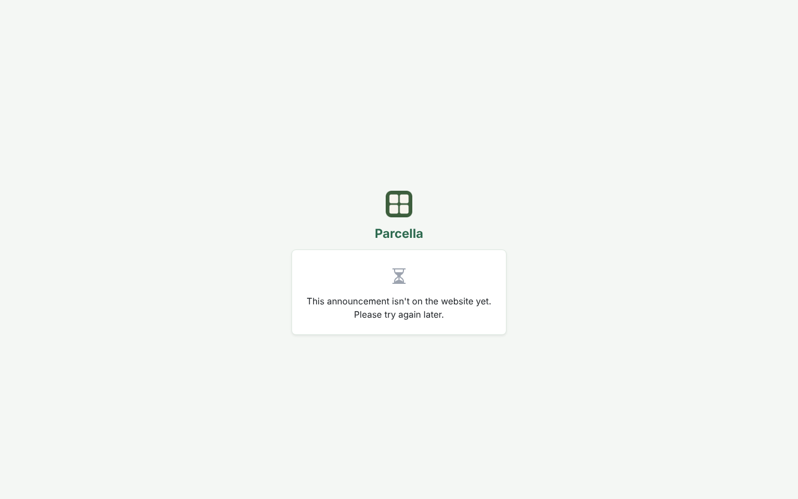

# Mitteilungen {#announcements}

Schreib eine Vereinsnachricht einmal und verschick sie über bis zu drei
Kanäle: eine E-Mail an deine Mitglieder, einen Beitragsentwurf auf der
Vereinswebsite und einen einseitigen Aushang zum Ausdrucken und Aufhängen in
der Anlage. Dasselbe Modul schickt auch Nachrichten an eine Auswahl von
Mitgliedern oder Bewerbern.

!!! info "Wer das nutzen kann"
    - Der Modulschalter ist **Mitteilungen** unter **Administration → Module
      ein- und ausschalten**. Er ist standardmäßig **aus**, weil das Modul
      jedem Mitglied eine E-Mail schicken kann und die Zugangsdaten deiner
      Website speichert.
    - Nur die Rollen **Vorstand** und **Administrator** sowie Mitglieder
      einer Gruppe mit **Voller Zugriff auf jedes Modul** sehen
      **Mitteilungen** im Menü und können es nutzen. Ein Gruppenrecht, um
      anderen Benutzern Zugriff zu geben, gibt es nicht.
    - Der Website-Kanal braucht eine Website-Verbindung unter
      **Administration → Integrationen → Webseite (Entwürfe aus
      Mitteilungen)**. Siehe [Integrationen](../administration/integrations.md).

## Drei Arten von Mitteilungen {#three-kinds-of-announcement}

| Art | Wie du sie beginnst | Kanäle |
|---|---|---|
| Vereinsnachricht | **Neue Mitteilung** in der Mitteilungsliste. | Mitglieder-E-Mail, Webseiten-Entwurf, druckbares PDF |
| Nachricht an gefilterte Mitglieder | **Diesen … Mitgliedern schreiben** in einer gefilterten [Mitgliederliste](members.md), oder Mitglieder anhaken und **An Auswahl schreiben** klicken. | Mitglieder-E-Mail, Briefe |
| Nachricht an die Pächter ausgewählter Parzellen | Parzellen in der [Parzellenliste](parcels.md#picking-parcels) anhaken und **An die Pächter schreiben** klicken. Wie eine Nachricht an gefilterte Mitglieder, aber ein Haushalt bekommt einen Brief und ein gemeinsames Postfach eine E-Mail. | Mitglieder-E-Mail, Briefe |
| Nachricht an ausgewählte Bewerber | Bewerber in der [Bewerberliste](applicants.md) anhaken und **An ausgewählte Bewerber schreiben** klicken. | Nur E-Mail |

Alle drei schreibst du im selben Formular, und alle stehen auf derselben
Seite.

## Mitteilungsliste {#announcement-list}

Öffne **Mitteilungen** im Menü. Die Liste zeigt alle Mitteilungen, die
neuesten zuerst.

| Spalte / Schaltfläche | Was sie zeigt |
|---|---|
| **Neue Mitteilung** | Öffnet ein leeres Formular für eine Vereinsnachricht. |
| Bild | Das Bild der Mitteilung als Vorschaubild oder ein Megafon-Symbol, wenn sie keins hat. |
| **Titel** | Der Titel, verlinkt auf die Bearbeitungsseite. Ein Badge kennzeichnet Nachrichten an **Gefilterte Mitglieder** oder **Bewerber**. |
| **Kanäle** | Ein Symbol je Kanal: Umschlag (E-Mail), Globus (Website), Drucker (PDF) bei Vereinsnachrichten; Umschlag und Briefkasten (Briefe) bei Nachrichten an Mitglieder. Grün heißt **erledigt**, rot **fehlgeschlagen**, blau **wird gesendet**, grau **noch nicht**. Fahr mit der Maus über ein Symbol, um seinen Stand zu lesen. |
| **Erstellt** | Das Datum, an dem die Mitteilung angelegt wurde. |
| Stift | Öffnet die Bearbeitungsseite. |

Gibt es noch keine Mitteilungen, sagt die Liste **Noch keine Mitteilungen
vorhanden.**

Einen Gesamtstatus „Entwurf / veröffentlicht“ gibt es nicht. Was wohin
gegangen ist, wird nur je Kanal festgehalten.

## Eine Mitteilung schreiben {#writing-an-announcement}

Das Formular ist für neue und bestehende Mitteilungen gleich.

| Feld / Schaltfläche | Was es bewirkt |
|---|---|
| **Titel** | Pflicht. Dient als E-Mail-Betreff, Beitragstitel und Überschrift des gedruckten Aushangs. |
| **Zusammenfassung** | Freiwillig, reiner Text, bis zu 300 Zeichen. Erscheint als Vorschauzeile unter dem E-Mail-Betreff und als Anreißer auf der Website. Ein Zähler zeigt, wie viele Zeichen du verbraucht hast; über 160 wird er orange, das ist etwa, was Suchmaschinen zeigen. |
| **Bild** | Freiwillig. PNG, JPEG oder WebP, bis 5 MB. Dient als Bild des Website-Beitrags und erscheint in der E-Mail und auf dem gedruckten Aushang. Eine größere Datei wird sofort abgelehnt, und **Speichern** bleibt gesperrt, bis du eine andere wählst. |
| **Bild entfernen** | Erscheint erst, wenn ein Bild gespeichert ist. Anhaken und speichern, um es zu entfernen. |
| **Bildbeschreibung (Alt-Text)** | Freiwillig, bis zu 255 Zeichen. Beschreib, was auf dem Bild zu sehen ist, für Menschen mit Screenreader und für Suchmaschinen. Leer gelassen, bekommt die Website den Titel. |
| **Text** | Pflicht. In Markdown geschrieben. Derselbe Text dient für den Webseiten-Entwurf und die Mitglieder-E-Mail. |
| **Druckversion (optional)** | Nur bei einer Mitteilung, die schon einmal gespeichert wurde, und nur bei Vereinsnachrichten. Siehe [Der gedruckte Aushang](#the-printed-notice). |
| **QR-Code zum Website-Beitrag** | An derselben Stelle wie die Druckversion. Siehe [Der gedruckte Aushang](#the-printed-notice). |
| **Speichern** | Speichert deine Änderungen und öffnet die Bearbeitungsseite. Speichern sichert nur deine Änderungen -- es wird nichts versendet oder veröffentlicht. |
| **Abbrechen** | Zurück zur Liste ohne Speichern. |

Fehlt Titel oder Text, zeigt das Formular **Bitte Titel und Text angeben.**
und behält, was du eingetippt hast.

### Der Texteditor {#the-text-editor}

Das Feld **Text** ist ein Markdown-Editor mit Werkzeugleiste: fett, kursiv,
durchgestrichen, Überschrift, Code, Zitat, Aufzählung und nummerierte Liste,
Link, Bild, Tabelle und Trennlinie. Das Augen-Symbol schaltet auf Vorschau,
das geteilte Symbol zeigt Text und Vorschau nebeneinander, und die Pfeile
öffnen den Editor im Vollbild. Das Fragezeichen öffnet eine kurze
Markdown-Anleitung in einem neuen Tab.

Die Bild-Schaltfläche fügt ein Bild *über seine Webadresse* ein; sie lädt
keine Datei hoch. Für das Hauptbild der Mitteilung nimm das Feld **Bild**.

## Die Bearbeitungsseite {#the-edit-page}

Nach dem ersten Speichern landest du auf der Bearbeitungsseite. Sie hat das
Formular von oben und darunter drei weitere Karten.

### Test-E-Mail senden {#send-a-test-email}

Schickt den aktuellen Inhalt zur Prüfung an eine einzelne Adresse. Zählt nie
als echter Versand und geht nie an Mitglieder. Gib eine Adresse ein und
klick auf **Test senden**. Die Test-E-Mail trägt einen sichtbaren Hinweis,
dass sie ein Test ist.

Die Seite zeigt dann **Test-E-Mail erfolgreich gesendet** mit der Adresse
oder **Test-E-Mail konnte nicht gesendet werden -- SMTP-Konfiguration unter
Admin -> Einstellungen prüfen.**

!!! tip
    Speichere zuerst. Der Test nutzt den gespeicherten Inhalt, nicht das,
    was noch im Formular steht.

### Versandkanäle {#delivery-channels}

Jeder Kanal hat eine Zeile mit seinem Stand und, wenn es etwas zu tun gibt,
eine Schaltfläche. Jeder Kanal wird einmal ausgeführt. Änderst du danach den
Inhalt und speicherst, lassen sich Website-Beitrag und PDF aktualisieren; die
E-Mail wird nur einmal versendet.

| Stand | Bedeutung |
|---|---|
| **Noch nicht gesendet** | Auf diesem Kanal ist noch nichts passiert. |
| **Gesendet** / **PDF erstellt** | Erledigt, mit Datum und Uhrzeit. |
| **Wird gesendet...** | Die E-Mail geht gerade raus. |
| **Fehlgeschlagen** / **Zu lang für eine Seite** | Der letzte Versuch hat nicht geklappt. Darunter steht der Grund, und die Schaltfläche wird zum erneuten Versuch wieder angeboten. |
| **Inhalt seitdem geändert.** | Du hast die Mitteilung bearbeitet, nachdem dieser Kanal erledigt war. |

#### Mitglieder-E-Mail {#member-email}

**Jetzt senden** schickt die Mitteilung an alle aktuellen Mitglieder, die
E-Mail-Benachrichtigungen eingeschaltet haben (die Einstellung „E-Mail-Info“
beim Mitglied). Mitglieder, deren Mitgliedschaft noch läuft, bekommen sie,
ob sie einen Garten haben oder nicht. Mitglieder ohne E-Mail-Adresse werden
übersprungen.

Du bestätigst zuerst: **Diese Mitteilung per E-Mail an alle aktuellen
Mitglieder mit aktivierten E-Mail-Benachrichtigungen senden? Dies ist nur
einmal möglich.**

- Die E-Mails gehen in kleinen Paketen mit einer Pause dazwischen raus,
  damit dein Mailserver nicht überflutet wird. Bei ein paar hundert
  Mitgliedern dauert das einige zehn Minuten. Du kannst die Seite verlassen;
  der Versand läuft weiter.
- Solange er läuft, zeigt die Zeile **Wird gesendet...** und einen
  mitlaufenden Zähler. Lade die Seite neu, um den aktuellen Stand zu sehen.
- Scheitern einzelne Adressen, zeigt der Kanal trotzdem **Gesendet**, mit
  der Zahl der Fehlschläge. Konnte keine einzige E-Mail gesendet werden,
  zeigt er **Fehlgeschlagen**, und du kannst es erneut versuchen.
- Nach dem Versand kommt die Schaltfläche nie wieder, auch nicht nach einer
  Bearbeitung. Änderst du den Text danach, sagt die Seite **Der Inhalt wurde
  nach dem E-Mail-Versand geändert. Die Mitglieder haben die frühere Fassung
  erhalten.**

#### Webseiten-Entwurf {#website-draft}

Neben **Webseiten-Entwurf** siehst du, welche Website verbunden ist:
**WordPress**, **Markdown-Ordner (Cloud-Speicher)** oder **Parcella-Plugin
(TYPO3, Contao, Drupal, Joomla, ...)**.

- **Entwurf erstellen** schickt Titel, Text, Zusammenfassung und Bild als
  unveröffentlichten Entwurf an die Website. Parcella veröffentlicht nie
  etwas; das bleibt deine Entscheidung im Admin-Bereich deiner Website.
- Nach erfolgreichem Senden verlinkt **Entwurf öffnen** auf den Entwurf im
  Editor deiner Website (WordPress, Plugins). Bei einem Markdown-Ordner
  steht stattdessen der Dateipfad da; du veröffentlichst, indem du die Zeile
  `draft: true` aus der Datei entfernst.
- Änderst du Titel, Text, Zusammenfassung oder Bild und speicherst, wird die
  Schaltfläche zu **Webseiten-Entwurf aktualisieren**. Sie überschreibt
  denselben Beitrag, statt einen zweiten anzulegen, und behält seinen
  Veröffentlichungsstatus; ein veröffentlichter Beitrag bleibt also
  veröffentlicht. Du bestätigst zuerst, weil Textänderungen, die direkt auf
  der Website gemacht wurden, verloren gehen.
- Wurde der Beitrag inzwischen auf der Website gelöscht, wird ein neuer
  Entwurf angelegt.
- Ohne Website-Verbindung scheitert der Versuch mit dem Hinweis, dass noch
  keine Website eingerichtet ist und du eine unter Admin -> Integrationen ->
  Webseite wählen sollst.

#### Druckbares PDF {#printable-pdf}

**PDF erstellen** erzeugt den einseitigen Aushang und lädt ihn herunter.
Siehe [Der gedruckte Aushang](#the-printed-notice). Danach bietet die Zeile
**Herunterladen** für das gespeicherte PDF an. **PDF erstellen** kommt
zurück, wenn du Titel, Text, Druckversion, QR-Einstellung oder Bild änderst
oder wenn der Aushang ohne QR-Code gekürzt wurde und der Website-Beitrag
inzwischen online sein könnte.

### Mitteilung löschen {#delete-announcement}

Entfernt diese Mitteilung endgültig, egal was schon versendet wurde. Du
bestätigst zuerst: **Diese Ankündigung wirklich löschen? Dies kann nicht
rückgängig gemacht werden.** Das Bild und das gespeicherte Druck-PDF werden
mit gelöscht. Schon versendete Mails und schon angelegte Website-Beiträge
bleiben unberührt.

## Der gedruckte Aushang {#the-printed-notice}

Der Kanal **Druckbares PDF** erzeugt eine einzelne A4-Seite fürs schwarze
Brett, mit dem Briefkopf deines Vereins, dem Bild, dem Titel, einer Zeile
„Veröffentlicht am <Datum> von <Name>“ (das Datum, an dem du das PDF
erzeugst, und der Name der Verfasserin oder des Verfassers) und dem Text.

| Feld | Was es bewirkt |
|---|---|
| **Druckversion (optional)** | Leer lassen, um den vollständigen Text oben zu drucken. Passt er nicht auf eine Seite, wird hier eine gekürzte Fassung vorgeschlagen -- frei bearbeitbar. Darunter sagt das Formular **Passt auf eine gedruckte Seite.** oder **Wahrscheinlich zu lang für eine gedruckte Seite -- Kürzung empfohlen.** Der Editor ist derselbe wie beim Text, ohne die Bild-Schaltfläche. |
| **QR-Code zum Website-Beitrag** | Druckt einen QR-Code zum Website-Beitrag, auch wenn der Text auf eine Seite passt -- für einen Drucktext, der nur ein Anreißer ist. Standardmäßig aus. |

Was bei **PDF erstellen** passiert:

1. Parcella versucht es mit der Druckversion oder, wenn sie leer ist, mit
   dem vollständigen Text.
2. Passt das auf eine Seite, fertig.
3. Wenn nicht, lässt es Absätze vom Ende weg, bis es passt, und fügt einen
   QR-Code mit „Die ganze Mitteilung online lesen:“ hinzu. Der gekürzte Text
   wird in **Druckversion (optional)** gespeichert, damit du ihn prüfen und
   anpassen kannst.
4. Passt nicht einmal ein Absatz neben Bild und Briefkopf, entsteht kein
   PDF. Der Kanal zeigt **Zu lang für eine Seite**, und du musst die
   Druckversion selbst kürzen.

Der QR-Code führt zu einem Kurzlink in Parcella, nicht direkt zum Beitrag.
Sobald der Beitrag auf deiner Website veröffentlicht ist, leitet der Link
dorthin weiter. Bis dahin sieht jeder, der ihn scannt, eine kleine Seite mit
**Diese Mitteilung ist noch nicht auf der Website. Bitte versuch es später noch einmal.** -- ohne Titel oder sonstige Einzelheiten. So kannst du
den Aushang drucken und aufhängen, bevor der Beitrag online geht. Ohne
Website-Verbindung gibt es gar keinen QR-Code.

Wurde ein gekürzter Aushang gedruckt, solange der Beitrag noch ein Entwurf
war, vermerkt die Seite **Der Text wurde ohne QR-Code gekürzt, weil der
Webseiten-Beitrag noch nicht öffentlich war. Sobald er veröffentlicht ist,
das PDF neu erstellen, um den QR-Code hinzuzufügen.**

!!! tip "Das PDF in der Cloud ablegen"
    Ist das Cloud-Speicher-Modul an und unter **Administration →
    Integrationen** ein **Ordner für gedruckte Mitteilungen** gesetzt, wird
    jedes erzeugte PDF auch dort gespeichert, benannt nach Titel und Datum.
    Ein zweites PDF am selben Tag ersetzt die Datei dieses Tages. Scheitert
    das Hochladen, bekommst du trotzdem den Download; der Fehler wird beim
    Kanal vermerkt.

## Nachrichten an gefilterte Mitglieder {#messages-to-filtered-members}

Dafür gedacht: betriebliche Nachrichten an einen Teil des Vereins, „alle mit
dem Tag *Wasserverantwortlich*“, „alle ausstehenden Mitglieder“.

1. Filtere die [Mitgliederliste](members.md) (Suche, Tag, Kästchen). Klick
   dann auf **Diesen … Mitgliedern schreiben**, oder hak einzelne Mitglieder
   an und klick auf **An Auswahl schreiben**.
2. Das Mitteilungsformular öffnet sich mit einer Karte **Nachricht an …
   Mitglied(er)** darüber.

Die Karte zeigt:

| Element | Was es zeigt |
|---|---|
| **Auswahl:** | Der Filter, auf dem die Nachricht beruht, als Badges: Tag, Suchtext, **Nur Inaktive anzeigen**, **Nur bestätigt aktive**, **Nur mit E-Mail-Info = ja**, „… von Hand ausgewählt“. |
| **Diese Mitglieder anzeigen** | Öffnet die Mitgliederliste mit diesem Filter. |
| „… per E-Mail“ | Mitglieder mit E-Mail-Adresse. |
| „… per Brief“ | Mitglieder ohne E-Mail-Adresse, aber mit Postanschrift, namentlich. |
| „… nicht erreichbar (keine E-Mail-Adresse, keine Postanschrift)“ | Rot, mit Links zu den Mitgliedern, damit du ihre Daten ergänzen kannst. |
| **Auch Mitgliedern mit E-Mail zusätzlich einen Brief schicken** | Anhaken, um jedem Mitglied mit Postanschrift einen Brief zu schicken, nicht nur denen ohne E-Mail. |

Die Empfänger werden beim Versand neu ermittelt, nach dem oben gezeigten
Filter der Mitgliederliste. Wer morgen den Tag bekommt, ist bei den Briefen
von morgen dabei. Von Hand ausgewählte Mitglieder, die nicht mehr zum Filter
passen, fallen heraus.

!!! warning "Die E-Mail-Info-Einstellung gilt hier nicht"
    Anders als eine Vereinsnachricht geht eine Nachricht an gefilterte
    Mitglieder an jedes ausgewählte Mitglied mit E-Mail-Adresse, auch an
    die, die E-Mail-Benachrichtigungen abgeschaltet haben. Sie ist für
    betriebliche Nachrichten gedacht, nicht für Newsletter. Beginnst du bei
    einer ungefilterten Mitgliederliste, entsteht stattdessen eine
    gewöhnliche Vereinsnachricht -- ein einzelner Klick kann also nie den
    ganzen Verein an seinem Abwahl-Wunsch vorbei anschreiben.

Die Kanäle sind **Mitglieder-E-Mail** (einmal gesendet, wie oben, nach der
Bestätigung **Diese Nachricht jetzt per E-Mail an … Mitglied(er) senden? Das
lässt sich nicht rückgängig machen.**) und **Briefe**:

- **… Brief(e) erzeugen** erstellt ein PDF mit einem Brief je Empfänger,
  gesetzt für Fensterumschläge (DIN 5008 Form B, mit Falzmarken), mit Titel und Text wie in der E-Mail. Eine
  Anrede wird nicht hinzugefügt, ein Bild auch nicht.
- Die Briefe entstehen beim Klick und werden nie gespeichert, weil sie Namen
  und Adressen enthalten. Du kannst sie jederzeit neu erzeugen.

Website- und Druck-Kanal gibt es für diese Nachrichten nicht.

## Nachrichten an ausgewählte Bewerber {#messages-to-selected-applicants}

Hak in der [Bewerberliste](applicants.md) Bewerber an und klick auf **An
ausgewählte Bewerber schreiben**. Das Formular zeigt eine Karte **Nachricht
an … Bewerber-Adresse(n)** mit den Namen der Bewerber (verlinkt) und
**Bewerber anzeigen**.

- Teilen sich mehrere ausgewählte Bewerbungen eine E-Mail-Adresse, bekommt
  diese Adresse die Nachricht nur einmal; die Karte sagt, wie viele
  zusammengefasst wurden.
- Nur per E-Mail. Die Auswahl steht fest: Später angehakte Bewerber kommen
  nicht dazu.
- Du brauchst auch Zugriff aufs Bewerbermodul.
- **Jetzt senden** fragt **Diese Nachricht jetzt per E-Mail an …
  Bewerber-Adresse(n) senden? Das lässt sich nicht rückgängig machen.**

## Die Seite „Noch nicht online“ {#the-not-online-yet-page}

Das ist die öffentliche Seite, die Leute sehen, wenn sie den QR-Code eines
gedruckten Aushangs scannen, bevor der Beitrag veröffentlicht ist, oder wenn
der Link unbekannt ist. Sie zeigt nur Logo und Namen deines Vereins und den
Satz **Diese Mitteilung ist noch nicht auf der Website. Bitte versuch es später noch einmal.**

## Siehe auch {#related}

- [Integrationen](../administration/integrations.md) -- Website und
  Cloud-Ordner für gedruckte Aushänge verbinden.
- [Mitglieder](members.md) -- die Einstellung „E-Mail-Info“, Tags und eine
  Nachricht an gefilterte Mitglieder beginnen.
- [Bewerber](applicants.md) -- ausgewählten Bewerbern schreiben.
- [E-Mail-Protokoll](../administration/email-log.md)
- [Module ein- und ausschalten](../administration/modules.md)
