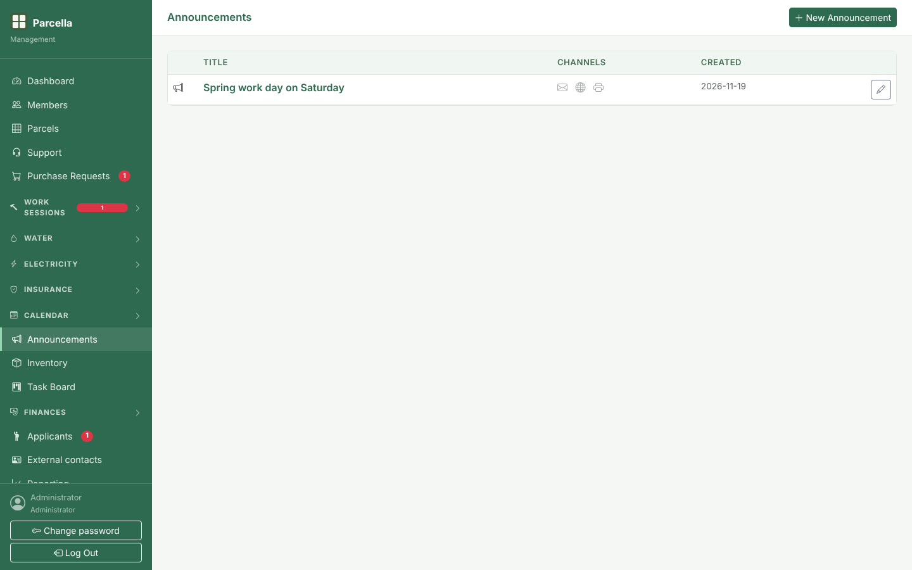

# Annonces {#announcements}

!!! note "Traduction automatique"
    Cette page a été traduite automatiquement de l'anglais et n'a pas encore été relue. En cas de doute, la version anglaise fait foi (changez de langue en haut de la page).

Rédigez un message une fois et envoyez-le sur jusqu'à quatre canaux : un
e-mail, un brouillon d'article sur le site web de l'association, un avis
d'une page à imprimer et afficher dans le jardin, et des courriers
personnels pour enveloppes à fenêtre. Cela vaut pour les nouvelles de
l'association comme pour les messages à une sélection de membres, aux
locataires de parcelles ou aux candidats (les candidats ne reçoivent pas
de courriers, car aucune adresse postale n'est enregistrée pour eux).

!!! info "Qui peut l'utiliser"
    - L'interrupteur du module est **Annonces** sous **Administration →
      Activer et désactiver les modules**. Il est **désactivé** par
      défaut, car il peut envoyer un e-mail à chaque membre et stocke
      l'identifiant de votre site web.
    - Seuls les rôles **Conseil d'administration** et **Administrateur**,
      et les membres d'un groupe avec **Accès complet à chaque module**,
      voient **Annonces** dans le menu et peuvent l'utiliser. Il n'existe
      pas de droit de groupe pour donner l'accès à d'autres utilisateurs.
    - Le canal du site web nécessite une connexion au site web sous
      **Administration → Intégrations → Site web (brouillons depuis les
      annonces)**. Voir [Intégrations](../administration/integrations.md).

## Trois types d'annonce {#three-kinds-of-announcement}

| Type | Comment la démarrer | Canaux |
|---|---|---|
| Nouvelles de l'association | **Nouvelle annonce** dans la liste des annonces. | E-mail, brouillon sur le site, avis, courriers |
| Message aux membres filtrés | **Écrire à ces {count} membres** sur une [liste des membres](members.md) filtrée, ou cochez des membres et cliquez sur **Écrire à la sélection**. | E-mail, brouillon sur le site, avis, courriers |
| Avis aux locataires des parcelles choisies | Cochez des parcelles dans la [liste des parcelles](parcels.md#picking-parcels) et cliquez sur **Écrire aux locataires**. Concerne le bail, pas l'adhésion : un avis par parcelle, qui la nomme ; e-mail seulement aux locataires qui l'acceptent, un courrier par adresse pour les autres. | E-mail, brouillon sur le site, avis, courriers |
| Message aux candidats sélectionnés | Cochez des candidats dans la [liste des candidats](applicants.md) et cliquez sur **Écrire aux candidats sélectionnés**. | E-mail, brouillon sur le site, avis |

Tous les trois se rédigent dans le même formulaire et sont listés sur la
même page.

## Liste des annonces {#announcement-list}

Ouvrez **Annonces** dans le menu. La liste affiche toutes les annonces,
la plus récente en premier.

| Colonne / bouton | Ce qu'elle affiche |
|---|---|
| **Nouvelle annonce** | Ouvre un formulaire vide pour des nouvelles de l'association. |
| Image | L'image de l'annonce en vignette, ou une icône de mégaphone si elle n'en a pas. |
| **Titre** | Le titre, avec un lien vers la page de modification. Un badge marque les messages **Membres filtrés** ou **Candidats**. |
| **Canaux** | Une icône par canal : enveloppe (e-mail), globe (site web), imprimante (avis) et boîte aux lettres (courriers ; pas pour les candidats). Vert signifie **fait**, rouge **échec**, bleu **envoi en cours**, gris **pas encore**. Survolez une icône pour lire son état. |
| **Créée le** | La date de création de l'annonce. |
| Crayon | Ouvre la page de modification. |

Sans annonce pour l'instant, la liste indique **Aucune annonce pour le
moment.**

Il n'y a pas de statut global « brouillon / publié ». Ce qui est parti
où n'est suivi que par canal.

## Rédiger une annonce {#writing-an-announcement}

Le formulaire est le même pour les nouvelles annonces et les annonces
existantes.

| Champ / bouton | Ce qu'il fait |
|---|---|
| **Titre** | Obligatoire. Sert d'objet de l'e-mail, de titre de l'article et de titre de l'avis imprimé. |
| **Résumé** | Facultatif, texte simple, jusqu'à 300 caractères. Affiché comme ligne d'aperçu sous l'objet de l'e-mail et comme extrait sur le site web. Un compteur indique combien de caractères vous avez utilisés ; il passe à l'orange au-delà de 160, soit à peu près ce qu'affichent les moteurs de recherche. |
| **Image** | Facultatif. PNG, JPEG ou WebP, jusqu'à 5 Mo. Sert d'image de l'article du site web, et s'affiche dans l'e-mail et sur l'avis imprimé. Un fichier plus gros est refusé immédiatement et **Enregistrer** est désactivé jusqu'à ce que vous en choisissiez un autre. |
| **Supprimer l'image** | Affiché seulement une fois une image enregistrée. Cochez et enregistrez pour la supprimer. |
| **Description de l'image (texte alternatif)** | Facultatif, jusqu'à 255 caractères. Décrivez ce que montre l'image, pour les personnes utilisant un lecteur d'écran et pour les moteurs de recherche. Laissé vide, les sites web reçoivent le titre. |
| **Texte** | Obligatoire. Écrit en Markdown. Ce même texte sert à la fois au brouillon du site web et à l'e-mail aux membres. |
| **Version imprimée (optionnel)** | Seulement sur une annonce déjà enregistrée une fois. Voir [L'avis imprimé](#the-printed-notice). |
| **QR code vers l'article du site** | Même endroit que la version imprimée. Voir [L'avis imprimé](#the-printed-notice). |
| **Enregistrer** | Enregistre vos modifications et ouvre la page de modification. Enregistrer ne fait que stocker vos modifications -- cela n'envoie ni ne publie rien. |
| **Annuler** | Retour à la liste sans enregistrer. |

Si le titre ou le texte manque, le formulaire affiche **Veuillez
indiquer un titre et un texte.** et conserve ce que vous avez saisi.

### L'éditeur de texte {#the-text-editor}

La zone **Texte** est un éditeur Markdown avec une barre d'outils :
gras, italique, barré, titre, code, citation, listes à puces et
numérotées, lien, image, tableau et ligne horizontale. L'icône œil passe
à un aperçu, l'icône de partage affiche texte et aperçu côte à côte, et
les flèches ouvrent un éditeur plein écran. Le point d'interrogation
ouvre un court guide Markdown dans un nouvel onglet.

Le bouton image insère une image *par son adresse web* ; il ne
téléverse pas de fichier. Pour l'image principale de l'annonce, utilisez
le champ **Image**.

## La page de modification {#the-edit-page}

Après le premier enregistrement, vous arrivez sur la page de
modification. Elle contient le formulaire ci-dessus, et en dessous trois
cartes de plus.

### Envoyer un e-mail de test {#send-a-test-email}

Envoie le contenu actuel à une adresse pour relecture. Jamais compté
comme un vrai envoi et jamais envoyé aux membres. Saisissez une adresse
et cliquez sur **Envoyer le test**. L'e-mail de test porte une mention
visible indiquant qu'il s'agit d'un test.

La page affiche ensuite **E-mail de test envoyé avec succès** avec
l'adresse, ou **Impossible d'envoyer l'e-mail de test -- vérifiez la
configuration SMTP dans Admin -> Paramètres.**

!!! tip
    Enregistrez d'abord. Le test utilise le contenu enregistré, pas ce
    qui est encore dans le formulaire.

### Canaux d'envoi {#delivery-channels}

Chaque canal a une ligne avec son statut et, quand il y a quelque chose
à faire, un bouton. Chaque canal ne se fait qu'une fois. Après avoir
modifié le contenu et enregistré, l'article du site web et le PDF
peuvent être mis à jour ; l'e-mail n'est envoyé qu'une fois.

| Statut | Signification |
|---|---|
| **Pas encore envoyé** | Rien ne s'est encore passé sur ce canal. |
| **Envoyé** / **PDF généré** | Fait, avec date et heure. |
| **Envoi en cours...** | L'e-mail est en train de partir. |
| **Échec** / **Trop long pour une page** | La dernière tentative n'a pas fonctionné. La raison est affichée en dessous, et le bouton est de nouveau proposé pour réessayer. |
| **Contenu modifié depuis.** | Vous avez modifié l'annonce après que ce canal a été traité. |

#### E-mail aux membres {#member-email}

**Envoyer maintenant** envoie l'annonce à tous les membres actuels qui
ont activé les notifications par e-mail (le réglage « infos e-mail » du
membre). Les membres dont l'adhésion est en cours la reçoivent, qu'ils
aient une parcelle ou non. Les membres sans adresse e-mail sont ignorés.

Vous confirmez d'abord : **Envoyer cette annonce par e-mail à tous les
membres actuels ayant activé les notifications par e-mail ? Cette action
n'est possible qu'une seule fois.**

- Les e-mails partent par petits lots avec une pause entre eux, pour ne
  pas submerger votre serveur de messagerie. Pour quelques centaines de
  membres, cela prend des dizaines de minutes. Vous pouvez quitter la
  page ; l'envoi continue.
- Pendant l'envoi, la ligne affiche **Envoi en cours...** et un
  compteur. Rechargez la page pour voir le dernier compte.
- Si certaines adresses échouent, le canal affiche quand même
  **Envoyé**, avec le nombre d'échecs indiqué. Si aucun e-mail n'a pu
  être envoyé, il affiche **Échec** et vous pouvez réessayer.
- Une fois envoyé, le bouton ne revient jamais, même après une
  modification. Si vous changez le texte ensuite, la page indique **Le
  contenu a été modifié après l'envoi de l'e-mail. Les membres ont reçu
  la version précédente.**

#### Brouillon sur le site {#website-draft}

À côté de **Brouillon sur le site**, vous voyez quel site web est
connecté : **WordPress**, **Dossier Markdown (stockage cloud)** ou
**Plugin Parcella (TYPO3, Contao, Drupal, Joomla, ...)**.

- **Créer le brouillon** envoie le titre, le texte, le résumé et l'image
  au site web comme brouillon non publié. Parcella ne publie jamais
  rien ; cela reste une décision que vous prenez dans l'administration
  de votre site web.
- Après un envoi réussi, **Ouvrir le brouillon** renvoie vers le
  brouillon dans l'éditeur de votre site web (WordPress, plugins). Pour
  un dossier Markdown, c'est le chemin du fichier qui s'affiche ; vous
  publiez en supprimant la ligne `draft: true` du fichier.
- Après avoir modifié le titre, le texte, le résumé ou l'image et
  enregistré, le bouton devient **Mettre à jour le brouillon du site**.
  Il écrase le même article au lieu d'en créer un second, et conserve
  son statut de publication : un article publié reste publié. Vous
  confirmez d'abord, car les modifications de texte faites directement
  sur le site web seront perdues.
- Si l'article a été supprimé sur le site web entre-temps, un nouveau
  brouillon est créé.
- Sans connexion au site web, la tentative échoue avec « No website is
  set up yet -- choose one under Admin -> Integrations -> Website. »

#### PDF imprimable {#printable-pdf}

**Générer le PDF** crée l'avis d'une page et le télécharge. Voir
[L'avis imprimé](#the-printed-notice). Ensuite, la ligne propose
**Télécharger** pour le PDF enregistré. **Générer le PDF** revient quand
vous changez le titre, le texte, la version imprimée, le réglage du QR
code ou l'image, ou quand l'avis a été raccourci sans QR code et que
l'article du site web a pu être mis en ligne depuis.

### Supprimer l'annonce {#delete-announcement}

Supprime définitivement cette annonce, quoi qu'il ait déjà été envoyé.
Vous confirmez d'abord : **Vraiment supprimer cette annonce ? Cette
action est irréversible.** L'image et le PDF d'impression enregistré
sont supprimés avec elle. Les e-mails déjà envoyés et les articles du
site web déjà créés ne sont pas concernés.

## L'avis imprimé {#the-printed-notice}

Le canal **PDF imprimable** produit une seule page A4 pour le panneau
d'affichage, avec l'en-tête de votre association, l'image, le titre, une
ligne « Publié le <date> par <nom> » (la date de génération du PDF, et
le nom de l'auteur) et le texte.

| Champ | Ce qu'il fait |
|---|---|
| **Version imprimée (optionnel)** | Laissez vide pour imprimer le texte complet ci-dessus. S'il ne tient pas sur une page, une version raccourcie vous sera proposée ici -- n'hésitez pas à la modifier. En dessous, le formulaire indique **Tient sur une page imprimée.** ou **Probablement trop long pour une page -- envisagez de raccourcir.** L'éditeur est le même que pour le texte, sans le bouton image. |
| **QR code vers l'article du site** | Imprime un QR code vers l'article du site web même si le texte tient sur une page, pour un texte imprimé qui n'est qu'une accroche. Désactivé par défaut. |

Ce qui se passe avec **Générer le PDF** :

1. Parcella essaie la version imprimée, ou le texte complet s'il est
   vide.
2. Si cela tient sur une page, c'est fini.
3. Sinon, il retire des paragraphes à partir de la fin jusqu'à ce que
   cela tienne, et ajoute un QR code avec « Lire l'annonce complète en
   ligne : ». Le texte raccourci est enregistré dans **Version imprimée
   (optionnel)**, pour que vous puissiez le vérifier et l'ajuster.
4. Si même un seul paragraphe ne tient pas à côté de l'image et de
   l'en-tête, aucun PDF n'est créé. Le canal affiche **Trop long pour
   une page** et vous devez raccourcir vous-même la version imprimée.

Le QR code mène à un lien court dans Parcella, pas directement à
l'article. Dès que l'article est publié sur votre site web, le lien y
redirige. D'ici là, quiconque le scanne voit une petite page indiquant
**Cette annonce n'est pas encore sur le site. Veuillez réessayer plus
tard.** -- sans le titre ni aucun autre détail. Vous pouvez donc
imprimer et afficher l'avis avant que l'article soit en ligne. Sans
connexion au site web, il n'y a pas de QR code du tout.

Si un avis raccourci a été imprimé alors que l'article était encore un
brouillon, la page indique **Le texte a été raccourci sans code QR car
l'article du site n'était pas encore public. Une fois publié, recréez le
PDF pour ajouter le code QR.**

!!! tip "Enregistrer le PDF dans le cloud"
    Avec le module de stockage cloud activé et un **Dossier des annonces
    imprimées** défini sous **Administration → Intégrations**, chaque PDF
    généré y est aussi enregistré, nommé d'après le titre et la date. Un
    second PDF le même jour remplace le fichier de ce jour. Si le
    téléversement échoue, vous obtenez quand même le téléchargement ;
    l'échec est indiqué sur le canal.

## Messages aux membres filtrés {#messages-to-filtered-members}

Utilisez cela pour des messages pratiques à une partie de l'association :
« toutes les personnes étiquetées *responsable de l'eau* », « tous les
membres en attente ».

1. Sur la [liste des membres](members.md), filtrez la liste (recherche,
   étiquette, cases à cocher). Cliquez ensuite sur **Écrire à ces
   {count} membres**, ou cochez des membres individuellement et cliquez
   sur **Écrire à la sélection**.
2. Le formulaire d'annonce s'ouvre avec une carte **Message à {count}
   membre(s)** au-dessus.

La carte affiche :

| Élément | Ce qu'il affiche |
|---|---|
| **Sélection :** | Le filtre sur lequel se base le message, sous forme de badges : étiquette, texte de recherche, **Afficher uniquement les inactifs**, **Actifs confirmés uniquement**, **Infos e-mail = oui uniquement**, « {count} choisi(s) à la main ». |
| **Afficher ces membres** | Ouvre la liste des membres avec ce filtre. |
| « {count} par e-mail » | Les membres qui acceptent les informations par e-mail (**Peut recevoir des informations par e-mail**) et ont une adresse. |
| « {count} par courrier » | Les courriers pour les autres membres ayant une adresse postale -- un par adresse, si bien que les membres qui vivent ensemble en partagent un. Leurs noms suivent. |
| « {count} injoignable(s) (pas d'accord ou d'adresse e-mail, pas d'adresse postale) » | Affiché en rouge, avec des liens vers les membres pour que vous puissiez corriger leurs fiches. |
| **Envoyer aussi un courrier aux membres qui reçoivent l'e-mail** | Cochez pour envoyer un courrier à chaque membre ayant une adresse postale, pas seulement à ceux sans e-mail. |

Les destinataires sont recalculés au moment de l'envoi, à partir du
filtre de la liste des membres affiché ci-dessus. Quelqu'un qui reçoit
l'étiquette demain est inclus dans les courriers de demain. Les membres
choisis à la main qui ne correspondent plus au filtre en sortent.

!!! note "E-mail seulement avec accord"
    Un message aux membres ne part par e-mail qu'aux membres qui
    acceptent les informations par e-mail. Toutes les autres personnes
    ayant une adresse postale reçoivent un courrier -- même quand
    quelqu'un qui vit avec elles a reçu l'e-mail, car chaque membre est
    invité personnellement. Les membres sans accord qui partagent une
    adresse reçoivent **un seul** courrier les nommant tous. Partir d'une
    liste des membres non filtrée crée à la place des nouvelles
    ordinaires de l'association.

Les canaux sont **E-mail aux membres** (envoyé une fois, comme
ci-dessus, après la confirmation **Envoyer maintenant ce message par
e-mail à {count} membre(s) ? C'est irréversible.**) et **Courriers** :

- **Créer {count} courrier(s)** crée un PDF avec un courrier par adresse
  postale, mis en page pour enveloppes à fenêtre (DIN 5008 Form B, avec
  repères de pliage), avec le titre et le texte comme dans l'e-mail.
  Aucune formule d'appel n'est ajoutée, et aucune image.
- Les courriers sont générés au moment du clic et jamais stockés, car ils
  contiennent des noms et des adresses. Vous pouvez les générer à
  nouveau à tout moment.

Le brouillon sur le site et l'avis imprimé sont proposés comme pour les
nouvelles de l'association. Les courriers des nouvelles de l'association
vont à chaque membre actif sans accord pour l'e-mail qui a une adresse
postale, un par adresse (ou à tout le monde avec **Envoyer aussi un
courrier aux membres qui reçoivent l'e-mail**).

## Messages aux candidats sélectionnés {#messages-to-selected-applicants}

Sur la [liste des candidats](applicants.md), cochez des candidats et
cliquez sur **Écrire aux candidats sélectionnés**. Le formulaire affiche
une carte **Message à {count} adresse(s) de candidats** avec les noms
des candidats (avec liens) et **Afficher les candidats**.

- Si plusieurs candidatures sélectionnées partagent une adresse e-mail,
  cette adresse ne reçoit le message qu'une fois ; la carte indique
  combien ont été regroupées.
- E-mail uniquement. La sélection est figée : les candidats que vous
  cochez plus tard ne sont pas ajoutés.
- Vous avez aussi besoin de l'accès au module des candidats.
- **Envoyer maintenant** demande **Envoyer maintenant ce message par
  e-mail à {count} adresse(s) de candidats ? C'est irréversible.**

## La page « pas encore en ligne » {#the-not-online-yet-page}

C'est la page publique que voient les personnes qui scannent le QR code
d'un avis imprimé avant que l'article soit publié, ou quand le lien est
inconnu. Elle n'affiche que le logo et le nom de votre association et la
phrase **Cette annonce n'est pas encore sur le site. Veuillez réessayer
plus tard.**

## Voir aussi {#related}

- [Intégrations](../administration/integrations.md) -- connecter le site
  web et le dossier cloud pour les avis imprimés.
- [Membres](members.md) -- le réglage « infos e-mail », les étiquettes,
  et démarrer un message aux membres filtrés.
- [Candidats](applicants.md) -- écrire aux candidats sélectionnés.
- [Journal des e-mails](../administration/email-log.md)
- [Activer et désactiver les modules](../administration/modules.md)
