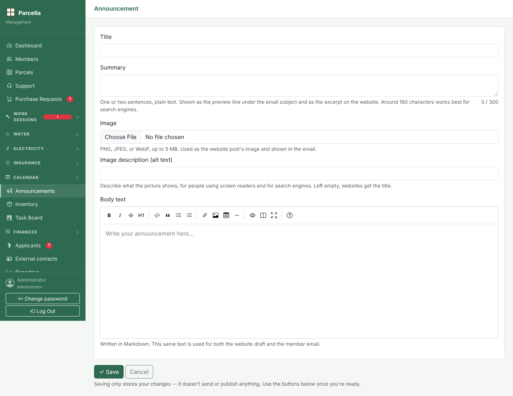

# Mededelingen {#announcements}

!!! note "Machinevertaling"
    Deze pagina is machinaal vertaald uit het Engels en nog niet nagekeken. Als iets onduidelijk is, geldt de Engelse versie (taal wisselt u bovenaan).

Schrijf een bericht één keer en verstuur het via maximaal vier kanalen:
een e-mail, een conceptbericht op de website van de vereniging, een
mededeling van één pagina om af te drukken en in de tuin op te hangen, en
persoonlijke brieven voor vensterenveloppen. Dat geldt voor
verenigingsnieuws en voor berichten aan een selectie van leden, aan de
huurders van percelen of aan aanmelders (aanmelders krijgen geen
brieven, omdat er geen postadres van hen wordt opgeslagen).

!!! info "Wie kan dit gebruiken"
    - De moduleschakelaar is **Mededelingen** onder **Administratie →
      Modules in- en uitschakelen**. Ze staat standaard **uit**, omdat ze
      elk lid kan e-mailen en de login van uw website opslaat.
    - Alleen de rollen **Bestuur** en **Beheerder**, en leden van een
      groep met **Volledige toegang tot elke module**, zien
      **Mededelingen** in het menu en kunnen de module gebruiken. Er is
      geen groepsrecht om andere gebruikers toegang te geven.
    - Het websitekanaal vraagt een websiteverbinding onder
      **Administratie → Integraties → Website (concepten vanuit
      mededelingen)**. Zie [Integraties](../administration/integrations.md).

## Drie soorten mededelingen {#three-kinds-of-announcement}

| Soort | Hoe u ze start | Kanalen |
|---|---|---|
| Verenigingsnieuws | **Nieuwe mededeling** in de lijst met mededelingen. | E-mail, websiteconcept, mededeling, brieven |
| Bericht aan gefilterde leden | **Deze {aantal} leden schrijven** op een gefilterde [ledenlijst](members.md), of leden aanvinken en op **Selectie aanschrijven** klikken. | E-mail, websiteconcept, mededeling, brieven |
| Bericht aan de huurders van gekozen percelen | Percelen aanvinken in de [perceellijst](parcels.md#picking-parcels) en op **Schrijf naar de pachters** klikken. Over de huur, niet het lidmaatschap: één bericht per perceel, met het nummer; e-mail alleen aan huurders die dat toestaan, één brief per adres voor de anderen. | E-mail, websiteconcept, mededeling, brieven |
| Bericht aan geselecteerde aanmelders | Aanmelders aanvinken in de [lijst met aanmelders](applicants.md) en op **Schrijf naar de geselecteerde aanvragers** klikken. | E-mail, websiteconcept, mededeling |

Ze worden allemaal in hetzelfde formulier geschreven en op dezelfde
pagina getoond.

## Lijst met mededelingen {#announcement-list}

Open **Mededelingen** in het menu. De lijst toont alle mededelingen, de
nieuwste eerst.

| Kolom / knop | Wat ze toont |
|---|---|
| **Nieuwe mededeling** | Opent een leeg formulier voor verenigingsnieuws. |
| Afbeelding | De afbeelding van de mededeling als miniatuur, of een megafoonpictogram als er geen is. |
| **Titel** | De titel, gelinkt aan de bewerkpagina. Een badge markeert berichten aan **Gefilterde leden** of **Aanvragers**. |
| **Kanalen** | Eén pictogram per kanaal: envelop (e-mail), wereldbol (website), printer (mededeling) en brievenbus (brieven; niet bij aanmelders). Groen betekent **gedaan**, rood **mislukt**, blauw **wordt verzonden**, grijs **nog niet**. Beweeg de muis over een pictogram om de status te lezen. |
| **Aangemaakt** | De datum waarop de mededeling is aangemaakt. |
| Potlood | Opent de bewerkpagina. |

Zonder mededelingen zegt de lijst **Nog geen mededelingen.**

Er is geen algemene status „concept / gepubliceerd“. Wat waar is
verstuurd, wordt alleen per kanaal bijgehouden.

## Een mededeling schrijven {#writing-an-announcement}

Het formulier is hetzelfde voor nieuwe en bestaande mededelingen.

| Veld / knop | Wat het doet |
|---|---|
| **Titel** | Verplicht. Gebruikt als onderwerp van de e-mail, titel van het bericht en kop van de afgedrukte mededeling. |
| **Samenvatting** | Optioneel, platte tekst, maximaal 300 tekens. Getoond als voorbeeldregel onder het onderwerp van de e-mail en als samenvatting op de website. Een teller toont hoeveel tekens u hebt gebruikt; boven 160 wordt hij oranje, ongeveer wat zoekmachines tonen. |
| **Afbeelding** | Optioneel. PNG, JPEG of WebP, maximaal 5 MB. Gebruikt als afbeelding van het websitebericht, getoond in de e-mail en op de afgedrukte mededeling. Een groter bestand wordt meteen geweigerd en **Opslaan** is uitgeschakeld tot u een ander kiest. |
| **Afbeelding verwijderen** | Alleen zichtbaar als er een afbeelding is opgeslagen. Vink aan en sla op om haar te verwijderen. |
| **Beschrijving van de afbeelding (alt-tekst)** | Optioneel, maximaal 255 tekens. Beschrijf wat er op de afbeelding staat, voor mensen met een schermlezer en voor zoekmachines. Leeg gelaten krijgt de website de titel. |
| **Tekst** | Verplicht. Geschreven in Markdown. Dezelfde tekst wordt gebruikt voor het websiteconcept en de e-mail aan leden. |
| **Afdrukversie (optioneel)** | Alleen bij een mededeling die al eens is opgeslagen. Zie [De afgedrukte mededeling](#the-printed-notice). |
| **QR-code naar het websitebericht** | Op dezelfde plek als de afdrukversie. Zie [De afgedrukte mededeling](#the-printed-notice). |
| **Opslaan** | Slaat uw wijzigingen op en opent de bewerkpagina. Opslaan bewaart alleen uw wijzigingen -- er wordt niets verzonden of gepubliceerd. |
| **Annuleren** | Terug naar de lijst zonder op te slaan. |

Ontbreekt de titel of de tekst, dan toont het formulier **Vul zowel een
titel als een tekst in.** en houdt het vast wat u hebt getypt.

### De teksteditor {#the-text-editor}

Het veld **Tekst** is een Markdown-editor met een werkbalk: vet,
cursief, doorgehaald, kop, code, citaat, opsommings- en genummerde
lijsten, link, afbeelding, tabel en horizontale lijn. Het oogpictogram
schakelt naar een voorbeeld, het splitspictogram toont tekst en voorbeeld
naast elkaar, en de pijlen openen een editor op volledig scherm. Het
vraagteken opent een korte Markdown-gids in een nieuw tabblad.

De afbeeldingsknop voegt een afbeelding in *via haar webadres*; hij
uploadt geen bestand. Gebruik voor de hoofdafbeelding van de mededeling
het veld **Afbeelding**.

## De bewerkpagina {#the-edit-page}

Na de eerste keer opslaan komt u op de bewerkpagina. Die heeft het
formulier van hierboven, en daaronder nog drie kaarten.

### Test-e-mail versturen {#send-a-test-email}

Verstuurt de huidige inhoud ter controle naar één adres. Telt nooit als
echte verzending en gaat nooit naar leden. Vul een adres in en klik op
**Test versturen**. De test-e-mail draagt een zichtbare notitie dat het
een test is.

De pagina toont dan **Test-e-mail succesvol verzonden** met het adres,
of **Kon de test-e-mail niet verzenden -- controleer de
SMTP-configuratie onder Beheer -> Instellingen.**

!!! tip
    Sla eerst op. De test gebruikt de opgeslagen inhoud, niet wat nog in
    het formulier staat.

### Verspreidingskanalen {#delivery-channels}

Elk kanaal heeft een regel met de status en, als er iets te doen is, één
knop. Elk kanaal wordt één keer uitgevoerd. Na het wijzigen en opslaan
van de inhoud kunnen het websitebericht en de PDF worden bijgewerkt; de
e-mail wordt maar één keer verstuurd.

| Status | Betekenis |
|---|---|
| **Nog niet verzonden** | Er is op dit kanaal nog niets gebeurd. |
| **Verzonden** / **PDF gegenereerd** | Gedaan, met datum en tijd. |
| **Bezig met verzenden...** | De e-mail gaat nu de deur uit. |
| **Mislukt** / **Te lang voor één pagina** | De laatste poging is niet gelukt. De reden staat eronder, en de knop wordt opnieuw aangeboden. |
| **Inhoud sindsdien gewijzigd.** | U hebt de mededeling bewerkt nadat dit kanaal was uitgevoerd. |

#### Ledenmail {#member-email}

**Nu verzenden** stuurt de mededeling naar alle huidige leden met
e-mailmeldingen ingeschakeld (de instelling „e-mailinfo“ bij het lid).
Leden met een lopend lidmaatschap krijgen haar, of ze nu een perceel
huren of niet. Leden zonder e-mailadres worden overgeslagen.

U bevestigt eerst: **Deze mededeling per e-mail versturen naar alle
huidige leden met e-mailmeldingen ingeschakeld? Dit kan maar één keer.**

- De e-mails gaan in kleine porties de deur uit met een pauze ertussen,
  zodat uw mailserver niet overspoeld raakt. Bij een paar honderd leden
  duurt dat tientallen minuten. U kunt de pagina verlaten; het
  verzenden gaat door.
- Zolang het loopt, toont de regel **Bezig met verzenden...** en een
  lopende telling. Laad de pagina opnieuw voor de actuele stand.
- Mislukken sommige adressen, dan toont het kanaal toch **Verzonden**,
  met het aantal mislukte vermeld. Kon er geen enkele e-mail worden
  verzonden, dan toont het **Mislukt** en kunt u het opnieuw proberen.
- Eenmaal verzonden komt de knop nooit meer terug, ook niet na een
  wijziging. Wijzigt u de tekst daarna, dan zegt de pagina **De inhoud
  is gewijzigd nadat de e-mail is verzonden. Leden hebben de eerdere
  versie ontvangen.**

#### Websiteconcept {#website-draft}

Naast **Websiteconcept** ziet u welke website is gekoppeld:
**WordPress**, **Markdown-map (cloudopslag)** of **Parcella-plugin
(TYPO3, Contao, Drupal, Joomla, ...)**.

- **Concept aanmaken** stuurt titel, tekst, samenvatting en afbeelding
  als ongepubliceerd concept naar de website. Parcella publiceert nooit
  iets; dat blijft een beslissing die u in de beheeromgeving van uw
  website neemt.
- Na een geslaagde verzending linkt **Concept openen** naar het concept
  in de editor van uw website (WordPress, plug-ins). Bij een
  Markdown-map wordt in plaats daarvan het bestandspad getoond; u
  publiceert door de regel `draft: true` uit het bestand te halen.
- Wijzigt u titel, tekst, samenvatting of afbeelding en slaat u op, dan
  wordt de knop **Websiteconcept bijwerken**. Die overschrijft hetzelfde
  bericht in plaats van een tweede aan te maken, en houdt de
  publicatiestatus, dus een gepubliceerd bericht blijft gepubliceerd. U
  bevestigt eerst, omdat tekstwijzigingen die direct op de website zijn
  gemaakt verloren gaan.
- Is het bericht intussen op de website verwijderd, dan wordt een nieuw
  concept aangemaakt.
- Zonder websiteverbinding mislukt de poging met „No website is set up
  yet -- choose one under Admin -> Integrations -> Website.“ (deze
  melding is altijd Engels).

#### Afdrukbare PDF {#printable-pdf}

**PDF genereren** maakt de mededeling van één pagina en downloadt haar.
Zie [De afgedrukte mededeling](#the-printed-notice). Daarna biedt de
regel **Downloaden** voor de opgeslagen PDF. **PDF genereren** komt terug
als u titel, tekst, afdrukversie, QR-instelling of afbeelding wijzigt, of
als de mededeling zonder QR-code werd ingekort en het websitebericht
intussen online kan staan.

### Mededeling verwijderen {#delete-announcement}

Verwijdert deze mededeling permanent, ongeacht wat al is verzonden. U
bevestigt eerst: **Deze mededeling echt verwijderen? Dit kan niet
ongedaan worden gemaakt.** De afbeelding en de opgeslagen afdruk-PDF
worden mee verwijderd. Al verzonden mails en al aangemaakte
websiteberichten worden niet geraakt.

## De afgedrukte mededeling {#the-printed-notice}

Het kanaal **Afdrukbare PDF** maakt één A4-pagina voor het
mededelingenbord, met het briefhoofd van uw vereniging, de afbeelding, de
titel, een regel „Gepubliceerd op <datum> door <naam>“ (de datum waarop u
de PDF maakt, en de naam van de auteur) en de tekst.

| Veld | Wat het doet |
|---|---|
| **Afdrukversie (optioneel)** | Laat leeg om de volledige tekst hierboven af te drukken. Past deze niet op één pagina, dan wordt hier een verkorte versie voorgesteld -- vrij te bewerken. Daaronder zegt het formulier **Past op één afgedrukte pagina.** of **Waarschijnlijk te lang voor één pagina -- overweeg in te korten.** De editor is dezelfde als voor de tekst, zonder de afbeeldingsknop. |
| **QR-code naar het websitebericht** | Drukt een QR-code naar het websitebericht af, ook als de tekst op één pagina past -- voor een printtekst die alleen een teaser is. Standaard uit. |

Wat er gebeurt bij **PDF genereren**:

1. Parcella probeert de afdrukversie, of de volledige tekst als die leeg
   is.
2. Past dat op één pagina, dan is het klaar.
3. Zo niet, dan laat het vanaf het einde alinea's weg tot het past, en
   voegt het een QR-code toe met „Lees de volledige mededeling online:“.
   De ingekorte tekst wordt opgeslagen in **Afdrukversie (optioneel)**,
   zodat u hem kunt controleren en aanpassen.
4. Past zelfs één alinea niet naast de afbeelding en het briefhoofd, dan
   wordt er geen PDF gemaakt. Het kanaal toont **Te lang voor één
   pagina** en u moet de afdrukversie zelf inkorten.

De QR-code leidt naar een korte link in Parcella, niet rechtstreeks naar
het bericht. Zodra het bericht op uw website is gepubliceerd, stuurt de
link daarheen door. Tot dan ziet wie hem scant een kleine pagina met
**Deze mededeling staat nog niet op de website. Probeer het later nog
eens.** -- zonder titel of ander detail. U kunt de mededeling dus al
afdrukken en ophangen voordat het bericht online staat. Zonder
websiteverbinding is er helemaal geen QR-code.

Is een ingekorte mededeling afgedrukt terwijl het bericht nog een
concept was, dan meldt de pagina **De tekst is ingekort zonder QR-code,
omdat het websitebericht nog niet openbaar was. Maak de PDF opnieuw
zodra het gepubliceerd is om de QR-code toe te voegen.**

!!! tip "De PDF in de cloud bewaren"
    Staat de module Cloudopslag aan en is onder **Administratie →
    Integraties** een **Map voor geprinte mededelingen** ingesteld, dan
    wordt elke gegenereerde PDF daar ook opgeslagen, genoemd naar titel
    en datum. Een tweede PDF op dezelfde dag vervangt het bestand van die
    dag. Mislukt het uploaden, dan krijgt u de download toch; de fout
    wordt bij het kanaal vermeld.

## Berichten aan gefilterde leden {#messages-to-filtered-members}

Gebruik dit voor praktische berichten aan een deel van de vereniging:
„iedereen met de tag *waterverantwoordelijke*“, „alle leden in
afwachting“.

1. Filter de lijst op de [ledenlijst](members.md) (zoeken, tag,
   vinkjes). Klik dan op **Deze {aantal} leden schrijven**, of vink
   afzonderlijke leden aan en klik op **Selectie aanschrijven**.
2. Het formulier opent met daarboven een kaart **Bericht aan {aantal}
   lid/leden**.

De kaart toont:

| Onderdeel | Wat het toont |
|---|---|
| **Selectie:** | Het filter waarop het bericht is gebaseerd, als badges: tag, zoektekst, **Toon alleen inactieven**, **Alleen bevestigd actief**, **Alleen e-mailinfo = ja**, „{aantal} met de hand gekozen“. |
| **Deze leden tonen** | Opent de ledenlijst met dit filter. |
| „{aantal} per e-mail“ | Leden die informatie per e-mail toestaan (**Mag informatie per e-mail ontvangen**) en een adres hebben. |
| „{aantal} per brief“ | Brieven voor de overige leden met een postadres -- één per adres, dus leden die samenwonen delen er een. Hun namen volgen. |
| „{aantal} niet bereikbaar (geen toestemming of e-mailadres, geen postadres)“ | In rood getoond, met links naar de leden zodat u hun gegevens kunt aanvullen. |
| **Ook een brief sturen aan leden die de e-mail krijgen** | Vink aan om elk lid met een postadres een brief te sturen, niet alleen wie geen e-mail krijgt. |

Ontvangers worden bij het verzenden opnieuw bepaald, uit het filter van
de ledenlijst hierboven. Wie morgen de tag krijgt, zit in de brieven van
morgen. Met de hand gekozen leden die niet meer aan het filter voldoen,
vallen weg.

!!! note "E-mail alleen met toestemming"
    Een bericht aan leden gaat per e-mail alleen naar leden die
    informatie per e-mail toestaan. Alle anderen met een postadres
    krijgen een brief -- ook als een huisgenoot de e-mail kreeg, omdat
    elk lid persoonlijk wordt uitgenodigd. Leden zonder toestemming die
    een adres delen, krijgen **één** brief met al hun namen. Starten
    vanuit een ongefilterde ledenlijst maakt in plaats daarvan gewoon
    verenigingsnieuws.

De kanalen zijn **Ledenmail** (één keer verzonden, zoals hierboven, na de
bevestiging **Dit bericht nu per e-mail naar {aantal} lid/leden sturen?
Dit kan niet ongedaan worden gemaakt.**) en **Brieven**:

- **{aantal} brief/brieven maken** maakt één PDF met een brief per
  postadres, opgemaakt voor vensterenveloppen (DIN 5008 formulier B, met
  vouwtekens), met titel en tekst zoals in de e-mail. Er wordt geen
  aanhef en geen afbeelding toegevoegd.
- De brieven worden gemaakt als u klikt en nooit opgeslagen, omdat ze
  namen en adressen bevatten. U kunt ze altijd opnieuw maken.

Websiteconcept en afgedrukte mededeling worden aangeboden zoals bij
verenigingsnieuws. Brieven bij verenigingsnieuws gaan naar elk actief lid
zonder e-mailtoestemming met een postadres, één per adres (of naar
iedereen met **Ook een brief sturen aan leden die de e-mail krijgen**).

## Berichten aan geselecteerde aanmelders {#messages-to-selected-applicants}

Vink in de [lijst met aanmelders](applicants.md) aanmelders aan en klik
op **Schrijf naar de geselecteerde aanvragers**. Het formulier toont een
kaart **Bericht aan {aantal} adres(sen) van aanvragers** met de namen van
de aanmelders (gelinkt) en **Aanvragers tonen**.

- Delen meerdere geselecteerde aanmeldingen een e-mailadres, dan krijgt
  dat adres het bericht maar één keer; de kaart zegt hoeveel er zijn
  samengevoegd.
- Alleen per e-mail. De selectie ligt vast: later aangevinkte aanmelders
  worden niet toegevoegd.
- U hebt ook toegang tot de module Aanmelders nodig.
- **Nu verzenden** vraagt **Dit bericht nu per e-mail naar {aantal}
  adres(sen) van aanvragers sturen? Dit kan niet ongedaan worden
  gemaakt.**

## De pagina „nog niet online“ {#the-not-online-yet-page}

Dit is de openbare pagina die mensen zien als ze een QR-code van een
afgedrukte mededeling scannen voordat het bericht is gepubliceerd, of
als de link onbekend is. Ze toont alleen het logo en de naam van uw
vereniging en de zin **Deze mededeling staat nog niet op de website.
Probeer het later nog eens.**

## Gerelateerd {#related}

- [Integraties](../administration/integrations.md) -- de website en de
  cloudmap voor afgedrukte mededelingen koppelen.
- [Leden](members.md) -- de instelling „e-mailinfo“, tags, en een bericht
  aan gefilterde leden starten.
- [Aanmelders](applicants.md) -- geselecteerde aanmelders schrijven.
- [E-maillogboek](../administration/email-log.md)
- [Modules in- en uitschakelen](../administration/modules.md)
