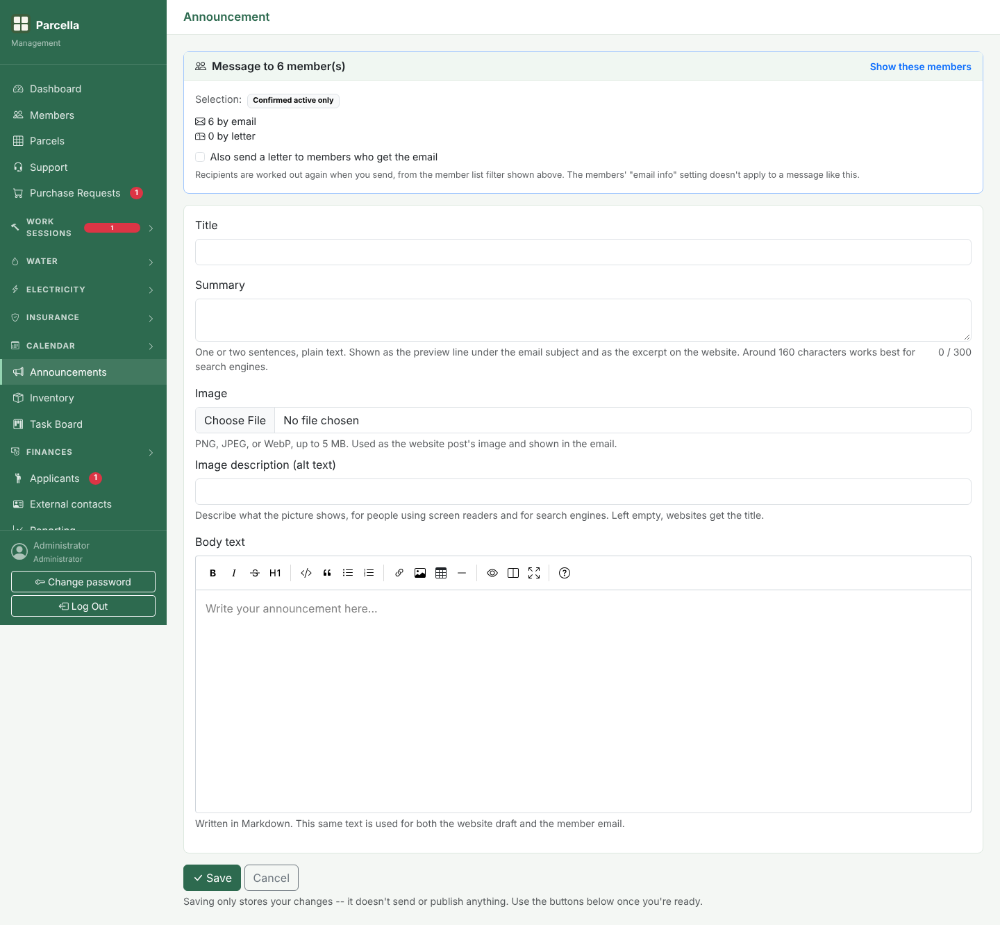

# Ogłoszenia {#announcements}

!!! note "Tłumaczenie maszynowe"
    Ta strona została przetłumaczona maszynowo z języka angielskiego i nie została jeszcze sprawdzona. Jeśli coś jest niejasne, obowiązuje wersja angielska (język zmienisz u góry).

Napisz wiadomość raz i wyślij ją nawet czterema kanałami: e-mailem, jako
szkic wpisu na stronie stowarzyszenia, jako jednostronicowe ogłoszenie
do wydruku i powieszenia w ogrodzie oraz jako osobiste listy do kopert z
okienkiem. Dotyczy to aktualności stowarzyszenia, a także wiadomości do
wybranych członków, do dzierżawców działek lub do kandydatów (kandydaci
nie dostają listów, bo nie zapisuje się dla nich adresu pocztowego).

!!! info "Kto może z tego korzystać"
    - Przełącznik modułu to **Ogłoszenia** w **Administracja → Włączanie
      i wyłączanie modułów**. Domyślnie jest **wyłączony**, bo może
      wysłać e-mail do każdego członka i przechowuje dane logowania do
      Twojej strony internetowej.
    - Tylko role **Zarząd** i **Administrator** oraz członkowie grupy z
      **Pełny dostęp do każdego modułu** widzą **Ogłoszenia** w menu i
      mogą z nich korzystać. Nie ma uprawnienia grupy, które dawałoby
      dostęp innym użytkownikom.
    - Kanał strony internetowej wymaga połączenia ze stroną w
      **Administracja → Integracje → Strona internetowa (szkice z
      ogłoszeń)**. Zob. [Integracje](../administration/integrations.md).

## Trzy rodzaje ogłoszeń {#three-kinds-of-announcement}

| Rodzaj | Jak go zacząć | Kanały |
|---|---|---|
| Aktualności stowarzyszenia | **Nowe ogłoszenie** na liście ogłoszeń. | E-mail, szkic na stronie, ogłoszenie do druku, listy |
| Wiadomość do przefiltrowanych członków | **Napisz do tych członków ({count})** na przefiltrowanej [liście członków](members.md) albo zaznacz członków i kliknij **Napisz do zaznaczonych**. | E-mail, szkic na stronie, ogłoszenie do druku, listy |
| Zawiadomienie do dzierżawców wybranych działek | Zaznacz działki na [liście działek](parcels.md#picking-parcels) i kliknij **Napisz do dzierżawców**. Dotyczy dzierżawy, nie członkostwa: jedno zawiadomienie na działkę, z jej nazwą; e-mail tylko do dzierżawców, którzy się na to zgadzają, dla pozostałych jeden list na adres. | E-mail, szkic na stronie, ogłoszenie do druku, listy |
| Wiadomość do wybranych kandydatów | Zaznacz kandydatów na [liście kandydatów](applicants.md) i kliknij **Napisz do zaznaczonych kandydatów**. | E-mail, szkic na stronie, ogłoszenie do druku |

Wszystkie pisze się w tym samym formularzu i wyświetla na tej samej
stronie.

## Lista ogłoszeń {#announcement-list}

Otwórz **Ogłoszenia** w menu. Lista pokazuje wszystkie ogłoszenia, od
najnowszych.

| Kolumna / przycisk | Co pokazuje |
|---|---|
| **Nowe ogłoszenie** | Otwiera pusty formularz aktualności stowarzyszenia. |
| Obraz | Obraz ogłoszenia jako miniatura albo ikona megafonu, jeśli go nie ma. |
| **Tytuł** | Tytuł, z linkiem do strony edycji. Oznaczenie wskazuje wiadomości **Wybrani członkowie** lub **Kandydaci**. |
| **Kanały** | Jedna ikona na kanał: koperta (e-mail), glob (strona), drukarka (ogłoszenie do druku) i skrzynka pocztowa (listy; nie dla kandydatów). Zielony oznacza **wykonano**, czerwony **niepowodzenie**, niebieski **wysyłanie**, szary **jeszcze nie**. Najedź na ikonę, aby odczytać jej stan. |
| **Utworzono** | Data utworzenia ogłoszenia. |
| Ołówek | Otwiera stronę edycji. |

Gdy nie ma jeszcze ogłoszeń, lista mówi **Brak ogłoszeń.**

Nie ma ogólnego statusu „szkic / opublikowane”. To, co poszło gdzie,
jest śledzone tylko dla każdego kanału osobno.

## Pisanie ogłoszenia {#writing-an-announcement}

Formularz jest taki sam dla nowych i istniejących ogłoszeń.

| Pole / przycisk | Do czego służy |
|---|---|
| **Tytuł** | Wymagany. Używany jako temat e-maila, tytuł wpisu i nagłówek ogłoszenia do druku. |
| **Streszczenie** | Opcjonalne, zwykły tekst, do 300 znaków. Pokazywane jako linia podglądu pod tematem e-maila i jako zajawka na stronie. Licznik pokazuje, ile znaków użyto; powyżej 160 zmienia kolor na pomarańczowy, bo mniej więcej tyle pokazują wyszukiwarki. |
| **Obraz** | Opcjonalny. PNG, JPEG lub WebP, do 5 MB. Używany jako obraz wpisu na stronie, pokazywany w e-mailu i na ogłoszeniu do druku. Większy plik jest od razu odrzucany, a **Zapisz** jest nieaktywne, dopóki nie wybierzesz innego. |
| **Usuń obraz** | Widoczne dopiero po zapisaniu obrazu. Zaznacz i zapisz, aby go usunąć. |
| **Opis obrazu (tekst alternatywny)** | Opcjonalny, do 255 znaków. Opisz, co przedstawia obraz, dla osób korzystających z czytników ekranu i dla wyszukiwarek. Jeśli zostanie pusty, strony dostają tytuł. |
| **Treść** | Wymagana. Pisana w Markdownie. Ta sama treść jest używana dla szkicu na stronie i e-maila do członków. |
| **Wersja do druku (opcjonalnie)** | Tylko w ogłoszeniu, które zostało raz zapisane. Zob. [Ogłoszenie do druku](#the-printed-notice). |
| **Kod QR do wpisu na stronie** | W tym samym miejscu co wersja do druku. Zob. [Ogłoszenie do druku](#the-printed-notice). |
| **Zapisz** | Zapisuje zmiany i otwiera stronę edycji. Zapis tylko przechowuje zmiany -- niczego nie wysyła ani nie publikuje. |
| **Anuluj** | Powrót do listy bez zapisywania. |

Jeśli brakuje tytułu lub treści, formularz pokazuje **Podaj tytuł i
treść.** i zachowuje to, co wpisałeś.

### Edytor tekstu {#the-text-editor}

Pole **Treść** to edytor Markdown z paskiem narzędzi: pogrubienie,
kursywa, przekreślenie, nagłówek, kod, cytat, listy wypunktowane i
numerowane, link, obraz, tabela i linia pozioma. Ikona oka przełącza na
podgląd, ikona podziału pokazuje tekst i podgląd obok siebie, a
strzałki otwierają edytor na pełnym ekranie. Znak zapytania otwiera
krótki przewodnik po Markdownie w nowej karcie.

Przycisk obrazu wstawia obraz *po jego adresie internetowym*; nie
przesyła pliku. Główny obraz ogłoszenia ustawiaj w polu **Obraz**.

## Strona edycji {#the-edit-page}

Po pierwszym zapisie trafiasz na stronę edycji. Ma formularz z góry, a
pod nim jeszcze trzy karty.

### Wyślij e-mail testowy {#send-a-test-email}

Wysyła bieżącą treść na jeden adres do sprawdzenia. Nigdy nie liczy się
jako prawdziwa wysyłka i nigdy nie trafia do członków. Wpisz adres i
kliknij **Wyślij test**. E-mail testowy ma widoczną notkę, że to test.

Strona pokazuje potem **E-mail testowy wysłany pomyślnie** z adresem albo
**Nie udało się wysłać e-maila testowego -- sprawdź konfigurację SMTP w
Admin -> Ustawienia.**

!!! tip
    Najpierw zapisz. Test używa zapisanej treści, a nie tego, co jest
    jeszcze w formularzu.

### Kanały dystrybucji {#delivery-channels}

Każdy kanał ma wiersz ze statusem i, gdy jest coś do zrobienia, jednym
przyciskiem. Każdy kanał jest wykonywany raz. Po zmianie treści i
zapisaniu wpis na stronie i PDF można zaktualizować; e-mail jest
wysyłany tylko raz.

| Status | Znaczenie |
|---|---|
| **Jeszcze nie wysłano** | Na tym kanale nic się jeszcze nie wydarzyło. |
| **Wysłano** / **PDF wygenerowany** | Wykonano, z datą i godziną. |
| **Wysyłanie...** | E-mail właśnie wychodzi. |
| **Niepowodzenie** / **Za długie na jedną stronę** | Ostatnia próba się nie udała. Przyczyna jest pokazana pod spodem, a przycisk jest ponownie dostępny do ponowienia. |
| **Treść zmieniona od tego czasu.** | Edytowałeś ogłoszenie po wykonaniu tego kanału. |

#### E-mail do członków {#member-email}

**Wyślij teraz** wysyła ogłoszenie do wszystkich obecnych członków z
włączonymi powiadomieniami e-mail (ustawienie „informacje e-mail” przy
członku). Dostają je członkowie, których członkostwo trwa, niezależnie
od tego, czy mają działkę. Członkowie bez adresu e-mail są pomijani.

Najpierw potwierdzasz: **Wysłać to ogłoszenie e-mailem do wszystkich
obecnych członków z włączonymi powiadomieniami e-mail? Można to zrobić
tylko raz.**

- E-maile wychodzą małymi partiami z przerwą między nimi, aby nie
  zalać serwera pocztowego. Dla kilkuset członków trwa to kilkadziesiąt
  minut. Możesz opuścić stronę; wysyłka trwa dalej.
- W trakcie wiersz pokazuje **Wysyłanie...** i bieżący licznik.
  Odśwież stronę, aby zobaczyć najnowszy stan.
- Jeśli niektóre adresy zawiodą, kanał i tak pokazuje **Wysłano**, z
  odnotowaną liczbą niepowodzeń. Jeśli nie udało się wysłać ani jednego
  e-maila, pokazuje **Niepowodzenie** i możesz spróbować ponownie.
- Po wysłaniu przycisk nigdy nie wraca, nawet po edycji. Jeśli później
  zmienisz tekst, strona mówi **Treść zmieniono po wysłaniu e-maila.
  Członkowie otrzymali wcześniejszą wersję.**

#### Szkic na stronie {#website-draft}

Obok **Szkic na stronie** widzisz, która strona jest podłączona:
**WordPress**, **Folder Markdown (chmura)** lub **Wtyczka Parcella
(TYPO3, Contao, Drupal, Joomla, ...)**.

- **Utwórz szkic** wysyła tytuł, tekst, streszczenie i obraz na stronę
  jako nieopublikowany szkic. Parcella nigdy niczego nie publikuje; to
  pozostaje Twoją decyzją w panelu administracyjnym strony.
- Po udanym wysłaniu **Otwórz szkic** prowadzi do szkicu w edytorze
  Twojej strony (WordPress, wtyczki). Dla folderu Markdown pokazywana
  jest zamiast tego ścieżka pliku; publikujesz, usuwając z pliku wiersz
  `draft: true`.
- Po zmianie tytułu, tekstu, streszczenia lub obrazu i zapisaniu
  przycisk zmienia się na **Aktualizuj szkic na stronie**. Nadpisuje ten
  sam wpis zamiast tworzyć drugi i zachowuje jego status publikacji,
  więc opublikowany wpis pozostaje opublikowany. Najpierw potwierdzasz,
  bo zmiany tekstu wprowadzone bezpośrednio na stronie przepadną.
- Jeśli wpis został w międzyczasie usunięty na stronie, tworzony jest
  nowy szkic.
- Bez połączenia ze stroną próba kończy się komunikatem „No website is
  set up yet -- choose one under Admin -> Integrations -> Website.” (ten
  komunikat nie jest jeszcze przetłumaczony).

#### PDF do druku {#printable-pdf}

**Generuj PDF** tworzy jednostronicowe ogłoszenie i je pobiera. Zob.
[Ogłoszenie do druku](#the-printed-notice). Potem wiersz oferuje
**Pobierz** dla zapisanego PDF. **Generuj PDF** wraca, gdy zmienisz
tytuł, tekst, wersję do druku, ustawienie QR lub obraz albo gdy
ogłoszenie zostało skrócone bez kodu QR, a wpis na stronie mógł w
międzyczasie zostać opublikowany.

### Usuń ogłoszenie {#delete-announcement}

Trwale usuwa to ogłoszenie, niezależnie od tego, co już zostało
wysłane. Najpierw potwierdzasz: **Czy na pewno usunąć to ogłoszenie? Tej
operacji nie można cofnąć.** Obraz i zapisany PDF do druku są usuwane
razem z nim. Już wysłane e-maile i już utworzone wpisy na stronie nie
są ruszane.

## Ogłoszenie do druku {#the-printed-notice}

Kanał **PDF do druku** tworzy jedną stronę A4 na tablicę ogłoszeń, z
nagłówkiem stowarzyszenia, obrazem, tytułem, wierszem „Opublikowano
<data> przez: <imię i nazwisko>” (data wygenerowania PDF i nazwisko
autora) oraz tekstem.

| Pole | Do czego służy |
|---|---|
| **Wersja do druku (opcjonalnie)** | Zostaw puste, aby wydrukować pełny tekst z góry. Jeśli nie mieści się na jednej stronie, tutaj zostanie zaproponowana skrócona wersja -- możesz ją dowolnie edytować. Pod nią formularz mówi **Mieści się na jednej stronie wydruku.** albo **Prawdopodobnie za długie na jedną stronę -- rozważ skrócenie.** Edytor jest taki sam jak dla treści, bez przycisku obrazu. |
| **Kod QR do wpisu na stronie** | Drukuje kod QR do wpisu na stronie, nawet jeśli tekst mieści się na jednej stronie, dla tekstu do druku, który jest tylko zajawką. Domyślnie wyłączone. |

Co się dzieje po **Generuj PDF**:

1. Parcella próbuje wersji do druku albo, jeśli jest pusta, pełnego
   tekstu.
2. Jeśli mieści się na jednej stronie, gotowe.
3. Jeśli nie, usuwa akapity od końca, aż się zmieści, i dodaje kod QR z
   „Przeczytaj całe ogłoszenie online:”. Skrócony tekst jest zapisywany
   w **Wersja do druku (opcjonalnie)**, abyś mógł go sprawdzić i
   poprawić.
4. Jeśli nawet jeden akapit nie mieści się obok obrazu i nagłówka, PDF
   nie powstaje. Kanał pokazuje **Za długie na jedną stronę** i musisz
   sam skrócić wersję do druku.

Kod QR prowadzi do krótkiego linku w Parcelli, a nie bezpośrednio do
wpisu. Gdy tylko wpis zostanie opublikowany na Twojej stronie, link tam
przekierowuje. Do tego czasu każdy, kto go zeskanuje, widzi małą stronę
z tekstem **To ogłoszenie nie jest jeszcze na stronie. Spróbuj ponownie
później.** -- bez tytułu ani żadnych innych szczegółów. Możesz więc
wydrukować i powiesić ogłoszenie, zanim wpis zostanie opublikowany. Bez
połączenia ze stroną w ogóle nie ma kodu QR.

Jeśli skrócone ogłoszenie zostało wydrukowane, gdy wpis był jeszcze
szkicem, strona zaznacza **Tekst skrócono bez kodu QR, ponieważ wpis na
stronie nie był jeszcze publiczny. Po jego opublikowaniu utwórz PDF
ponownie, aby dodać kod QR.**

!!! tip "Zapisywanie PDF w chmurze"
    Przy włączonym module magazynu w chmurze i ustawionym **Folder na
    drukowane ogłoszenia** w **Administracja → Integracje** każdy
    wygenerowany PDF jest też tam zapisywany, z nazwą od tytułu i daty.
    Drugi PDF tego samego dnia zastępuje plik z tego dnia. Jeśli
    przesłanie się nie uda, i tak dostajesz pobranie; niepowodzenie jest
    odnotowywane przy kanale.

## Wiadomości do przefiltrowanych członków {#messages-to-filtered-members}

Używaj tego do wiadomości organizacyjnych do części stowarzyszenia:
„wszyscy z tagiem *odpowiedzialny za wodę*”, „wszyscy oczekujący
członkowie”.

1. Na [liście członków](members.md) przefiltruj listę (wyszukiwanie,
   tag, pola wyboru). Potem kliknij **Napisz do tych członków ({count})**
   albo zaznacz pojedynczych członków i kliknij **Napisz do
   zaznaczonych**.
2. Otwiera się formularz ogłoszenia z kartą **Wiadomość do członków:
   {count}** nad nim.

Karta pokazuje:

| Element | Co pokazuje |
|---|---|
| **Wybór:** | Filtr, na którym opiera się wiadomość, jako oznaczenia: tag, tekst wyszukiwania, **Pokaż tylko nieaktywnych**, **Tylko potwierdzeni aktywni**, **Tylko z informacją e-mail = tak**, „Ręcznie wybrano: {count}”. |
| **Pokaż tych członków** | Otwiera listę członków z tym filtrem. |
| „E-mailem: {count}” | Członkowie, którzy zgadzają się na informacje e-mailem (**Może otrzymywać informacje e-mailem**) i mają adres. |
| „Listownie: {count}” | Listy dla pozostałych członków z adresem pocztowym -- jeden na adres, więc członkowie mieszkający razem dzielą jeden. Po tym ich nazwiska. |
| „Nieosiągalni: {count} (brak zgody lub adresu e-mail, brak adresu pocztowego)” | Pokazywane na czerwono, z linkami do członków, abyś mógł poprawić ich rekordy. |
| **Wyślij list także członkom, którzy dostaną e-mail** | Zaznacz, aby wysłać list do każdego członka z adresem pocztowym, nie tylko do tych bez e-maila. |

Odbiorcy są ustalani ponownie przy wysyłce, na podstawie filtra listy
członków pokazanego powyżej. Ktoś, kto dostanie tag jutro, jest
uwzględniony w jutrzejszych listach. Ręcznie wybrani członkowie, którzy
przestali pasować do filtra, odpadają.

!!! note "E-mail tylko za zgodą"
    Wiadomość do członków idzie e-mailem tylko do członków, którzy
    zgadzają się na informacje e-mailem. Wszyscy pozostali z adresem
    pocztowym dostają list -- także wtedy, gdy ktoś, z kim mieszkają,
    dostał e-mail, bo każdy członek jest zapraszany osobiście. Członkowie
    bez zgody pod wspólnym adresem dostają **jeden** list wymieniający
    ich wszystkich. Rozpoczęcie od nieprzefiltrowanej listy członków
    tworzy zamiast tego zwykłe aktualności stowarzyszenia.

Kanały to **E-mail do członków** (wysyłany raz, jak wyżej, po
potwierdzeniu **Wysłać teraz tę wiadomość e-mailem do członków:
{count}? Tego nie można cofnąć.**) oraz **Listy**:

- **Utwórz listy: {count}** tworzy jeden PDF z listem na każdy adres
  pocztowy, ułożony do kopert z okienkiem (DIN 5008 formularz B, ze
  znacznikami zgięcia), z tytułem i treścią jak w e-mailu. Nie jest
  dodawane powitanie ani obraz.
- Listy są generowane po kliknięciu i nigdy nie są przechowywane, bo
  zawierają nazwiska i adresy. Możesz je wygenerować ponownie w
  dowolnym momencie.

Szkic na stronie i ogłoszenie do druku są dostępne jak przy
aktualnościach stowarzyszenia. Listy przy aktualnościach stowarzyszenia
trafiają do każdego aktywnego członka bez zgody na e-mail, który ma
adres pocztowy, jeden na adres (albo do wszystkich przy **Wyślij list
także członkom, którzy dostaną e-mail**).

## Wiadomości do wybranych kandydatów {#messages-to-selected-applicants}

Na [liście kandydatów](applicants.md) zaznacz kandydatów i kliknij
**Napisz do zaznaczonych kandydatów**. Formularz pokazuje kartę
**Wiadomość na {count} adres(y) kandydatów** z nazwiskami kandydatów (z
linkami) i **Pokaż kandydatów**.

- Jeśli kilka wybranych zgłoszeń ma ten sam adres e-mail, ten adres
  dostaje wiadomość tylko raz; karta mówi, ile połączono.
- Tylko e-mail. Wybór jest stały: kandydaci zaznaczeni później nie są
  dodawani.
- Potrzebujesz też dostępu do modułu kandydatów.
- **Wyślij teraz** pyta **Wysłać teraz tę wiadomość e-mailem na {count}
  adres(y) kandydatów? Tego nie można cofnąć.**

## Strona „jeszcze nie online” {#the-not-online-yet-page}

To publiczna strona, którą ludzie widzą, gdy zeskanują kod QR z
wydrukowanego ogłoszenia, zanim wpis zostanie opublikowany, albo gdy
link jest nieznany. Pokazuje tylko logo i nazwę Twojego stowarzyszenia
oraz zdanie **To ogłoszenie nie jest jeszcze na stronie. Spróbuj
ponownie później.**

## Powiązane {#related}

- [Integracje](../administration/integrations.md) -- podłączenie strony
  internetowej i folderu w chmurze na drukowane ogłoszenia.
- [Członkowie](members.md) -- ustawienie „informacje e-mail”, tagi i
  rozpoczęcie wiadomości do przefiltrowanych członków.
- [Kandydaci](applicants.md) -- pisanie do wybranych kandydatów.
- [Dziennik e-maili](../administration/email-log.md)
- [Włączanie i wyłączanie modułów](../administration/modules.md)
