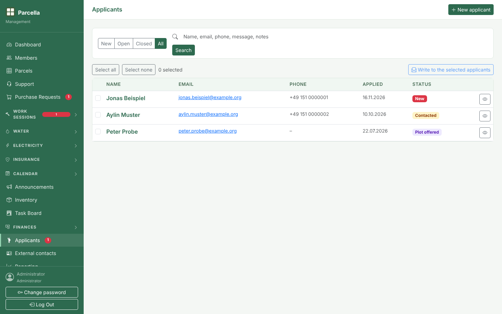
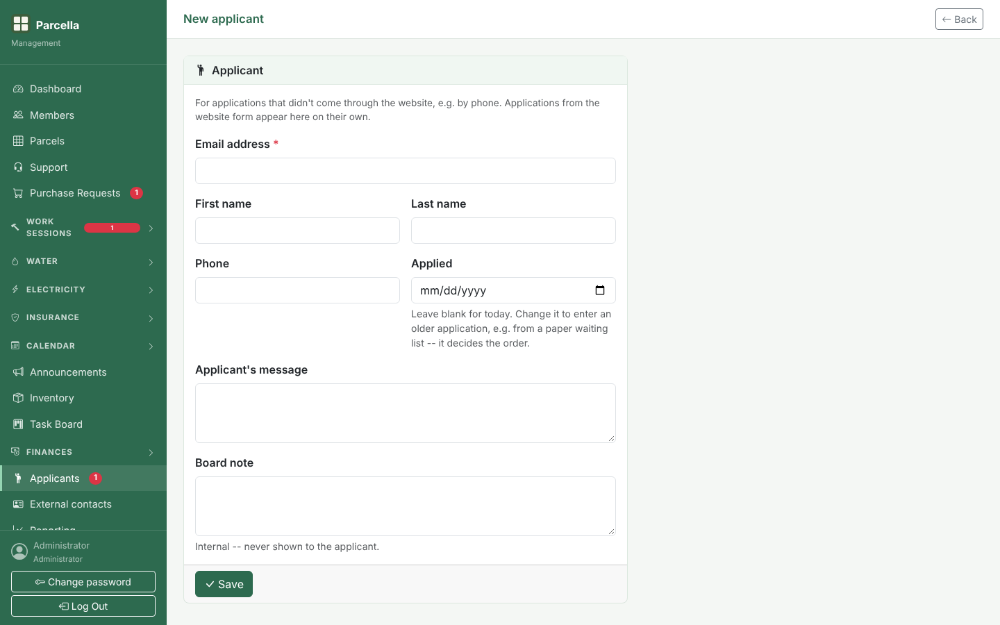

# Bewerber {#applicants}

Die Bewerberliste ist die Warteliste deines Vereins für freie Gärten.
Bewerbungen aus dem Formular auf deiner Website kommen von selbst an;
Bewerbungen per Telefon oder auf Papier kannst du auch selbst erfassen. Du
hältst fest, wen du kontaktiert und wem du einen Garten angeboten hast, und
wird ein Garten frei, übergibst du ihn -- der Bewerber wird in einem Schritt
Mitglied und neuer Pächter.

Bewerber sind absichtlich von der Mitgliederliste getrennt. Die meisten
Bewerber bekommen nie einen Garten; ihre Daten dürfen deshalb nicht in
Mitgliederzahlen, Rechnungen, Arbeitsstunden oder Mitteilungen landen.

!!! info "Wer das nutzen kann"
    Das Modul **Bewerber** ist standardmäßig eingeschaltet. Es lässt sich
    unter [Module ein- und ausschalten](../administration/modules.md)
    abschalten.

    - **Sehen** der Liste und der Bewerbungen braucht das Recht *Lesen* bei
      **Bewerber**.
    - **Erfassen** eines Bewerbers, **Bearbeiten** von Kontaktdaten, Status
      und Vorstandsnotiz sowie das **Kontaktieren** eines neuen Bewerbers
      braucht das Recht *Schreiben*.
    - **Endgültiges Löschen** eines Bewerbers braucht das Recht *Löschen*.
    - **Parzelle zuweisen** braucht das Recht *Schreiben* bei **Bewerber**
      und bei **Mitglieder & Parzellen**.

    Vorstandsmitglieder und Administratoren haben all das. Eine Gruppe kann
    es anderen geben, z. B. wer sich um die Gartenvergabe kümmert (siehe
    [Gruppen](../administration/groups.md)).

    Bewerbungen von deiner Website kommen nur an, solange das eigene Modul
    **Öffentliche Bewerbungsformular-API** eingeschaltet ist. Es ist
    standardmäßig aus, weil damit Personen außerhalb des Vereins in
    Parcella schreiben können. Siehe
    [Bewerbungen von deiner Website](#applications-from-your-website).

## Wo du neue Bewerbungen bemerkst {#where-you-notice-new-applications}

- Der Eintrag **Bewerber** im Hauptmenü zeigt eine rote Zahl: die
  Bewerbungen, die sich noch niemand angesehen hat (Status **Neu**). Sie
  verschwindet, sobald jede neue Bewerbung in einen anderen Status
  weitergesetzt ist.
- Das [Dashboard](../getting-started/dashboard.md) hat eine Karte **Neue
  Bewerbungen** mit derselben Zahl, „noch nicht bearbeitet“. Sie öffnet
  die Liste, gefiltert auf neue Bewerbungen.

Parcella schickt dem Vorstand bei einer neuen Bewerbung keine E-Mail -- die
Zahl im Menü und auf dem Dashboard ist das Signal.

## Status {#statuses}

Jede Bewerbung durchläuft diese Status. Du setzt sie auf der
[Bewerbungsseite](#application-page); nur **Abgeschlossen (Garten
vergeben)** setzt Parcella selbst.

| Status | Bedeutung |
|---|---|
| **Neu** | Gerade angekommen; noch niemand hat sie angesehen. |
| **Kontaktiert** | Der Vorstand hat sich gemeldet -- z. B. die erste E-Mail geschickt. Der Bewerber steht auf der Warteliste. |
| **Garten angeboten** | Ein Garten wurde angeboten. |
| **Angenommen** | Der Bewerber möchte den angebotenen Garten; die Übergabe wird noch organisiert. |
| **Abgelehnt** | Der Verein hat abgesagt, oder der Bewerber möchte keine weiteren Angebote. |
| **Abgeschlossen (Garten vergeben)** | Der Bewerber hat über **Parzelle zuweisen** eine Parzelle bekommen. |

**Neu**, **Kontaktiert**, **Garten angeboten** und **Angenommen** zählen als
*offen*. Lehnt ein Bewerber ein Angebot ab, möchte aber auf der Warteliste
bleiben, setz ihn zurück auf **Kontaktiert**. Möchte er keine weiteren
Angebote, setz **Abgelehnt**.

## Bewerberliste {#applicant-list}

Öffne **Bewerber** im Hauptmenü. Die Liste zeigt die Bewerbungen, das
jüngste Bewerbungsdatum zuerst.

### Filter und Suche {#filter-and-search}

| Feld / Schaltfläche | Was es bewirkt |
|---|---|
| **Neu** | Nur Bewerbungen mit Status **Neu**. Erscheint nur, solange es neue Bewerbungen gibt -- und dann öffnet die Liste mit diesem Filter. |
| **Offen** | Bewerbungen mit **Neu**, **Kontaktiert**, **Garten angeboten** oder **Angenommen**. Die Liste öffnet mit diesem Filter, wenn es keine neuen Bewerbungen gibt. |
| **Abgeschlossen** | Bewerbungen mit **Abgeschlossen (Garten vergeben)** oder **Abgelehnt**. |
| **Alle** | Jede Bewerbung. |
| **Name, E-Mail, Telefon, Nachricht, Notizen…** | Durchsucht Vor- und Nachname, E-Mail-Adresse, Telefonnummer, die Nachricht des Bewerbers und die Vorstandsnotiz. Lässt sich mit den Filter-Schaltflächen kombinieren. Weil die Vorstandsnotiz durchsucht wird, findet eine dort notierte Ticketnummer den Bewerber. |
| **Suchen** | Wendet die Suche an. |
| **Zurücksetzen** | Hebt die Suche auf, behält die Filter-Schaltfläche. |

### Spalten {#columns}

| Spalte | Was sie zeigt |
|---|---|
| Kästchen | Wählt den Bewerber für **An ausgewählte Bewerber schreiben** (siehe unten). |
| **Name** | Vor- und Nachname oder die E-Mail-Adresse, wenn kein Name angegeben ist. Ein Klick öffnet die Bewerbung. |
| **E-Mail** | Ein Klick öffnet dein eigenes E-Mail-Programm. |
| **Telefon** | |
| **Beworben am** | Das Bewerbungsdatum. Es bestimmt die Reihenfolge der Warteliste. |
| **Status** | Siehe [Status](#statuses). |
| Augen-Schaltfläche | Öffnet die Bewerbung. |

Neben dem Namen können zwei Arten von Badges erscheinen:

- **2×**, **3×** … -- diese E-Mail-Adresse hat sich mehrfach beworben.
  Parcella führt wiederholte Bewerbungen nicht zusammen; jede bleibt ein
  eigener Eintrag, damit keine Nachricht verloren geht. Du entscheidest,
  was damit passiert. Die Bewerbungsseite listet die anderen.
- **Rote Liste** -- Name, E-Mail-Adresse oder Telefonnummer des Bewerbers
  passen zu einem [externen Kontakt](external-contacts.md) mit dem
  Rote-Liste-Schlagwort deines Vereins. Fahr mit der Maus über das Badge,
  um zu sehen, welcher Kontakt und welche Angaben passen. Solange das
  Modul Externe Kontakte aus ist, gibt es keine Rote Liste.

### An ausgewählte Bewerber schreiben {#writing-to-selected-applicants}

Solange das Modul **Mitteilungen** eingeschaltet ist, sehen
Vorstandsmitglieder und Administratoren in jeder Zeile ein Kästchen.

| Schaltfläche | Was sie bewirkt |
|---|---|
| **Alle auswählen** | Hakt jeden Bewerber an, den aktueller Filter und Suche zeigen. |
| **Keine auswählen** | Entfernt alle Häkchen. |
| ***N* ausgewählt** | Zählt die angehakten Bewerber. |
| **An ausgewählte Bewerber schreiben** | Beginnt eine neue [Mitteilung](announcements.md) an die angehakten Bewerber. Sie geht nur per E-Mail raus, einmal je Adresse -- wer sich zweimal beworben hat, bekommt eine E-Mail. Deaktiviert, bis du jemanden anhakst. |

### Einen Bewerber von Hand erfassen {#adding-an-applicant-by-hand}

**Bewerber erfassen** (oben rechts, braucht Schreibrecht) öffnet das
Formular [Bewerber erfassen](#new-applicant).

## Bewerber erfassen {#new-applicant}

Für Bewerbungen, die nicht über die Website kamen -- per Telefon, per Brief
oder von einer alten Warteliste auf Papier. Bewerbungen aus dem
Website-Formular erscheinen von selbst in der Liste.

| Feld | Was es bewirkt |
|---|---|
| **E-Mail-Adresse** \* | Pflicht -- das einzige Pflichtfeld. Muss eine gültige E-Mail-Adresse sein, sonst „Bitte eine gültige E-Mail-Adresse eingeben.“ |
| **Vorname** / **Nachname** | Hier freiwillig, aber nötig, bevor du eine Parzelle zuweisen kannst. |
| **Telefon** | |
| **Beworben am** | Das Bewerbungsdatum. „Leer lassen für heute. Für ältere Bewerbungen, z. B. von einer Warteliste auf Papier, hier das ursprüngliche Datum eintragen -- es bestimmt die Reihenfolge.“ Ein Datum in der Zukunft wird abgelehnt. |
| **Nachricht des Bewerbers** | Was der Bewerber geschrieben oder dir erzählt hat. |
| **Notiz des Vorstands** | „Intern -- wird dem Bewerber nie angezeigt.“ |

Klick auf **Speichern**. Die Bewerbung beginnt mit Status **Neu**, ihre
Herkunft ist **Von Hand erfasst** (mit deinem Namen), und sie hat kein Datum
der Datenschutz-Einwilligung -- das wird nur bei Bewerbungen von der Website
festgehalten. **Zurück** führt ohne Speichern zur Liste zurück.

## Bewerbungsseite {#application-page}

Ein Klick auf einen Bewerber in der Liste öffnet seine Bewerbung.

Passt der Bewerber zu einem externen Kontakt auf der Roten Liste, nennt ein
roter Kasten **Rote Liste** oben den Kontakt und die passenden Angaben
(Name, E-Mail, Telefon). Wer externe Kontakte sehen darf, kann zum Kontakt
durchklicken.

### Bewerbung {#application}

Die linke Karte enthält alles, was du bearbeiten kannst.

| Feld | Was es bewirkt |
|---|---|
| **Status** | Siehe [Status](#statuses). Jede Änderung wird im **Statusverlauf** festgehalten. |
| **E-Mail-Adresse** \*, **Vorname**, **Nachname**, **Telefon** | Die Kontaktdaten des Bewerbers. |
| **Beworben am** | Das Bewerbungsdatum. Ändere es, um eine Bewerbung an ihren richtigen Platz in der Warteliste zu bringen, z. B. beim Erfassen einer alten Papierbewerbung. Eine Änderung steht im Statusverlauf, weil sie den Bewerber nach oben oder unten rückt. Künftige Daten werden abgelehnt. |
| **Nachricht des Bewerbers** | Der Text, den der Bewerber geschickt hat. |
| **Notiz des Vorstands** | Interne Notizen, die der Bewerber nie sieht -- z. B. „am 3. Mai angerufen, möchte einen kleinen Garten“. |

Mit **Speichern** sicherst du deine Änderungen. Ohne Schreibrecht siehst du
die Daten, kannst aber nicht speichern. Änderungen an Kontaktdaten und
Vorstandsnotiz stehen nicht im Verlauf.

### Schaltflächen oben {#buttons-at-the-top}

| Schaltfläche | Was sie bewirkt |
|---|---|
| **Zurück** | Führt zur Bewerberliste zurück. |
| **Löschen** | Löscht die Bewerbung endgültig nach der Bestätigung „Diesen Bewerber endgültig löschen? Das lässt sich nicht rückgängig machen.“ Ihr Statusverlauf geht mit. Braucht Löschrecht. |

!!! info "Warum sich Bewerber endgültig löschen lassen"
    Fast alles andere in Parcella behält seinen Verlauf. Bewerber sind die
    Ausnahme: Ihre Daten werden nur für die Bewerbung gehalten, also musst
    du sie vollständig entfernen können -- wenn jemand darum bittet oder
    sobald die Bewerbung vorbei ist. Dein Verein kann alte Bewerbungen auch
    automatisch löschen lassen; siehe
    [Automatisches Löschen](#automatic-deletion).

### Bewerber kontaktieren {#contact-applicant}

Erscheint nur bei einer **neuen** Bewerbung, für Benutzer mit Schreibrecht.
Es ist der erste Schritt im Ablauf: eine Dankes-E-Mail, die bestätigt, dass
der Bewerber auf der Warteliste steht.

| Feld / Schaltfläche | Was es bewirkt |
|---|---|
| **An:** | Die E-Mail-Adresse des Bewerbers. |
| **Betreff:** | „Vielen Dank für Deine Anmeldung auf unserer Warteliste!“ (in der Sprache, in der du Parcella nutzt). |
| Nachricht | Der Text der E-Mail, fertig zum Bearbeiten. Name des Bewerbers und Name des Vereins sind schon eingesetzt. |
| **Senden** | Schickt den Text nach deiner Bestätigung an den Bewerber und setzt den Status auf **Kontaktiert**. |

Nach dem Senden sagt ein grüner Hinweis „Die E-Mail wurde gesendet und der
Status auf „Kontaktiert“ gesetzt.“ Der Kasten verschwindet dann, weil die
Bewerbung nicht mehr neu ist.

Lässt sich die E-Mail nicht senden, ändert sich nichts: Der Status bleibt
**Neu**, dein bearbeiteter Text bleibt im Kasten, und du siehst „Die E-Mail
konnte nicht gesendet werden – bitte prüfe die SMTP-Einstellungen. Der
Status wurde nicht geändert.“ Bring die E-Mail-Einstellungen in Ordnung und
versuch es noch einmal.

Der Ausgangstext stammt aus **Text der E-Mail an neue Bewerber** in den
[Vereinseinstellungen](../administration/settings.md) → **Bewerber**. Ist
er leer, nimmt Parcella seinen eingebauten Text in der Sprache, in der du
Parcella nutzt. Bewerber haben keine eigene Spracheinstellung; schreibt dein
Verein seinen eigenen Text, dann in der Sprache, die deine Bewerber
sprechen.

!!! note
    Parcella behält keine Kopie der E-Mail. Nur der Statuswechsel auf
    **Kontaktiert** zeigt, dass sie rausging.

### Parzelle zuweisen {#assign-a-parcel}

Erscheint nur bei einer offenen Bewerbung, für Benutzer mit Schreibrecht bei
**Bewerber** und bei **Mitglieder & Parzellen**. **Parzelle zuweisen**
übergibt eine gekündigte Parzelle an den Bewerber -- siehe
[Parzelle zuweisen](#assign-a-parcel_1) unten.

### Details {#details}

| Zeile | Was sie zeigt |
|---|---|
| **Beworben am** | Das Bewerbungsdatum. |
| **Herkunft** | **Website-Formular** oder **Von Hand erfasst** mit dem Namen des Benutzers, der sie erfasst hat. |
| **Datenschutz-Einwilligung (Bewerber)** | Wann der Bewerber das Datenschutz-Kästchen im Website-Formular angehakt hat. Leer bei von Hand erfassten Bewerbungen. Das ist die Einwilligung des Bewerbers -- keine Zustimmung des Vorstands. |
| **Status geändert** | Wann sich der Status zuletzt geändert hat. |

Alle Daten erscheinen ohne Uhrzeit.

### Weitere Bewerbungen dieser Adresse {#other-applications-from-this-address}

Erscheint nur, wenn sich dieselbe E-Mail-Adresse mehrfach beworben hat.
Listet die anderen Bewerbungen mit Datum und Status; ein Klick auf ein Datum
öffnet eine davon.

### Vorgänge {#processes}

Ist das Modul [Vorgänge](processes.md) eingeschaltet und darfst du Vorgänge
sehen, listet eine Karte **Vorgänge** die Vorgänge zu diesem Bewerber.
**Vorgang starten** beginnt einen neuen.

### Statusverlauf {#status-history}

Jede Statusänderung und jede Änderung des Bewerbungsdatums, mit Datum,
Uhrzeit und dem Benutzer, der sie gemacht hat -- die neueste zuerst.
Änderungen, die Parcella selbst macht (eine Übergabe), stehen hier auch.

## Parzelle zuweisen {#assign-a-parcel_1}

Wird eine Parzelle frei, übergibt diese Seite sie in einem Schritt an einen
oder mehrere Bewerber. Du öffnest sie mit **Parzelle zuweisen** auf einer
Bewerbung.

!!! info "Bevor du anfängst"
    - Die Parzelle muss den Status **gekündigt** haben. Setz ihn zuerst im
      [Parzellenformular](parcels.md#new-parcel-and-edit-parcel). Ist keine
      Parzelle gekündigt, sagt dir die Seite das.
    - Jeder Bewerber, der die Parzelle übernimmt, braucht in seiner
      Bewerbung einen Vor- und einen Nachnamen.

### Schritt 1: Parzelle und Übergabedatum {#step-1-parcel-and-handover-date}

| Feld | Was es bewirkt |
|---|---|
| **Gekündigte Parzelle** | Die zu übergebende Parzelle. Nur gekündigte Parzellen stehen zur Wahl, jeweils mit den Namen ihrer aktuellen Pächter. |
| **Übergabedatum** | Der Tag, an dem die neuen Pächter übernehmen. Standardmäßig heute. Es darf in der Zukunft liegen: Die bisherigen Pächter bleiben dann bis zu diesem Tag Pächter, Mitglieder und Rechnungsempfänger, und die neuen Pächter erscheinen auf der Parzellenseite als künftige. |
| **Weitere Bewerber (Mitpächter)** | Freiwillig: andere offene Bewerber, die die Parzelle gemeinsam mit diesem übernehmen, z. B. ein Paar, das sich getrennt beworben hat. |
| **Dokumentenordner für die neuen Pächter** | Nur für Vorstandsmitglieder und Administratoren, solange das Modul **Cloud-Speicher** eingeschaltet ist. Der Ordner, der am Übergabedatum zum Dokumentenordner der Parzelle wird. Mit **Cloud-Speicher durchsuchen** klickst du dich durch deinen Speicher und wählst **Diesen Ordner verwenden**. Anlegen und teilen musst du den Ordner in deinem Cloud-Speicher selbst. Freiwillig -- du kannst ihn auch später auf der Parzellenseite festlegen. |
| **Vorschau** | Zeigt, was passieren wird. Noch wird nichts geändert. |

### Schritt 2: die Vorschau prüfen {#step-2-check-the-preview}

Die Vorschau-Karte **Übergabe der Parzelle *X* am *Datum*** listet genau,
was passieren wird:

- **Bisherige Pächter** -- die Pacht jedes aktuellen Pächters endet am
  Übergabedatum. Hat er keine andere Parzelle, endet seine Mitgliedschaft
  am Vortag („Mitgliedschaft endet nach dem *Datum*“). Hat er noch eine
  andere Parzelle, bleibt er Mitglied; die Vorschau nennt diese Parzelle.
- **Neue Pächter und Rechnungsempfänger** -- jeder Bewerber „wird neues
  Mitglied“ (Name, E-Mail und Telefon aus der Bewerbung) oder wird, wenn
  ein aktives Mitglied schon die E-Mail-Adresse des Bewerbers hat, mit
  diesem Mitglied verknüpft („bereits Mitglied“).
- **Dokumentenordner** -- welcher Ordner am Übergabedatum stillgelegt wird
  und welcher übernimmt. Kannst du Ordner nicht selbst verwalten, sagt ein
  Hinweis, dass jemand mit vollem Zugriff den neuen Ordner später setzt.

Stimmt etwas nicht -- die Parzelle ist nicht gekündigt, die Bewerbung eines
Bewerbers ist schon abgeschlossen oder hat keinen Namen --, erklärt es eine
Fehlermeldung, und nichts passiert.

Klick auf **Parzelle übergeben** und bestätige. Parcella macht dann in
einem Rutsch:

1. beendet die bisherigen Pachten am Übergabedatum (sie bleiben im Verlauf
   der Parzelle als frühere Pächter),
2. beendet die Mitgliedschaft bisheriger Pächter ohne andere Parzelle,
3. legt die neuen Mitglieder an -- ihr **Mitglied seit** ist das
   Übergabedatum -- und macht sie zu Pächtern und Rechnungsempfängern der
   Parzelle,
4. setzt die Parzelle wieder auf **aktiv**,
5. setzt die Bewerbungen auf **Abgeschlossen (Garten vergeben)**.

Danach landest du auf der Parzellenseite.

!!! tip "Das neue Mitglied danach vervollständigen"
    Aus der Bewerbung werden nur Name, E-Mail-Adresse und Telefonnummer
    übernommen. Öffne das neue Mitglied und ergänze Adresse und IBAN.
    **Darf per E-Mail Informationen erhalten** ist angehakt, wie bei jedem
    neuen Mitglied; entferne das Häkchen, wenn es nur Papier möchte.

## Bewerbungen von deiner Website {#applications-from-your-website}

Die meisten Bewerbungen kommen über ein Formular auf der Website deines
Vereins. Ist es eingerichtet, erscheint jedes abgeschickte Formular in der
Bewerberliste als **neue** Bewerbung mit der Herkunft **Website-Formular**
und dem Datum, an dem der Bewerber seine Datenschutz-Einwilligung gegeben
hat.

Was das Formular abfragt: E-Mail-Adresse (Pflicht), Vor- und Nachname,
Telefon, eine Nachricht und ein Datenschutz-Kästchen, das angehakt sein
muss. Parcella schützt das Formular vor Spam: versteckte Felder, die nur
Bots ausfüllen, ein optionales Captcha und eine Grenze von wenigen
Einsendungen je Stunde vom selben Besucher.

So richtest du es ein:

1. Schalte das Modul **Öffentliche Bewerbungsformular-API** unter
   [Module ein- und ausschalten](../administration/modules.md) ein.
2. Trag unter [Integrationen](../administration/integrations.md) die
   Adresse deiner Website ein, damit Parcella Formulare von dort annimmt.
   Die Seite nennt auch die Adressen, an die das Formular sendet.
3. Bring das Formular auf deine Website:
    - **WordPress**: Installier das Plugin Parcella Connector und setz den
      Shortcode `[parcella_applicant_form]` auf eine Seite.
    - **Jede andere Website**: ein einfaches HTML-Formular, das die Felder
      oben an Parcella sendet. Die Details findet deine Webdesignerin oder
      dein Webdesigner unter Integrationen.

Was Bewerber sehen, steht unter [Für Gärtner](../gardeners/index.md).

!!! note
    Parcella schickt dem Bewerber keine automatische Bestätigung. Nutz
    [Bewerber kontaktieren](#contact-applicant) für die erste Antwort.

## Automatisches Löschen {#automatic-deletion}

In den [Vereinseinstellungen](../administration/settings.md) → **Bewerber**
lässt **Bewerbungen löschen nach (Monaten)** Parcella alte Bewerbungen für
dich löschen. Jede Bewerbung, deren Status sich so viele Monate nicht
geändert hat, wird endgültig gelöscht -- **egal welcher Status**, und ohne
jemandem Bescheid zu geben. Die Monate zählen ab der letzten
Statusänderung, oder ab dem Bewerbungsdatum, wenn sich der Status nie
geändert hat.

Lass das Feld leer oder auf 0 (die Vorgabe), um Bewerbungen zu behalten, bis
du sie von Hand löschst. Die Prüfung läuft im Hintergrund, während Parcella
benutzt wird, höchstens einmal pro Stunde.

!!! warning
    Automatisches Löschen entfernt auch offene Bewerbungen, die einfach
    lange warten. Ist deine Warteliste lang, wähl einen Zeitraum, der
    länger ist als die übliche Wartezeit, oder setz den Status lange
    wartender Bewerber ab und zu weiter.

## Siehe auch {#related}

- [Parzellen](parcels.md) -- eine Parzelle vor der Übergabe kündigen
- [Mitglieder](members.md) -- die Daten des neuen Mitglieds vervollständigen
- [Eine Parzelle übergeben](../guides/parcel-handover.md)
- [Mitteilungen](announcements.md) -- an ausgewählte Bewerber schreiben
- [Externe Kontakte](external-contacts.md) -- das Rote-Liste-Schlagwort
- [Integrationen](../administration/integrations.md) -- das Website-Formular
