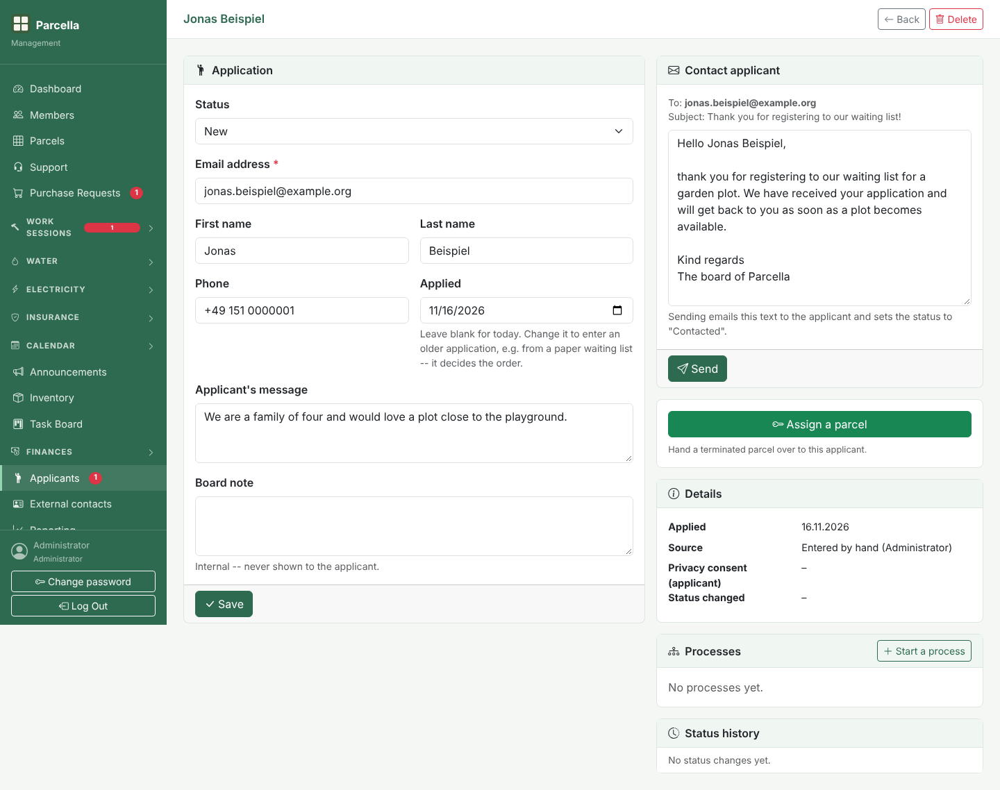
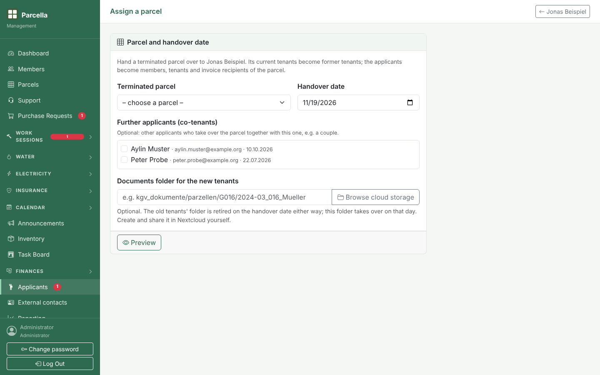

# Uchádzači {#applicants}

!!! note "Strojový preklad"
    Táto stránka bola strojovo preložená z angličtiny a zatiaľ nebola skontrolovaná. Ak je niečo nejasné, platí anglická verzia (jazyk prepnete hore).

Zoznam uchádzačov je poradovník vášho spolku na voľné záhradky.
Prihlášky z formulára na vašom webe sem prichádzajú samy; zadať môžete
aj prihlášky, ktoré prišli telefonicky alebo na papieri. Sledujete,
koho ste kontaktovali a komu ste ponúkli záhradku, a keď sa záhradka
uvoľní, odovzdáte ju -- uchádzač sa jedným krokom stane členom aj novým
nájomcom.

Uchádzači sú zámerne oddelení od zoznamu členov. Väčšina uchádzačov
záhradku nikdy nedostane, takže ich dáta sa nesmú dostať do počtov
členov, faktúr, pracovných hodín ani rozosielania.

!!! info "Kto to môže používať"
    Modul **Uchádzači** je predvolene zapnutý. Dá sa vypnúť v časti
    [Zapínanie a vypínanie modulov](../administration/modules.md).

    - **Zobrazenie** zoznamu a prihlášok potrebuje oprávnenie *čítanie*
      pre **Uchádzači**.
    - **Pridanie** uchádzača, **úprava** kontaktných údajov, stavu a
      poznámky výboru a **kontaktovanie** nového uchádzača potrebujú
      oprávnenie *zápis*.
    - **Natrvalo zmazať** uchádzača možno s oprávnením *mazanie*.
    - **Prideliť parcelu** potrebuje oprávnenie *zápis* pre
      **Uchádzači** aj **Členovia a parcely**.

    Členovia výboru a administrátori majú všetky tieto oprávnenia.
    Skupina ich môže udeliť aj iným, napr. tomu, kto má na starosti
    prideľovanie záhradiek (pozri [Skupiny](../administration/groups.md)).

    Prihlášky z vášho webu prichádzajú, len kým je zapnutý samostatný
    modul **Verejné API formulára prihlášok**. Predvolene je vypnutý,
    pretože umožňuje ľuďom mimo spolku zapisovať do Parcelly. Pozri
    [Prihlášky z vášho webu](#applications-from-your-website).

## Kde si všimnete nové prihlášky {#where-you-notice-new-applications}

- Položka **Uchádzači** v hlavnom menu ukazuje červené číslo:
  prihlášky, na ktoré sa ešte nikto nepozrel (stav **Nová**). Zmizne,
  keď je každá nová prihláška posunutá do iného stavu.
- [Dashboard](../getting-started/dashboard.md) má kartu **Nové
  prihlášky** s rovnakým číslom, „zatiaľ nevybavené“. Otvorí zoznam
  filtrovaný na nové prihlášky.

Parcella výbor o novej prihláške e-mailom neinformuje -- signálom je
číslo v menu a na dashboarde.

## Stavy {#statuses}

Každá prihláška prechádza týmito stavmi. Nastavujete ich na [stránke
prihlášky](#application-page); len **Uzavreté (záhrada pridelená)**
nastavuje Parcella sama.

| Stav | Význam |
|---|---|
| **Nová** | Práve prišla; zatiaľ sa na ňu nikto nepozrel. |
| **Kontaktovaný** | Výbor sa ozval -- napr. poslal prvý e-mail. Uchádzač je v poradovníku. |
| **Záhrada ponúknutá** | Záhradka bola ponúknutá. |
| **Prijaté** | Uchádzač chce ponúknutú záhradku; odovzdanie sa ešte pripravuje. |
| **Zamietnuté** | Spolok odmietol alebo uchádzač nechce ďalšie ponuky. |
| **Uzavreté (záhrada pridelená)** | Uchádzač dostal parcelu cez **Prideliť parcelu**. |

**Nová**, **Kontaktovaný**, **Záhrada ponúknutá** a **Prijaté** sa
počítajú ako *otvorené*. Ak uchádzač odmietne ponuku, ale chce zostať v
poradovníku, nastavte ho späť na **Kontaktovaný**. Ak nechce ďalšie
ponuky, nastavte **Zamietnuté**.

## Zoznam uchádzačov {#applicant-list}

Otvorte **Uchádzači** v hlavnom menu. Zoznam ukazuje prihlášky,
najnovší dátum prihlášky prvý.

### Filter a vyhľadávanie {#filter-and-search}

| Pole / tlačidlo | Čo robí |
|---|---|
| **Nové** | Len prihlášky so stavom **Nová**. Zobrazí sa len, kým sú nové prihlášky -- a vtedy sa zoznam otvorí s týmto filtrom. |
| **Otvorené** | Prihlášky v stave **Nová**, **Kontaktovaný**, **Záhrada ponúknutá** alebo **Prijaté**. Zoznam sa otvorí s týmto filtrom, keď nie sú žiadne nové prihlášky. |
| **Uzavreté** | Prihlášky v stave **Uzavreté (záhrada pridelená)** alebo **Zamietnuté**. |
| **Všetky** | Každá prihláška. |
| **Meno, e-mail, telefón, správa, poznámky…** | Hľadá v mene a priezvisku, e-mailovej adrese, telefónnom čísle, správe uchádzača a poznámke výboru. Kombinuje sa s tlačidlami filtra. Keďže sa prehľadáva aj poznámka výboru, číslo tiketu, ktoré ste si tam poznačili, nájde uchádzača. |
| **Hľadať** | Použije vyhľadávanie. |
| **Zrušiť filter** | Zruší vyhľadávanie, tlačidlo filtra ponechá. |

### Stĺpce {#columns}

| Stĺpec | Čo ukazuje |
|---|---|
| Zaškrtávacie políčko | Vyberie uchádzača pre **Napísať vybraným uchádzačom** (pozri nižšie). |
| **Meno** | Meno a priezvisko alebo e-mailová adresa, ak meno nebolo zadané. Kliknutím otvoríte prihlášku. |
| **E-mail** | Kliknutím napíšete zo svojho poštového programu. |
| **Telefón** | |
| **Prihlásené** | Dátum prihlášky. Rozhoduje o poradí v poradovníku. |
| **Stav** | Pozri [Stavy](#statuses). |
| Tlačidlo s okom | Otvorí prihlášku. |

Vedľa mena sa môžu objaviť dva druhy odznakov:

- **2×**, **3×** … -- z tejto e-mailovej adresy sa prihlásili viackrát.
  Parcella opakované prihlášky nezlučuje; každá zostáva samostatným
  záznamom, aby sa žiadna správa nestratila. O tom, čo s nimi, rozhodnete
  vy. Stránka prihlášky uvádza ostatné.
- **Červená vlajka** -- meno, e-mailová adresa alebo telefónne číslo
  uchádzača sa zhoduje s [externým kontaktom](external-contacts.md),
  ktorý nesie štítok červenej vlajky vášho spolku. Podržte myš nad
  odznakom a uvidíte, ktorý kontakt a ktoré údaje sa zhodujú. Kým je
  modul Externé kontakty vypnutý, červené vlajky nie sú.

### Písanie vybraným uchádzačom {#writing-to-selected-applicants}

Kým je zapnutý modul **Oznamy**, členovia výboru a administrátori vidia
pri každom riadku zaškrtávacie políčko.

| Tlačidlo | Čo robí |
|---|---|
| **Vybrať všetko** | Zaškrtne každého uchádzača, ktorého ukazuje aktuálny filter a vyhľadávanie. |
| **Zrušiť výber** | Zruší všetky zaškrtnutia. |
| **Vybrané: *N*** | Počíta zaškrtnutých uchádzačov. |
| **Napísať vybraným uchádzačom** | Začne nový [oznam](announcements.md) zaškrtnutým uchádzačom. Odchádza len e-mailom, raz na adresu -- kto sa prihlásil dvakrát, dostane jeden e-mail. Kým nikoho nezaškrtnete, je neaktívne. |

### Ručné pridanie uchádzača {#adding-an-applicant-by-hand}

**Pridať uchádzača** (vpravo hore, potrebuje oprávnenie na zápis)
otvorí formulár [Nový uchádzač](#new-applicant).

## Nový uchádzač {#new-applicant}

Pre prihlášky, ktoré neprišli cez web -- telefonicky, listom alebo zo
starého papierového poradovníka. Prihlášky z formulára na webe sa v
zozname objavia samy.

| Pole | Čo robí |
|---|---|
| **E-mailová adresa** \* | Povinné -- jediné povinné pole. Musí to byť platná e-mailová adresa, inak „Zadajte, prosím, platnú e-mailovú adresu.“ |
| **Meno** / **Priezvisko** | Tu voliteľné, ale potrebné, kým budete môcť prideliť parcelu. |
| **Telefón** | |
| **Prihlásené** | Dátum prihlášky. „Nechajte prázdne pre dnešný dátum. Zmeňte ho pri zadávaní staršej žiadosti, napr. z papierového poradovníka -- určuje poradie.“ Dátum v budúcnosti sa odmietne. |
| **Správa uchádzača** | Čo uchádzač napísal alebo vám povedal. |
| **Poznámka výboru** | „Interná -- uchádzačovi sa nikdy nezobrazí.“ |

Kliknite na **Uložiť**. Prihláška začína v stave **Nová**, jej zdroj
je **Zadané ručne** (s vaším menom) a nemá dátum súhlasu so
spracovaním údajov -- ten sa zaznamenáva len pri prihláškach z webu.
**Späť** vás vráti do zoznamu bez uloženia.

## Stránka prihlášky {#application-page}

Kliknutím na uchádzača v zozname otvoríte jeho prihlášku.

Ak sa uchádzač zhoduje s externým kontaktom označeným červenou vlajkou,
červené pole **Červená vlajka** hore uvádza kontakt a zhodné údaje
(meno, e-mail, telefón). Používatelia, ktorí smú vidieť externé
kontakty, môžu prekliknúť na kontakt.

### Prihláška {#application}

Ľavá karta obsahuje všetko, čo môžete upravovať.

| Pole | Čo robí |
|---|---|
| **Stav** | Pozri [Stavy](#statuses). Každá zmena sa zaznamená v **História stavu**. |
| **E-mailová adresa** \*, **Meno**, **Priezvisko**, **Telefón** | Kontaktné údaje uchádzača. |
| **Prihlásené** | Dátum prihlášky. Zmeňte ho, aby ste prihlášku presunuli na správne miesto v poradí, napr. pri zadávaní starej papierovej prihlášky. Zmena sa zaznamená v histórii stavu, pretože posúva uchádzača nahor alebo nadol. Dátumy v budúcnosti sa odmietnu. |
| **Správa uchádzača** | Text, ktorý uchádzač poslal. |
| **Poznámka výboru** | Interné poznámky, uchádzačovi sa nikdy nezobrazia -- napr. „volal 3. mája, uprednostňuje malú záhradku“. |

Kliknutím na **Uložiť** uložíte zmeny. Bez oprávnenia na zápis dáta
vidíte, ale nemôžete ich uložiť. Zmeny kontaktných údajov a poznámky
výboru sa v histórii nezaznamenávajú.

### Tlačidlá hore {#buttons-at-the-top}

| Tlačidlo | Čo robí |
|---|---|
| **Späť** | Vráti sa do zoznamu uchádzačov. |
| **Zmazať** | Natrvalo zmaže prihlášku po potvrdení „Natrvalo zmazať tohto uchádzača? Nedá sa vrátiť späť.“ Spolu s ňou sa zmaže jej história stavu. Potrebuje oprávnenie na mazanie. |

!!! info "Prečo sa uchádzači dajú natrvalo zmazať"
    Takmer všetko ostatné v Parcelle si zachováva históriu. Uchádzači
    sú výnimka: ich dáta sa uchovávajú len kvôli prihláške, takže ich
    musíte vedieť úplne odstrániť -- keď vás o to niekto požiada alebo
    keď je prihláška vybavená. Váš spolok si môže nechať staré
    prihlášky mazať aj automaticky; pozri [Automatické mazanie](#automatic-deletion).

### Kontaktovať žiadateľa {#contact-applicant}

Zobrazí sa len pri **novej** prihláške, používateľom s oprávnením na
zápis. Je to prvý krok postupu: ďakovný e-mail, ktorý potvrdzuje, že
uchádzač je v poradovníku.

| Pole / tlačidlo | Čo robí |
|---|---|
| **Komu:** | E-mailová adresa uchádzača. |
| **Predmet:** | „Ďakujeme za registráciu do nášho poradovníka!“ (v jazyku, v ktorom Parcellu používate). |
| Správa | Text e-mailu, pripravený na úpravu. Meno uchádzača a názov spolku sú už vyplnené. |
| **Odoslať** | Po potvrdení pošle text uchádzačovi e-mailom a nastaví stav na **Kontaktovaný**. |

Po odoslaní zelené upozornenie hovorí „E-mail bol odoslaný a stav
nastavený na „Kontaktovaný“.“ Pole potom zmizne, pretože prihláška už
nie je nová.

Ak sa e-mail nedá odoslať, nič sa nezmení: stav zostane **Nová**, váš
upravený text zostane v poli a uvidíte „E-mail sa nepodarilo odoslať –
skontrolujte prosím nastavenia SMTP. Stav nebol zmenený.“ Opravte
nastavenia pošty a skúste to znova.

Východiskový text pochádza z **Text e-mailu novým žiadateľom** v
[Nastaveniach spolku](../administration/settings.md) → **Uchádzači**.
Ak je prázdny, Parcella použije svoj vstavaný text v jazyku, v ktorom
Parcellu používate. Uchádzači nemajú vlastné nastavenie jazyka, preto
ak váš spolok píše vlastný text, píšte ho v jazyku, ktorým hovoria vaši
uchádzači.

!!! note
    Parcella si kópiu e-mailu neuchováva. Že odišiel, ukazuje len zmena
    stavu na **Kontaktovaný**.

### Prideliť parcelu {#assign-a-parcel}

Zobrazí sa len pri otvorenej prihláške, používateľom s oprávnením na
zápis pre **Uchádzači** aj **Členovia a parcely**. **Prideliť parcelu**
odovzdá ukončenú parcelu uchádzačovi -- pozri
[Prideliť parcelu](#assign-a-parcel_1) nižšie.

### Podrobnosti {#details}

| Riadok | Čo ukazuje |
|---|---|
| **Prihlásené** | Dátum prihlášky. |
| **Zdroj** | **Formulár na webe** alebo **Zadané ručne** s menom používateľa, ktorý ju zadal. |
| **Súhlas so spracovaním údajov (uchádzač)** | Kedy uchádzač zaškrtol políčko ochrany údajov vo formulári na webe. Pri ručne zadaných prihláškach prázdne. Je to súhlas uchádzača -- nie schválenie výborom. |
| **Stav zmenený** | Kedy sa stav naposledy zmenil. |

Všetky dátumy sa zobrazujú bez času.

### Ďalšie prihlášky z tejto adresy {#other-applications-from-this-address}

Zobrazí sa len vtedy, ak sa z tej istej e-mailovej adresy prihlásili
viackrát. Uvádza ostatné prihlášky s dátumom a stavom; kliknutím na
dátum niektorú otvoríte.

### Procesy {#processes}

Ak je zapnutý modul [Procesy](processes.md) a smiete vidieť procesy,
karta **Procesy** uvádza procesy týkajúce sa tohto uchádzača. **Začať
proces** spustí nový.

### História stavu {#status-history}

Každá zmena stavu a každá zmena dátumu prihlášky, s dátumom, časom a
používateľom, ktorý ju urobil -- najnovšie prvé. Zobrazujú sa tu aj
zmeny, ktoré urobila sama Parcella (odovzdanie).

## Prideliť parcelu {#assign-a-parcel_1}

Keď sa parcela uvoľní, táto stránka ju jedným krokom odovzdá jednému
alebo viacerým uchádzačom. Otvoríte ju tlačidlom **Prideliť parcelu**
pri prihláške.

!!! info "Skôr než začnete"
    - Parcela musí mať stav **ukončená**. Najprv ho nastavte vo
      [formulári parcely](parcels.md#new-parcel-and-edit-parcel). Ak
      nie je ukončená žiadna parcela, stránka vám to povie.
    - Každý uchádzač, ktorý parcelu preberá, potrebuje v prihláške meno
      a priezvisko.

### Krok 1: parcela a dátum odovzdania {#step-1-parcel-and-handover-date}

| Pole | Čo robí |
|---|---|
| **Ukončená parcela** | Parcela na odovzdanie. Ponúkajú sa len ukončené parcely, každá s menami jej aktuálnych nájomcov. |
| **Dátum odovzdania** | Deň, keď noví nájomcovia preberajú parcelu. Predvolene dnes. Môže byť v budúcnosti: doterajší nájomcovia potom zostávajú nájomcami, členmi a príjemcami faktúr až do tohto dňa a noví nájomcovia sa na stránke parcely zobrazia ako budúci. |
| **Ďalší uchádzači (spolunájomcovia)** | Voliteľné: ďalší otvorení uchádzači, ktorí parcelu preberajú spolu s týmto, napr. pár, ktorý sa prihlásil osobitne. |
| **Priečinok dokumentov pre nových nájomcov** | Len pre členov výboru a administrátorov, kým je zapnutý modul **Cloudové úložisko**. Priečinok, ktorý sa v deň odovzdania stane priečinkom dokumentov parcely. **Prehliadať cloudové úložisko** vám umožní preklikať sa úložiskom a vybrať **Použiť tento priečinok**. Priečinok vo svojom cloudovom úložisku vytvorte a nazdieľajte sami. Voliteľné -- môžete ho nastaviť aj neskôr na stránke parcely. |
| **Náhľad** | Ukáže, čo sa stane. Zatiaľ sa nič nezmení. |

### Krok 2: skontrolujte náhľad {#step-2-check-the-preview}

Karta náhľadu, **Odovzdanie parcely *X* dňa *dátum***, uvádza presne,
čo sa stane:

- **Doterajší nájomcovia** -- nájom každého súčasného nájomcu končí
  dňom odovzdania. Ak nemajú inú parcelu, ich členstvo končí deň predtým
  („členstvo končí po *dátum*“). Ak majú ešte inú parcelu, členstvo si
  ponechajú; náhľad túto parcelu uvedie.
- **Noví nájomcovia a príjemcovia faktúr** -- každý uchádzač sa buď
  „stane novým členom“ (meno, e-mail a telefón sa prevezmú z prihlášky),
  alebo, ak aktívny člen už má e-mailovú adresu uchádzača, sa prepojí s
  týmto členom („už člen“).
- **Priečinok dokumentov** -- ktorý priečinok sa v deň odovzdania vyradí
  a ktorý ho nahradí. Ak priečinky nemôžete spravovať sami, poznámka
  hovorí, že nový priečinok neskôr nastaví niekto s plným prístupom.

Ak je niečo nesprávne -- parcela nie je ukončená, prihláška uchádzača je
už uzavretá alebo nemá meno --, chybové hlásenie to vysvetlí a nič sa
nestane.

Kliknite na **Odovzdať parcelu** a potvrďte. Parcella potom naraz:

1. ukončí doterajšie nájmy dňom odovzdania (zostanú v histórii parcely
   ako bývalí nájomcovia),
2. ukončí členstvo doterajších nájomcov, ktorí nemajú inú parcelu,
3. vytvorí nových členov -- ich **Členom od** je dátum odovzdania -- a
   urobí z nich nájomcov a príjemcov faktúr parcely,
4. nastaví parcelu späť na **aktívna**,
5. nastaví prihlášky na **Uzavreté (záhrada pridelená)**.

Potom sa ocitnete na stránke parcely.

!!! tip "Potom doplňte nového člena"
    Z prihlášky sa kopíruje len meno, e-mailová adresa a telefónne
    číslo. Otvorte nového člena a doplňte adresu a IBAN. **Môže
    dostávať informácie e-mailom** je zaškrtnuté, ako pri každom novom
    členovi; odškrtnite to, ak chce len papier.

## Prihlášky z vášho webu {#applications-from-your-website}

Väčšina prihlášok prichádza cez formulár na webe vášho spolku. Keď je
nastavený, každý odoslaný formulár sa v zozname uchádzačov objaví ako
**nová** prihláška so zdrojom **Formulár na webe** a dátumom, keď
uchádzač dal súhlas so spracovaním údajov.

Čo formulár žiada: e-mailovú adresu (povinné), meno a priezvisko,
telefón, správu a zaškrtávacie políčko súhlasu so spracovaním údajov,
ktoré musí byť zaškrtnuté. Parcella chráni formulár pred spamom:
skryté polia, ktoré vypĺňajú len boty, voliteľná captcha a obmedzenie
na niekoľko odoslaní za hodinu od toho istého návštevníka.

Nastavenie:

1. Zapnite modul **Verejné API formulára prihlášok** v časti
   [Zapínanie a vypínanie modulov](../administration/modules.md).
2. V časti [Integrácie](../administration/integrations.md) zadajte
   adresu svojho webu, aby od neho Parcella prijímala formuláre.
   Stránka uvádza aj adresy, na ktoré formulár posiela.
3. Vložte formulár na svoj web:
    - **WordPress**: nainštalujte plugin Parcella Connector a na
      stránku vložte shortcode `[parcella_applicant_form]`.
    - **Akýkoľvek iný web**: jednoduchý formulár HTML, ktorý posiela
      polia uvedené vyššie do Parcelly. Váš webdizajnér nájde
      podrobnosti v Integráciách.

Čo vidia uchádzači, je opísané v časti [Pre záhradkárov](../gardeners/index.md).

!!! note
    Parcella uchádzačovi automatické potvrdenie neposiela. Na prvú
    odpoveď použite [Kontaktovať žiadateľa](#contact-applicant).

## Automatické mazanie {#automatic-deletion}

V [Nastaveniach spolku](../administration/settings.md) → **Uchádzači**
vám **Mazať prihlášky po (mesiacoch)** umožní nechať Parcellu mazať
staré prihlášky za vás. Každá prihláška, ktorej stav sa toľko mesiacov
nezmenil, sa natrvalo zmaže -- **bez ohľadu na jej stav** a bez
upozornenia kohokoľvek. Mesiace sa počítajú od poslednej zmeny stavu
alebo od dátumu prihlášky, ak sa stav nikdy nezmenil.

Nechajte pole prázdne alebo na 0 (predvolené), ak chcete prihlášky
ponechať, kým ich nezmažete ručne. Kontrola beží na pozadí, kým ľudia
Parcellu používajú, najviac raz za hodinu.

!!! warning
    Automatické mazanie odstráni aj otvorené prihlášky, ktoré
    jednoducho čakajú dlho. Ak je váš poradovník dlhý, zvoľte obdobie
    dlhšie ako bežné čakanie alebo z času na čas posuňte stav
    dlho čakajúcich uchádzačov.

## Súvisiace {#related}

- [Parcely](parcels.md) -- ukončenie parcely pred odovzdaním
- [Členovia](members.md) -- doplnenie údajov nového člena
- [Odovzdanie parcely](../guides/parcel-handover.md)
- [Oznamy](announcements.md) -- písanie vybraným uchádzačom
- [Externé kontakty](external-contacts.md) -- štítok červenej vlajky
- [Integrácie](../administration/integrations.md) -- formulár na webe
