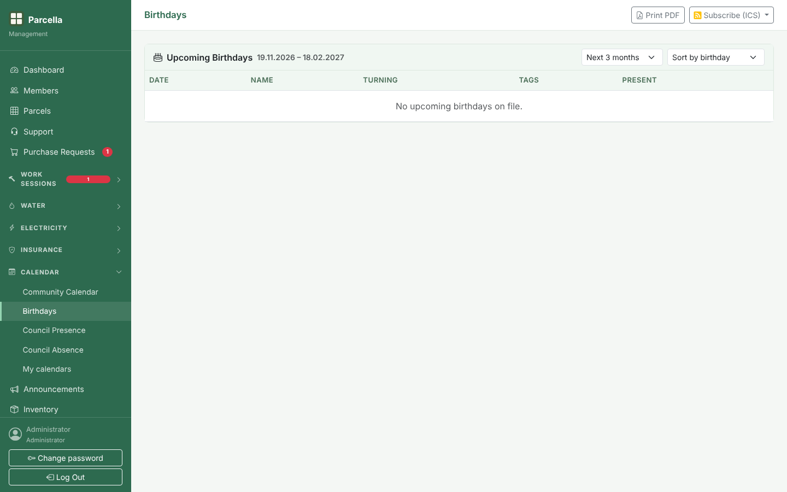

# Kalendář {#calendar}

!!! note "Strojový překlad"
    Tato stránka byla strojově přeložena z angličtiny a dosud nebyla zkontrolována. Pokud je něco nejasné, platí anglická verze (jazyk přepnete nahoře).

Modul kalendáře drží termíny, na kterých vašemu spolku záleží, na jednom
místě: schůze a kontroly, narozeniny členů, kdy jsou členové výboru na
místě a kdy je někdo pryč. Každý kalendář lze odebírat v kalendářové
aplikaci v telefonu nebo počítači.

!!! info "Kdo to může používat"
    - Přepínač modulu je **Kalendář** v **Administrace → Zapínání a
      vypínání modulů**. Ve výchozím stavu je **zapnutý**.
    - Role **Výbor** a **Správce** a členové skupiny s **Plný přístup ke
      každému modulu** mohou vše.
    - Všichni ostatní potřebují oprávnění **Kalendář** v některé ze svých
      [skupin](../administration/groups.md): *čtení* pro zobrazení
      kalendářů, *zápis* pro přidávání záznamů, *mazání* pro jejich
      odstranění.
    - Výjimkou je **Nepřítomnost výboru**: nepřítomnost může zadat
      každý, kdo je přihlášen a může otevřít kalendář.
    - Vytváření a úprava vlastních kalendářů v **Vlastní kalendáře**
      vyžaduje plný přístup (Výbor, Správce nebo skupina s plným
      přístupem).

Mřížka měsíce záměrně neexistuje. Každý kalendář je jednoduchý seznam
toho, co přijde, od dneška. Minulé záznamy automaticky ze seznamu (i z
odběrů) zmizí.

Všechny kalendáře najdete v postranním panelu pod **Kalendář**:
**Kalendář spolku**, **Narozeniny**, **Přítomnost výboru**,
**Nepřítomnost výboru** a **Vlastní kalendáře**. Otevření samotné
adresy kalendáře vás vezme do **Kalendář spolku**.

## Kalendář spolku {#community-calendar}

Kalendář celého spolku: členské schůze, kontroly zahrádek a další akce
spolku, společně s plánovanými pracovními směnami z modulu
[pracovních hodin](work-hours.md). Tento kalendář můžete ukázat na
veřejném webu.

### Nový záznam {#new-entry}

Karta **Nový záznam** vlevo se zobrazí, jen pokud máte pro kalendář
oprávnění k *zápisu*.

| Pole / tlačítko | Co dělá |
|---|---|
| **Typ** | **Členská schůze**, **Kontrola zahrádky** nebo **Ostatní** (výchozí). Mění jen barevný odznak v seznamu. |
| **Název** | Povinné. Název akce, např. „Výroční členská schůze“. |
| **Datum** | Povinné. (První) den akce. |
| **Čas** | Volitelný čas začátku. Pro celodenní záznam nechte prázdné. |
| **Datum ukončení** | Volitelné. Jen pro vícedenní záznamy -- pro jeden den nechte prázdné. |
| **Čas ukončení** | Volitelný čas konce. |
| **Místo** | Volitelné. Zobrazí se se špendlíkem pod názvem. |
| **Popis** | Volitelný volný text. V seznamu se nezobrazuje, ale jde do odběru a do widgetu na webu. |
| **Přidat záznam** | Uloží záznam a ukáže ho v seznamu. |

### Nadcházející {#upcoming}

| Sloupec | Co ukazuje |
|---|---|
| **Datum** | Datum, plus časové rozmezí, pokud bylo zadáno. |
| **Název** | Název a místo. U pracovní směny odkazuje název na tuto směnu v modulu pracovních hodin. |
| **Typ** | Odznak: **Členská schůze**, **Kontrola zahrádky**, **Ostatní** nebo **Pracovní směna**. |
| Ikona koše | Po potvrzení (**Opravdu chcete smazat tento záznam?**) smaže záznam. Zobrazí se jen s oprávněním k *mazání* a jen u záznamů vytvořených zde -- pracovní směny se mění v modulu pracovních hodin. |

Pokud není nic naplánováno, seznam uvádí **Žádné nadcházející záznamy.**

!!! note "Které pracovní směny se zobrazí"
    Zobrazují se jen pravidelné, plánované pracovní směny. Spontánní
    „speciální“ směny (například „dnes natřít lavičku“) se vynechávají,
    protože podle nich si členové nemohou plánovat. Pracovní směny se
    čtou přímo z modulu pracovních hodin, takže přeplánování směny tam
    ji změní i zde -- není co synchronizovat.

### Odebírat (ICS) {#subscribe-ics}

Tlačítko **Odebírat (ICS)** vpravo nahoře ukáže **Veřejný odkaz ICS
(lze vložit na veřejný web):**. Kliknutím do pole adresu označte a
zkopírujte.

Tento kanál nepotřebuje přihlášení ani heslo. Obsahuje jen to, co je už
veřejné: záznamy výše a plánované pracovní směny. Můžete ho přidat do
kalendářové aplikace nebo ho ukázat na webu spolku (viz
[Odběr v kalendářové aplikaci](#subscribing-in-a-calendar-app) níže).

<!-- TODO(verify): the WordPress connector plugin renders this calendar with a [parcella_calendar] shortcode. Link to the integrations page once it documents the plugin side. -->

## Narozeniny {#birthdays}

Nadcházející narozeniny vašich aktivních členů. Pro tento seznam se nic
neukládá: pokaždé se vypočítá z data narození každého člena. Opravte
datum narození u [člena](members.md) a seznam je hned správný. Členové
bez data narození se nezobrazují.

### Volba časového rozmezí a pořadí {#choosing-the-time-range-and-order}

Záhlaví karty **Nadcházející narozeniny** ukazuje pokryté období
(například „01.12.2026 – 28.02.2027“) a dva rozbalovací seznamy. Seznam
se znovu načte, jakmile jeden změníte.

| Pole | Co dělá |
|---|---|
| Časové rozmezí | **Příští měsíc**, **Příští 3 měsíce** (výchozí) nebo **Příštích 12 měsíců**, vždy počítáno od dneška dopředu. **Příštích 12 měsíců** vypíše každého člena s datem narození. |
| Řazení | **Řadit podle narozenin** (výchozí), **Řadit podle příjmení** nebo **Řadit podle čísla parcely**. Řazení podle parcely používá nejnižší současné číslo parcely člena a členy bez parcely dává na konec. |

### Nadcházející narozeniny {#upcoming-birthdays}

| Sloupec | Co ukazuje |
|---|---|
| **Datum** | Datum příštích narozenin. |
| **Jméno** | Člen s odkazem na jeho záznam. Kulaté narozeniny (30, 40, 50 ...) dostanou odznak **Kulaté** a celý řádek je zvýrazněn. |
| **Oslaví** | Věk, kterého se člen dožívá. |
| **Štítky** | Štítky člena. Kliknutím na jeden otevřete seznam členů vyfiltrovaný podle tohoto štítku. |
| **Dárek** | **Bez dárku**, pokud člen řekl, že si nepřeje narozeninový dárek (nastavuje se v záznamu člena). |

Pokud nikdo nemá ve zvoleném rozmezí narozeniny, seznam uvádí **Žádné
nadcházející narozeniny v systému.**

### Tisk PDF {#print-pdf}

**Tisk PDF** vytvoří vytisknutelný seznam pro toho, kdo rozdává dárky.
Používá přesně časové rozmezí a pořadí, které jste na stránce zvolili.

PDF je A4 na šířku, s hlavičkovým papírem vašeho spolku, a má více
sloupců než webová stránka: parcela, jméno, narozeniny, věk (kulaté
narozeniny zvýrazněné), štítky, „Bez dárku“, poštovní adresa, hlavní
e-mailová adresa a hlavní telefonní číslo. Při řazení podle parcely jsou
členové seskupeni pod číslem parcely; člen s více parcelami se objeví
pod každou z nich a členové bez parcely jsou poslední pod „Bez parcely“.

!!! warning "Osobní údaje"
    Výtisk obsahuje adresy a telefonní čísla. S papírovými kopiemi
    podle toho zacházejte.

### Odebírat (ICS) {#subscribe-ics_1}

Tlačítko **Odebírat (ICS)** ukáže **Soukromý odkaz ICS (nesdílejte --
kdokoli s tímto odkazem jej může zobrazit):**. Kanál obsahuje narozeniny
každého aktivního člena jako každoročně se opakující celodenní záznam.

## Přítomnost výboru {#council-presence}

Plánujte, kdy jsou členové výboru na místě, například úřední hodiny v
klubovně. Členové pak vidí, kdy tam někdo z výboru je.

### Nový termín přítomnosti {#new-presence-slot}

Zobrazí se jen s oprávněním k *zápisu* pro kalendář.

| Pole / tlačítko | Co dělá |
|---|---|
| **Člen(ové) výboru** | Povinné. Zaškrtněte jeden nebo více uživatelských účtů. Vyberte více, pokud termín pokrývá více členů společně -- každý z nich dostane vlastní záznam pro stejný termín. Pokud nezaškrtnete nikoho, formulář ukáže **Vyberte alespoň jednoho člena výboru** a neuloží se. |
| **Datum** | Povinné. |
| **Od** / **Do** | Volitelné časy. Bez času se termín počítá jako celodenní. |
| **Poznámka** | Volitelné, např. „Úřední hodiny pro členy“. |
| **Přidat** | Uloží termín. |

Seznam lidí ukazuje jen aktivní uživatelské účty, ne každého člena: člen
výboru potřebuje přihlášení do Parcelly, aby byl uveden.

### Nadcházející {#upcoming_1}

Záznamy jsou seskupené pod jedním nadpisem na den.

| Sloupec | Co ukazuje |
|---|---|
| **Člen** | Obrázek a jméno uživatele. |
| **Čas** | Od -- do, nebo pomlčka, pokud čas nebyl zadán. |
| **Poznámka** | Poznámka, pokud nějaká je. |
| Ikona koše | Po potvrzení smaže tento jeden záznam (jedna osoba, jeden termín). Vyžaduje oprávnění k *mazání*. |

Když není nic naplánováno: **Žádné naplánované termíny přítomnosti.**

Tlačítko **Odebírat (ICS)** ukáže soukromý odkaz, stejně jako u
narozenin. Termíny s časem se v kalendářových aplikacích zobrazí jako
časově určené schůzky.

## Nepřítomnost výboru {#council-absence}

Dovolené a jiné nepřítomnosti, aby výbor věděl, kdo není k dispozici.
Tuto stránku může používat každý, kdo je přihlášen -- nepotřebujete
žádné další oprávnění.

### Zadat nepřítomnost {#log-absence}

| Pole / tlačítko | Co dělá |
|---|---|
| **Člen(ové)** | Výchozí jste vy; pokud zadáváte nepřítomnost za jiné, vyberte i je. Sebe můžete odškrtnout a zadat nepřítomnost jen za někoho jiného. Pokud odškrtnete všechny, nepřítomnost se zadá za vás. |
| **Od** | Povinné. První den nepřítomnosti. |
| **Do** | Povinné. Poslední den nepřítomnosti. |
| **Poznámka** | Volitelné, např. „Dovolená“. Zda a co vysvětlíte, je na vás. |
| **Přidat** | Uloží jednu nepřítomnost za každou zaškrtnutou osobu. |

### Nadcházející nepřítomnosti {#upcoming-absences}

Nepřítomnosti zůstávají v seznamu, dokud neuplyne jejich poslední den.

| Sloupec | Co ukazuje |
|---|---|
| **Kdo** | Obrázek a jméno uživatele. |
| **Období** | Od -- do. |
| **Poznámka** | Poznámka, pokud nějaká je. |
| Ikona koše | Po potvrzení smaže záznam. Vidíte ji u svých vlastních záznamů; výbor a uživatelé s plným přístupem ji vidí u každého záznamu, aby mohli opravit chyby. |

Když nikdo není pryč: **Žádné zadané nepřítomnosti.**

Tlačítko **Odebírat (ICS)** ukáže soukromý odkaz, stejně jako u
narozenin. Nepřítomnosti jsou celodenní záznamy.

## Vlastní kalendáře {#my-calendars}

Vlastní doplňkové kalendáře vašeho spolku, pro cokoli, co nepatří do
veřejného kalendáře spolku: rezervace klubovny, termíny výboru, rozpis
sekání trávy. Žádný z těchto kalendářů nikdy není veřejný.

Seznam **Kalendáře** ukazuje:

- **Zdroje** nahoře, pokud je zapnutý modul [inventáře](inventory.md) a
  smíte ho číst -- viz [Zdroje](#resources) níže.
- Každý kalendář s barevnou tečkou, názvem a popisem. Kliknutím na
  název ho otevřete.
- **Jen výbor** u kalendářů, které vidí jen výbor a uživatelé s plným
  přístupem. Ostatní uživatelé tyto kalendáře vůbec nevidí.
- **Archivováno** u archivovaných kalendářů. Archivované kalendáře vidí
  jen výbor a uživatelé s plným přístupem.

Pokud zatím žádné kalendáře nejsou, seznam uvádí **Zatím žádné
kalendáře.**

### Nový kalendář {#new-calendar}

Zobrazí se jen výboru a uživatelům s plným přístupem.

| Pole / tlačítko | Co dělá |
|---|---|
| **Název** | Povinné, nejvýše 100 znaků, např. „Rezervace klubovny“. |
| **Barva** | Barva tečky vedle názvu. Výchozí je zelená. |
| **Popis** | Volitelné. Zobrazí se pod názvem a na stránce kalendáře. |
| **Viditelné jen pro výbor a uživatele s plným přístupem** | Udělá z kalendáře kalendář **Jen výbor**. |
| **Vytvořit kalendář** | Vytvoří kalendář. |

### Úprava kalendáře {#editing-a-calendar}

Otevřete **Upravit** pod názvem kalendáře (jen výbor a uživatelé s
plným přístupem).

| Pole / tlačítko | Co dělá |
|---|---|
| **Název**, **Barva**, **Popis** | Jako výše. |
| **Viditelné jen pro výbor a uživatele s plným přístupem** | Přepne kalendář mezi všemi a jen výborem. Tato změna také vytvoří novou adresu odběru, takže dřívější odběratelé ztratí přístup. |
| **Aktivní (odškrtněte pro archivaci)** | Odškrtnutím kalendář archivujete. Jeho záznamy se zachovají, ale nové nelze přidat a jeho adresa odběru přestane fungovat. Opětovným zaškrtnutím kalendář vrátíte. |
| **Nová adresa odběru (staré přestanou fungovat)** | Zaškrtněte, když už někdo, kdo měl odkaz, nemá kalendář vidět, například po odchodu z výboru. |
| **Uložit** | Uloží změny. |

Kalendář nelze smazat. Místo toho ho archivujte, aby zůstala zachována
jeho historie.

## Stránka kalendáře {#a-calendars-page}

Otevření kalendáře z **Vlastní kalendáře** ukáže jeho barvu a název jako
titulek stránky, popis a nadcházející záznamy. **Zpět** vás vrátí do
**Vlastní kalendáře**.

Karta **Nový záznam** funguje jako ta v
[Kalendáři spolku](#new-entry), bez pole **Typ**. Zobrazí se jen s
oprávněním k *zápisu* a jen dokud je kalendář aktivní. Název a místo
mohou mít nejvýše 255 znaků; časy musí být platné (hh:mm), jinak se
ignorují.

Seznam **Nadcházející** ukazuje **Datum** (s datem konce a časy),
**Název** (s místem a popisem) a ikonu koše pro smazání záznamu
(vyžaduje oprávnění k *mazání*).

Archivovaný kalendář ukazuje **Tento kalendář je archivován: záznamy
zůstávají, nové nelze přidat.**

Tlačítko **Odebírat (ICS)** (jen u aktivních kalendářů) ukáže
**Soukromá adresa odběru (nesdílejte)**. Každý z vašich vlastních
kalendářů má vlastní tajný odkaz, oddělený od sdíleného odkazu
používaného kalendáři narozenin a výboru.

## Zdroje {#resources}

Přehled jen pro čtení o vlastních předmětech spolku, které si členové
mohou půjčit, a kdo je právě má. Otevírá se z **Vlastní kalendáře** a
funguje, jen když je zapnutý modul inventáře a máte pro něj oprávnění ke
čtení, protože ukazuje, kdo si co půjčil. **Zpět** vás vrátí do
**Vlastní kalendáře**.

Seznam obsahuje každý předmět ve vlastnictví spolku označený k zapůjčení,
který nebyl vyřazen. Předměty se spravují a půjčují v modulu
[inventáře](inventory.md), ne zde.

| Sloupec | Co ukazuje |
|---|---|
| **Položka** | Název předmětu (s odkazem na něj v inventáři) a jeho kategorie. |
| **Stav** | Dostupnost: **K dispozici**, **Zapůjčeno** (nic nezbývá), nebo u předmětů, kterých máte více, např. „K dispozici 2 z 5“. |
| **Právě zapůjčeno** | Jeden řádek na otevřenou výpůjčku: „od 03.11.2026: Jana Nováková (1×)“, nebo pomlčka, pokud ho nikdo nemá. |

Výpůjčky v Parcelle nemají plánované datum vrácení, takže tato stránka
ukazuje jen aktuální stav, ne harmonogram do budoucna.

Pokud žádné předměty k zapůjčení nejsou: **Žádné předměty spolku k
zapůjčení.**

## Odběr v kalendářové aplikaci {#subscribing-in-a-calendar-app}

Každý kalendář má tlačítko **Odebírat (ICS)** s adresou („odkaz ICS“).
Ve většině kalendářových aplikací ji přidáte volbou jako „Odebírat
kalendář“, „Přidat kalendář z URL“ nebo „Z internetu“. Aplikace pak
adresu pravidelně kontroluje, takže nové záznamy se objevují samy. Jak
často kontroluje, záleží na aplikaci.

| Kalendář | Odkaz | Kdo ho smí mít |
|---|---|---|
| Kalendář spolku | Veřejný | Kdokoli. Bezpečný pro web spolku. |
| Narozeniny | Soukromý, sdílený tajný klíč | Jen lidé, kteří mají vidět narozeniny členů. |
| Přítomnost výboru | Soukromý, sdílený tajný klíč | Výbor a pomocníci. |
| Nepřítomnost výboru | Soukromý, sdílený tajný klíč | Výbor a pomocníci. |
| Každý z **Vlastní kalendáře** | Soukromý, jeden tajný klíč na kalendář | Kdokoli, kdo má daný kalendář vidět. |

Odkazy na narozeniny, přítomnost výboru a nepřítomnost výboru používají
pro celou vaši instalaci **stejný** tajný klíč. Kdo má jeden z těchto
odkazů, může číst všechny tři kanály, bez přihlášení. Dávejte je jen
lidem, kterým důvěřujete.

!!! warning "Když soukromý odkaz unikne"
    U **Vlastní kalendáře** zaškrtněte u kalendáře **Nová adresa odběru
    (staré přestanou fungovat)** a uložte. U odkazů na narozeniny a
    výbor tlačítko pro změnu sdíleného tajného klíče neexistuje.
    <!-- TODO(verify): there is no UI to rotate the shared ICS token (stored as a club setting); confirm whether an administrator can reset it somewhere, e.g. via the API club settings. -->

## Související {#related}

- [Pracovní hodiny](work-hours.md) -- odkud pocházejí pracovní směny v
  kalendáři spolku.
- [Členové](members.md) -- data narození, štítky a nastavení „bez
  dárku“.
- [Inventář](inventory.md) -- předměty k zapůjčení a výpůjčky.
- [Skupiny](../administration/groups.md) -- udělení oprávnění ke
  kalendáři.
- [Zapínání a vypínání modulů](../administration/modules.md)
