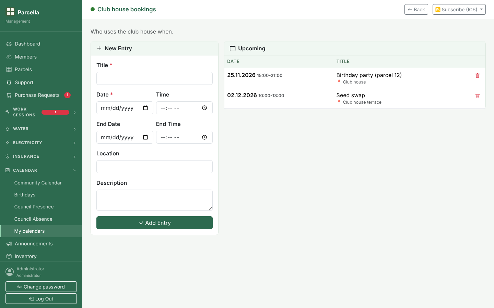

# Calendrier {#calendar}

!!! note "Traduction automatique"
    Cette page a été traduite automatiquement de l'anglais et n'a pas encore été relue. En cas de doute, la version anglaise fait foi (changez de langue en haut de la page).

Le module calendrier rassemble en un seul endroit les dates qui comptent
pour votre association : réunions et visites de parcelles, anniversaires
des membres, présence des membres du bureau sur place, et absences.
Chaque calendrier peut être suivi par abonnement depuis une application
de calendrier sur téléphone ou ordinateur.

!!! info "Qui peut l'utiliser"
    - L'interrupteur du module est **Calendrier** sous **Administration →
      Activer et désactiver les modules**. Il est **activé** par défaut.
    - Les rôles **Conseil d'administration** et **Administrateur**, et
      les membres d'un groupe avec **Accès complet à chaque module**,
      peuvent tout faire.
    - Tous les autres ont besoin du droit **Calendrier** dans l'un de
      leurs [groupes](../administration/groups.md) : *lecture* pour voir
      les calendriers, *écriture* pour ajouter des entrées, *suppression*
      pour en retirer.
    - **Absence du conseil** est l'exception : toute personne connectée
      qui peut ouvrir le calendrier peut enregistrer une absence.
    - Créer et modifier vos propres calendriers sous **Mes calendriers**
      nécessite l'accès complet (Conseil d'administration, Administrateur
      ou un groupe à accès complet).

Il n'y a volontairement pas de grille mensuelle. Chaque calendrier est
une simple liste de ce qui arrive, à partir d'aujourd'hui. Les entrées
passées disparaissent automatiquement de la liste (et des flux
d'abonnement).

Vous trouvez tous les calendriers dans la barre latérale sous
**Calendrier** : **Calendrier communautaire**, **Anniversaires**,
**Présence du conseil**, **Absence du conseil** et **Mes calendriers**.
L'adresse simple du calendrier mène au **Calendrier communautaire**.

## Calendrier communautaire {#community-calendar}

Le calendrier de toute l'association : assemblées des membres, visites
de parcelles et autres événements de l'association, avec les sessions
de travail planifiées du module [heures de travail](work-hours.md).
C'est le calendrier que vous pouvez afficher sur votre site web public.

### Nouvelle entrée {#new-entry}

La carte **Nouvelle entrée** à gauche n'est affichée que si vous avez le
droit d'*écriture* sur le calendrier.

| Champ / bouton | Ce qu'il fait |
|---|---|
| **Type** | **Assemblée des membres**, **Inspection de parcelle** ou **Autre** (par défaut). Ne change que le badge coloré dans la liste. |
| **Titre** | Obligatoire. Le nom de l'événement, par ex. « Assemblée générale annuelle ». |
| **Date** | Obligatoire. Le (premier) jour de l'événement. |
| **Heure** | Heure de début facultative. Laissez vide pour une entrée sur toute la journée. |
| **Date de fin** | Facultatif. Seulement pour les entrées sur plusieurs jours -- laissez vide pour un seul jour. |
| **Heure de fin** | Heure de fin facultative. |
| **Lieu** | Facultatif. Affiché avec une épingle sous le titre. |
| **Description** | Texte libre facultatif. Il n'est pas affiché dans la liste, mais figure dans le flux d'abonnement et le widget du site web. |
| **Ajouter l'entrée** | Enregistre l'entrée et l'affiche dans la liste. |

### À venir {#upcoming}

| Colonne | Ce qu'elle affiche |
|---|---|
| **Date** | La date, plus la plage horaire si elle a été saisie. |
| **Titre** | Le titre et le lieu. Pour une session de travail, le titre renvoie vers cette session dans le module heures de travail. |
| **Type** | Un badge : **Assemblée des membres**, **Inspection de parcelle**, **Autre** ou **Session de travail**. |
| Icône corbeille | Supprime l'entrée après confirmation (**Vraiment supprimer cette entrée ?**). Affichée seulement avec le droit de *suppression*, et seulement pour les entrées créées ici -- les sessions de travail se modifient dans le module heures de travail. |

Si rien n'est prévu, la liste indique **Aucune entrée à venir.**

!!! note "Quelles sessions de travail apparaissent"
    Seules les sessions de travail ordinaires et planifiées apparaissent
    ici. Les sessions « spéciales » spontanées (par exemple « peindre le
    banc aujourd'hui ») sont omises, car les membres ne peuvent pas
    s'organiser en fonction d'elles. Les sessions de travail sont lues
    directement dans le module heures de travail : reprogrammer une
    session là-bas la modifie aussi ici -- rien à synchroniser.

### S'abonner (ICS) {#subscribe-ics}

Le bouton **S'abonner (ICS)** en haut à droite affiche le **Lien ICS
public (peut être intégré sur votre site public) :**. Cliquez dans le
champ pour sélectionner l'adresse et la copier.

Ce flux ne nécessite ni connexion ni mot de passe. Il ne contient que ce
qui est déjà public : les entrées ci-dessus et les sessions de travail
planifiées. Vous pouvez l'ajouter à une application de calendrier, ou
l'afficher sur le site web de l'association (voir
[S'abonner dans une application de calendrier](#subscribing-in-a-calendar-app)
ci-dessous).

<!-- TODO(verify): the WordPress connector plugin renders this calendar with a [parcella_calendar] shortcode. Link to the integrations page once it documents the plugin side. -->

## Anniversaires {#birthdays}

Les prochains anniversaires de vos membres actifs. Rien n'est stocké
pour cette liste : elle est calculée à chaque fois à partir de la date
de naissance de chaque membre. Corrigez une date de naissance sur le
[membre](members.md) et la liste est immédiatement juste. Les membres
sans date de naissance n'apparaissent pas.

### Choisir la période et l'ordre {#choosing-the-time-range-and-order}

L'en-tête de la carte **Anniversaires à venir** affiche les dates
couvertes (par exemple « 01.12.2026 – 28.02.2027 ») et deux listes
déroulantes. La liste se recharge dès que vous en changez une.

| Champ | Ce qu'il fait |
|---|---|
| Période | **Mois à venir**, **3 prochains mois** (par défaut) ou **12 prochains mois**, toujours comptés à partir d'aujourd'hui. **12 prochains mois** liste chaque membre ayant une date de naissance. |
| Tri | **Trier par anniversaire** (par défaut), **Trier par nom de famille** ou **Trier par numéro de parcelle**. Le tri par parcelle utilise le plus petit numéro de parcelle actuel du membre et place les membres sans parcelle en dernier. |

### Anniversaires à venir {#upcoming-birthdays}

| Colonne | Ce qu'elle affiche |
|---|---|
| **Date** | La date du prochain anniversaire. |
| **Nom** | Le membre, avec un lien vers sa fiche. Les anniversaires ronds (30, 40, 50 ...) reçoivent un badge **Anniversaire rond**, et toute la ligne est mise en évidence. |
| **Fêtera ses** | L'âge qu'aura le membre. |
| **Étiquettes** | Les étiquettes du membre. Cliquez sur l'une pour ouvrir la liste des membres filtrée sur cette étiquette. |
| **Cadeau** | **Pas de cadeau** si le membre a indiqué ne pas vouloir de cadeau d'anniversaire (réglé sur la fiche du membre). |

Si personne n'a son anniversaire dans la période choisie, la liste
indique **Aucun anniversaire à venir enregistré.**

### Imprimer le PDF {#print-pdf}

**Imprimer le PDF** crée une liste imprimable pour la personne qui
remet les cadeaux. Elle utilise exactement la période et l'ordre choisis
sur la page.

Le PDF est au format A4 paysage, avec l'en-tête de votre association, et
a plus de colonnes que la page web : parcelle, nom, anniversaire, âge
atteint (anniversaires ronds mis en évidence), étiquettes, « Pas de
cadeau », adresse postale, adresse e-mail principale et numéro de
téléphone principal. Trié par parcelle, les membres sont regroupés sous
leur numéro de parcelle ; un membre ayant plusieurs parcelles apparaît
sous chacune, et les membres sans parcelle viennent en dernier sous
« Sans parcelle ».

!!! warning "Données personnelles"
    L'impression contient des adresses et des numéros de téléphone.
    Traitez les copies papier en conséquence.

### S'abonner (ICS) {#subscribe-ics_1}

Le bouton **S'abonner (ICS)** affiche un
**Lien ICS privé (à ne pas partager -- toute personne disposant de ce lien peut le consulter) :**.
Le flux contient l'anniversaire de chaque membre actif sous forme
d'entrée annuelle récurrente sur toute la journée.

## Présence du conseil {#council-presence}

Planifiez quand les membres du bureau sont sur place, par exemple les
permanences au local. Les membres peuvent alors voir quand quelqu'un du
bureau est là.

### Nouveau créneau de présence {#new-presence-slot}

Affiché seulement avec le droit d'*écriture* sur le calendrier.

| Champ / bouton | Ce qu'il fait |
|---|---|
| **Membre(s) du conseil** | Obligatoire. Cochez un ou plusieurs comptes utilisateurs. Sélectionnez-en plusieurs si plusieurs membres assurent ce créneau ensemble -- chacun reçoit sa propre entrée pour le même créneau. Si vous ne cochez personne, le formulaire affiche **Sélectionnez au moins un membre du conseil** et n'enregistre pas. |
| **Date** | Obligatoire. |
| **De** / **Jusqu'à** | Heures facultatives. Sans heure, le créneau compte pour toute la journée. |
| **Note** | Facultatif, par ex. « Permanence ouverte aux membres ». |
| **Ajouter** | Enregistre le créneau. |

La liste des personnes n'affiche que les comptes utilisateurs actifs,
pas tous les membres : un membre du bureau a besoin d'un identifiant
Parcella pour être listé.

### À venir {#upcoming_1}

Les entrées sont regroupées sous un titre par jour.

| Colonne | Ce qu'elle affiche |
|---|---|
| **Membre** | La photo et le nom de l'utilisateur. |
| **Heure** | De -- à, ou un tiret si aucune heure n'a été indiquée. |
| **Note** | La note, s'il y en a une. |
| Icône corbeille | Supprime cette seule entrée (une personne, un créneau) après confirmation. Nécessite le droit de *suppression*. |

Quand rien n'est prévu : **Aucun créneau de présence planifié.**

Le bouton **S'abonner (ICS)** affiche un lien privé, comme pour les
anniversaires. Les créneaux avec heure apparaissent comme des
rendez-vous horodatés dans les applications de calendrier.

## Absence du conseil {#council-absence}

Vacances et autres absences, pour que le bureau sache qui n'est pas
disponible. Toute personne connectée peut utiliser cette page -- aucun
droit supplémentaire n'est nécessaire.

### Enregistrer une absence {#log-absence}

| Champ / bouton | Ce qu'il fait |
|---|---|
| **Membre(s)** | Vous par défaut ; sélectionnez aussi d'autres personnes si vous l'enregistrez pour elles. Vous pouvez vous décocher pour n'enregistrer une absence que pour quelqu'un d'autre. Si vous décochez tout le monde, l'absence est enregistrée pour vous. |
| **Du** | Obligatoire. Premier jour de l'absence. |
| **Au** | Obligatoire. Dernier jour de l'absence. |
| **Note** | Facultatif, par ex. « Vacances ». C'est vous qui décidez quoi expliquer, ou rien. |
| **Ajouter** | Enregistre une absence par personne cochée. |

### Absences à venir {#upcoming-absences}

Les absences restent dans la liste jusqu'à ce que leur dernier jour soit
passé.

| Colonne | Ce qu'elle affiche |
|---|---|
| **Qui** | La photo et le nom de l'utilisateur. |
| **Période** | Du -- au. |
| **Note** | La note, s'il y en a une. |
| Icône corbeille | Supprime l'entrée après confirmation. Vous la voyez sur vos propres entrées ; le bureau et les utilisateurs à accès complet la voient sur toutes les entrées, pour corriger les erreurs. |

Quand personne n'est absent : **Aucune absence à venir enregistrée.**

Le bouton **S'abonner (ICS)** affiche un lien privé, comme pour les
anniversaires. Les absences sont des entrées sur toute la journée.

## Mes calendriers {#my-calendars}

Les calendriers supplémentaires de votre association, pour tout ce qui
n'a pas sa place sur le calendrier communautaire public : réservations du
local, dates du bureau, planning de tonte. Aucun de ces calendriers n'est
jamais public.

La liste **Calendriers** affiche :

- **Ressources** en haut, si le module [inventaire](inventory.md) est
  activé et que vous pouvez le lire -- voir [Ressources](#resources)
  ci-dessous.
- Chaque calendrier avec son point de couleur, son nom et sa
  description. Cliquez sur le nom pour l'ouvrir.
- **Bureau uniquement** sur les calendriers que seuls le bureau et les
  utilisateurs à accès complet peuvent voir. Les autres utilisateurs ne
  voient pas du tout ces calendriers.
- **Archivé** sur les calendriers archivés. Seuls le bureau et les
  utilisateurs à accès complet voient les calendriers archivés.

S'il n'y a encore aucun calendrier, la liste indique **Aucun calendrier
pour l'instant.**

### Nouveau calendrier {#new-calendar}

Affiché seulement au bureau et aux utilisateurs à accès complet.

| Champ / bouton | Ce qu'il fait |
|---|---|
| **Nom** | Obligatoire, jusqu'à 100 caractères, par ex. « Réservations du local ». |
| **Couleur** | La couleur du point à côté du nom. Vert par défaut. |
| **Description** | Facultative. Affichée sous le nom et sur la page du calendrier. |
| **Visible uniquement par le bureau et les utilisateurs à accès complet** | En fait un calendrier **Bureau uniquement**. |
| **Créer le calendrier** | Crée le calendrier. |

### Modifier un calendrier {#editing-a-calendar}

Ouvrez **Modifier** sous le nom d'un calendrier (bureau et utilisateurs
à accès complet uniquement).

| Champ / bouton | Ce qu'il fait |
|---|---|
| **Nom**, **Couleur**, **Description** | Comme ci-dessus. |
| **Visible uniquement par le bureau et les utilisateurs à accès complet** | Fait passer le calendrier de tout le monde au bureau uniquement et inversement. Ce changement crée aussi un nouveau lien d'abonnement, si bien que les personnes abonnées auparavant perdent l'accès. |
| **Actif (décocher pour archiver)** | Décochez pour archiver le calendrier. Ses entrées sont conservées, mais on ne peut plus en ajouter et son lien d'abonnement cesse de fonctionner. Recochez pour réactiver le calendrier. |
| **Nouvelle adresse d'abonnement (les anciennes ne fonctionnent plus)** | Cochez cette case quand quelqu'un qui avait le lien ne doit plus voir le calendrier, par exemple après avoir quitté le bureau. |
| **Enregistrer** | Enregistre les modifications. |

Il n'est pas possible de supprimer un calendrier. Archivez-le plutôt,
pour que son historique reste.

## La page d'un calendrier {#a-calendars-page}

Ouvrir un calendrier depuis **Mes calendriers** affiche sa couleur et
son nom comme titre de page, la description et ses entrées à venir.
**Retour** revient à **Mes calendriers**.

La carte **Nouvelle entrée** fonctionne comme celle du
[Calendrier communautaire](#new-entry), sans le champ **Type**. Elle
n'est affichée qu'avec le droit d'*écriture* et seulement tant que le
calendrier est actif. Le titre et le lieu peuvent comporter jusqu'à
255 caractères ; les heures doivent être valides (hh:mm), sinon elles
sont ignorées.

La liste **À venir** affiche **Date** (avec date de fin et heures),
**Titre** (avec lieu et description) et une icône corbeille pour
supprimer une entrée (nécessite le droit de *suppression*).

Un calendrier archivé affiche **Ce calendrier est archivé : ses entrées
restent, mais on ne peut plus en ajouter.**

Le bouton **S'abonner (ICS)** (calendriers actifs uniquement) affiche
une **Adresse d'abonnement privée (à ne pas partager)**. Chacun de vos
propres calendriers a son propre lien secret, distinct du lien commun
utilisé par les calendriers des anniversaires et du conseil.

## Ressources {#resources}

Une vue d'ensemble en lecture seule des objets de l'association que les
membres peuvent emprunter, et de qui les a en ce moment. On y accède
depuis **Mes calendriers** et elle ne fonctionne que si le module
inventaire est activé et que vous avez le droit de le lire, car elle
montre qui a emprunté quoi. **Retour** revient à **Mes calendriers**.

La liste comprend chaque objet appartenant à l'association, marqué comme
empruntable et non retiré. Les objets se gèrent et se prêtent dans le
module [inventaire](inventory.md), pas ici.

| Colonne | Ce qu'elle affiche |
|---|---|
| **Objet** | Le nom de l'objet (avec un lien vers l'inventaire) et sa catégorie. |
| **Statut** | La disponibilité : **Disponible**, **Prêté** (plus rien de disponible), ou pour les objets que vous avez en plusieurs exemplaires, par ex. « 2 sur 5 disponibles ». |
| **Actuellement prêté** | Une ligne par prêt en cours : « depuis le 03.11.2026 : Jeanne Dupont (1×) », ou un tiret si personne ne l'a. |

Les prêts dans Parcella n'ont pas de date de retour prévue : cette page
ne montre donc que la situation actuelle, pas un planning pour l'avenir.

S'il n'y a aucun objet empruntable : **Aucun objet de l'association
empruntable.**

## S'abonner dans une application de calendrier {#subscribing-in-a-calendar-app}

Chaque calendrier a un bouton **S'abonner (ICS)** avec une adresse (un
« lien ICS »). Dans la plupart des applications de calendrier, vous
l'ajoutez avec une option comme « S'abonner à un calendrier »,
« Ajouter un calendrier depuis une URL » ou « Depuis internet ».
L'application consulte ensuite l'adresse régulièrement, si bien que les
nouvelles entrées apparaissent d'elles-mêmes. La fréquence dépend de
l'application.

| Calendrier | Lien | Qui peut l'avoir |
|---|---|---|
| Calendrier communautaire | Public | Tout le monde. Sans risque pour le site web de l'association. |
| Anniversaires | Privé, secret commun | Seulement les personnes qui doivent voir les anniversaires des membres. |
| Présence du conseil | Privé, secret commun | Le bureau et les bénévoles. |
| Absence du conseil | Privé, secret commun | Le bureau et les bénévoles. |
| Chacun de **Mes calendriers** | Privé, un secret par calendrier | Qui doit voir ce calendrier. |

Les liens des anniversaires, de la présence et de l'absence du conseil
utilisent tous le **même** secret pour toute votre installation.
Quiconque possède l'un de ces liens peut lire les trois flux, sans se
connecter. Ne les confiez qu'à des personnes de confiance.

!!! warning "Si un lien privé fuite"
    Pour **Mes calendriers**, cochez **Nouvelle adresse d'abonnement
    (les anciennes ne fonctionnent plus)** sur le calendrier et
    enregistrez. Pour les liens des anniversaires et du conseil, il n'y
    a pas de bouton pour changer le secret commun.
    <!-- TODO(verify): there is no UI to rotate the shared ICS token (stored as a club setting); confirm whether an administrator can reset it somewhere, e.g. via the API club settings. -->

## Voir aussi {#related}

- [Heures de travail](work-hours.md) -- d'où viennent les sessions de
  travail du calendrier communautaire.
- [Membres](members.md) -- dates de naissance, étiquettes et le réglage
  « pas de cadeau ».
- [Inventaire](inventory.md) -- objets empruntables et prêts.
- [Groupes](../administration/groups.md) -- donner à quelqu'un des
  droits sur le calendrier.
- [Activer et désactiver les modules](../administration/modules.md)
