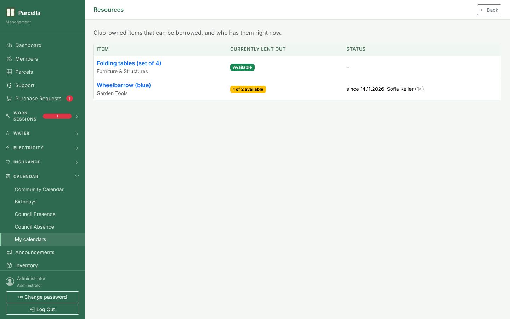

# Calendar

The calendar module keeps the dates your club cares about in one place:
meetings and inspections, member birthdays, when board members are on
site, and when someone is away. Every calendar can be subscribed to from
a phone or desktop calendar app.

!!! info "Who can use this"
    - The module switch is **Calendar** under **Administration → Turning
      modules on and off**. It is **on** by default.
    - The **Board** and **Administrator** roles, and members of a group
      with **Full access to every module**, can do everything.
    - Everyone else needs the **Calendar** permission in one of their
      [groups](../administration/groups.md): *read* to see the
      calendars, *write* to add entries, *delete* to remove them.
    - **Council Absence** is the exception: anyone who is logged in and
      can open the calendar can log an absence.
    - Creating and editing your own calendars under **My calendars**
      needs full access (Board, Administrator or a full-access group).

There is deliberately no month grid. Each calendar is a simple list of
what's coming up, starting today. Past entries drop off the list (and
out of the subscription feeds) automatically.

You find all calendars in the sidebar under **Calendar**:
**Community Calendar**, **Birthdays**, **Council Presence**,
**Council Absence** and **My calendars**. Opening the plain calendar
address takes you to the **Community Calendar**.

## Community Calendar

The club-wide calendar: member meetings, parcel inspections and other
club events, together with the planned work sessions from the
[work hours](work-hours.md) module. This is the calendar you can show on
your public website.

### New Entry

The **New Entry** card on the left is only shown if you have *write*
permission on the calendar.

| Field / button | What it does |
|---|---|
| **Type** | **Member Meeting**, **Parcel Inspection** or **Other** (the default). Only changes the coloured badge in the list. |
| **Title** | Required. The name of the event, e.g. "Annual General Meeting". |
| **Date** | Required. The (first) day of the event. |
| **Time** | Optional start time. Leave it empty for an all-day entry. |
| **End Date** | Optional. Only for multi-day entries -- leave it empty for a single day. |
| **End Time** | Optional end time. |
| **Location** | Optional. Shown with a pin under the title. |
| **Description** | Optional free text. It is not shown in the list, but it goes into the subscription feed and the website widget. |
| **Add Entry** | Saves the entry and shows it in the list. |

### Upcoming

| Column | What it shows |
|---|---|
| **Date** | The date, plus the time range if one was entered. |
| **Title** | The title and location. For a work session, the title links to that session in the work hours module. |
| **Type** | A badge: **Member Meeting**, **Parcel Inspection**, **Other** or **Work Session**. |
| Bin icon | Deletes the entry after a confirmation (**Really delete this entry?**). Only shown with *delete* permission, and only for entries made here -- work sessions are changed in the work hours module. |

If nothing is planned, the list says **No upcoming entries.**

!!! note "Which work sessions appear"
    Only regular, planned work sessions show up here. Spontaneous
    "special" sessions (for example "paint the bench today") are left
    out, because members can't plan around them. Work sessions are
    read straight from the work hours module, so rescheduling a session
    there changes it here too -- there is nothing to keep in sync.

### Subscribe (ICS)

The **Subscribe (ICS)** button at the top right shows the
**Public ICS link (safe to embed on your public website):**. Click into
the box to select the address and copy it.

This feed needs no login and no password. It contains only what is
already public: the entries above and the planned work sessions. You
can add it to a calendar app, or show it on the club website (see
[Subscribing in a calendar app](#subscribing-in-a-calendar-app) below).

<!-- TODO(verify): the WordPress connector plugin renders this calendar with a [parcella_calendar] shortcode. Link to the integrations page once it documents the plugin side. -->

## Birthdays

The upcoming birthdays of your active members. Nothing is stored for
this list: it is worked out from each member's date of birth every time.
Correct a birth date on the [member](members.md) and the list is
right straight away. Members without a date of birth don't appear.

### Choosing the time range and order

The header of the **Upcoming Birthdays** card shows the dates covered
(for example "01.12.2026 – 28.02.2027") and two drop-downs. The list
reloads as soon as you change one.

| Field | What it does |
|---|---|
| Time range | **Next month**, **Next 3 months** (the default) or **Next 12 months**, always counted forward from today. **Next 12 months** lists every member with a date of birth. |
| Sort | **Sort by birthday** (the default), **Sort by last name** or **Sort by plot number**. Sorting by plot uses the member's lowest current plot number and puts members without a plot last. |

### Upcoming Birthdays

| Column | What it shows |
|---|---|
| **Date** | The date of the next birthday. |
| **Name** | The member, linked to their record. Round birthdays (30, 40, 50 ...) get a **Milestone** badge, and the whole row is highlighted. |
| **Turning** | The age the member is turning. |
| **Tags** | The member's tags. Click one to open the member list filtered by that tag. |
| **Present** | **No present** if the member has said they don't want a birthday present (set on the member's record). |

If nobody has a birthday in the chosen range, the list says
**No upcoming birthdays on file.**

### Print PDF

**Print PDF** creates a printable list for whoever hands out the
presents. It uses exactly the time range and order you chose on the
page.

The PDF is A4 landscape, with your club's letterhead, and has more
columns than the web page: plot, name, birthday, age turning (round
birthdays highlighted), tags, "No present", postal address, main e-mail
address and main phone number. When sorted by plot, the members are
grouped under their plot number; a member with several plots appears
under each one, and members without a plot come last under "No plot".

!!! warning "Personal data"
    The printout contains addresses and phone numbers. Treat paper
    copies accordingly.

### Subscribe (ICS)

The **Subscribe (ICS)** button shows a
**Private ICS link (keep this to yourself -- anyone with this link can view it):**.
The feed contains every active member's birthday as a yearly repeating
all-day entry.

## Council Presence

Plan when board members are on site, for example office hours in the
clubhouse. Members can then see when someone from the board is there.

### New Presence Slot

Only shown with *write* permission on the calendar.

| Field / button | What it does |
|---|---|
| **Council Member(s)** | Required. Tick one or more user accounts. Select more than one if several members cover this slot together -- each of them gets their own entry for the same slot. If you tick nobody, the form shows **Select at least one council member** and doesn't save. |
| **Date** | Required. |
| **From** / **Until** | Optional times. Without a time the slot counts as all day. |
| **Note** | Optional, e.g. "Open office hours for members". |
| **Add** | Saves the slot. |

The list of people only shows active user accounts, not every member:
a board member needs a Parcella login to be listed.

### Upcoming

The entries are grouped under one heading per day.

| Column | What it shows |
|---|---|
| **Member** | The user's picture and name. |
| **Time** | From -- until, or a dash if no time was given. |
| **Note** | The note, if any. |
| Bin icon | Deletes this one entry (one person, one slot) after a confirmation. Needs *delete* permission. |

When nothing is planned: **No upcoming presence slots scheduled.**

The **Subscribe (ICS)** button shows a private link, like for birthdays.
Slots with a time show up as timed appointments in calendar apps.

## Council Absence

Holidays and other absences, so the board knows who is not available.
Anyone who is logged in can use this page -- you don't need any extra
permission.

### Log Absence

| Field / button | What it does |
|---|---|
| **Member(s)** | Defaults to you; select others too if you're logging this on their behalf. You can untick yourself to log an absence only for someone else. If you untick everyone, the absence is logged for you. |
| **From** | Required. First day of the absence. |
| **Until** | Required. Last day of the absence. |
| **Note** | Optional, e.g. "Vacation". You decide what, if anything, to explain. |
| **Add** | Saves one absence per ticked person. |

### Upcoming Absences

Absences stay on the list until their last day has passed.

| Column | What it shows |
|---|---|
| **Who** | The user's picture and name. |
| **Period** | From -- until. |
| **Note** | The note, if any. |
| Bin icon | Deletes the entry after a confirmation. You see it on your own entries; the board and full-access users see it on every entry, to clean up mistakes. |

When nobody is away: **No upcoming absences logged.**

The **Subscribe (ICS)** button shows a private link, like for birthdays.
Absences are all-day entries.

## My calendars

Your club's own extra calendars, for anything that doesn't belong on the
public community calendar: clubhouse bookings, board dates, the
mowing rota. None of these calendars is ever public.

The **Calendars** list shows:

- **Resources** at the top, if the [inventory](inventory.md) module is
  on and you may read it -- see [Resources](#resources) below.
- Every calendar with its colour dot, name and description. Click the
  name to open it.
- **Board only** on calendars only the board and full-access users can
  see. Other users don't see these calendars at all.
- **Archived** on calendars that were archived. Only the board and
  full-access users see archived calendars.

If there are no calendars yet, the list says **No calendars yet.**

### New calendar

Only shown to the board and full-access users.

| Field / button | What it does |
|---|---|
| **Name** | Required, up to 100 characters, e.g. "Clubhouse bookings". |
| **Colour** | The colour of the dot next to the name. Defaults to green. |
| **Description** | Optional. Shown under the name and on the calendar's page. |
| **Only visible to the board and full-access users** | Makes this a **Board only** calendar. |
| **Create calendar** | Creates the calendar. |

### Editing a calendar

Open **Edit** under a calendar's name (board and full-access users
only).

| Field / button | What it does |
|---|---|
| **Name**, **Colour**, **Description** | As above. |
| **Only visible to the board and full-access users** | Switches the calendar between everyone and board only. Changing this also creates a new subscription link, so people who subscribed before lose access. |
| **Active (uncheck to archive)** | Untick to archive the calendar. Its entries are kept, but no new ones can be added and its subscription link stops working. Tick it again to bring the calendar back. |
| **New subscription link (old ones stop working)** | Tick this when someone who had the link should no longer see the calendar, for example after leaving the board. |
| **Save** | Saves the changes. |

There is no way to delete a calendar. Archive it instead, so its
history stays.

## A calendar's page

Opening a calendar from **My calendars** shows its colour and name as
the page title, the description, and its upcoming entries. **Back**
returns to **My calendars**.

The **New Entry** card works like the one on the
[Community Calendar](#new-entry), without the **Type** field. It is only
shown with *write* permission and only while the calendar is active.
Title and location can be up to 255 characters; times must be valid
times (hh:mm) or they are ignored.

The **Upcoming** list shows **Date** (with end date and times),
**Title** (with location and description) and a bin icon to delete an
entry (needs *delete* permission).

An archived calendar shows **This calendar is archived: its entries
stay, but no new ones can be added.**

The **Subscribe (ICS)** button (active calendars only) shows a
**Private subscription URL (keep it to yourself)**. Each of your own
calendars has its own secret link, separate from the shared link used
by the birthday and council calendars.

## Resources

A read-only overview of the club's own items that members can borrow,
and who has them right now. It is reached from **My calendars** and only
works when the inventory module is on and you have read permission for
it, because it shows who borrowed what. **Back** returns to
**My calendars**.

The list includes every club-owned item marked as borrowable that hasn't
been retired. Items are managed and lent out in the
[inventory](inventory.md) module, not here.

| Column | What it shows |
|---|---|
| **Item** | The item's name (linked to it in the inventory) and its category. |
| **Status** | The availability: **Available**, **Lent out** (nothing left), or for items you have several of, e.g. "2 of 5 available". |
| **Currently lent out** | One line per open loan: "since 03.11.2026: Jane Doe (1×)", or a dash if nobody has it. |

Loans in Parcella have no planned return date, so this page shows only
the current situation, not a timetable for the future.

If there are no borrowable items: **No borrowable club-owned items.**

## Subscribing in a calendar app

Every calendar has a **Subscribe (ICS)** button with an address
(an "ICS link"). In most calendar apps you add it with an option such
as "Subscribe to calendar", "Add calendar from URL" or "From internet".
The app then checks the address regularly, so new entries appear by
themselves. How often it checks depends on the app.

| Calendar | Link | Who may have it |
|---|---|---|
| Community Calendar | Public | Anyone. Safe for the club website. |
| Birthdays | Private, shared secret | Only people who should see member birthdays. |
| Council Presence | Private, shared secret | Board and helpers. |
| Council Absence | Private, shared secret | Board and helpers. |
| Each of **My calendars** | Private, one secret per calendar | Whoever should see that calendar. |

The birthday, council presence and council absence links all use the
**same** secret for your whole installation. Anyone who has one of
these links can read all three feeds, without logging in. Only hand
them to people you trust.

!!! warning "If a private link gets out"
    For **My calendars**, tick **New subscription link (old ones stop
    working)** on the calendar and save. For the birthday and council
    links there is no button to change the shared secret.
    <!-- TODO(verify): there is no UI to rotate the shared ICS token (stored as a club setting); confirm whether an administrator can reset it somewhere, e.g. via the API club settings. -->

## Related

- [Work hours](work-hours.md) -- where the work sessions on the community
  calendar come from.
- [Members](members.md) -- dates of birth, tags and the "no present"
  setting.
- [Inventory](inventory.md) -- borrowable items and loans.
- [Groups](../administration/groups.md) -- giving someone calendar
  permissions.
- [Turning modules on and off](../administration/modules.md)
