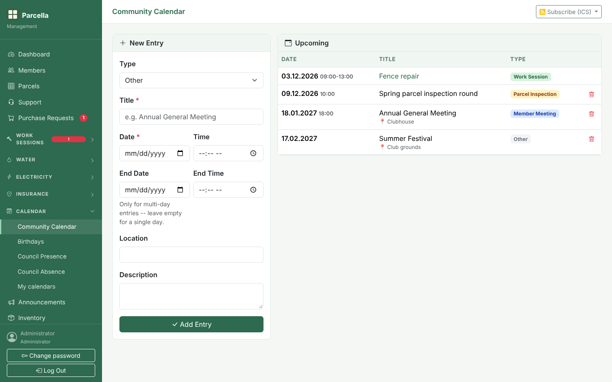
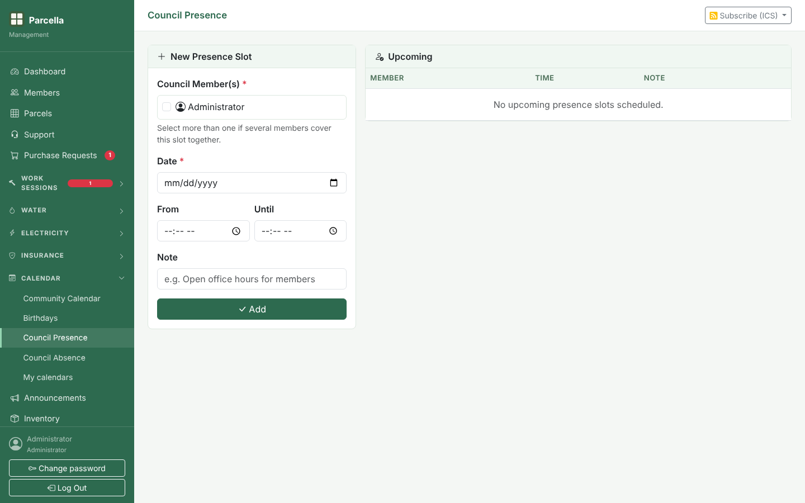
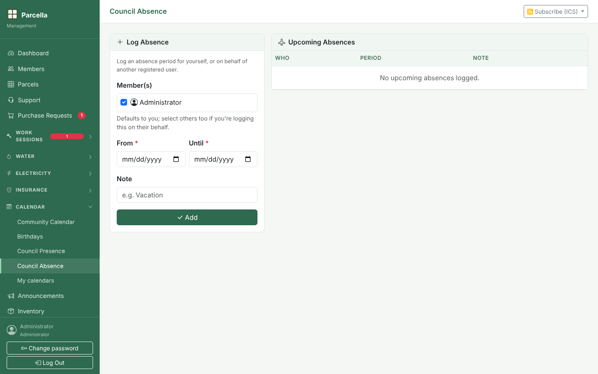
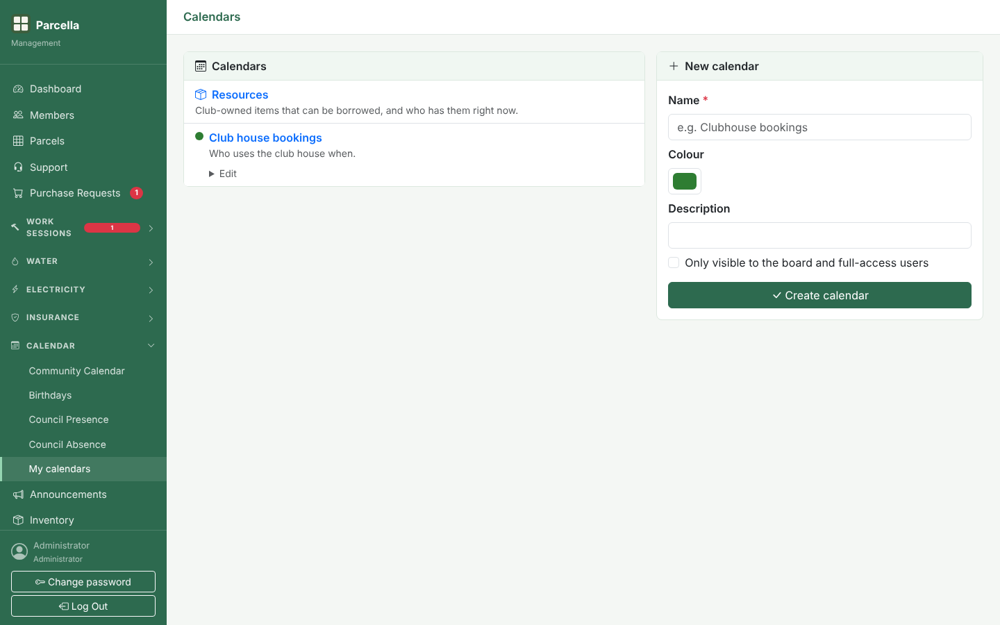

# Kalendár {#calendar}

!!! note "Strojový preklad"
    Táto stránka bola strojovo preložená z angličtiny a zatiaľ nebola skontrolovaná. Ak je niečo nejasné, platí anglická verzia (jazyk prepnete hore).

Modul kalendára uchováva dátumy, na ktorých vášmu spolku záleží, na
jednom mieste: schôdze a kontroly, narodeniny členov, kedy sú členovia
výboru na mieste a kedy je niekto preč. Každý kalendár sa dá odoberať z
kalendárovej aplikácie v telefóne alebo v počítači.

!!! info "Kto to môže používať"
    - Prepínač modulu je **Kalendár** v časti **Administrácia →
      Zapínanie a vypínanie modulov**. Predvolene je **zapnutý**.
    - Roly **Výbor** a **Administrátor** a členovia skupiny s **Plný
      prístup ku každému modulu** môžu všetko.
    - Všetci ostatní potrebujú oprávnenie **Kalendár** v niektorej zo
      svojich [skupín](../administration/groups.md): *čítanie* na
      zobrazenie kalendárov, *zápis* na pridávanie záznamov, *mazanie* na
      ich odstraňovanie.
    - **Neprítomnosť výboru** je výnimka: neprítomnosť môže zadať
      každý, kto je prihlásený a môže otvoriť kalendár.
    - Vytváranie a úprava vlastných kalendárov v časti **Vlastné
      kalendáre** potrebuje plný prístup (Výbor, Administrátor alebo
      skupina s plným prístupom).

Mesačná mriežka zámerne neexistuje. Každý kalendár je jednoduchý zoznam
toho, čo príde, od dneška. Minulé záznamy zo zoznamu (aj z kanálov na
odber) vypadávajú automaticky.

Všetky kalendáre nájdete v bočnom paneli pod **Kalendár**: **Kalendár
klubu**, **Narodeniny**, **Prítomnosť výboru**, **Neprítomnosť výboru**
a **Vlastné kalendáre**. Otvorenie samotnej adresy kalendára vás
zavedie do **Kalendára klubu**.

## Kalendár klubu {#community-calendar}

Kalendár celého spolku: členské schôdze, kontroly parciel a iné udalosti
spolku, spolu s plánovanými pracovnými zmenami z modulu [pracovných
hodín](work-hours.md). Tento kalendár môžete zobraziť na svojom
verejnom webe.

### Nový záznam {#new-entry}

Karta **Nový záznam** vľavo sa zobrazí, len ak máte pre kalendár
oprávnenie *zápis*.

| Pole / tlačidlo | Čo robí |
|---|---|
| **Typ** | **Členská schôdza**, **Kontrola záhradky** alebo **Ostatné** (predvolené). Mení len farebný odznak v zozname. |
| **Názov** | Povinné. Názov udalosti, napr. „Valné zhromaždenie“. |
| **Dátum** | Povinné. (Prvý) deň udalosti. |
| **Čas** | Voliteľný čas začiatku. Pre celodenný záznam ho nechajte prázdny. |
| **Dátum ukončenia** | Voliteľné. Iba pre viacdňové záznamy -- pre jeden deň ponechajte prázdne. |
| **Čas ukončenia** | Voliteľný čas konca. |
| **Miesto** | Voliteľné. Zobrazí sa so špendlíkom pod názvom. |
| **Popis** | Voliteľný voľný text. V zozname sa nezobrazuje, ale ide do kanála na odber a do widgetu na webe. |
| **Pridať záznam** | Uloží záznam a ukáže ho v zozname. |

### Nadchádzajúce {#upcoming}

| Stĺpec | Čo ukazuje |
|---|---|
| **Dátum** | Dátum, plus časový rozsah, ak bol zadaný. |
| **Názov** | Názov a miesto. Pri pracovnej zmene názov odkazuje na túto zmenu v module pracovných hodín. |
| **Typ** | Odznak: **Členská schôdza**, **Kontrola záhradky**, **Ostatné** alebo **Pracovná zmena**. |
| Ikona koša | Po potvrdení (**Naozaj zmazať tento záznam?**) záznam zmaže. Zobrazí sa len s oprávnením *mazanie* a len pri záznamoch vytvorených tu -- pracovné zmeny sa menia v module pracovných hodín. |

Ak nie je nič naplánované, zoznam hovorí **Žiadne nadchádzajúce
záznamy.**

!!! note "Ktoré pracovné zmeny sa zobrazujú"
    Zobrazujú sa tu len bežné, plánované pracovné zmeny. Spontánne
    „špeciálne“ zmeny (napríklad „dnes natrieť lavičku“) sú vynechané,
    pretože členovia sa podľa nich nemôžu plánovať. Pracovné zmeny sa
    čítajú priamo z modulu pracovných hodín, takže presunutie zmeny tam
    ju zmení aj tu -- nie je čo synchronizovať.

### Odoberať (ICS) {#subscribe-ics}

Tlačidlo **Odoberať (ICS)** vpravo hore ukáže **Verejný odkaz ICS
(možno vložiť na verejný web):**. Kliknite do poľa, aby ste adresu
označili, a skopírujte ju.

Tento kanál nepotrebuje prihlásenie ani heslo. Obsahuje len to, čo je
už verejné: záznamy vyššie a plánované pracovné zmeny. Môžete ho pridať
do kalendárovej aplikácie alebo zobraziť na webe spolku (pozri
[Odber v kalendárovej aplikácii](#subscribing-in-a-calendar-app) nižšie).

<!-- TODO(verify): the WordPress connector plugin renders this calendar with a [parcella_calendar] shortcode. Link to the integrations page once it documents the plugin side. -->

## Narodeniny {#birthdays}

Nadchádzajúce narodeniny vašich aktívnych členov. Pre tento zoznam sa
nič neukladá: zakaždým sa vypočíta z dátumu narodenia každého člena.
Opravte dátum narodenia pri [členovi](members.md) a zoznam je hneď
správny. Členovia bez dátumu narodenia sa nezobrazujú.

### Výber obdobia a poradia {#choosing-the-time-range-and-order}

Hlavička karty **Nadchádzajúce narodeniny** ukazuje pokryté dátumy
(napríklad „01.12.2026 – 28.02.2027“) a dva rozbaľovacie zoznamy.
Zoznam sa znova načíta, hneď ako niektorý zmeníte.

| Pole | Čo robí |
|---|---|
| Obdobie | **Budúci mesiac**, **Nasledujúce 3 mesiace** (predvolené) alebo **Nasledujúcich 12 mesiacov**, vždy počítané od dneška dopredu. **Nasledujúcich 12 mesiacov** uvádza každého člena s dátumom narodenia. |
| Zoradenie | **Zoradiť podľa narodenín** (predvolené), **Zoradiť podľa priezviska** alebo **Zoradiť podľa čísla parcely**. Zoradenie podľa parcely používa najnižšie aktuálne číslo parcely člena a členov bez parcely dáva na koniec. |

### Nadchádzajúce narodeniny {#upcoming-birthdays}

| Stĺpec | Čo ukazuje |
|---|---|
| **Dátum** | Dátum najbližších narodenín. |
| **Meno** | Člen s odkazom na jeho záznam. Okrúhle narodeniny (30, 40, 50 ...) dostanú odznak **Okrúhle** a celý riadok je zvýraznený. |
| **Oslávi** | Vek, ktorý člen oslávi. |
| **Štítky** | Štítky člena. Kliknutím na niektorý otvoríte zoznam členov filtrovaný podľa tohto štítku. |
| **Darček** | **Bez darčeka**, ak člen povedal, že nechce darček k narodeninám (nastavuje sa v zázname člena). |

Ak nikto nemá narodeniny vo vybranom období, zoznam hovorí **Žiadne
nadchádzajúce narodeniny v systéme.**

### Tlačiť PDF {#print-pdf}

**Tlačiť PDF** vytvorí zoznam na tlač pre toho, kto rozdáva darčeky.
Použije presne to obdobie a poradie, ktoré ste vybrali na stránke.

PDF je A4 na šírku, s hlavičkou vášho spolku, a má viac stĺpcov ako
webová stránka: parcela, meno, narodeniny, vek (okrúhle narodeniny
zvýraznené), štítky, „Bez darčeka“, poštová adresa, hlavná e-mailová
adresa a hlavné telefónne číslo. Pri zoradení podľa parcely sú členovia
zoskupení pod číslom svojej parcely; člen s viacerými parcelami sa
objaví pod každou z nich a členovia bez parcely sú na konci pod „Bez
parcely“.

!!! warning "Osobné údaje"
    Výtlačok obsahuje adresy a telefónne čísla. S papierovými kópiami
    podľa toho zaobchádzajte.

### Odoberať (ICS) {#subscribe-ics_1}

Tlačidlo **Odoberať (ICS)** ukáže **Súkromný odkaz ICS (nezdieľajte --
ktokoľvek s týmto odkazom ho môže zobraziť):**. Kanál obsahuje
narodeniny každého aktívneho člena ako každoročne sa opakujúci
celodenný záznam.

## Prítomnosť výboru {#council-presence}

Plánujte, kedy sú členovia výboru na mieste, napríklad konzultačné
hodiny v klubovni. Členovia potom vidia, kedy je tam niekto z výboru.

### Nový termín prítomnosti {#new-presence-slot}

Zobrazí sa len s oprávnením *zápis* pre kalendár.

| Pole / tlačidlo | Čo robí |
|---|---|
| **Člen(ovia) výboru** | Povinné. Zaškrtnite jeden alebo viac používateľských účtov. Vyberte viac osôb, ak sa o tento termín delí viac členov -- každý z nich dostane vlastný záznam pre ten istý termín. Ak nezaškrtnete nikoho, formulár ukáže **Vyberte aspoň jedného člena výboru** a neuloží sa. |
| **Dátum** | Povinné. |
| **Od** / **Do** | Voliteľné časy. Bez času sa termín počíta ako celodenný. |
| **Poznámka** | Voliteľné, napr. „Konzultačné hodiny pre členov“. |
| **Pridať** | Uloží termín. |

Zoznam ľudí ukazuje len aktívne používateľské účty, nie každého člena:
aby bol člen výboru uvedený, potrebuje prihlásenie do Parcelly.

### Nadchádzajúce {#upcoming_1}

Záznamy sú zoskupené pod jedným nadpisom na každý deň.

| Stĺpec | Čo ukazuje |
|---|---|
| **Člen** | Obrázok a meno používateľa. |
| **Čas** | Od -- do alebo pomlčka, ak čas nebol zadaný. |
| **Poznámka** | Poznámka, ak nejaká je. |
| Ikona koša | Po potvrdení zmaže tento jeden záznam (jedna osoba, jeden termín). Potrebuje oprávnenie *mazanie*. |

Keď nie je nič naplánované: **Žiadne naplánované termíny prítomnosti.**

Tlačidlo **Odoberať (ICS)** ukáže súkromný odkaz, ako pri narodeninách.
Termíny s časom sa v kalendárových aplikáciách zobrazia ako schôdzky s
časom.

## Neprítomnosť výboru {#council-absence}

Dovolenky a iné neprítomnosti, aby výbor vedel, kto nie je k dispozícii.
Túto stránku môže používať každý, kto je prihlásený -- nepotrebujete
žiadne ďalšie oprávnenie.

### Zadať neprítomnosť {#log-absence}

| Pole / tlačidlo | Čo robí |
|---|---|
| **Člen(ovia)** | Predvolene ste to vy; vyberte aj ďalšie osoby, ak to zadávate v ich mene. Seba môžete odškrtnúť, ak chcete zadať neprítomnosť len pre niekoho iného. Ak odškrtnete všetkých, neprítomnosť sa zadá pre vás. |
| **Od** | Povinné. Prvý deň neprítomnosti. |
| **Do** | Povinné. Posledný deň neprítomnosti. |
| **Poznámka** | Voliteľné, napr. „Dovolenka“. Vy rozhodujete, čo prípadne vysvetlíte. |
| **Pridať** | Uloží jednu neprítomnosť na každú zaškrtnutú osobu. |

### Nadchádzajúce neprítomnosti {#upcoming-absences}

Neprítomnosti zostávajú v zozname, kým neuplynie ich posledný deň.

| Stĺpec | Čo ukazuje |
|---|---|
| **Kto** | Obrázok a meno používateľa. |
| **Obdobie** | Od -- do. |
| **Poznámka** | Poznámka, ak nejaká je. |
| Ikona koša | Po potvrdení záznam zmaže. Vidíte ju pri vlastných záznamoch; výbor a používatelia s plným prístupom ju vidia pri každom zázname, aby mohli upratať chyby. |

Keď nikto nie je preč: **Žiadne zadané neprítomnosti.**

Tlačidlo **Odoberať (ICS)** ukáže súkromný odkaz, ako pri narodeninách.
Neprítomnosti sú celodenné záznamy.

## Vlastné kalendáre {#my-calendars}

Ďalšie vlastné kalendáre vášho spolku na všetko, čo nepatrí do verejného
kalendára spolku: rezervácie klubovne, termíny výboru, rozpis kosenia.
Žiadny z týchto kalendárov nie je nikdy verejný.

Zoznam **Kalendáre** ukazuje:

- **Zdroje** hore, ak je zapnutý modul [inventára](inventory.md) a
  smiete ho čítať -- pozri [Zdroje](#resources) nižšie.
- Každý kalendár s farebnou bodkou, názvom a popisom. Kliknutím na názov
  ho otvoríte.
- **Len výbor** pri kalendároch, ktoré vidia len výbor a používatelia s
  plným prístupom. Ostatní používatelia tieto kalendáre vôbec nevidia.
- **Archivované** pri kalendároch, ktoré boli archivované. Archivované
  kalendáre vidia len výbor a používatelia s plným prístupom.

Ak ešte nie sú žiadne kalendáre, zoznam hovorí **Zatiaľ žiadne
kalendáre.**

### Nový kalendár {#new-calendar}

Zobrazí sa len výboru a používateľom s plným prístupom.

| Pole / tlačidlo | Čo robí |
|---|---|
| **Názov** | Povinné, najviac 100 znakov, napr. „rezervácie klubovne“. |
| **Farba** | Farba bodky vedľa názvu. Predvolene zelená. |
| **Popis** | Voliteľné. Zobrazí sa pod názvom a na stránke kalendára. |
| **Viditeľné len pre výbor a používateľov s plným prístupom** | Urobí z neho kalendár **Len výbor**. |
| **Vytvoriť kalendár** | Vytvorí kalendár. |

### Úprava kalendára {#editing-a-calendar}

Otvorte **Upraviť** pod názvom kalendára (len výbor a používatelia s
plným prístupom).

| Pole / tlačidlo | Čo robí |
|---|---|
| **Názov**, **Farba**, **Popis** | Ako vyššie. |
| **Viditeľné len pre výbor a používateľov s plným prístupom** | Prepína kalendár medzi všetkými a len výborom. Zmena vytvorí aj novú adresu odberu, takže tí, ktorí ho predtým odoberali, stratia prístup. |
| **Aktívny (odškrtnite na archiváciu)** | Odškrtnutím kalendár archivujete. Jeho záznamy sa zachovajú, ale nové sa nedajú pridať a jeho adresa odberu prestane fungovať. Zaškrtnutím ho vrátite späť. |
| **Nová adresa odberu (staré prestanú fungovať)** | Zaškrtnite, keď niekto, kto mal odkaz, by už nemal kalendár vidieť, napríklad po odchode z výboru. |
| **Uložiť** | Uloží zmeny. |

Kalendár sa nedá zmazať. Namiesto toho ho archivujte, aby jeho história
zostala.

## Stránka kalendára {#a-calendars-page}

Otvorenie kalendára z **Vlastné kalendáre** ukáže jeho farbu a názov ako
nadpis stránky, popis a nadchádzajúce záznamy. **Späť** vás vráti do
**Vlastné kalendáre**.

Karta **Nový záznam** funguje ako v [Kalendári klubu](#new-entry), bez
poľa **Typ**. Zobrazí sa len s oprávnením *zápis* a len kým je kalendár
aktívny. Názov a miesto môžu mať najviac 255 znakov; časy musia byť
platné (hh:mm), inak sa ignorujú.

Zoznam **Nadchádzajúce** ukazuje **Dátum** (s dátumom ukončenia a
časmi), **Názov** (s miestom a popisom) a ikonu koša na zmazanie záznamu
(potrebuje oprávnenie *mazanie*).

Archivovaný kalendár ukazuje **Tento kalendár je archivovaný: záznamy
zostávajú, nové nemožno pridať.**

Tlačidlo **Odoberať (ICS)** (len pri aktívnych kalendároch) ukáže
**Súkromná adresa odberu (nezdieľajte)**. Každý z vašich vlastných
kalendárov má vlastný tajný odkaz, oddelený od spoločného odkazu
používaného kalendármi narodenín a výboru.

## Zdroje {#resources}

Prehľad len na čítanie o vlastných predmetoch spolku, ktoré si členovia
môžu požičať, a o tom, kto ich práve má. Otvoríte ho z **Vlastné
kalendáre** a funguje len vtedy, keď je zapnutý modul inventára a máte
preň oprávnenie na čítanie, pretože ukazuje, kto si čo požičal.
**Späť** vás vráti do **Vlastné kalendáre**.

Zoznam obsahuje každý predmet vo vlastníctve spolku označený na
požičanie, ktorý nebol vyradený. Predmety sa spravujú a požičiavajú v
module [inventára](inventory.md), nie tu.

| Stĺpec | Čo ukazuje |
|---|---|
| **Predmet** | Názov predmetu (s odkazom naň v inventári) a jeho kategória. |
| **Stav** | Dostupnosť: **K dispozícii**, **Zapožičané** (nič nezostalo) alebo pri predmetoch, ktorých máte viac, napr. „K dispozícii 2 z 5“. |
| **Práve zapožičané** | Jeden riadok na otvorenú výpožičku: „od 03.11.2026: Jana Nováková (1×)“ alebo pomlčka, ak ho nikto nemá. |

Výpožičky v Parcelle nemajú plánovaný dátum vrátenia, takže táto
stránka ukazuje len aktuálny stav, nie rozvrh do budúcnosti.

Ak nie sú žiadne predmety na požičanie: **Žiadne predmety spolku na
zapožičanie.**

## Odber v kalendárovej aplikácii {#subscribing-in-a-calendar-app}

Každý kalendár má tlačidlo **Odoberať (ICS)** s adresou („odkaz ICS“).
Vo väčšine kalendárových aplikácií ho pridáte voľbou ako „Odoberať
kalendár“, „Pridať kalendár z URL“ alebo „Z internetu“. Aplikácia potom
adresu pravidelne kontroluje, takže nové záznamy sa objavia samy. Ako
často kontroluje, závisí od aplikácie.

| Kalendár | Odkaz | Kto ho smie mať |
|---|---|---|
| Kalendár klubu | Verejný | Ktokoľvek. Bezpečný pre web spolku. |
| Narodeniny | Súkromný, spoločný tajný kľúč | Len ľudia, ktorí majú vidieť narodeniny členov. |
| Prítomnosť výboru | Súkromný, spoločný tajný kľúč | Výbor a pomocníci. |
| Neprítomnosť výboru | Súkromný, spoločný tajný kľúč | Výbor a pomocníci. |
| Každý z **Vlastné kalendáre** | Súkromný, jeden tajný kľúč na kalendár | Ktokoľvek, kto má daný kalendár vidieť. |

Odkazy na narodeniny, prítomnosť výboru a neprítomnosť výboru používajú
pre celú vašu inštaláciu **ten istý** tajný kľúč. Kto má jeden z týchto
odkazov, môže čítať všetky tri kanály bez prihlásenia. Dávajte ich len
ľuďom, ktorým dôverujete.

!!! warning "Ak sa súkromný odkaz dostane von"
    Pri **Vlastné kalendáre** zaškrtnite pri kalendári **Nová adresa
    odberu (staré prestanú fungovať)** a uložte. Pri odkazoch na
    narodeniny a výbor tlačidlo na zmenu spoločného tajného kľúča
    neexistuje.
    <!-- TODO(verify): there is no UI to rotate the shared ICS token (stored as a club setting); confirm whether an administrator can reset it somewhere, e.g. via the API club settings. -->

## Súvisiace {#related}

- [Pracovné hodiny](work-hours.md) -- odkiaľ pochádzajú pracovné zmeny
  v kalendári spolku.
- [Členovia](members.md) -- dátumy narodenia, štítky a nastavenie „bez
  darčeka“.
- [Inventár](inventory.md) -- predmety na požičanie a výpožičky.
- [Skupiny](../administration/groups.md) -- udelenie oprávnení pre
  kalendár.
- [Zapínanie a vypínanie modulov](../administration/modules.md)
