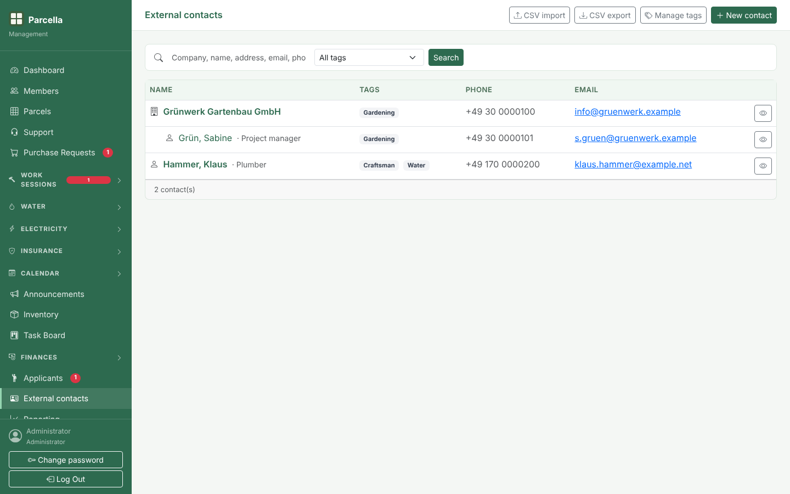

# Externe Kontakte {#external-contacts}

Externe Kontakte ist das Adressbuch des Vereins für alle, die kein Mitglied
sind: Lieferanten, Handwerker, die Wasserwerke, die Stadtverwaltung. Ein
Kontakt ist entweder eine **Firma** oder eine **Person**, und eine Person
kann bei einer Firma arbeiten. Du kannst Kontakte mit Eingangsrechnungen und
Einkaufswünschen verknüpfen, mit Tags versehen und ihre Dokumente in der
Cloud des Vereins ablegen.

!!! info "Wer das nutzen kann"
    Vorstandsmitglieder und Administratoren haben immer vollen Zugriff.
    Alle anderen sehen nichts von diesem Modul, bis eine Gruppe Rechte für
    **Externe Kontakte** gewährt (siehe [Gruppen](../administration/groups.md)):

    - **Lesen** -- Liste und Kontaktseiten sehen, CSV exportieren, die
      Tag-Seite sehen, Dokumente herunterladen.
    - **Schreiben** -- Kontakte anlegen und bearbeiten, Telefonnummern,
      E-Mail-Adressen und Tags hinzufügen, Tags umbenennen, CSV
      importieren, den Dokumentenordner eines Kontakts wählen und Dokumente
      hochladen.
    - **Löschen** -- Kontakte, Telefonnummern, E-Mail-Adressen und Tags
      löschen und Firmen zusammenführen.

    Eingeschaltet wird das Modul mit **Externe Kontakte** unter
    [Module ein- und ausschalten](../administration/modules.md). Es ist
    standardmäßig an.

## Firmen und Personen {#companies-and-people}

- Eine **Firma** hat einen Firmennamen, eine Adresse, eine IBAN und eigene
  Telefonnummern und E-Mail-Adressen.
- Eine **Person** hat Vor- und Nachnamen, eine Position (z. B.
  „Sachbearbeiter“, „Inhaber“) und optional eine Firma. Hat die Person
  keine eigene Adresse oder IBAN, zeigt ihre Seite die der Firma.
- Ob ein Kontakt eine Firma oder eine Person ist, entscheidest du beim
  Anlegen; später lässt es sich nicht ändern.
- Ein Firmenname darf nur einmal vorkommen, ebenso der Name einer Person
  (Großbuchstaben spielen keine Rolle). Mitglieder zählen nicht -- ein
  Kontakt darf denselben Namen haben wie ein Mitglied.
- Jedes Feld ist freiwillig. Ein Kontakt ganz ohne Namen erscheint als
  **Kontakt ohne Namen**.

## Kontaktliste {#contact-list}

**Externe Kontakte** in der Navigation listet jede Firma, darunter
eingerückt ihre Personen, und jede Person, die zu keiner Firma gehört. Die
Liste ist alphabetisch nach Firmenname sortiert, bei Personen ohne Firma
nach Nachname.

| Feld / Schaltfläche | Was es bewirkt |
|---|---|
| **CSV-Import** | Öffnet den [Import-Dialog](#csv-import). Braucht Schreibrecht. |
| **CSV-Export** | Lädt die Liste als CSV-Datei herunter (siehe [CSV-Export](#csv-export)). Nutzt die aktuelle Suche und den Tag-Filter. |
| **Tags verwalten** | Öffnet die [Tag-Seite](#contact-tags). |
| **Neuer Kontakt** | Öffnet das [Kontaktformular](#contact-form). Braucht Schreibrecht. |
| Suchfeld | Durchsucht Firmenname, Vor- und Nachname, Position, Straße, PLZ, Ort, IBAN, Notizen, Telefonnummern und E-Mail-Adressen. **Suchen** wendet die Suche an. |
| **Alle Tags** / ein Tag | Zeigt nur Kontakte mit diesem Tag. Erscheint erst, wenn es Tags gibt. |
| **Zurücksetzen** | Hebt Suche und Tag-Filter auf. Erscheint nur, solange ein Filter aktiv ist. |

| Spalte | Was sie zeigt |
|---|---|
| **Name** | Ein Gebäude-Symbol für Firmen, ein Personen-Symbol für Personen; der Name verlinkt auf die Kontaktseite. Personen zeigen ihre Position hinter dem Namen. |
| **Tags** | Die Tags des Kontakts. Ein Klick auf einen Tag filtert die Liste danach. |
| **Telefon** | Die erste Telefonnummer. |
| **E-Mail** | Die erste E-Mail-Adresse, als E-Mail-Link. |
| Augen-Schaltfläche | Öffnet den Kontakt. |

Passt eine Suche oder ein Tag auf eine Person, wird ihre Firma mit
aufgelistet und die passende Person darunter hervorgehoben. Die Fußzeile
zeigt, wie viele Einträge (Firmen und Personen ohne Firma) gelistet sind.

## Kontaktformular {#contact-form}

**Neuer Kontakt** öffnet ein leeres Formular, **Bearbeiten** auf einer
Kontaktseite das ausgefüllte. **Person hinzufügen** auf der Seite einer Firma
öffnet es als neue Person mit schon eingetragener Firma.

Bei einem neuen Kontakt wählst du oben zuerst **Firma** oder **Person**. Das
Formular zeigt dann nur die Felder für diese Art.

### Firma / Person {#company-person}

| Feld | Erscheint bei | Was es bewirkt |
|---|---|---|
| **Vorname**, **Nachname** | Person | Der Name der Person. Ein Teil genügt. |
| **Firmenname** | Firma | Der Name der Firma. |
| **Firma (optional)** | Person | Die Firma, bei der die Person arbeitet. Schlägt beim Tippen bestehende Firmen vor. Eine vorhandene Firma wird verknüpft; ein neuer Name legt diese Firma an. Leer lassen für eine Person ohne Firma. Beim **Bearbeiten** löst das Leeren die Person von der Firma. |
| **Position** | Person | Z. B. „Sachbearbeiter, Inhaber“. |
| **E-Mail**, **Telefon** | Neue Kontakte | Die erste E-Mail-Adresse und Telefonnummer. Weitere ergänzt du später auf der Kontaktseite. |

Der Hinweis „Alle Felder sind optional. Ein Firmenname und ein
Personenname dürfen je nur einmal vorkommen.“ erinnert an die
[Regeln oben](#companies-and-people).

### Adresse & Bankverbindung {#address-bank-details}

| Feld | Was es bewirkt |
|---|---|
| **Straße**, **PLZ**, **Ort** | Die Postadresse. |
| **IBAN** | Bankkonto, z. B. um die Rechnungen des Lieferanten zu bezahlen. Bis zu 34 Zeichen. |

Bei einer Person mit Firma: „Leer lassen, um die der Firma zu verwenden.
Zusammen mit einer neuen Firma wird sie zur Adresse der Firma.“ Hat die
Firma noch keine Adresse oder IBAN, wird deine Eingabe bei der Firma
gespeichert; ist sie gleich der der Firma, wird sie nicht doppelt
gespeichert. Nur eine Adresse oder IBAN, die wirklich abweicht, bleibt bei
der Person.

### Notizen und Tags {#notes-and-tags}

| Feld | Was es bewirkt |
|---|---|
| **Notizen** | Freitext -- Öffnungszeiten, Kundennummer, eine Ticketnummer. Die Suche der Liste findet ihn. |
| Tag-Kästchen | Bestehende Tags anhaken. |
| **Neue Tags, durch Komma getrennt** | Neue Tags eintippen; sie werden angelegt und hinzugefügt. |

Klick auf **Kontakt anlegen** (neu) oder **Änderungen speichern**
(bearbeiten) oder **Abbrechen**. Gibt es schon eine Firma oder Person mit
demselben Namen, kommt das Formular mit einer Meldung wie „Eine Firma …
gibt es schon.“ zurück und behält, was du eingetippt hast.

## Kontaktseite {#contact-page}

### Schaltflächen {#buttons}

| Schaltfläche | Was sie bewirkt |
|---|---|
| **Bearbeiten** | Öffnet das Kontaktformular. Braucht Schreibrecht. |
| **Zurück** / **Weiter** | Der vorherige oder nächste Eintrag der Liste, mit deiner Suche und deinem Tag-Filter. Tastatur: ++ctrl+left++ und ++ctrl+right++. |
| **Zur Liste** | Führt mit demselben Filter zur Liste zurück. |

### Firma / Person {#company-person_1}

| Feld | Was es zeigt |
|---|---|
| **Firma** (Firma) | Der Firmenname. |
| **Name**, **Position**, **Firma** (Person) | Name und Position der Person und ein Link zu ihrer Firma. Eine gelöschte Firma ist mit „(gelöscht)“ markiert. |
| **Adresse** | Die Adresse des Kontakts. Bei einer Person ohne eigene die der Firma, markiert mit **Adresse der Firma**. |
| **IBAN** | Die IBAN des Kontakts. Bei einer Person ohne eigene die der Firma, markiert mit **IBAN der Firma**. |

### Personen {#people}

Nur auf der Seite einer Firma: jede Person bei der Firma, mit Position,
Telefonnummern und E-Mail-Adressen. **Person hinzufügen** legt eine neue
Person bei dieser Firma an (Schreibrecht). Gibt es keine, steht dort „Noch
keine Personen bei dieser Firma.“

### Tags {#tags}

Die Tags des Kontakts; ein Klick auf einen zeigt alle Kontakte damit. Mit
Schreibrecht entfernt das **x** an einem Tag diesen bei diesem Kontakt, und
das Feld **Tag hinzufügen…** fügt einen bestehenden oder neuen Tag hinzu (bis
zu 100 Zeichen). **Tags verwalten** öffnet die [Tag-Seite](#contact-tags).

### Telefonnummern und E-Mail-Adressen {#phone-numbers-and-email-addresses}

| Feld / Schaltfläche | Was es bewirkt |
|---|---|
| Nummer / Adresse | Ein Klick ruft an oder öffnet eine E-Mail. Eine Bezeichnung steht in Klammern. |
| Nummern- / Adressfeld, **Bezeichnung (optional)**, **+** | Fügt eine weitere Nummer oder Adresse hinzu, z. B. mit „Büro“ oder „Rechnungen“ bezeichnet. Braucht Schreibrecht. |
| Papierkorb-Schaltfläche | Entfernt die Nummer oder Adresse. Braucht Löschrecht. |

### Eingangsrechnungen und Einkaufswünsche {#incoming-invoices-and-purchase-requests}

Listet die mit diesem Kontakt verknüpften
[Eingangsrechnungen](finances/incoming-invoices.md) und
[Einkaufswünsche](purchase-requests.md) -- auf der Seite einer Firma auch
die ihrer Personen, mit dem Namen der Person hinter dem Eintrag. Jede Karte
erscheint nur, wenn das Modul eingeschaltet ist und du es lesen darfst.

| Karte | Spalten |
|---|---|
| **Eingangsrechnungen** | Rechnungsdatum, Rechnungsnummer (oder Absender), Gesamtbetrag. |
| **Einkaufswünsche** | Erstellungsdatum, Titel, geschätzte Kosten. |

### Dokumente {#documents}

Erscheint, wenn das Modul Cloud-Speicher eingeschaltet ist. Briefe,
Angebote und Verträge liegen nicht in Parcella, sondern in einem Ordner in
der Cloud des Vereins; diese Karte zeigt den Ordner.

- Ein Administrator legt zuerst den Basisordner unter
  [Integrationen](../administration/integrations.md) fest (**Ordner für
  Dokumente externer Kontakte**). Bis dahin sagt die Karte das.
- Den Ordner für jeden Kontakt legst du von Hand in der Cloud an, im
  Basisordner. Auf der Kontaktseite wählt ihn dann jemand mit Schreibrecht
  in der Liste **Ordner** und klickt auf **Ordner speichern**. **Ordner
  ändern** wählt einen anderen; **— kein Ordner —** hebt die Verknüpfung
  auf (die Dateien bleiben in der Cloud).
- Ist ein Ordner gewählt, listet die Karte seine Dateien und Unterordner.
  Ein Klick auf einen Unterordner öffnet ihn, ein Klick auf eine Datei lädt
  sie herunter. Der Pfad über der Liste führt zurück nach oben.
- Mit Schreibrecht legt **Hochladen** eine Datei in den Ordner, der gerade
  angezeigt wird.
- Dateien löschen, umbenennen und verschieben machst du in der Cloud
  selbst.

Dokumente gehören zur Firma: Die Seite einer Person verlinkt stattdessen
auf die Dokumente der Firma („Dokumente liegen bei der Firma:“).

!!! warning
    Benennst du den Ordner eines Kontakts in der Cloud um, verliert
    Parcella ihn aus den Augen. Wähl ihn auf der Kontaktseite neu.

### Notizen {#notes}

Die Notizen, falls vorhanden.

### Gefahrenzone {#danger-zone}

Erscheint mit Löschrecht.

| Feld / Schaltfläche | Was es bewirkt |
|---|---|
| **Zusammenführen mit** + **Zusammenführen** | Nur auf der Seite einer Firma. Für zwei Einträge derselben Firma (z. B. „Müller GmbH“ und „Mueller GmbH“): die zu behaltende Firma wählen, auf **Zusammenführen** klicken und bestätigen. Personen, Telefonnummern, E-Mail-Adressen, Tags und verknüpfte Rechnungen und Einkaufswünsche wandern zur gewählten Firma. Deren Adresse, IBAN und Dokumentenordner werden aus dieser ergänzt, wo sie keine hat; Notizen werden an ihre Notizen angehängt. Diese Firma wird dann gelöscht, und die behaltene öffnet sich. |
| **Kontakt löschen** | Löscht den Kontakt nach einer Bestätigung. Er verschwindet aus der Liste und den Auswahlfeldern, verknüpfte Rechnungen und Einkaufswünsche zeigen ihn aber weiter (dort, wo sie ihn zeigen, als „gelöscht“ markiert). Sein Name wird wieder frei. Eine Firma, die noch Personen hat, lässt sich nicht löschen: „Diese Firma hat noch Personen. Bitte erst verschieben oder löschen.“ |

## Kontakt-Tags {#contact-tags}

**Tags verwalten** öffnet **Kontakt-Tags**. Kontakt-Tags sind getrennt von
den Mitglieder-Tags. **Zurück zu den Kontakten** führt zur Liste zurück.

| Feld / Schaltfläche | Was es bewirkt |
|---|---|
| **Markiert Bewerbungen:** | Einen Tag (oder **— keiner —**) wählen und auf **Speichern** klicken. Bewerbungen, deren Name, E-Mail-Adresse oder Telefonnummer zu einem Kontakt mit diesem Tag passt, bekommen in der Bewerberliste eine rote Markierung und auf ihrer Seite eine Warnung -- nützlich für einen Tag „nicht verpachten“. Eine markierte Firma markiert auch ihre Personen. Erscheint nur, wenn das Bewerbermodul eingeschaltet ist und es Tags gibt; ändern braucht Schreibrecht. Siehe [Bewerber](applicants.md). |
| Tag-Name + Häkchen-Schaltfläche | Benennt den Tag bei allen Kontakten um. Braucht Schreibrecht. Ein schon vorhandener Name wird abgelehnt. |
| ***N* Kontakt(e)** | Öffnet die Liste, gefiltert nach diesem Tag. |
| Papierkorb-Schaltfläche | Löscht den Tag bei allen Kontakten nach einer Bestätigung. Braucht Löschrecht. |
| **Übersetzungen** | Öffnet ein Feld je Sprache. Der Name eines Tags kann je Sprache anders angezeigt werden; leere Felder zeigen den eigenen Namen des Tags. **Übersetzungen speichern** speichert sie (Schreibrecht). |

Neue Tags legst du bei einem Kontakt oder im Kontaktformular an, nicht auf
dieser Seite.

## CSV-Export {#csv-export}

**CSV-Export** lädt `external-contacts.csv` herunter: durch Semikolons
getrennt, eine Zeile je Firma oder Person, mit den Spalten Typ, Firma,
Vorname, Nachname, Position, Strasse, PLZ, Ort, IBAN, E-Mail-Adressen,
Telefonnummern, Tags, Notizen. „Typ“ ist „Firma“ oder „Person“. Jede Firma
kommt zuerst, gefolgt von ihren Personen. Mehrere E-Mail-Adressen, Nummern
oder Tags teilen sich eine Zelle, getrennt durch Semikolons.

Die Datei lässt sich unverändert wieder importieren.

## CSV-Import {#csv-import}

Der Import hat zwei Schritte und braucht Schreibrecht.

### Schritt 1: die Datei wählen {#step-1-choose-the-file}

**CSV-Import** in der Liste öffnet **Kontakte aus CSV importieren**. Wähl
eine `.csv`-Datei (durch Semikolon oder Komma getrennt, mit Kopfzeile) und
klick auf **Importieren**. Noch wird nichts gespeichert.

### Schritt 2: Kontakte importieren {#step-2-import-contacts}

Die Karte **Spalten zuordnen** zeigt jede Spalte deiner Datei mit
Überschrift und den ersten fünf Zeilen. Wähl für jede Spalte das Feld, in
das sie gehört, oder **— ignorieren —**:

**Typ (Firma/Person)**, **Firmenname**, **Vorname**, **Nachname**,
**Position**, **Straße**, **PLZ**, **Ort**, **IBAN**, **E-Mail-Adressen**,
**Telefonnummern**, **Tags**, **Notizen**.

Parcella wählt das Feld bei gängigen deutschen und englischen Überschriften
vor und ordnet seinen eigenen Export vollständig zu. Kein Feld ist Pflicht.
**Importieren** führt den Import aus; **Zurück** bricht ab.

So wird jede Zeile behandelt:

- **Firma oder Person:** Die Typ-Spalte sagt „Firma“/„Company“ oder
  „Person“. Ohne sie ist eine Zeile mit Vor- oder Nachname eine Person,
  sonst eine Firma.
- **Bestehende Kontakte werden aktualisiert:** Eine Firma wird über ihren
  Namen gefunden, eine Person über Vor- und Nachname (Großbuchstaben spielen
  keine Rolle). Der Treffer bekommt jedes Feld, das in der Datei ausgefüllt
  ist; Telefonnummern, E-Mail-Adressen und Tags, die er noch nicht hat,
  kommen hinzu. Nie wird etwas entfernt oder geleert.
- **Neue Kontakte** entstehen für Zeilen ohne Treffer.
- **Die Firma einer Person:** Die Firmenspalte verknüpft die Person mit der
  Firma dieses Namens, die bei Bedarf angelegt wird. Adresse und IBAN der
  Zeile ergänzen, was dieser Firma fehlt, und bleiben nur dort bei der
  Person, wo sie abweichen.
- Komplett leere Zeilen werden übersprungen.

Danach zeigt die Liste eine Zusammenfassung, z. B. „3 Kontakt(e) angelegt,
1 aktualisiert.“, dazu die ersten Probleme, falls Zeilen übersprungen wurden
(z. B. ein doppelter Name).

## Wo Kontakte anderswo gewählt werden {#where-contacts-are-picked-elsewhere}

Ist dieses Modul eingeschaltet und darfst du Kontakte lesen, bieten andere
Module eine Kontaktauswahl an. Firmen erscheinen als Gruppe mit ihren
Personen darunter; gelöschte Kontakte stehen nicht zur Wahl.

| Wo | Bezeichnung | Was es bewirkt |
|---|---|---|
| [Eingangsrechnungen](finances/incoming-invoices.md) -- neue Rechnung | **Kontakt** | Die Wahl eines Kontakts füllt den Absender aus. Der Absender bleibt ein Freitextfeld. |
| Seite einer Eingangsrechnung | **Kontakt** | Den verknüpften Kontakt später setzen oder ändern. |
| [Einkaufswünsche](purchase-requests.md) -- neuer Antrag und Antragsseite | **Lieferant (Kontakt)** | Der Lieferant für den Einkauf. Lässt sich in jedem Status ändern. |

## Siehe auch {#related}

- [Bewerber](applicants.md) -- rote Markierung durch Kontakte mit Tag
- [Integrationen](../administration/integrations.md) -- Cloud-Speicher und
  der Basisordner für Dokumente
- [Gruppen](../administration/groups.md) -- dem Kassierer Zugriff auf
  Kontakte geben
