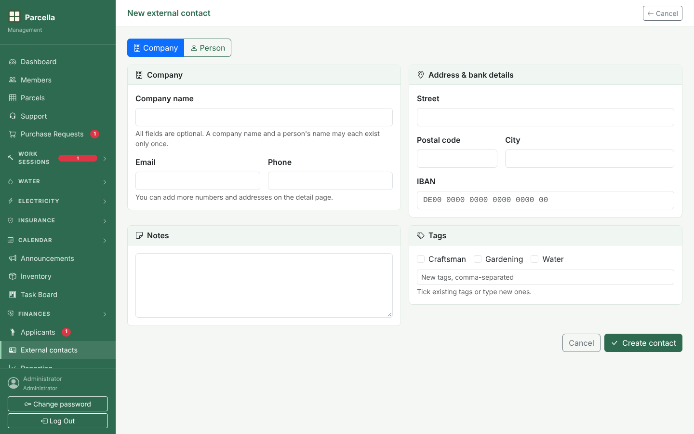
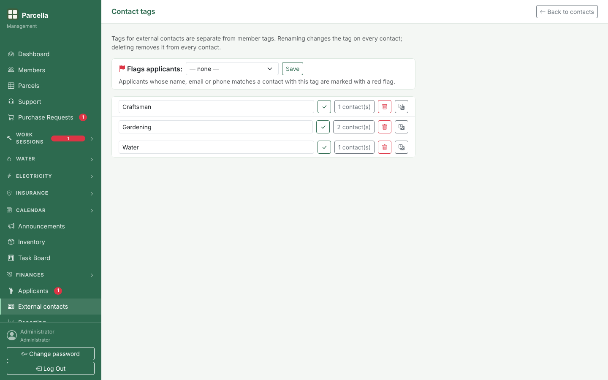

# Externé kontakty {#external-contacts}

!!! note "Strojový preklad"
    Táto stránka bola strojovo preložená z angličtiny a zatiaľ nebola skontrolovaná. Ak je niečo nejasné, platí anglická verzia (jazyk prepnete hore).

Externé kontakty sú adresár spolku pre všetkých, ktorí nie sú členmi:
dodávatelia, remeselníci, vodárne, obecný úrad. Kontakt je buď
**firma**, alebo **osoba**, a osoba môže pracovať vo firme. Kontakty
môžete prepojiť s prijatými faktúrami a žiadosťami o nákup, označiť ich
štítkami a ich dokumenty uchovávať v cloude spolku.

!!! info "Kto to môže používať"
    Členovia výboru a administrátori majú vždy plný prístup. Všetci
    ostatní z tohto modulu nevidia nič, kým im skupina neudelí
    oprávnenia pre **Externé kontakty** (pozri [Skupiny](../administration/groups.md)):

    - **Čítanie** -- vidieť zoznam a stránky kontaktov, exportovať CSV,
      vidieť stránku štítkov, sťahovať dokumenty.
    - **Zápis** -- vytvárať a upravovať kontakty, pridávať telefónne
      čísla, e-mailové adresy a štítky, premenovávať štítky, importovať
      CSV, vyberať priečinok dokumentov kontaktu a nahrávať dokumenty.
    - **Mazanie** -- mazať kontakty, telefónne čísla, e-mailové adresy a
      štítky a zlučovať firmy.

    Modul sa zapína prepínačom **Externé kontakty** v časti
    [Zapínanie a vypínanie modulov](../administration/modules.md).
    Predvolene je zapnutý.

## Firmy a osoby {#companies-and-people}

- **Firma** má názov firmy, adresu, IBAN a vlastné telefónne čísla a
  e-mailové adresy.
- **Osoba** má meno a priezvisko, pozíciu (napr. „Úradník“,
  „Majiteľ“) a voliteľne firmu. Ak osoba nemá vlastnú adresu alebo
  IBAN, jej stránka ukazuje údaje firmy.
- Či je kontakt firma alebo osoba, sa rozhodne pri vytvorení a neskôr sa
  to nedá zmeniť.
- Názov firmy môže existovať len raz, rovnako meno osoby (na veľkých
  písmenách nezáleží). Členovia sa nepočítajú -- kontakt môže mať
  rovnaké meno ako člen.
- Každé pole je voliteľné. Kontakt bez akéhokoľvek mena sa zobrazí ako
  **Kontakt bez názvu**.

## Zoznam kontaktov {#contact-list}

**Externé kontakty** v navigácii uvádzajú každú firmu s jej ľuďmi
odsadenými pod ňou a každú osobu, ktorá nepatrí k firme. Zoznam je
zoradený abecedne podľa názvu firmy, pri osobách bez firmy podľa
priezviska.

| Pole / tlačidlo | Čo robí |
|---|---|
| **Import CSV** | Otvorí [dialóg importu](#csv-import). Potrebuje oprávnenie na zápis. |
| **Export CSV** | Stiahne zoznam ako súbor CSV (pozri [Export CSV](#csv-export)). Použije aktuálne vyhľadávanie a filter štítkov. |
| **Spravovať štítky** | Otvorí [stránku štítkov](#contact-tags). |
| **Nový kontakt** | Otvorí [formulár kontaktu](#contact-form). Potrebuje oprávnenie na zápis. |
| Pole vyhľadávania | Hľadá v názve firmy, mene a priezvisku, pozícii, ulici, PSČ, meste, IBAN, poznámkach, telefónnych číslach a e-mailových adresách. Kliknutím na **Hľadať** ho použijete. |
| **Všetky štítky** / štítok | Ukáže len kontakty s týmto štítkom. Zobrazí sa, až keď existujú štítky. |
| **Zrušiť filter** | Zruší vyhľadávanie a filter štítkov. Zobrazí sa len, kým je filter aktívny. |

| Stĺpec | Čo ukazuje |
|---|---|
| **Názov** | Ikona budovy pri firmách, ikona osoby pri osobách; názov odkazuje na stránku kontaktu. Osoby ukazujú za menom svoju pozíciu. |
| **Štítky** | Štítky kontaktu. Kliknutím na štítok podľa neho zoznam vyfiltrujete. |
| **Telefón** | Prvé telefónne číslo. |
| **E-mail** | Prvá e-mailová adresa ako odkaz na e-mail. |
| Tlačidlo s okom | Otvorí kontakt. |

Keď vyhľadávanie alebo štítok zodpovedá osobe, uvedie sa aj jej firma a
zodpovedajúca osoba je pod ňou zvýraznená. Päta ukazuje, koľko záznamov
(firiem a osôb bez firmy) je uvedených.

## Formulár kontaktu {#contact-form}

**Nový kontakt** otvorí prázdny formulár, **Upraviť** na stránke
kontaktu vyplnený. **Pridať osobu** na stránke firmy ho otvorí ako
novú osobu s už vyplnenou firmou.

Pri novom kontakte najprv hore vyberte **Firma** alebo **Osoba**.
Formulár potom ukáže len polia pre tento druh.

### Firma / Osoba {#company-person}

| Pole | Zobrazí sa pri | Čo robí |
|---|---|---|
| **Meno**, **Priezvisko** | Osoba | Meno osoby. Stačí jedna časť. |
| **Názov firmy** | Firma | Názov firmy. |
| **Firma (nepovinné)** | Osoba | Firma, v ktorej osoba pracuje. Počas písania navrhuje existujúce firmy. Existujúca firma sa prepojí; nový názov túto firmu vytvorí. Pre samostatnú osobu nechajte prázdne. Pri **Upraviť** vymazanie odoberie osobu z firmy. |
| **Pozícia** | Osoba | Napr. „Úradník, Majiteľ“. |
| **E-mail**, **Telefón** | Nové kontakty | Prvá e-mailová adresa a telefónne číslo. Ďalšie pridáte neskôr na stránke kontaktu. |

Poznámka „Všetky polia sú nepovinné. Názov firmy aj meno osoby smú
existovať len raz.“ vám pripomína [pravidlá vyššie](#companies-and-people).

### Adresa a bankové spojenie {#address-bank-details}

| Pole | Čo robí |
|---|---|
| **Ulica**, **PSČ**, **Mesto** | Poštová adresa. |
| **IBAN** | Bankový účet, napr. na platenie faktúr dodávateľa. Najviac 34 znakov. |

Pri osobe vo firme: „Nechajte prázdne pre použitie údajov firmy.
Zadané spolu s novou firmou sa stane adresou firmy.“ Ak firma ešte
nemá adresu alebo IBAN, to, čo zadáte, sa uloží pri firme; ak je to
rovnaké ako pri firme, neuloží sa to dvakrát. Pri osobe zostane len
adresa alebo IBAN, ktoré sa naozaj líšia.

### Poznámky a štítky {#notes-and-tags}

| Pole | Čo robí |
|---|---|
| **Poznámky** | Voľný text -- otváracie hodiny, číslo zákazníka, číslo tiketu. Vyhľadávanie v zozname ho nájde. |
| Zaškrtávacie políčka štítkov | Zaškrtnite existujúce štítky. |
| **Nové štítky, oddelené čiarkou** | Napíšte nové štítky; vytvoria sa a pridajú. |

Kliknite na **Vytvoriť kontakt** (nový) alebo **Uložiť zmeny**
(úprava), alebo na **Zrušiť**. Ak firma alebo osoba s rovnakým menom už
existuje, formulár sa vráti s hlásením ako „Firma … už existuje.“ a
zachová, čo ste napísali.

## Stránka kontaktu {#contact-page}

<!-- TODO(verify): no screenshot -- the sample data contains no external contacts, so the screenshot tool has no contact page to open. Add one once sample data seeds contacts. -->

### Tlačidlá {#buttons}

| Tlačidlo | Čo robí |
|---|---|
| **Upraviť** | Otvorí formulár kontaktu. Potrebuje oprávnenie na zápis. |
| **Predchádzajúci** / **Ďalší** | Predchádzajúci alebo ďalší záznam zoznamu, so zachovaním vyhľadávania a filtra štítkov. Klávesnica: ++ctrl+left++ a ++ctrl+right++. |
| **Späť na zoznam** | Vráti sa do zoznamu s rovnakým filtrom. |

### Firma / Osoba {#company-person_1}

| Pole | Čo ukazuje |
|---|---|
| **Firma** (firma) | Názov firmy. |
| **Meno**, **Pozícia**, **Firma** (osoba) | Meno osoby, pozícia a odkaz na jej firmu. Zmazaná firma je označená „(zmazaná)“. |
| **Adresa** | Adresa kontaktu. Pri osobe bez nej adresa firmy, označená **Adresa firmy**. |
| **IBAN** | IBAN kontaktu. Pri osobe bez neho IBAN firmy, označený **IBAN firmy**. |

### Osoby {#people}

Len na stránke firmy: každá osoba vo firme s pozíciou, telefónnymi
číslami a e-mailovými adresami. **Pridať osobu** vytvorí novú osobu v
tejto firme (oprávnenie na zápis). „Pri tejto firme zatiaľ nie sú žiadne
osoby.“, ak žiadne nie sú.

### Štítky {#tags}

Štítky kontaktu; kliknutím na niektorý uvidíte všetky kontakty s ním.
S oprávnením na zápis **x** na štítku ho z tohto kontaktu odstráni a
pole **Pridať štítok…** pridá existujúci alebo nový štítok (najviac 100
znakov). **Spravovať štítky** otvorí [stránku štítkov](#contact-tags).

### Telefónne čísla a e-mailové adresy {#phone-numbers-and-email-addresses}

| Pole / tlačidlo | Čo robí |
|---|---|
| Číslo / adresa | Kliknutím zavoláte alebo napíšete e-mail. Popis sa zobrazuje v zátvorkách. |
| Pole čísla / adresy, **Popis (nepovinné)**, **+** | Pridá ďalšie číslo alebo adresu, napr. s popisom „Kancelária“ alebo „Faktúry“. Potrebuje oprávnenie na zápis. |
| Tlačidlo koša | Odstráni číslo alebo adresu. Potrebuje oprávnenie na mazanie. |

### Prijaté faktúry a žiadosti o nákup {#incoming-invoices-and-purchase-requests}

Uvádza [prijaté faktúry](finances/incoming-invoices.md) a
[žiadosti o nákup](purchase-requests.md) prepojené s týmto kontaktom --
na stránke firmy aj tie, ktoré sú prepojené s jej ľuďmi, s menom osoby
za záznamom. Každá karta sa zobrazí, len ak je daný modul zapnutý a
smiete ho čítať.

| Karta | Stĺpce |
|---|---|
| **Prijaté faktúry** | Dátum faktúry, číslo faktúry (alebo odosielateľ), celková suma. |
| **Žiadosti o nákup** | Dátum vytvorenia, názov, odhadované náklady. |

### Dokumenty {#documents}

Zobrazí sa, keď je zapnutý modul cloudového úložiska. Listy, ponuky a
zmluvy sa neukladajú v Parcelle, ale v priečinku v cloude spolku; táto
karta tento priečinok ukazuje.

- Administrátor najprv nastaví základný priečinok v časti
  [Integrácie](../administration/integrations.md) (**Priečinok pre
  dokumenty externých kontaktov**). Dovtedy to karta uvádza.
- Priečinok pre každý kontakt sa vytvára ručne v cloude, v základnom
  priečinku. Na stránke kontaktu ho potom niekto s oprávnením na zápis
  vyberie zo zoznamu **Priečinok** a klikne na **Uložiť priečinok**.
  **Zmeniť priečinok** vyberie iný; **— žiadny priečinok —** zruší
  prepojenie (súbory zostanú v cloude).
- Keď je priečinok vybraný, karta uvádza jeho súbory a podpriečinky.
  Kliknutím na podpriečinok ho otvoríte, kliknutím na súbor ho
  stiahnete. Cesta nad zoznamom vedie späť nahor.
- S oprávnením na zápis **Nahrať** vloží súbor do práve zobrazeného
  priečinka.
- Mazanie, premenovanie a presúvanie súborov sa robí priamo v cloude.

Dokumenty patria firme: stránka osoby namiesto toho odkazuje na
dokumenty firmy („Dokumenty sú uložené pri firme:“).

!!! warning
    Ak priečinok kontaktu v cloude premenujete, Parcella ho stratí.
    Vyberte ho na stránke kontaktu znova.

### Poznámky {#notes}

Poznámky, ak nejaké sú.

### Nebezpečná zóna {#danger-zone}

Zobrazí sa s oprávnením na mazanie.

| Pole / tlačidlo | Čo robí |
|---|---|
| **Zlúčiť do** + **Zlúčiť** | Len na stránke firmy. Pre dva záznamy tej istej firmy (napr. „Müller GmbH“ a „Mueller GmbH“): vyberte firmu, ktorá zostane, kliknite na **Zlúčiť** a potvrďte. Osoby, telefónne čísla, e-mailové adresy, štítky a prepojené faktúry a žiadosti o nákup sa presunú do vybranej firmy. Jej adresa, IBAN a priečinok dokumentov sa doplnia z tejto, kde ich nemá; poznámky sa pridajú k jej poznámkam. Táto firma sa potom zmaže a otvorí sa ponechaná. |
| **Zmazať kontakt** | Po potvrdení zmaže kontakt. Zmizne zo zoznamu a z výberov, ale prepojené faktúry a žiadosti o nákup ho naďalej ukazujú (tam, kde ho ukazujú, označený ako „zmazaný“). Jeho meno sa znova uvoľní. Firmu, ktorá má ešte osoby, nemožno zmazať: „Táto firma má ešte osoby. Najprv ich presuňte alebo zmažte.“ |

## Štítky kontaktov {#contact-tags}

**Spravovať štítky** otvorí **Štítky kontaktov**. Štítky kontaktov sú
oddelené od štítkov členov. **Späť na kontakty** vás vráti do zoznamu.

| Pole / tlačidlo | Čo robí |
|---|---|
| **Označuje uchádzačov:** | Vyberte jeden štítok (alebo **— žiadny —**) a kliknite na **Uložiť**. Uchádzači, ktorých meno, e-mailová adresa alebo telefónne číslo zodpovedá kontaktu s týmto štítkom, dostanú v zozname uchádzačov červenú vlajku a na svojej stránke varovanie -- užitočné pre štítok „neprenajímať“. Firma so štítkom označí aj svojich ľudí. Zobrazí sa len, keď je zapnutý modul uchádzačov a existujú štítky; zmena potrebuje oprávnenie na zápis. Pozri [Uchádzači](applicants.md). |
| Názov štítku + tlačidlo s fajkou | Premenuje štítok pri každom kontakte. Potrebuje oprávnenie na zápis. Názov, ktorý už existuje, sa odmietne. |
| **Kontakty: {count}** | Otvorí zoznam filtrovaný podľa tohto štítku. |
| Tlačidlo koša | Po potvrdení zmaže štítok pri každom kontakte. Potrebuje oprávnenie na mazanie. |
| **Preklady** | Otvorí jedno pole na každý jazyk. Názov štítku sa môže v každom jazyku zobrazovať inak; prázdne polia ukazujú vlastný názov štítku. **Uložiť preklady** ich uloží (oprávnenie na zápis). |

Nové štítky sa vytvárajú pri kontakte alebo vo formulári kontaktu, nie
na tejto stránke.

## Export CSV {#csv-export}

**Export CSV** stiahne `external-contacts.csv`: oddelený bodkočiarkou,
jeden riadok na firmu alebo osobu, so stĺpcami Typ, Firma, Vorname,
Nachname, Position, Strasse, PLZ, Ort, IBAN, E-Mail-Adressen,
Telefonnummern, Tags, Notizen (typ, firma, meno, priezvisko, pozícia,
ulica, PSČ, mesto, IBAN, e-mailové adresy, telefónne čísla, štítky,
poznámky). „Typ“ je „Firma“ alebo „Person“. Každá firma ide prvá, za
ňou jej ľudia. Viac e-mailových adries, čísel alebo štítkov je v jednej
bunke, oddelených bodkočiarkami.

Súbor sa dá bez zmien znova importovať.

## Import CSV {#csv-import}

Import má dva kroky a potrebuje oprávnenie na zápis.

### Krok 1: výber súboru {#step-1-choose-the-file}

**Import CSV** v zozname otvorí **Import kontaktov z CSV**. Vyberte
súbor `.csv` (oddelený bodkočiarkou alebo čiarkou, s hlavičkovým
riadkom) a kliknite na **Importovať**. Zatiaľ sa nič neuloží.

### Krok 2: Import kontaktov {#step-2-import-contacts}

<!-- TODO(verify): no screenshot -- this screen is only reachable by uploading a file, which the screenshot tool can't do from a URL. -->

Karta **Priradiť stĺpce** ukazuje každý stĺpec vášho súboru s jeho
nadpisom a prvými piatimi riadkami. Pre každý stĺpec vyberte pole, do
ktorého patrí, alebo **— ignorovať —**:

**Typ (firma/osoba)**, **Názov firmy**, **Meno**, **Priezvisko**,
**Pozícia**, **Ulica**, **PSČ**, **Mesto**, **IBAN**, **E-mailové
adresy**, **Telefónne čísla**, **Štítky**, **Poznámky**.

Parcella pole predvyberie pri bežných nemeckých a anglických nadpisoch
a vlastný export priradí úplne. Žiadne pole nie je povinné. Kliknutím
na **Importovať** ho spustíte; **Späť** ho zruší.

Ako sa spracuje každý riadok:

- **Firma alebo osoba:** stĺpec typu hovorí „Firma“/„Company“ alebo
  „Person“. Bez neho je riadok s menom alebo priezviskom osoba, inak
  firma.
- **Existujúce kontakty sa aktualizujú:** firma sa páruje podľa názvu,
  osoba podľa mena a priezviska (na veľkých písmenách nezáleží). Zhoda
  dostane každé pole, ktoré je v súbore vyplnené; telefónne čísla,
  e-mailové adresy a štítky, ktoré ešte nemá, sa pridajú. Nič sa nikdy
  neodstráni ani nevyprázdni.
- **Nové kontakty** sa vytvoria pre riadky bez zhody.
- **Firma osoby:** stĺpec firmy prepojí osobu s firmou tohto názvu,
  ktorá sa v prípade potreby vytvorí. Adresa a IBAN riadku doplnia, čo
  firme chýba, a pri osobe zostanú len tam, kde sa líšia.
- Úplne prázdne riadky sa preskočia.

Potom zoznam ukáže zhrnutie, napr. „Vytvorené kontakty: 3,
aktualizované: 1.“, plus prvé problémy, ak boli riadky preskočené
(napr. duplicitné meno).

## Kde sa kontakty vyberajú inde {#where-contacts-are-picked-elsewhere}

Keď je tento modul zapnutý a smiete čítať kontakty, iné moduly ponúkajú
výber kontaktu. Firmy sa zobrazujú ako skupina s ich ľuďmi pod nimi;
zmazané kontakty sa neponúkajú.

| Kde | Označenie | Čo robí |
|---|---|---|
| [Prijaté faktúry](finances/incoming-invoices.md) -- nová faktúra | **Kontakt** | Výber kontaktu vyplní odosielateľa. Odosielateľ zostáva poľom s voľným textom. |
| Stránka prijatej faktúry | **Kontakt** | Neskôr nastaví alebo zmení prepojený kontakt. |
| [Žiadosti o nákup](purchase-requests.md) -- nová žiadosť a stránka žiadosti | **Dodávateľ (kontakt)** | Dodávateľ pre nákup. Dá sa zmeniť v akomkoľvek stave. |

## Súvisiace {#related}

- [Uchádzači](applicants.md) -- červené vlajky zo štítkovaných kontaktov
- [Integrácie](../administration/integrations.md) -- cloudové úložisko a
  základný priečinok dokumentov
- [Skupiny](../administration/groups.md) -- prístup pokladníka ku
  kontaktom
