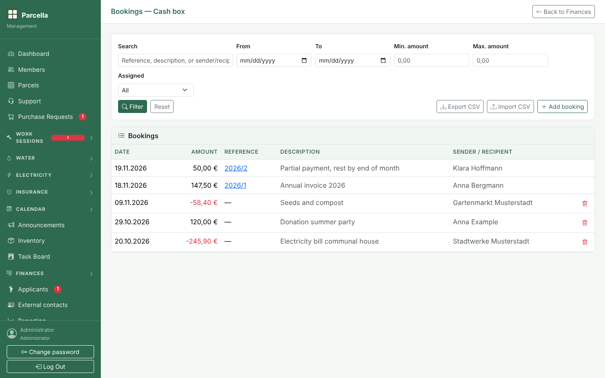

# Bankrekeningen en boekingen {#bank-accounts-and-bookings}

!!! note "Machinevertaling"
    Deze pagina is machinaal vertaald uit het Engels en nog niet nagekeken. Als iets onduidelijk is, geldt de Engelse versie (taal wisselt u bovenaan).

Hier legt u de echte rekeningen van de vereniging vast --
betaalrekeningen, een spaarrekening, de kas -- en ziet u alles wat op
elke rekening is geboekt. U kunt boekingen met de hand toevoegen of uw
bankafschrift als CSV-bestand importeren. Daarbij biedt Parcella aan elke
boeking aan een open factuur te koppelen, zodat een binnenkomende
overschrijving meteen als betaling van het lid wordt vastgelegd.

!!! info "Wie kan dit gebruiken"
    Onderdeel van de module **Financiën** (standaard uit). Rekeningen en
    boekingen bekijken, en CSV exporteren, vraagt leesrecht op
    **Financiën**. Rekeningen aanmaken of wijzigen, boekingen toevoegen
    en importeren vraagt schrijfrecht; rekeningen of boekingen
    verwijderen vraagt verwijderrecht. Bestuursleden en beheerders
    kunnen alles. Zie [Financiën](index.md).

!!! note "Geen volledig grootboek"
    De boekingenlijst van een rekening is een overzicht van
    geldbewegingen, geen dubbele boekhouding. Er is geen beginsaldo en
    geen lopend saldo. Boekingen die niet aan een factuur zijn gekoppeld
    (bankkosten, een terugbetaling) hebben geen categorie, dus ze
    verschijnen niet in het
    [boekhoudkundig overzicht](bookkeeping.md#accounting-statement).

## Rekeningen {#accounts}

Open de pagina via de kaart **Rekeningen** op het financiële dashboard.
**Terug naar Financiën** in de bovenbalk brengt u terug.

### Nieuwe rekening {#new-account}

Getoond met schrijfrecht.

| Veld | Wat het doet |
|---|---|
| **Naam** | Verplicht, bijv. „Betaalrekening Rabobank“ of „Kas“. Opslaan zonder naam toont „Een naam is verplicht“. |
| **Type** | **Bank** of **Contant**. |
| **Rekeningnummer/IBAN** | Optioneel, ter referentie. |
| **Notitie** | Optioneel. |
| **Actief** | Standaard aan. Alleen actieve rekeningen worden aangeboden bij het vastleggen van een betaling. Zet het uit voor een rekening die u hebt opgeheven: de geschiedenis blijft, maar ze wordt niet meer aangeboden. |
| **Rekening toevoegen** | Slaat de rekening op. U ziet „Klaar.“. |

### Lijst met rekeningen {#accounts-list}

| Kolom / knop | Wat ze toont |
|---|---|
| **Naam**, **Type**, **Rekeningnummer/IBAN**, **Notitie**, **Actief** | De gegevens van de rekening. Met schrijfrecht zijn ze in de rij bewerkbaar; klik op het vinkpictogram om op te slaan. |
| **Geregistreerde betalingen** | De som van alle betalingen voor uitgaande facturen die op deze rekening zijn vastgelegd. Betalingen van inkomende facturen en andere boekingen tellen niet mee. |
| Boekingenpictogram | Opent de [boekingen](#bookings-of-an-account) van de rekening. |
| Vinkpictogram | Slaat de rij op. Vraagt schrijfrecht. |
| Prullenbakpictogram | Verwijdert de rekening na „Deze rekening verwijderen? Er zijn geen boekingen.“ Vraagt verwijderrecht. Grijs bij een rekening met boekingen (zie hieronder). |

Zijn er nog geen rekeningen: „Nog geen rekeningen -- voeg er hierboven
een toe.“

!!! note "Rekeningen met boekingen kunnen niet worden verwijderd"
    Alleen een rekening zonder enige boeking -- geen met de hand
    ingevoerde of geïmporteerde boeking, geen factuurbetaling erop --
    kan worden verwijderd. Bij elke andere rekening is de prullenbak
    grijs („Heeft boekingen: vink in plaats daarvan ‘Actief’ uit.“).
    **Actief** uitzetten verbergt de rekening in de betalingsformulieren
    en houdt al haar boekingen.

## Boekingen van een rekening {#bookings-of-an-account}

Open de pagina met het boekingenpictogram in de lijst met rekeningen. De
titel is „Boekingen — *rekeningnaam*“. Ze toont alles wat op deze
rekening is geboekt, het nieuwste eerst:

- betalingen van uitgaande facturen die met deze rekening zijn
  vastgelegd (positieve bedragen),
- betalingen van [inkomende facturen](incoming-invoices.md) die met deze
  rekening zijn vastgelegd (negatieve bedragen),
- andere boekingen die u met de hand hebt ingevoerd of geïmporteerd
  (positief of negatief, zoals ingevoerd).

De eerste 50 boekingen worden getoond; meer worden automatisch geladen
terwijl u naar beneden scrolt. De knop **Terug naar Financiën** in de
bovenbalk brengt u terug naar de lijst met rekeningen (ondanks het
label). Op de importschermen hieronder brengt dezelfde knop u terug naar
de boekingen van de rekening zonder iets te importeren.

### Filter en acties {#filter-and-actions}

| Veld / knop | Wat het doet |
|---|---|
| **Zoeken** | Vindt boekingen waarvan referentie, omschrijving of afzender/ontvanger deze tekst bevat. |
| **Van** / **Tot** | Alleen boekingen op of tussen deze datums. |
| **Bedrag vanaf** / **Bedrag tot** | Alleen boekingen met een bedrag in dit bereik. Let op: uitgaand geld is negatief; om uitgaven van 100 of meer te vinden, zet u **Bedrag tot** op `-100`. |
| **Koppeling** | **Alle**, **Gekoppeld aan een factuur** (factuurbetalingen) of **Niet gekoppeld** (andere boekingen). Handig om bankregels te vinden die nog moeten worden gecontroleerd. |
| **Filteren** / **Resetten** | Past het filter toe / wist het. |
| **CSV exporteren** | Downloadt de boekingen die bij het huidige filter passen als CSV-bestand (gescheiden door puntkomma's: datum, bedrag, referentie, omschrijving, tegenpartij). Vraagt alleen leesrecht. |
| **CSV importeren** | Opent het importvenster, zie [Een bankafschrift importeren](#importing-a-bank-statement). Vraagt schrijfrecht. |
| **Boeking toevoegen** | Opent het venster voor een boeking met de hand, zie [Een boeking met de hand toevoegen](#adding-a-booking-by-hand). Vraagt schrijfrecht. |

### Boekingentabel {#bookings-table}

| Kolom / knop | Wat ze toont |
|---|---|
| **Datum** | De boekingsdatum. |
| **Bedrag** | Het bedrag; uitgaand geld wordt rood met een minteken getoond. |
| **Referentie** | Bij een factuurbetaling het factuurnummer als link naar de factuur (of inkomende factuur). Leeg bij andere boekingen. |
| **Omschrijving** | De betalingsnotitie of boekingsomschrijving. |
| **Afzender / ontvanger** | Wie betaalde of werd betaald: de ontvanger van de factuur, de afzender van de inkomende factuur, of de tegenpartij die u invulde. |
| Prullenbakpictogram | Verwijdert de boeking na „Deze boeking echt verwijderen?“. Alleen bij boekingen die met de hand zijn ingevoerd of geïmporteerd, en alleen met verwijderrecht. Factuurbetalingen kunnen hier niet worden verwijderd -- verwijder ze bij de factuur. |

Heeft de rekening geen boekingen: „Nog geen boekingen.“

Na een import of koppeling vertelt een groene melding bovenaan wat er is
gebeurd, bijv. „12 geïmporteerd, 1 overgeslagen.“, „3 boeking(en)
gekoppeld aan een bestaande factuur.“, „IBAN ingevuld voor 2 lid/leden
vanuit de import.“ of, na een enkele boeking, „Geregistreerd als betaling
voor de gekoppelde factuur.“

## Een boeking met de hand toevoegen {#adding-a-booking-by-hand}

Klik op **Boeking toevoegen**. Het venster vraagt:

| Veld | Wat het doet |
|---|---|
| **Datum** | Verplicht, vooraf ingevuld met vandaag. |
| **Bedrag** | Verplicht. Positief voor geld dat binnenkomt, negatief voor geld dat uitgaat, bijv. `-12,50`. |
| **Omschrijving** | Optioneel. |
| **Afzender / ontvanger** | Optioneel. Wordt ook gebruikt om een passende factuur voor te stellen. |
| **Boeking toevoegen** | Gaat verder naar de koppelstap. |

### Mogelijk overeenkomende facturen {#possible-matching-invoices}

<!-- No screenshot: this page is only reached by submitting the form above. -->

Voordat er iets wordt opgeslagen, zoekt Parcella open facturen met
hetzelfde bedrag: bij een positief bedrag uitgaande facturen waarop nog
precies zoveel openstaat; bij een negatief bedrag inkomende facturen
waarvan nog zoveel onbetaald is. Het toont **Datum**, **Bedrag** en
**Afzender / ontvanger** van de boeking, en dan de keuzes:

| Keuze | Wat er gebeurt |
|---|---|
| **Registreren als gewone boeking** | Slaat een gewone boeking op de rekening op, niet gekoppeld aan een factuur. |
| Eén regel per passende factuur | Toont de factuur (nummer en ontvanger, of afzender en nummer) en „nog open: *bedrag*“. Een groene badge „naam komt overeen“ verschijnt als de ingevulde afzender/ontvanger een naam deelt met de ontvanger of afzender van de factuur. Deze keuze legt de boeking vast als **betaling van die factuur**, met deze rekening, datum en de omschrijving als notitie. |
| **Boeking toevoegen** | Slaat uw keuze op. |

Er worden hooguit vijf facturen voorgesteld, die met een overeenkomende
naam eerst. Heeft precies één voorstel een overeenkomende naam, dan is
dat voorgeselecteerd; anders **Registreren als gewone boeking**. Past
geen factuur: „Geen openstaande facturen komen overeen met dit bedrag.“

!!! tip
    Het koppelen vergelijkt alleen het bedrag dat nog openstaat, tot op
    de cent. Een factuur met aanmaningskosten staat open inclusief die
    kosten, en een gedeeltelijk betaalde factuur alleen met wat
    overblijft.

## Een bankafschrift importeren {#importing-a-bank-statement}

Bij de meeste banken kunt u het rekeningafschrift als CSV-bestand
downloaden. Elke kolomindeling werkt. Importeren gaat in drie stappen.

**1. Uploaden.** Klik op **CSV importeren**, kies het bestand en klik op
**CSV importeren**. „Elke CSV werkt -- upload het bestand en koppel de
kolommen op het volgende scherm aan Parcella-velden.“ Bestanden
gescheiden door puntkomma of komma worden allebei herkend, net als UTF-8
en oudere Windows-coderingen. Een leeg bestand wordt geweigerd met „Dit
CSV-bestand lijkt leeg te zijn.“

**2. CSV-kolommen koppelen.** <!-- No screenshot: reached only by uploading a file. -->
„Kies voor elke kolom aan welk Parcella-veld deze hoort (of laat hem
genegeerd). Datum en Bedrag zijn verplicht.“ De pagina toont de
kolomkoppen van uw bestand, elk met een keuzelijst, en de eerste vijf
rijen als voorbeeld.

| Veld | Betekenis |
|---|---|
| **— Negeren —** | De kolom wordt niet gebruikt. |
| **Datum** | Verplicht. De boekingsdatum. Geaccepteerde formaten: `2026-03-31`, `31.03.2026` en `31.03.26`. |
| **Bedrag** | Verplicht. Bedrag met teken, met een decimale komma of punt (`-12,50` of `-12.50`). Duizendtalscheidingstekens zijn prima, zoals uw bank ze exporteert: `1.234,56`, `1,234.56` of `1 234,56`. |
| **Omschrijving** | Optioneel, bijv. de betalingsomschrijving. |
| **Afzender / ontvanger** | Optioneel. Gebruikt voor het koppelen en in de lijst getoond. |
| **IBAN** | Optioneel. Zie de tip hieronder. |

Gangbare Duitse en Engelse koppen („Buchungsdatum“, „Betrag“,
„Verwendungszweck“, „Auftraggeber“, „IBAN“ ...) worden voor u
voorgeselecteerd; controleer ze toch. Klik op **CSV importeren** om
verder te gaan. Is **Datum** of **Bedrag** niet gekoppeld, dan wordt u
teruggestuurd met „Koppel ten minste één kolom aan zowel Datum als
Bedrag.“

**3. Rijen koppelen aan facturen.** <!-- No screenshot: reached only through the import. -->
„Kies voor elke rij een overeenkomende openstaande factuur om als echte
betaling te registreren, of laat de rij als gewone boeking.“ Elke rij
toont **Datum**, **Bedrag**, **Afzender / ontvanger** en een keuzelijst
**Koppeling** met **Niet importeren**, **Registreren als gewone boeking**
en de voorgestelde facturen (openstaand bedrag tussen haakjes, een ✓ als
de naam overeenkomt). De voorselectie werkt als bij een enkele boeking.
Rijen waarvan datum of bedrag niet kon worden gelezen, tonen „Ongeldige
rij — wordt overgeslagen“. Een rij die al op deze rekening staat, krijgt
een badge **Al geïmporteerd** en staat vooraf op **Niet importeren**.
Klik op **CSV importeren** om alles op te slaan.

Wat er wordt opgeslagen:

- elke rij met een gekozen factuur wordt een betaling van die factuur op
  deze rekening -- tenzij die factuur intussen volledig is betaald: dan
  wordt er niets vastgelegd, en de resultaatmelding zegt dat;
- elke andere geldige rij wordt een gewone boeking;
- rijen op **Niet importeren**, en ongeldige rijen, worden overgeslagen
  en in de resultaatmelding geteld.

!!! tip "IBAN's van leden invullen"
    Koppelt u zowel **Afzender / ontvanger** als **IBAN**, dan zoekt
    Parcella een lid wiens naam precies de naam van de afzender is
    (voornaam achternaam, of achternaam voornaam, hoofd-/kleine letters
    genegeerd). Heeft dat lid nog geen IBAN opgeslagen, dan wordt de IBAN
    uit het afschrift ingevuld. Bestaande IBAN's worden nooit
    overschreven.

!!! tip "Hetzelfde afschrift twee keer importeren"
    Een rij telt als al geïmporteerd als deze rekening al een boeking
    heeft met dezelfde datum, hetzelfde bedrag en dezelfde omschrijving
    (een betaling die bij een factuur is vastgelegd telt ook). Elkaar
    overlappende exports zijn dus veilig: alleen de nieuwe rijen worden
    toegevoegd. Parcella telt in plaats van alleen te vergelijken --
    staat dezelfde koffieaankoop twee keer op één dag in het bestand en
    één keer op de rekening, dan is er één nieuw.

    Een rij die al bestaat, wordt alleen geïmporteerd als u haar
    **Niet importeren** wijzigt. Twee keer op **CSV importeren** klikken,
    of de pagina met de terugknop opnieuw versturen, voegt niets toe.

## Gerelateerd {#related}

- [Facturen, betalingen en herinneringen](invoices.md)
- [Inkomende facturen](incoming-invoices.md)
- [Alle boekingen](bookkeeping.md#all-bookings) -- elke factuurbetaling
  over alle rekeningen heen.
- [Leden](../members.md) -- waar de IBAN wordt opgeslagen.
