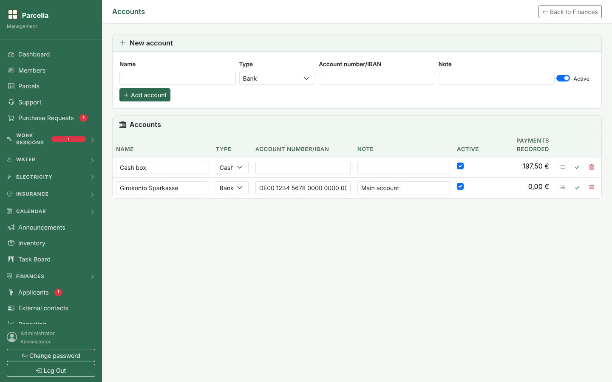

# Rachunki bankowe i księgowania {#bank-accounts-and-bookings}

!!! note "Tłumaczenie maszynowe"
    Ta strona została przetłumaczona maszynowo z języka angielskiego i nie została jeszcze sprawdzona. Jeśli coś jest niejasne, obowiązuje wersja angielska (język zmienisz u góry).

Tutaj zapisujesz prawdziwe konta stowarzyszenia -- rachunki bieżące,
rachunek oszczędnościowy, kasę -- i widzisz wszystko, co na każdym z
nich zaksięgowano. Księgowania możesz dodawać ręcznie lub zaimportować
wyciąg bankowy jako plik CSV. Przy tym Parcella proponuje dopasowanie
każdego księgowania do otwartej faktury, dzięki czemu przychodzący
przelew od razu zostaje zapisany jako płatność członka.

!!! info "Kto może z tego korzystać"
    Część modułu **Finanse** (domyślnie wyłączonego). Oglądanie kont i
    księgowań oraz eksport CSV wymaga prawa odczytu **Finanse**.
    Tworzenie lub zmiana kont, dodawanie księgowań i import wymagają
    prawa zapisu; usuwanie kont lub księgowań wymaga prawa usuwania.
    Członkowie zarządu i administratorzy mogą wszystko. Zob.
    [Finanse](index.md).

!!! note "To nie pełna księga"
    Lista księgowań konta to zapis przepływów pieniędzy, a nie
    księgowość podwójna. Nie ma salda otwarcia ani salda bieżącego.
    Księgowania niezwiązane z fakturą (opłata bankowa, zwrot) nie mają
    kategorii, więc nie pojawiają się w
    [zestawieniu księgowym](bookkeeping.md#accounting-statement).

## Konta {#accounts}

Otwierasz je kartą **Konta** na panelu finansów. **Powrót do Finansów**
na górnym pasku prowadzi z powrotem.

### Nowe konto {#new-account}

Widoczne z prawem zapisu.

| Pole | Do czego służy |
|---|---|
| **Nazwa** | Wymagana, np. „Rachunek bieżący” albo „Kasa”. Zapis bez nazwy pokazuje „Imię i nazwisko jest wymagane”. |
| **Typ** | **Bank** lub **Gotówka**. |
| **Numer konta/IBAN** | Opcjonalny, dla Twojej orientacji. |
| **Notatka** | Opcjonalna. |
| **Aktywne** | Domyślnie włączone. Przy zapisie płatności proponowane są tylko aktywne konta. Wyłącz to dla zamkniętego konta: jego historia zostaje, ale nie jest już proponowane. |
| **Dodaj konto** | Zapisuje konto. Widzisz „Gotowe.”. |

### Lista kont {#accounts-list}

| Kolumna / przycisk | Co pokazuje |
|---|---|
| **Nazwa**, **Typ**, **Numer konta/IBAN**, **Notatka**, **Aktywne** | Dane konta. Z prawem zapisu można je edytować w wierszu; kliknij ikonę haczyka, aby zapisać. |
| **Zarejestrowane płatności** | Suma wszystkich płatności za faktury wychodzące zapisanych na tym koncie. Płatności faktur przychodzących i inne księgowania nie są wliczane. |
| Ikona księgowań | Otwiera [księgowania](#bookings-of-an-account) konta. |
| Ikona haczyka | Zapisuje wiersz. Wymaga prawa zapisu. |
| Ikona kosza | Usuwa konto po „Usunąć to konto? Nie ma żadnych księgowań.” Wymaga prawa usuwania. Wyszarzona dla konta, które ma księgowania (zob. niżej). |

Jeśli nie ma jeszcze kont: „Brak jeszcze kont -- dodaj jedno powyżej.”

!!! note "Kont z księgowaniami nie można usunąć"
    Usunąć można tylko konto bez żadnych księgowań -- bez księgowania
    wpisanego ręcznie lub zaimportowanego i bez zapisanej na nim
    płatności faktury. Przy każdym innym koncie kosz jest wyszarzony
    („Ma księgowania: zamiast tego odznacz „Aktywne”.”). Wyłączenie
    **Aktywne** ukrywa konto w formularzach płatności i zachowuje
    wszystkie jego księgowania.

## Księgowania konta {#bookings-of-an-account}

Otwierasz je ikoną księgowań na liście kont. Tytuł to „Księgowania —
*nazwa konta*”. Pokazuje wszystko, co zaksięgowano na tym koncie, od
najnowszych:

- płatności faktur wychodzących zapisane z tym kontem (kwoty dodatnie),
- płatności [faktur przychodzących](incoming-invoices.md) zapisane z
  tym kontem (kwoty ujemne),
- inne księgowania wpisane ręcznie lub zaimportowane (dodatnie lub
  ujemne, tak jak je wpisano).

Pokazywanych jest pierwszych 50 księgowań; kolejne doładowują się
automatycznie przy przewijaniu w dół. Przycisk **Powrót do Finansów**
na górnym pasku prowadzi z powrotem do listy kont (wbrew swojej
nazwie). Na ekranach importu poniżej ten sam przycisk prowadzi z
powrotem do księgowań konta, niczego nie importując.

### Filtr i działania {#filter-and-actions}

| Pole / przycisk | Do czego służy |
|---|---|
| **Szukaj** | Znajduje księgowania, których referencja, opis lub nadawca/odbiorca zawiera ten tekst. |
| **Od** / **Do** | Tylko księgowania w tym dniu lub pomiędzy tymi datami. |
| **Kwota od** / **Kwota do** | Tylko księgowania z kwotą w tym zakresie. Pamiętaj, że pieniądze wychodzące są ujemne: aby znaleźć wydatki 100 lub więcej, ustaw **Kwota do** na `-100`. |
| **Przypisanie** | **Wszystkie**, **Przypisane do faktury** (płatności faktur) lub **Nieprzypisane** (inne księgowania). Przydatne, aby znaleźć wiersze bankowe, które trzeba jeszcze sprawdzić. |
| **Filtruj** / **Wyczyść** | Stosuje filtr / czyści go. |
| **Eksportuj CSV** | Pobiera księgowania pasujące do bieżącego filtra jako plik CSV (rozdzielany średnikami: data, kwota, referencja, opis, kontrahent). Wymaga tylko prawa odczytu. |
| **Importuj CSV** | Otwiera okno importu, zob. [Import wyciągu bankowego](#importing-a-bank-statement). Wymaga prawa zapisu. |
| **Dodaj księgowanie** | Otwiera okno księgowania ręcznego, zob. [Ręczne dodanie księgowania](#adding-a-booking-by-hand). Wymaga prawa zapisu. |

### Tabela księgowań {#bookings-table}

| Kolumna / przycisk | Co pokazuje |
|---|---|
| **Data** | Data księgowania. |
| **Kwota** | Kwota; pieniądze wychodzące są pokazywane na czerwono ze znakiem minus. |
| **Referencja** | Dla płatności faktury numer faktury jako link do faktury (lub faktury przychodzącej). Pusta dla innych księgowań. |
| **Opis** | Notatka płatności lub opis księgowania. |
| **Nadawca / odbiorca** | Kto zapłacił lub komu zapłacono: odbiorca faktury, nadawca faktury przychodzącej albo wpisany kontrahent. |
| Ikona kosza | Usuwa księgowanie po „Czy na pewno usunąć to księgowanie?”. Tylko dla księgowań wpisanych ręcznie lub zaimportowanych i tylko z prawem usuwania. Płatności faktur nie można tu usunąć -- usuń je na fakturze. |

Jeśli konto nie ma księgowań: „Brak księgowań.”

Po imporcie lub dopasowaniu zielony komunikat na górze mówi, co się
stało, np. „Zaimportowano 12, pominięto 1.”, „Dopasowano 3 księgowań do
istniejącej faktury.”, „Uzupełniono IBAN dla 2 członków z importu.”
albo, po pojedynczym księgowaniu, „Zarejestrowano jako płatność do
dopasowanej faktury.”

## Ręczne dodanie księgowania {#adding-a-booking-by-hand}

Kliknij **Dodaj księgowanie**. Okno pyta o:

| Pole | Do czego służy |
|---|---|
| **Data** | Wymagana, wstępnie wypełniona dzisiejszą datą. |
| **Kwota** | Wymagana. Dodatnia dla pieniędzy przychodzących, ujemna dla wychodzących, np. `-12,50`. |
| **Opis** | Opcjonalny. |
| **Nadawca / odbiorca** | Opcjonalny. Używany też do proponowania pasującej faktury. |
| **Dodaj księgowanie** | Przechodzi do kroku dopasowania. |

### Możliwe pasujące faktury {#possible-matching-invoices}

<!-- No screenshot: this page is only reached by submitting the form above. -->

Zanim cokolwiek zostanie zapisane, Parcella szuka otwartych faktur o tej
samej kwocie: dla kwoty dodatniej faktur wychodzących, które mają do
zapłaty dokładnie tyle; dla kwoty ujemnej faktur przychodzących z taką
niezapłaconą kwotą. Pokazuje **Data**, **Kwota** i **Nadawca /
odbiorca** księgowania, a potem możliwości wyboru:

| Wybór | Co się dzieje |
|---|---|
| **Zarejestruj jako zwykłe księgowanie** | Zapisuje zwykłe księgowanie na koncie, niezwiązane z żadną fakturą. |
| Jeden wiersz na pasującą fakturę | Pokazuje fakturę (numer i odbiorcę albo nadawcę i numer) oraz „pozostało: *kwota*”. Zielone oznaczenie „nazwa pasuje” pojawia się, gdy wpisany nadawca/odbiorca ma wspólną nazwę z odbiorcą lub nadawcą faktury. Wybór zapisuje księgowanie jako **płatność tej faktury**, z tym kontem, datą i opisem jako notatką. |
| **Dodaj księgowanie** | Zapisuje Twój wybór. |

Proponowanych jest najwyżej pięć faktur, najpierw te z pasującą nazwą.
Jeśli dokładnie jedna propozycja ma pasującą nazwę, jest wstępnie
wybrana; w przeciwnym razie wybrane jest **Zarejestruj jako zwykłe
księgowanie**. Jeśli żadna faktura nie pasuje: „Żadna otwarta faktura
nie pasuje do tej kwoty.”

!!! tip
    Dopasowanie porównuje tylko kwotę pozostałą do zapłaty, co do
    grosza. Faktura z opłatą za upomnienie jest do zapłaty łącznie z
    opłatą, a częściowo zapłacona faktura tylko w pozostałej części.

## Import wyciągu bankowego {#importing-a-bank-statement}

Większość banków pozwala pobrać wyciąg z konta jako plik CSV. Działa
każdy układ kolumn. Import ma trzy kroki.

**1. Przesłanie.** Kliknij **Importuj CSV**, wybierz plik i kliknij
**Importuj CSV**. „Działa każdy plik CSV -- prześlij go, a na
następnym ekranie dopasuj kolumny do pól Parcella.” Rozpoznawane są
pliki rozdzielane średnikami i przecinkami, a także kodowanie UTF-8 i
starsze kodowania Windows. Pusty plik jest odrzucany z komunikatem „Ten
plik CSV wydaje się być pusty.”

**2. Mapowanie kolumn CSV.** <!-- No screenshot: reached only by uploading a file. -->
„Dla każdej kolumny wybierz, do którego pola Parcella należy (lub
pozostaw ją zignorowaną). Data i Kwota są wymagane.” Strona pokazuje
nagłówki kolumn Twojego pliku, każdy z listą rozwijaną, oraz pierwsze
pięć wierszy jako próbkę.

| Pole | Znaczenie |
|---|---|
| **— Ignoruj —** | Kolumna nie jest używana. |
| **Data** | Wymagana. Data księgowania. Akceptowane formaty: `2026-03-31`, `31.03.2026` i `31.03.26`. |
| **Kwota** | Wymagana. Kwota ze znakiem, z przecinkiem lub kropką dziesiętną (`-12,50` lub `-12.50`). Separatory tysięcy są w porządku, tak jak eksportuje je bank: `1.234,56`, `1,234.56` lub `1 234,56`. |
| **Opis** | Opcjonalny, np. tytuł przelewu. |
| **Nadawca / odbiorca** | Opcjonalny. Używany do dopasowania i pokazywany na liście. |
| **IBAN** | Opcjonalny. Zob. wskazówkę niżej. |

Typowe nagłówki niemieckie i angielskie („Buchungsdatum”, „Betrag”,
„Verwendungszweck”, „Auftraggeber”, „IBAN” ...) są wybierane wstępnie;
mimo to je sprawdź. Kliknij **Importuj CSV**, aby kontynuować. Jeśli
**Data** lub **Kwota** nie jest przypisana, wracasz z komunikatem
„Przypisz co najmniej jedną kolumnę do Daty i Kwoty.”

**3. Dopasowanie wierszy do faktur.** <!-- No screenshot: reached only through the import. -->
„Dla każdego wiersza wybierz pasującą otwartą fakturę, aby
zarejestrować rzeczywistą płatność, lub pozostaw jako zwykłe
księgowanie.” Każdy wiersz pokazuje **Data**, **Kwota**, **Nadawca /
odbiorca** i listę rozwijaną **Dopasowanie** z **Nie importuj**,
**Zarejestruj jako zwykłe księgowanie** i proponowanymi fakturami
(kwota do zapłaty w nawiasach, ✓ gdy nazwa pasuje). Wstępny wybór
działa jak przy pojedynczym księgowaniu. Wiersze, których daty lub
kwoty nie dało się odczytać, pokazują „Nieprawidłowy wiersz — zostanie
pominięty”. Wiersz, który już jest na tym koncie, dostaje oznaczenie
**Już zaimportowano** i ma wstępnie ustawione **Nie importuj**. Kliknij
**Importuj CSV**, aby wszystko zapisać.

Co zostaje zapisane:

- każdy wiersz z wybraną fakturą staje się płatnością tej faktury na
  tym koncie -- chyba że faktura została w międzyczasie w pełni
  zapłacona: wtedy nic nie jest zapisywane, a komunikat o wyniku to
  mówi;
- każdy inny prawidłowy wiersz staje się zwykłym księgowaniem;
- wiersze ustawione na **Nie importuj** i nieprawidłowe wiersze są
  pomijane i liczone w komunikacie o wyniku.

!!! tip "Uzupełnianie numerów IBAN członków"
    Jeśli przypiszesz zarówno **Nadawca / odbiorca**, jak i **IBAN**,
    Parcella szuka członka, którego imię i nazwisko jest dokładnie nazwą
    nadawcy (imię nazwisko albo nazwisko imię, bez względu na wielkość
    liter). Jeśli ten członek nie ma jeszcze zapisanego IBAN, IBAN z
    wyciągu zostaje uzupełniony. Istniejące numery IBAN nigdy nie są
    nadpisywane.

!!! tip "Dwukrotny import tego samego wyciągu"
    Wiersz liczy się jako już zaimportowany, gdy to konto ma już
    księgowanie z tą samą datą, kwotą i opisem (liczy się też płatność
    zapisana do faktury). Nakładające się eksporty są więc bezpieczne:
    dodawane są tylko nowe wiersze. Parcella liczy, a nie tylko
    porównuje -- jeśli plik ma ten sam zakup kawy dwa razy jednego dnia,
    a konto ma go raz, jeden z nich jest nowy.

    Wiersz, który już istnieje, jest importowany tylko wtedy, gdy
    zmienisz jego **Nie importuj** na coś innego. Dwukrotne kliknięcie
    **Importuj CSV** albo ponowne wysłanie strony przyciskiem wstecz nic
    nie dodaje.

## Powiązane {#related}

- [Faktury, płatności i upomnienia](invoices.md)
- [Faktury przychodzące](incoming-invoices.md)
- [Wszystkie księgowania](bookkeeping.md#all-bookings) -- każda płatność
  faktury ze wszystkich kont.
- [Członkowie](../members.md) -- gdzie przechowywany jest IBAN.
