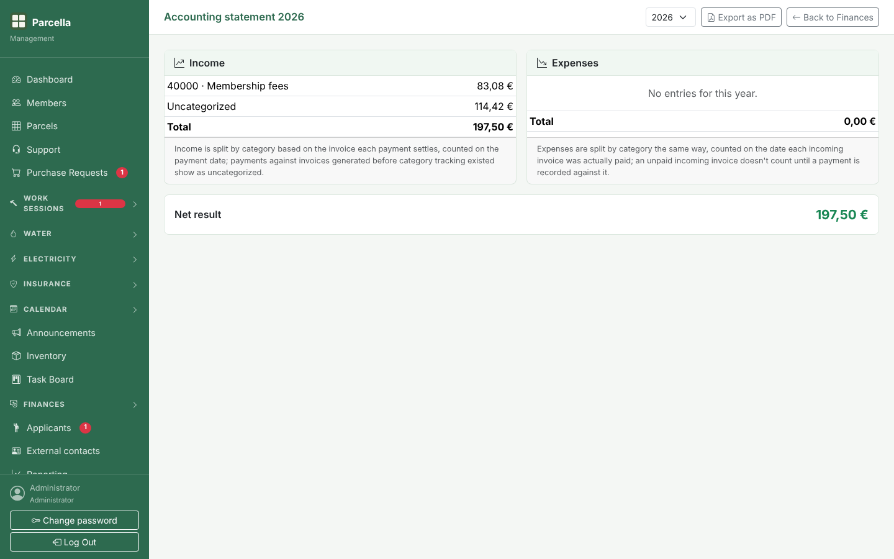

# Kategorien, Haushaltsplan und Übersicht {#categories-budget-and-statement}

Buchhaltungskategorien sind kurze Kennzeichen wie „40000
Mitgliedsbeiträge“, die du Rechnungszeilen und den Positionen von
Eingangsrechnungen zuordnest. Mit ihnen kann Parcella dir sagen, woher das
Geld des Vereins kam und wohin es ging: in der Liste aller Buchungen, in der
kassenbasierten Buchhaltungsübersicht fürs Finanzamt und im Haushaltsplan
fürs nächste Jahr.

!!! info "Wer das nutzen kann"
    Teil des Moduls **Finanzen** (standardmäßig aus). Alle vier Seiten
    lassen sich mit dem Leserecht für **Finanzen** ansehen, einschließlich
    des PDF-Exports der Übersicht. Kategorien hinzufügen, ändern und
    importieren und den Haushaltsplan speichern braucht Schreibrecht; eine
    Kategorie löschen braucht Löschrecht. Vorstandsmitglieder und
    Administratoren können alles. Siehe [Finanzen](index.md).

## Buchhaltungskategorien {#bookkeeping-categories}


Du öffnest sie mit der Karte **Kategorien** auf dem Finanz-Dashboard.
**Zurück zu Finanzen** in der oberen Leiste führt zurück.

Parcella liefert keinen offiziellen Kontenrahmen mit. Die Beispieldaten
enthalten drei Beispielkategorien; ersetz sie durch den eigenen Kontenrahmen
deines Vereins, eingetippt oder aus deiner Buchhaltungssoftware importiert.

### Neue Kategorie {#new-category}

Erscheint mit Schreibrecht.

| Feld | Was es bewirkt |
|---|---|
| **Nummer** | Pflicht. Genau fünf Ziffern, z. B. `40000`. Darf von keiner anderen Kategorie verwendet werden. |
| **Bezeichnung** | Pflicht, z. B. „Mitgliedsbeiträge“. |
| **Gruppe** | **Einnahmen**, **Ausgaben**, **Anlagevermögen**, **Eigenkapital & Verbindlichkeiten** oder **Sonstiges**. Der Haushaltsplan stellt Kategorien der Gruppe **Einnahmen** in seinen Einnahmenteil und alle anderen in seinen Ausgabenteil. |
| **Kategorie hinzufügen** | Speichert die Kategorie. |

Fehler: Die Nummer hat nicht genau fünf Ziffern oder Bezeichnung bzw.
Gruppe fehlen, oder es gibt schon eine Kategorie mit dieser Nummer.

### Aus CSV importieren {#import-from-csv}

Erscheint mit Schreibrecht. Wähl eine **CSV-Datei** und klick auf
**Importieren**.

Die Datei braucht eine Kopfzeile `code,title,group`, getrennt durch Kommas.
**group** ist eines von `income`, `expense`, `fixed_assets`,
`equity_liabilities`, `other` (Groß- oder Kleinschreibung). Zum Beispiel:

```
code,title,group
40000,Mitgliedsbeiträge,income
40100,Pachteinnahmen,income
60020,Ehrenamtspauschale,expense
```

Zeilen mit ungültiger Nummer, unbekannter Gruppe, fehlender Bezeichnung oder
einer schon vorhandenen Nummer werden übersprungen. Das Ergebnis erscheint
als „*n* importiert, *m* übersprungen.“ Bestehende Kategorien ändert ein
Import nie.

### Kategorienliste {#categories-list}

| Spalte / Schaltfläche | Was sie zeigt |
|---|---|
| **Nummer**, **Bezeichnung**, **Gruppe** | Die Kategorie. Mit Schreibrecht sind sie in der Zeile bearbeitbar; das Häkchen-Symbol speichert. Es gelten dieselben Regeln wie für eine neue Kategorie. |
| Papierkorb-Symbol | Löscht die Kategorie nach einer Bestätigung. Braucht Löschrecht. |

Gibt es keine: „Noch keine Kategorien -- oben hinzufügen oder eine CSV
importieren.“

!!! warning "Eine Kategorie löschen"
    „Diese Kategorie löschen? Positionen, die sie verwenden, bleiben
    erhalten, nur ohne Kategorie.“ Rechnungszeilen, Artikelvorlagen und
    Positionen von Eingangsrechnungen verlieren die Kategorie; frühere
    Zahlungen dafür erscheinen in der Übersicht dann als „Ohne Kategorie“.
    **Geplante Beträge für diese Kategorie im Haushaltsplan werden
    gelöscht.** Benenn eine Kategorie lieber um, statt sie zu löschen und neu
    anzulegen.

## Alle Buchungen {#all-bookings}


Du öffnest sie mit der Karte **Alle Buchungen** auf dem Dashboard. Sie
listet jede Zahlung, die der Verein für seine Rechnungen bekommen hat, und
jede Zahlung, die er für Eingangsrechnungen geleistet hat, über alle Konten,
die neuesten zuerst. Buchungen, die an keine Rechnung gebunden sind
(Bankgebühren, Erstattungen), sind nicht enthalten -- die findest du in den
[Buchungen](bank-accounts.md#bookings-of-an-account) des Kontos.

**Filter**

| Filter | Was er bewirkt |
|---|---|
| **Suche** | Findet Zahlungen, deren Absender/Empfänger oder Beschreibung diesen Text enthält. |
| **Von** / **Bis** | Zahlungsdatum an oder zwischen diesen Daten. |
| **Kategorie** | **Alle Kategorien** oder nur Zahlungen, deren Rechnung eine Zeile in dieser Kategorie hat. |
| **Art** | **Einnahmen & Ausgaben**, **Einnahme** oder **Ausgabe**. |
| **Betrag von** / **Betrag bis** | Zahlungsbetrag in diesem Bereich. Ausgaben zählen hier als positive Beträge. |
| **Filtern** / **Zurücksetzen** | Wendet den Filter an / setzt ihn zurück. |

**Tabelle** (der Kopf zeigt die Anzahl, z. B. „42 Buchung(en)“)

| Spalte | Was sie zeigt |
|---|---|
| **Datum** | Das Zahlungsdatum. |
| **Art** | **Einnahme** (grün) oder **Ausgabe** (rot). |
| **Absender / Empfänger** | Der Empfänger der Rechnung oder der Absender der Eingangsrechnung. Ein Klick öffnet diese Rechnung. |
| **Kategorien** | Alle Kategorien auf den Zeilen der Rechnung oder „Ohne Kategorie“. |
| **Beschreibung** | Die Namen und Beschreibungen der Rechnungszeilen. |
| **Betrag** | Der gezahlte Betrag, grün bei Einnahmen, rot bei Ausgaben. |

Passt nichts: „Keine Buchungen entsprechen diesen Filtern.“

!!! note
    Der angezeigte Betrag ist die ganze Zahlung, auch wenn die Rechnung
    Zeilen in mehreren Kategorien hat. Die
    [Buchhaltungsübersicht](#accounting-statement) teilt sie auf die
    Kategorien auf; diese Liste nicht.

## Buchhaltungsübersicht {#accounting-statement}



Du öffnest sie mit der Karte **Buchhaltungsübersicht** auf dem Dashboard.
Der Titel ist „Buchhaltungsübersicht *Jahr*“. Sie ist eine einfache
kassenbasierte Einnahmen- und Ausgabenrechnung je Kategorie, wie sie ein
gemeinnütziger Verein beim Finanzamt einreicht oder der
Jahreshauptversammlung vorlegt.

**Obere Leiste**

| Element | Was es bewirkt |
|---|---|
| Jahr | Auswahlfeld mit jedem Jahr, in dem eine Zahlung erfasst wurde, und dem aktuellen Jahr. Zeigt das neueste zuerst; eine Änderung lädt die Seite neu. |
| **Als PDF exportieren** | Lädt die Übersicht des gewählten Jahres als PDF mit dem Briefkopf deines Vereins herunter („Einnahmen-Überschuss-Rechnung *Jahr*“). |
| **Zurück zu Finanzen** | Zurück zum Dashboard. |

Die Seite hat zwei Karten, **Einnahmen** und **Ausgaben**, jede mit
**Kategorie** („Nummer · Bezeichnung“ oder „Ohne Kategorie“) und **Betrag**
und einer Zeile **Summe**. Darunter steht das **Ergebnis** (Einnahmen minus
Ausgaben), grün oder, wenn negativ, rot. Eine Karte ohne Einträge sagt
„Keine Einträge für dieses Jahr.“

So werden die Zahlen gezählt:

- **Nur Geld, das wirklich geflossen ist, zählt.** Einnahmen sind die für
  Ausgangsrechnungen erfassten Zahlungen, Ausgaben die für
  Eingangsrechnungen erfassten. Unbezahlte Rechnungen erscheinen nicht.
- **Das Zahlungsdatum entscheidet das Jahr**, nicht das Rechnungsdatum.
- **Jede Zahlung wird anteilig auf die Kategorien aufgeteilt**, im
  Verhältnis der Rechnungszeilen. Hat eine Rechnung über 100,00 80,00 Pacht
  und 20,00 Wasser, zählt eine Teilzahlung von 50,00 mit 40,00 zur Pacht
  und 10,00 zum Wasser. Eine in einer Zahlung enthaltene Mahngebühr wird
  genauso aufgeteilt.
- Zeilen ohne Kategorie und Rechnungen aus der Zeit, bevor Kategorien
  genutzt wurden, erscheinen als „Ohne Kategorie“.
- Kontobuchungen, die an keine Rechnung gebunden sind (Bankgebühren,
  Zinsen, auf einem Konto eingetragene Barkäufe), sind **nicht** enthalten.
  Erfass solche Kosten als [Eingangsrechnung](incoming-invoices.md) mit
  Zahlung, wenn sie hier erscheinen sollen.

!!! tip
    Für eine saubere Übersicht gib jedem Katalogposten und jeder Position
    einer Eingangsrechnung eine Kategorie, *bevor* du den Lauf abschließt
    oder die Rechnung erfasst. Kategorien werden beim Abschließen auf die
    Rechnungen kopiert und lassen sich danach nicht mehr hinzufügen.

## Haushaltsplan {#budget-plan}


Du öffnest ihn mit der Karte **Haushaltsplan** auf dem Dashboard. Der Titel
ist „Haushaltsplan *Jahr*“. Er öffnet sich mit dem **nächsten Jahr**. Mit
den Pfeil-Schaltflächen **Vorjahr** / **Folgejahr** in der oberen Leiste
planst du ein anderes Jahr; **Zurück zu Finanzen** führt zum Dashboard.

Die Tabelle hat eine Zeile je Buchhaltungskategorie und diese Spalten:

| Spalte | Was sie zeigt |
|---|---|
| **Kategorie** | Nummer und Bezeichnung. |
| „*Jahr* Ist“ (drei Spalten) | Was in jedem der drei Jahre vor dem geplanten Jahr tatsächlich eingenommen oder gezahlt wurde, genau wie in der [Buchhaltungsübersicht](#accounting-statement). Beim laufenden Jahr heißt die Überschrift „*Jahr* bisher“, weil das Jahr noch nicht vorbei ist. |
| „*Jahr* Plan“ | Der Betrag, den du für diese Kategorie planst. Mit Schreibrecht bearbeitbar. |

Die Zeilen sind gruppiert:

- **Einnahmen** -- alle Kategorien der Gruppe **Einnahmen**, mit einer Zeile
  **Summe**.
- **Ausgaben** -- alle anderen Kategorien (Ausgaben, Anlagevermögen,
  Eigenkapital & Verbindlichkeiten, Sonstiges), mit einer Zeile **Summe**.
- **Sonstiges (ohne Kategorie oder auf der anderen Seite gebucht)** --
  erscheint in einem Teil nur bei Bedarf. Es enthält, was die Übersicht
  gezählt hat, aber keine Zeile des Teils zeigt: Zahlungen ohne Kategorie
  oder zum Beispiel die Zahlung einer Eingangsrechnung, deren Position eine
  Einnahmenkategorie trägt. So stimmen die Summen der Teile immer mit der
  Übersicht überein.
- **Ergebnis (Einnahmen − Ausgaben)** ganz unten, rot, wenn negativ.

Trag die geplanten Beträge als Zahlen ein, z. B. `1050,00`, und klick auf
**Plan speichern**. Du siehst „Haushaltsplan gespeichert.“. Vergangene
Jahre zeigen, was tatsächlich gezahlt wurde (wie in der
Buchhaltungsübersicht); lass ein Feld leer für „nichts geplant“. Ein Feld zu
leeren, entfernt den Plan für diese Kategorie. Etwas, das keine Zahl ist,
wird mit „Bitte Beträge als Zahlen eingeben, z. B. 1050,00.“ abgelehnt, und
es wird nichts gespeichert.

Gespeichert wird nur der Plan. Die Ist-Spalten werden jedes Mal aus den
erfassten Zahlungen neu berechnet und stimmen deshalb immer mit der
Buchhaltungsübersicht überein.

Gibt es noch keine Kategorien: „Noch keine Buchungskategorien. Der
Haushaltsplan hat eine Zeile je Kategorie.“ mit einem Link **Kategorien
verwalten**.

## Siehe auch {#related}

- [Rechnungsläufe](invoice-runs.md) -- wo Rechnungszeilen ihre Kategorie
  bekommen.
- [Eingangsrechnungen](incoming-invoices.md) -- wo Ausgabepositionen ihre
  Kategorie bekommen.
- [Konten und Buchungen](bank-accounts.md)
