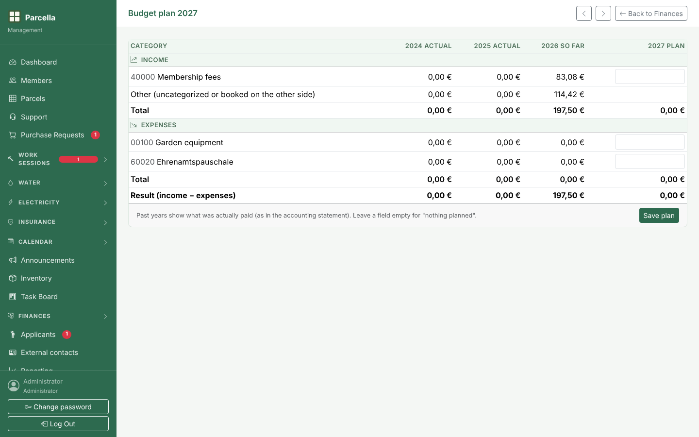

# Categorieën, begroting en overzicht {#categories-budget-and-statement}

!!! note "Machinevertaling"
    Deze pagina is machinaal vertaald uit het Engels en nog niet nagekeken. Als iets onduidelijk is, geldt de Engelse versie (taal wisselt u bovenaan).

Boekhoudcategorieën zijn korte codes zoals „40000 Contributie“ die u aan
factuurregels en aan de posten van inkomende facturen hangt. Daarmee kan
Parcella u vertellen waar het geld van de vereniging vandaan kwam en
waar het heen ging: in de lijst met alle boekingen, in het boekhoudkundig
overzicht op kasbasis voor de belastingdienst, en in de begroting voor
volgend jaar.

!!! info "Wie kan dit gebruiken"
    Onderdeel van de module **Financiën** (standaard uit). Alle vier de
    schermen kunnen worden bekeken met leesrecht op **Financiën**, ook de
    PDF-export van het overzicht. Categorieën toevoegen, wijzigen en
    importeren en de begroting opslaan vragen schrijfrecht; een
    categorie verwijderen vraagt verwijderrecht. Bestuursleden en
    beheerders kunnen alles. Zie [Financiën](index.md).

## Boekhoudcategorieën {#bookkeeping-categories}


Open de pagina via de kaart **Categorieën** op het financiële dashboard.
**Terug naar Financiën** in de bovenbalk brengt u terug.

Parcella levert geen officieel rekeningschema mee. De voorbeeldgegevens
bevatten drie voorbeeldcategorieën; vervang ze door het eigen schema van
uw vereniging, ingetypt of geïmporteerd uit uw boekhoudsoftware.

### Nieuwe categorie {#new-category}

Getoond met schrijfrecht.

| Veld | Wat het doet |
|---|---|
| **Code** | Verplicht. Precies vijf cijfers, bijv. `40000`. Mag niet door een andere categorie worden gebruikt. |
| **Titel** | Verplicht, bijv. „Contributie“. |
| **Groep** | **Inkomsten**, **Uitgaven**, **Vaste activa**, **Eigen vermogen & schulden** of **Overig**. De begroting zet categorieën van **Inkomsten** in haar inkomstendeel en alle andere in haar uitgavendeel. |
| **Categorie toevoegen** | Slaat de categorie op. |

Fouten: „Ongeldige categorie -- de code moet precies 5 cijfers bevatten,
titel en groep zijn verplicht.“ of „Er bestaat al een categorie met deze
code.“

### Importeren uit CSV {#import-from-csv}

Getoond met schrijfrecht. Kies een **CSV-bestand** en klik op
**Importeren**.

Het bestand heeft een koprij `code,title,group` nodig, gescheiden door
komma's. **group** is een van `income`, `expense`, `fixed_assets`,
`equity_liabilities`, `other` (hoofd- of kleine letters). Bijvoorbeeld:

```
code,title,group
40000,Contributie,income
40100,Pachtopbrengst,income
60020,Vrijwilligersvergoeding,expense
```

Rijen met een ongeldige code, een onbekende groep, een ontbrekende titel,
of een code die al bestaat, worden overgeslagen. Het resultaat wordt
getoond als „*n* geïmporteerd, *m* overgeslagen.“ Bestaande categorieën
worden door een import nooit gewijzigd.

### Lijst met categorieën {#categories-list}

| Kolom / knop | Wat ze toont |
|---|---|
| **Code**, **Titel**, **Groep** | De categorie. Met schrijfrecht zijn ze in de rij bewerkbaar; klik op het vinkpictogram om op te slaan. Dezelfde regels als voor een nieuwe categorie gelden. |
| Prullenbakpictogram | Verwijdert de categorie na bevestiging. Vraagt verwijderrecht. |

Zijn er geen: „Nog geen categorieën -- voeg er hierboven een toe of
importeer een CSV.“

!!! warning "Een categorie verwijderen"
    „Deze categorie verwijderen? Regels die deze gebruiken blijven werken,
    alleen zonder categorie.“ Factuurregels, artikelsjablonen en posten
    van inkomende facturen verliezen de categorie; eerdere betalingen
    ervoor verschijnen dan als „Geen categorie“ in het overzicht. **Begrote
    bedragen voor deze categorie in de begroting worden verwijderd.**
    Hernoem een categorie liever dan haar te verwijderen en opnieuw aan
    te maken.

## Alle boekingen {#all-bookings}


Open de lijst via de kaart **Alle boekingen** op het dashboard. Ze toont
elke betaling die de vereniging voor haar facturen ontving en elke
betaling die ze voor inkomende facturen deed, over alle rekeningen heen,
de nieuwste eerst. Boekingen die niet aan een factuur zijn gekoppeld
(bankkosten, terugbetalingen) zitten er niet in -- zie daarvoor de
[boekingen](bank-accounts.md#bookings-of-an-account) van de rekening.

**Filter**

| Filter | Wat het doet |
|---|---|
| **Zoeken** | Vindt betalingen waarvan afzender/ontvanger of omschrijving deze tekst bevat. |
| **Van** / **Tot** | Betaaldatum op of tussen deze datums. |
| **Categorie** | **Alle categorieën**, of alleen betalingen waarvan de factuur een regel in deze categorie heeft. |
| **Type** | **Inkomsten & uitgaven**, **Inkomsten** of **Uitgaven**. |
| **Bedrag vanaf** / **Bedrag tot** | Betaalbedrag in dit bereik. Uitgaven tellen hier als positieve bedragen. |
| **Filteren** / **Resetten** | Past het filter toe / wist het. |

**Tabel** (de kop toont het aantal, bijv. „42 boeking(en)“)

| Kolom | Wat ze toont |
|---|---|
| **Datum** | De betaaldatum. |
| **Type** | **Inkomsten** (groen) of **Uitgaven** (rood). |
| **Afzender / ontvanger** | De ontvanger van de factuur, of de afzender van de inkomende factuur. Klik erop om die factuur te openen. |
| **Categorieën** | Alle categorieën op de regels van de factuur, of „Geen categorie“. |
| **Omschrijving** | De regelnamen en omschrijvingen van de factuur. |
| **Bedrag** | Het betaalde bedrag, groen voor inkomsten, rood voor uitgaven. |

Past er niets: „Geen boekingen komen overeen met deze filters.“

!!! note
    Het getoonde bedrag is de hele betaling, ook als de factuur regels in
    meerdere categorieën heeft. Het
    [boekhoudkundig overzicht](#accounting-statement) verdeelt haar over
    de categorieën; deze lijst niet.

## Boekhoudkundig overzicht {#accounting-statement}


Open het via de kaart **Boekhoudkundig overzicht** op het dashboard. De
titel is „Boekhoudkundig overzicht *jaar*“. Het is een eenvoudig
overzicht van inkomsten en uitgaven op kasbasis per categorie, het soort
dat een vereniging zonder winstoogmerk aan de belastingdienst geeft of op
de algemene ledenvergadering presenteert.

**Bovenbalk**

| Bediening | Wat het doet |
|---|---|
| Jaar | Keuzelijst met elk jaar waarin een betaling is vastgelegd, plus het huidige jaar. Toont het nieuwste eerst; een wijziging laadt de pagina opnieuw. |
| **Exporteren als PDF** | Downloadt het overzicht voor het gekozen jaar als PDF met het briefhoofd van uw vereniging („Kasstroomoverzicht *jaar*“). |
| **Terug naar Financiën** | Terug naar het dashboard. |

De pagina heeft twee kaarten, **Inkomsten** en **Uitgaven**, elk met
**Categorie** („code · titel“, of „Geen categorie“) en **Bedrag**, met
een rij **Totaal**. Daaronder wordt het **Resultaat** (inkomsten min
uitgaven) groen getoond, of rood als het negatief is. Een kaart zonder
posten zegt „Geen posten voor dit jaar.“

Zo worden de cijfers geteld:

- **Alleen geld dat echt is bewogen, telt.** Inkomsten zijn de
  betalingen die voor uitgaande facturen zijn vastgelegd, uitgaven de
  betalingen die voor inkomende facturen zijn vastgelegd. Onbetaalde
  facturen verschijnen niet.
- **De betaaldatum bepaalt het jaar**, niet de factuurdatum.
- **Elke betaling wordt per categorie verdeeld**, naar verhouding van
  de regels van de factuur. Heeft een factuur van 100,00 80,00 pacht en
  20,00 water, dan telt een deelbetaling van 50,00 voor 40,00 bij pacht
  en 10,00 bij water. Aanmaningskosten in een betaling worden op
  dezelfde manier verdeeld.
- Regels zonder categorie, en facturen van vóór het gebruik van
  categorieën, verschijnen als „Geen categorie“.
- Rekeningboekingen die niet aan een factuur zijn gekoppeld (bankkosten,
  rente, contante aankopen die op een rekening zijn ingevoerd) tellen
  **niet** mee. Leg zulke kosten vast als
  [inkomende factuur](incoming-invoices.md) met een betaling als ze hier
  moeten verschijnen.

!!! tip
    Voor een net overzicht geeft u elk catalogusitem en elke post van een
    inkomende factuur een categorie *voordat* u de ronde afrondt of de
    rekening vastlegt. Categorieën worden bij het afronden van de ronde
    op de facturen gekopieerd en kunnen daarna niet meer worden
    toegevoegd.

## Begroting {#budget-plan}



Open haar via de kaart **Begroting** op het dashboard. De titel is
„Begroting *jaar*“. Ze opent op **volgend jaar**. Gebruik de pijlknoppen
**Vorig jaar** / **Volgend jaar** in de bovenbalk om een ander jaar te
plannen; **Terug naar Financiën** brengt u terug naar het dashboard.

De tabel heeft één rij per boekhoudcategorie en deze kolommen:

| Kolom | Wat ze toont |
|---|---|
| **Categorie** | Code en titel. |
| „*jaar* werkelijk“ (drie kolommen) | Wat in elk van de drie jaren vóór het geplande jaar werkelijk is ontvangen of betaald, precies zoals in het [boekhoudkundig overzicht](#accounting-statement). Voor het huidige jaar luidt de kop „*jaar* tot nu toe“, omdat het jaar nog niet voorbij is. |
| „*jaar* begroot“ | Het bedrag dat u voor deze categorie begroot. Bewerkbaar met schrijfrecht. |

De rijen zijn gegroepeerd:

- **Inkomsten** -- alle categorieën van de groep **Inkomsten**, met een
  rij **Totaal**.
- **Uitgaven** -- alle andere categorieën (uitgaven, vaste activa, eigen
  vermogen & schulden, overig), met een rij **Totaal**.
- **Overig (zonder categorie of aan de andere kant geboekt)** --
  verschijnt in een deel alleen als het nodig is. Het bevat wat het
  overzicht telde maar geen rij van het deel toont: betalingen zonder
  categorie, of bijvoorbeeld een betaling van een inkomende factuur
  waarvan de post een inkomstencategorie heeft. Daarmee kloppen de
  totalen van de delen altijd met het overzicht.
- **Resultaat (inkomsten − uitgaven)** onderaan, rood als het negatief
  is.

Vul de begrote bedragen in als getallen, bijv. `1050.00`, en klik op
**Begroting opslaan**. U ziet „Begroting opgeslagen.“. „Afgelopen jaren
tonen wat werkelijk is betaald (zoals in het kasoverzicht). Een leeg veld
betekent "niets begroot".“ Een veld leegmaken verwijdert de begroting
voor die categorie. Iets wat geen getal is, wordt geweigerd met „Voer
bedragen in als getallen, bijv. 1050.00.“ en er wordt niets opgeslagen.

Alleen de begroting wordt opgeslagen. De kolommen met werkelijke cijfers
worden elke keer opnieuw uit de vastgelegde betalingen berekend, dus ze
kloppen altijd met het boekhoudkundig overzicht.

Hebt u nog geen categorieën: „Nog geen boekhoudcategorieën. De begroting
heeft één rij per categorie.“ met een link **Categorieën beheren**.

## Gerelateerd {#related}

- [Factuurrondes](invoice-runs.md) -- waar factuurregels hun categorie
  krijgen.
- [Inkomende facturen](incoming-invoices.md) -- waar uitgavenposten hun
  categorie krijgen.
- [Bankrekeningen en boekingen](bank-accounts.md)
