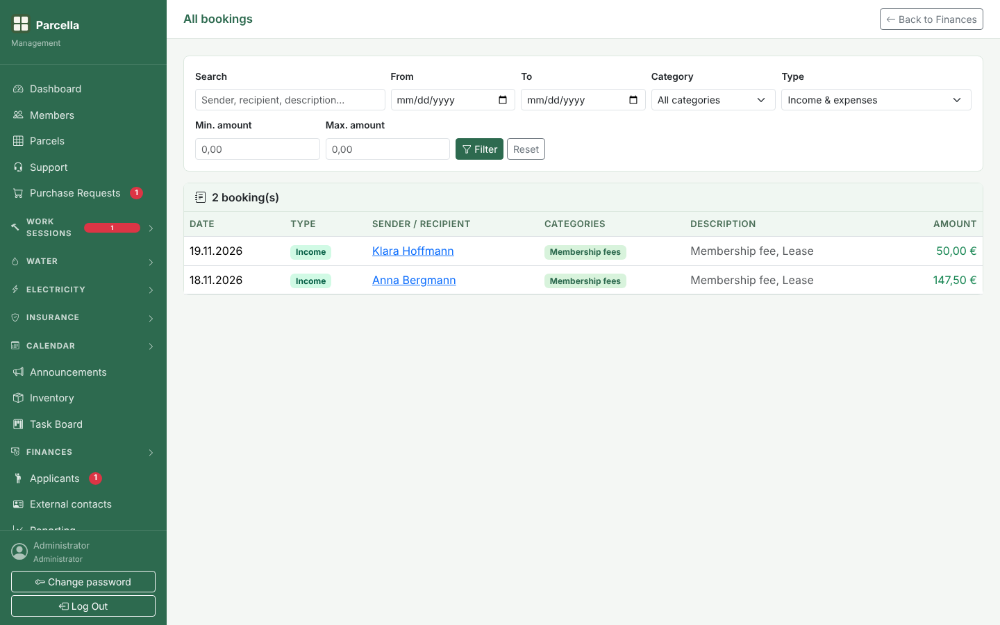

# Kategorie, budżet i zestawienie {#categories-budget-and-statement}

!!! note "Tłumaczenie maszynowe"
    Ta strona została przetłumaczona maszynowo z języka angielskiego i nie została jeszcze sprawdzona. Jeśli coś jest niejasne, obowiązuje wersja angielska (język zmienisz u góry).

Kategorie księgowe to krótkie kody, np. „40000 Składki członkowskie”,
które przypisujesz do pozycji faktur i do pozycji faktur
przychodzących. Dzięki nim Parcella mówi, skąd pochodziły pieniądze
stowarzyszenia i dokąd poszły: na liście wszystkich księgowań, w
kasowym zestawieniu księgowym dla urzędu skarbowego i w planie budżetu
na następny rok.

!!! info "Kto może z tego korzystać"
    Część modułu **Finanse** (domyślnie wyłączonego). Wszystkie cztery
    ekrany można oglądać z prawem odczytu **Finanse**, łącznie z
    eksportem zestawienia do PDF. Dodawanie, zmiana i import kategorii
    oraz zapis budżetu wymagają prawa zapisu; usunięcie kategorii wymaga
    prawa usuwania. Członkowie zarządu i administratorzy mogą wszystko.
    Zob. [Finanse](index.md).

## Kategorie księgowe {#bookkeeping-categories}


Otwierasz je kartą **Kategorie** na panelu finansów. **Powrót do
Finansów** na górnym pasku prowadzi z powrotem.

Parcella nie dostarcza oficjalnego planu kont. Dane przykładowe
zawierają trzy przykładowe kategorie; zastąp je własnym planem kont
stowarzyszenia, wpisanym ręcznie lub zaimportowanym z programu
księgowego.

### Nowa kategoria {#new-category}

Widoczna z prawem zapisu.

| Pole | Do czego służy |
|---|---|
| **Numer** | Wymagany. Dokładnie pięć cyfr, np. `40000`. Nie może być używany przez inną kategorię. |
| **Nazwa** | Wymagana, np. „Składki członkowskie”. |
| **Grupa** | **Przychody**, **Wydatki**, **Środki trwałe**, **Kapitał własny i zobowiązania** lub **Inne**. Plan budżetu umieszcza kategorie **Przychody** w części przychodów, a wszystkie pozostałe w części wydatków. |
| **Dodaj kategorię** | Zapisuje kategorię. |

Błędy: „Nieprawidłowa kategoria -- numer musi mieć dokładnie 5 cyfr,
wymagane są nazwa i grupa.” lub „Kategoria z tym numerem już istnieje.”

### Import z CSV {#import-from-csv}

Widoczny z prawem zapisu. Wybierz **Plik CSV** i kliknij **Importuj**.

Plik potrzebuje wiersza nagłówka `code,title,group`, oddzielonego
przecinkami. **group** to jedno z `income`, `expense`, `fixed_assets`,
`equity_liabilities`, `other` (wielkość liter dowolna). Na przykład:

```
code,title,group
40000,Membership fees,income
40100,Lease income,income
60020,Volunteer allowance,expense
```

Wiersze z nieprawidłowym numerem, nieznaną grupą, brakującą nazwą albo
numerem, który już istnieje, są pomijane. Wynik jest pokazywany jako
„Zaimportowano *n*, pominięto *m*.” Import nigdy nie zmienia
istniejących kategorii.

### Lista kategorii {#categories-list}

| Kolumna / przycisk | Co pokazuje |
|---|---|
| **Numer**, **Nazwa**, **Grupa** | Kategoria. Z prawem zapisu można je edytować w wierszu; kliknij ikonę haczyka, aby zapisać. Obowiązują te same zasady co dla nowej kategorii. |
| Ikona kosza | Po potwierdzeniu usuwa kategorię. Wymaga prawa usuwania. |

Jeśli nie ma żadnych: „Brak jeszcze kategorii -- dodaj powyżej lub
zaimportuj plik CSV.”

!!! warning "Usuwanie kategorii"
    „Usunąć tę kategorię? Pozycje, które jej używają, nadal będą
    działać, tylko bez kategorii.” Pozycje faktur, szablony pozycji i
    pozycje faktur przychodzących tracą kategorię; dawne płatności za nie
    są wtedy pokazywane w zestawieniu jako „Bez kategorii”. **Kwoty
    zaplanowane dla tej kategorii w planie budżetu zostają usunięte.**
    Zamiast usuwać i tworzyć kategorię od nowa, zmień jej nazwę.

## Wszystkie księgowania {#all-bookings}



Otwierasz je kartą **Wszystkie księgowania** na panelu. Pokazuje każdą
płatność, którą stowarzyszenie otrzymało za swoje faktury, i każdą
płatność, którą zrobiło za faktury przychodzące, ze wszystkich kont, od
najnowszych. Księgowania niezwiązane z fakturą (opłaty bankowe, zwroty)
nie są uwzględniane -- dla nich zob.
[księgowania](bank-accounts.md#bookings-of-an-account) konta.

**Filtr**

| Filtr | Do czego służy |
|---|---|
| **Szukaj** | Znajduje płatności, których nadawca/odbiorca lub opis zawiera ten tekst. |
| **Od** / **Do** | Data płatności w tym dniu lub pomiędzy tymi datami. |
| **Kategoria** | **Wszystkie kategorie** albo tylko płatności, których faktura ma pozycję w tej kategorii. |
| **Typ** | **Przychody i wydatki**, **Przychód** lub **Wydatek**. |
| **Kwota od** / **Kwota do** | Kwota płatności w tym zakresie. Wydatki liczą się tu jako kwoty dodatnie. |
| **Filtruj** / **Wyczyść** | Stosuje filtr / czyści go. |

**Tabela** (nagłówek pokazuje liczbę, np. „42 księgowań”)

| Kolumna | Co pokazuje |
|---|---|
| **Data** | Data płatności. |
| **Typ** | **Przychód** (na zielono) lub **Wydatek** (na czerwono). |
| **Nadawca / odbiorca** | Odbiorca faktury lub nadawca faktury przychodzącej. Kliknij, aby otworzyć tę fakturę. |
| **Kategorie** | Wszystkie kategorie z pozycji faktury lub „Bez kategorii”. |
| **Opis** | Nazwy i opisy pozycji faktury. |
| **Kwota** | Zapłacona kwota, na zielono dla przychodów, na czerwono dla wydatków. |

Jeśli nic nie pasuje: „Żadne księgowania nie pasują do tych filtrów.”

!!! note
    Pokazywana kwota to cała płatność, nawet jeśli faktura ma pozycje w
    kilku kategoriach. [Zestawienie księgowe](#accounting-statement)
    dzieli ją między kategorie; ta lista nie.

## Zestawienie księgowe {#accounting-statement}


Otwierasz je kartą **Zestawienie księgowe** na panelu. Tytuł to
„Zestawienie księgowe *rok*”. To proste kasowe zestawienie przychodów
i wydatków według kategorii, takie, jakie stowarzyszenie non-profit
przekazuje urzędowi skarbowemu lub przedstawia na walnym zebraniu.

**Górny pasek**

| Element | Do czego służy |
|---|---|
| Rok | Lista rozwijana z każdym rokiem, w którym zapisano płatność, plus bieżący rok. Pokazuje najpierw najnowszy; zmiana przeładowuje stronę. |
| **Eksportuj jako PDF** | Pobiera zestawienie za wybrany rok jako PDF z nagłówkiem Twojego stowarzyszenia („Rozliczenie kasowe *rok*”). |
| **Powrót do Finansów** | Powrót do panelu. |

Strona ma dwie karty, **Przychody** i **Wydatki**, każda z kolumnami
**Kategoria** („kod · nazwa” lub „Bez kategorii”) i **Kwota**, z
wierszem **Razem**. Pod nimi **Wynik** (przychody minus wydatki) jest
pokazywany na zielono lub na czerwono, jeśli jest ujemny. Karta bez
wpisów mówi „Brak wpisów w tym roku.”

Jak liczone są kwoty:

- **Liczą się tylko pieniądze, które faktycznie się przemieściły.**
  Przychody to płatności zapisane dla faktur wychodzących, wydatki to
  płatności zapisane dla faktur przychodzących. Niezapłacone faktury się
  nie pojawiają.
- **O roku decyduje data płatności**, nie data faktury.
- **Każda płatność jest dzielona według kategorii** proporcjonalnie do
  pozycji faktury. Jeśli faktura na 100,00 ma 80,00 dzierżawy i 20,00
  wody, częściowa płatność 50,00 liczy się w 40,00 do dzierżawy i w
  10,00 do wody. Opłata za upomnienie zawarta w płatności jest dzielona
  tak samo.
- Pozycje bez kategorii oraz faktury sprzed wprowadzenia kategorii są
  pokazywane jako „Bez kategorii”.
- Księgowania na koncie niezwiązane z fakturą (opłaty bankowe, odsetki,
  zakupy gotówkowe wpisane na koncie) **nie** są uwzględniane. Zapisz
  takie koszty jako [fakturę przychodzącą](incoming-invoices.md) z
  płatnością, jeśli mają się tu pojawić.

!!! tip
    Dla czystego zestawienia nadaj kategorię każdej pozycji katalogu i
    każdej pozycji faktury przychodzącej *zanim* sfinalizujesz serię
    faktur lub zarejestrujesz rachunek. Kategorie są kopiowane na
    faktury przy finalizacji serii i nie można ich potem do nich dodać.

## Plan budżetu {#budget-plan}


Otwierasz go kartą **Plan budżetu** na panelu. Tytuł to „Plan budżetu
*rok*”. Otwiera się na **następnym roku**. Przyciskami strzałek
**Poprzedni rok** / **Następny rok** na górnym pasku planujesz inny
rok; **Powrót do Finansów** wraca do panelu.

Tabela ma jeden wiersz na kategorię księgową i takie kolumny:

| Kolumna | Co pokazuje |
|---|---|
| **Kategoria** | Numer i nazwa. |
| „*rok* wykonanie” (trzy kolumny) | Co faktycznie otrzymano lub zapłacono w każdym z trzech lat przed planowanym rokiem, dokładnie jak w [zestawieniu księgowym](#accounting-statement). Dla bieżącego roku nagłówek brzmi „*rok* dotychczas”, bo rok się jeszcze nie skończył. |
| „*rok* plan” | Kwota planowana dla tej kategorii. Edytowalna z prawem zapisu. |

Wiersze są pogrupowane:

- **Przychody** -- wszystkie kategorie z grupy **Przychody**, z
  wierszem **Razem**.
- **Wydatki** -- wszystkie pozostałe kategorie (wydatki, środki trwałe,
  kapitał własny i zobowiązania, inne), z wierszem **Razem**.
- **Inne (bez kategorii lub zaksięgowane po drugiej stronie)** --
  pojawia się w części tylko wtedy, gdy jest potrzebne. Zawiera to, co
  zestawienie policzyło, ale czego nie pokazuje żaden wiersz części:
  płatności bez kategorii albo np. płatność faktury przychodzącej, której
  pozycja ma kategorię przychodów. Dzięki temu sumy części zawsze
  zgadzają się z zestawieniem.
- **Wynik (przychody − wydatki)** na dole, na czerwono, gdy jest
  ujemny.

Wpisz planowane kwoty jako liczby, np. `1050.00`, i kliknij **Zapisz
plan**. Widzisz „Plan budżetu zapisany.”. „Lata ubiegłe pokazują
faktycznie zapłacone kwoty (jak w zestawieniu kasowym). Puste pole
oznacza „nic nie zaplanowano”.” Opróżnienie pola usuwa plan dla tej
kategorii. Coś, co nie jest liczbą, jest odrzucane z komunikatem „Wpisz
kwoty jako liczby, np. 1050.00.” i nic nie zostaje zapisane.

Zapisywany jest tylko plan. Kolumny wykonania są za każdym razem
przeliczane z zapisanych płatności, więc zawsze zgadzają się z
zestawieniem księgowym.

Jeśli nie masz jeszcze kategorii: „Brak kategorii księgowych. Plan
budżetu ma jeden wiersz na kategorię.” z linkiem **Zarządzaj
kategoriami**.

## Powiązane {#related}

- [Serie faktur](invoice-runs.md) -- gdzie pozycje faktur dostają
  kategorię.
- [Faktury przychodzące](incoming-invoices.md) -- gdzie pozycje
  wydatków dostają kategorię.
- [Rachunki bankowe i księgowania](bank-accounts.md)
