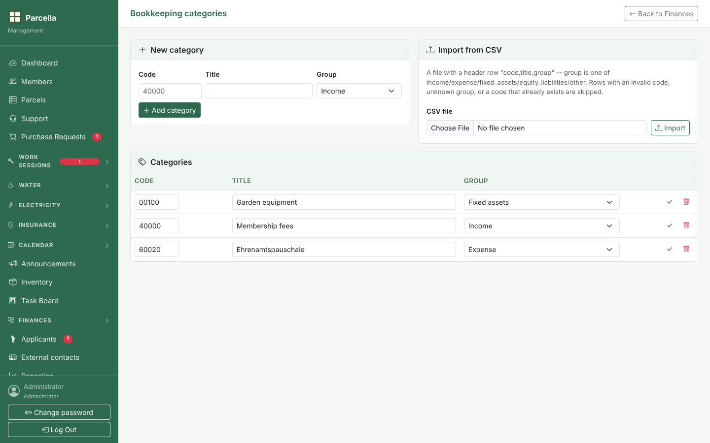

# Kategórie, rozpočet a prehľad {#categories-budget-and-statement}

!!! note "Strojový preklad"
    Táto stránka bola strojovo preložená z angličtiny a zatiaľ nebola skontrolovaná. Ak je niečo nejasné, platí anglická verzia (jazyk prepnete hore).

Účtovné kategórie sú krátke kódy ako „40000 Členské príspevky“, ktoré
priraďujete riadkom faktúr a položkám prijatých faktúr. Vďaka nim vám
Parcella vie povedať, odkiaľ peniaze spolku prišli a kam odišli: v
zozname všetkých platieb, v účtovnom prehľade na hotovostnej báze pre
daňový úrad a v rozpočte na ďalší rok.

!!! info "Kto to môže používať"
    Súčasť modulu **Financie** (predvolene vypnutý). Všetky štyri
    obrazovky sa dajú prezerať s oprávnením na čítanie pre
    **Financie**, vrátane exportu prehľadu do PDF. Pridávanie, zmena a
    import kategórií a uloženie rozpočtu potrebujú oprávnenie na zápis;
    mazanie kategórie potrebuje oprávnenie na mazanie. Členovia výboru a
    administrátori môžu všetko. Pozri [Financie](index.md).

## Účtovné kategórie {#bookkeeping-categories}



Otvoríte ich kartou **Kategórie** na finančnom prehľade. **Späť na
Financie** v hornom pruhu vás vráti späť.

Parcella nedodáva oficiálnu účtovú osnovu. Ukážkové dáta obsahujú tri
príkladové kategórie; nahraďte ich vlastnou osnovou vášho spolku,
napísanou ručne alebo importovanou z vášho účtovného softvéru.

### Nová kategória {#new-category}

Zobrazí sa s oprávnením na zápis.

| Pole | Čo robí |
|---|---|
| **Číslo** | Povinné. Presne päť číslic, napr. `40000`. Nesmie ho používať iná kategória. |
| **Názov** | Povinné, napr. „Členské príspevky“. |
| **Skupina** | **Príjmy**, **Výdavky**, **Dlhodobý majetok**, **Vlastné imanie a záväzky** alebo **Ostatné**. Rozpočet dáva kategórie **Príjmy** do svojej príjmovej časti a všetky ostatné do výdavkovej časti. |
| **Pridať kategóriu** | Uloží kategóriu. |

Chyby: „Neplatná kategória -- číslo musí mať presne 5 číslic, názov a
skupina sú povinné.“ alebo „Kategória s týmto číslom už existuje.“

### Import z CSV {#import-from-csv}

Zobrazí sa s oprávnením na zápis. Vyberte **Súbor CSV** a kliknite na
**Importovať**.

Súbor potrebuje hlavičkový riadok `code,title,group`, oddelený
čiarkami. **group** je jedno z `income`, `expense`, `fixed_assets`,
`equity_liabilities`, `other` (veľkými alebo malými písmenami).
Napríklad:

```
code,title,group
40000,Členské príspevky,income
40100,Príjmy z nájmu,income
60020,Odmena dobrovoľníkom,expense
```

Riadky s neplatným číslom, neznámou skupinou, chýbajúcim názvom alebo
číslom, ktoré už existuje, sa preskočia. Výsledok sa zobrazí ako
„Importovaných *n*, preskočených *m*.“ Existujúce kategórie import nikdy
nemení.

### Zoznam kategórií {#categories-list}

| Stĺpec / tlačidlo | Čo ukazuje |
|---|---|
| **Číslo**, **Názov**, **Skupina** | Kategória. S oprávnením na zápis sa dajú upravovať priamo v riadku; uložíte ich kliknutím na ikonu fajky. Platia rovnaké pravidlá ako pre novú kategóriu. |
| Ikona koša | Po potvrdení kategóriu zmaže. Potrebuje oprávnenie na mazanie. |

Ak žiadne nie sú: „Zatiaľ žiadne kategórie -- pridajte vyššie alebo
importujte CSV.“

!!! warning "Mazanie kategórie"
    „Zmazať túto kategóriu? Položky, ktoré ju používajú, zostanú
    zachované, len bez kategórie.“ Riadky faktúr, šablóny položiek a
    položky prijatých faktúr kategóriu stratia; minulé platby za ne sa
    potom v prehľade zobrazia ako „Bez kategórie“. **Plánované sumy pre
    túto kategóriu v rozpočte sa zmažú.** Kategóriu radšej premenujte,
    než by ste ju zmazali a vytvorili znova.

## Všetky platby {#all-bookings}


Otvoríte ich kartou **Všetky platby** na prehľade. Uvádzajú každú
platbu, ktorú spolok dostal za svoje faktúry, a každú platbu, ktorú
uhradil za prijaté faktúry, zo všetkých účtov, najnovšie navrchu.
Zaúčtovania, ktoré nie sú viazané na faktúru (bankové poplatky,
vrátenia), tu nie sú -- tie nájdete v [zaúčtovaniach](bank-accounts.md#bookings-of-an-account)
účtu.

**Filter**

| Filter | Čo robí |
|---|---|
| **Hľadať** | Nájde platby, ktorých odosielateľ/príjemca alebo popis obsahuje tento text. |
| **Od** / **Do** | Dátum platby v tento deň alebo medzi týmito dátumami. |
| **Kategória** | **Všetky kategórie** alebo len platby, ktorých faktúra má riadok v tejto kategórii. |
| **Typ** | **Príjmy a výdavky**, **Príjem** alebo **Výdavok**. |
| **Suma od** / **Suma do** | Suma platby v tomto rozsahu. Výdavky sa tu počítajú ako kladné sumy. |
| **Filtrovať** / **Zrušiť filter** | Použije filter / zruší ho. |

**Tabuľka** (hlavička ukazuje počet, napr. „42 platieb“)

| Stĺpec | Čo ukazuje |
|---|---|
| **Dátum** | Dátum platby. |
| **Typ** | **Príjem** (zelene) alebo **Výdavok** (červene). |
| **Odosielateľ / príjemca** | Príjemca faktúry alebo odosielateľ prijatej faktúry. Kliknutím otvoríte túto faktúru. |
| **Kategórie** | Všetky kategórie na riadkoch faktúry alebo „Bez kategórie“. |
| **Popis** | Názvy a popisy riadkov faktúry. |
| **Suma** | Zaplatená suma, zelene pri príjmoch, červene pri výdavkoch. |

Ak nič nevyhovuje: „Žiadne platby nezodpovedajú týmto filtrom.“

!!! note
    Zobrazená suma je celá platba, aj keď má faktúra riadky vo
    viacerých kategóriách. [Účtovný prehľad](#accounting-statement) ju
    medzi kategórie rozdelí; tento zoznam nie.

## Účtovný prehľad {#accounting-statement}


Otvoríte ho kartou **Účtovný prehľad** na prehľade. Je to jednoduchý
prehľad príjmov a výdavkov na hotovostnej báze podľa kategórií, aký
nezisková organizácia odovzdáva daňovému úradu alebo predkladá na
výročnej členskej schôdzi.

**Horný pruh**

| Ovládací prvok | Čo robí |
|---|---|
| Rok | Rozbaľovací zoznam s každým rokom, v ktorom bola zaznamenaná platba, plus aktuálny rok. Ukazuje najnovší prvý; zmena stránku znova načíta. |
| **Exportovať ako PDF** | Stiahne prehľad za vybraný rok ako PDF s hlavičkou vášho spolku („Prehľad príjmov a výdavkov *rok*“). |
| **Späť na Financie** | Späť na prehľad. |

Stránka má dve karty, **Príjmy** a **Výdavky**, každá uvádza
**Kategória** („kód · názov“ alebo „Bez kategórie“) a **Suma**, s
riadkom **Spolu**. Pod nimi sa **Výsledok** (príjmy mínus výdavky)
zobrazuje zelene, alebo červene, ak je záporný. Karta bez záznamov
hovorí „Pre tento rok nie sú žiadne záznamy.“

Ako sa čísla počítajú:

- **Počítajú sa len peniaze, ktoré sa naozaj pohli.** Príjmy sú platby
  zaznamenané pri vydaných faktúrach, výdavky platby zaznamenané pri
  prijatých faktúrach. Nezaplatené faktúry sa nezobrazujú.
- **O roku rozhoduje dátum platby**, nie dátum faktúry.
- **Každá platba sa rozdelí podľa kategórií** v pomere riadkov faktúry.
  Ak má faktúra na 100,00 riadok nájom 80,00 a vodu 20,00, čiastočná
  platba 50,00 sa započíta 40,00 na nájom a 10,00 na vodu. Rovnako sa
  rozdelí aj poplatok za upomienku zahrnutý v platbe.
- Riadky bez kategórie a faktúry z obdobia pred používaním kategórií sa
  zobrazujú ako „Bez kategórie“.
- Zaúčtovania na účte, ktoré nie sú viazané na faktúru (bankové
  poplatky, úroky, hotovostné nákupy zadané na účte), **nie sú**
  zahrnuté. Ak sa tu majú objaviť, zaznamenajte takéto náklady ako
  [prijatú faktúru](incoming-invoices.md) s platbou.

!!! tip
    Pre čistý prehľad dajte každej položke katalógu a každej položke
    prijatej faktúry kategóriu *skôr*, než dokončíte vyúčtovanie alebo
    zaznamenáte účet. Kategórie sa na faktúry skopírujú pri dokončení
    vyúčtovania a dodatočne sa k nim pridať nedajú.

## Rozpočet {#budget-plan}


Otvoríte ho kartou **Rozpočet** na prehľade. Názov je „Rozpočet
*rok*“. Otvorí sa na **budúcom roku**. Tlačidlami so šípkami
**Predchádzajúci rok** / **Nasledujúci rok** v hornom pruhu naplánujete
iný rok; **Späť na Financie** vás vráti na prehľad.

Tabuľka má jeden riadok na účtovnú kategóriu a tieto stĺpce:

| Stĺpec | Čo ukazuje |
|---|---|
| **Kategória** | Číslo a názov. |
| „*rok* skutočnosť“ (tri stĺpce) | Čo sa v každom z troch rokov pred plánovaným rokom naozaj prijalo alebo zaplatilo, presne ako v [účtovnom prehľade](#accounting-statement). Pri aktuálnom roku nadpis znie „*rok* zatiaľ“, pretože rok ešte neskončil. |
| „*rok* plán“ | Suma, ktorú pre túto kategóriu plánujete. S oprávnením na zápis sa dá upraviť. |

Riadky sú zoskupené:

- **Príjmy** -- všetky kategórie skupiny **Príjmy**, s riadkom
  **Spolu**.
- **Výdavky** -- všetky ostatné kategórie (výdavky, dlhodobý majetok,
  vlastné imanie a záväzky, ostatné), s riadkom **Spolu**.
- **Ostatné (bez kategórie alebo zaúčtované na druhej strane)** --
  objaví sa v časti len vtedy, keď je potrebné. Obsahuje to, čo
  prehľad započítal, ale žiadny riadok časti neukazuje: platby bez
  kategórie alebo napríklad platbu prijatej faktúry, ktorej položka má
  príjmovú kategóriu. Vďaka tomu súčty častí vždy sedia s prehľadom.
- **Výsledok (príjmy − výdavky)** na konci, červene, keď je záporný.

Plánované sumy zadajte ako čísla, napr. `1050.00`, a kliknite na
**Uložiť plán**. Uvidíte „Rozpočet uložený.“. „Minulé roky ukazujú, čo
bolo skutočne zaplatené (ako v pokladničnom výkaze). Prázdne pole
znamená „nič neplánované“.“ Vyprázdnenie poľa odstráni plán pre túto
kategóriu. Čokoľvek, čo nie je číslo, sa odmietne hlásením „Zadajte
sumy ako čísla, napr. 1050.00.“ a nič sa neuloží.

Ukladá sa len plán. Stĺpce skutočnosti sa vždy znova vypočítajú zo
zaznamenaných platieb, takže sa vždy zhodujú s účtovným prehľadom.

Ak ešte nemáte kategórie: „Zatiaľ žiadne účtovné kategórie. Rozpočet má
jeden riadok na kategóriu.“ s odkazom **Spravovať kategórie**.

## Súvisiace {#related}

- [Vyúčtovania](invoice-runs.md) -- kde riadky faktúr dostávajú
  kategóriu.
- [Prijaté faktúry](incoming-invoices.md) -- kde výdavkové položky
  dostávajú kategóriu.
- [Bankové účty a zaúčtovania](bank-accounts.md)
