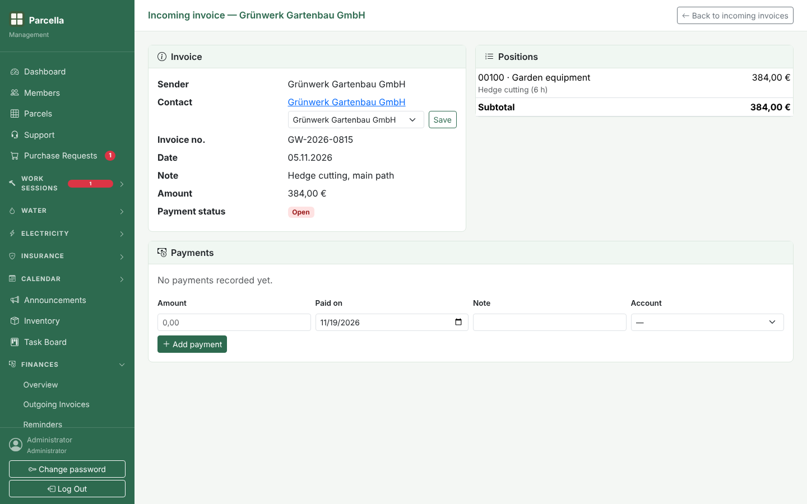

# Přijaté faktury {#incoming-invoices}

!!! note "Strojový překlad"
    Tato stránka byla strojově přeložena z angličtiny a dosud nebyla zkontrolována. Pokud je něco nejasné, platí anglická verze (jazyk přepnete nahoře).

Přijaté faktury jsou účty, které spolek dostává: od dodavatele vody,
pojišťovny, železářství. Když je zde evidujete, rozdělené na položky s
účetní kategorií, a poznamenáte si, kdy byly zaplaceny, získáte výdajovou
stranu [účetního přehledu](bookkeeping.md#accounting-statement).

!!! info "Kdo to může používat"
    Součást modulu **Finance** (ve výchozím stavu vypnutý). Prohlížení
    vyžaduje oprávnění ke čtení u **Finance**; evidence faktur,
    propojení kontaktů a přidávání plateb vyžadují oprávnění k zápisu;
    smazání faktury nebo platby vyžaduje oprávnění k mazání. Nahrávání a
    stahování naskenované faktury (přílohy) je možné jen pro členy
    výboru a administrátory, a jen když je zapnutý modul **Cloudové
    úložiště** a je nastavena složka pro přijaté faktury. Viz
    [Finance](index.md).

## Seznam přijatých faktur {#incoming-invoices-list}

Otevřete ho přes **Finance → Přijaté faktury** nebo kartou **Přijaté
faktury** na přehledu. Seznam je seřazený podle data faktury,
nejnovější první.

**Horní lišta**

| Tlačítko | Co dělá |
|---|---|
| **Zaznamenat přijatou fakturu** | Otevře formulář nové přijaté faktury (viz níže). Vyžaduje oprávnění k zápisu. |
| **Zpět na Finance** | Zpět na finanční přehled. |

**Filtr**

| Filtr | Co dělá |
|---|---|
| **Č. faktury** | Faktury, jejichž číslo obsahuje tento text. |
| **Odesílatel** | Faktury, jejichž odesílatel obsahuje tento text. |
| **Částka od** / **Částka do** | Celková částka faktury nejméně / nejvýše tolik. |
| **Stav platby** | **Vše**, **Otevřená**, **Částečně uhrazená** nebo **Uhrazená**. |
| **Filtrovat** / **Zrušit filtr** | Použije filtr / zruší ho. |

**Tabulka**

| Sloupec / tlačítko | Co ukazuje |
|---|---|
| **Datum** | Datum faktury. |
| **Odesílatel** | Kdo účet poslal; kliknutím otevřete [přijatou fakturu](#incoming-invoice). |
| **Č. faktury** | Číslo faktury dodavatele, pokud bylo zadáno. |
| **Kategorie** | Jeden řádek na položku: její kategorie (nebo „Bez kategorie“) a popis. |
| **Částka** | Celková částka faktury (součet všech položek). |
| **Stav platby** | **Otevřená**, **Částečně uhrazená** nebo **Uhrazená**, podle zaznamenaných plateb. |
| Ikona stažení | Stáhne přiloženou fakturu. Zobrazí se, jen když existuje příloha a smíte používat cloudové úložiště. |
| Ikona koše | Po potvrzení smaže přijatou fakturu i s položkami a platbami. Vyžaduje oprávnění k mazání. |

Pokud zatím nic nebylo zaznamenáno: „Zatím nebyly zaznamenány žádné
přijaté faktury.“

!!! note "Smazáním příloha zůstane"
    „Opravdu smazat tuto přijatou fakturu? Příloha se tím z cloudové
    složky nesmaže.“ Naskenovaná faktura zůstane ve sdílené složce;
    pokud je potřeba, odstraňte ji tam ručně.

## Zaznamenat přijatou fakturu {#record-incoming-invoice}

Klikněte na **Zaznamenat přijatou fakturu**. Otevře se dialog:

| Pole | Co dělá |
|---|---|
| **Kontakt** | Volitelné. Zobrazí se, jen když je zapnutý modul [Externí kontakty](../external-contacts.md) a smíte číst kontakty. Výběr dodavatele z kontaktů za vás vyplní **Odesílatel** („Výběr kontaktu vyplní odesílatele.“), pokud jste ho už nenapsali. **— žádný —** nepropojí žádný kontakt. |
| **Odesílatel** | Povinné. Název dodavatele, jak se má zobrazovat v seznamech, při párování s bankou a v účetním přehledu. |
| **Č. faktury** | Volitelné. Číslo faktury dodavatele. |
| **Datum faktury** | Povinné, předvyplněno dneškem. |
| **Poznámka** | Volitelné. |
| **Položky** | Jeden řádek na nákladovou položku (viz níže). |
| **Přidat položku** | Přidá další řádek položky. Každý řádek kromě prvního má tlačítko pro odebrání. |
| **Příloha** | Volitelné. Naskenovaná nebo vyfotografovaná faktura. „Nahráno do sdílené cloudové složky výše.“ Zobrazí se jen členům výboru a administrátorům, když je nastavené cloudové úložiště a složka pro přijaté faktury. |
| **Uložit** | Uloží fakturu. Uvidíte „Uloženo.“. |
| **Zrušit** | Zavře dialog bez uložení. |

Každá položka má tři pole:

| Pole | Co dělá |
|---|---|
| Kategorie | Volitelná [účetní kategorie](bookkeeping.md#bookkeeping-categories). „—“ znamená žádná; položka se pak zobrazí jako „Bez kategorie“. |
| **Popis (co bylo zakoupeno)** | Volitelný volný text, např. „Servis sekačky“. Více položek může sdílet kategorii, ale popisovat různé nákupy. |
| Částka | Částka položky, např. `249,90`. Položka bez platné částky se vynechá. |

!!! warning "Před uložením zkontrolujte"
    Odesílatele, datum, položky a částky po uložení nelze upravit;
    později lze měnit jen propojený kontakt a platby. Pokud je něco
    špatně, přijatou fakturu smažte a zaznamenejte znovu.

Pokud přílohu nelze nahrát, faktura se přesto uloží a chyba z cloudového
úložiště se ukáže nahoře v seznamu. Název souboru přílohy v cloudové
složce začíná interním číslem, takže dvě faktury se stejným názvem
souboru se nikdy nepřepíšou. Samotná složka se nastavuje v **Integrace**
→ **Složka pro přijaté faktury**, viz
[Integrace](../../administration/integrations.md).

## Přijatá faktura {#incoming-invoice}

Otevře se, když v seznamu kliknete na odesílatele. Titulek je „Přijatá
faktura — *odesílatel*“.

**Horní lišta**

| Tlačítko | Co dělá |
|---|---|
| **Stáhnout přílohu** | Stáhne přiloženou fakturu z cloudové složky. Zobrazí se, jen když existuje příloha a smíte používat cloudové úložiště. |
| **Zpět na přijaté faktury** | Zpět na seznam. |

Karta **Faktura**

| Pole | Co ukazuje |
|---|---|
| **Odesílatel** | Odesílatel, jak byl zadán. |
| **Kontakt** | Propojený externí kontakt, jako odkaz na kontakt, pokud smíte kontakty vidět („smazán“, pokud byl kontakt mezitím smazán). S oprávněním k zápisu můžete pomocí rozbalovacího seznamu a **Uložit** propojit jiný kontakt nebo žádný. Změna kontaktu **nemění** text **Odesílatel**. |
| **Č. faktury** | Číslo faktury dodavatele. |
| **Datum** | Datum faktury. |
| **Poznámka** | Poznámka. |
| **Částka** | Celková částka faktury. |
| **Stav platby** | **Otevřená**, **Částečně uhrazená** nebo **Uhrazená**. |

Karta **Položky**: každá položka s kategorií („číslo · název“ nebo „Bez
kategorie“), popisem a částkou a **Součet**.

Karta **Platby**: každá platba zaznamenaná k tomuto účtu s datem,
částkou, účtem a poznámkou. Ikona koše platbu smaže (vyžaduje oprávnění
k mazání, ptá se „Smazat tuto platbu?“). Pokud žádné nejsou: „Zatím
nebyly zaznamenány žádné platby.“

Zaznamenání platby (oprávnění k zápisu):

| Pole | Co dělá |
|---|---|
| **Částka** | Povinné. Co spolek zaplatil, jako kladné číslo. Částečné platby jsou v pořádku. |
| **Uhrazeno dne** | Povinné, předvyplněno dneškem. Toto datum určuje, ve kterém roce se výdaj počítá v účetním přehledu. |
| **Poznámka** | Volitelné. |
| **Účet** | Volitelné. [Účet](bank-accounts.md#accounts), ze kterého peníze odešly; nabízejí se jen aktivní účty. Platba se pak objeví jako záporná částka v zápisech tohoto účtu. |
| **Přidat platbu** | Uloží platbu. |

Stav se změní na **Uhrazená**, jakmile platby dosáhnou celkové částky
faktury. Přijaté faktury nemají upomínky ani poplatky.

!!! tip "Placení z bankovního výpisu"
    Místo zadání platby zde můžete importovat bankovní výpis na stránce
    zápisů účtu: záporný zápis se stejnou částkou jako otevřená přijatá
    faktura se nabídne jako shoda a zaznamená se jako její platba. Viz
    [Bankovní účty a zaúčtování](bank-accounts.md#possible-matching-invoices).

!!! note "Počítají se jen zaplacené faktury"
    Účetní přehled i rozpočet počítají výdaj ke dni, kdy byl zaplacen.
    Přijatá faktura bez platby se tam vůbec neobjeví.

## Související {#related}

- [Externí kontakty](../external-contacts.md) -- stránka kontaktu
  dodavatele uvádí přijaté faktury, které jsou s ním propojené.
- [Žádosti o nákup](../purchase-requests.md) -- schválení nákupu probíhá
  tam; výsledná faktura se zde zaznamená ručně.
  <!-- TODO(verify): there is no link between a purchase request and an incoming invoice in the code; confirm this is the intended workflow. -->
- [Kategorie, rozpočet a přehled](bookkeeping.md)
- [Integrace](../../administration/integrations.md) -- sdílená cloudová
  složka pro přílohy.
