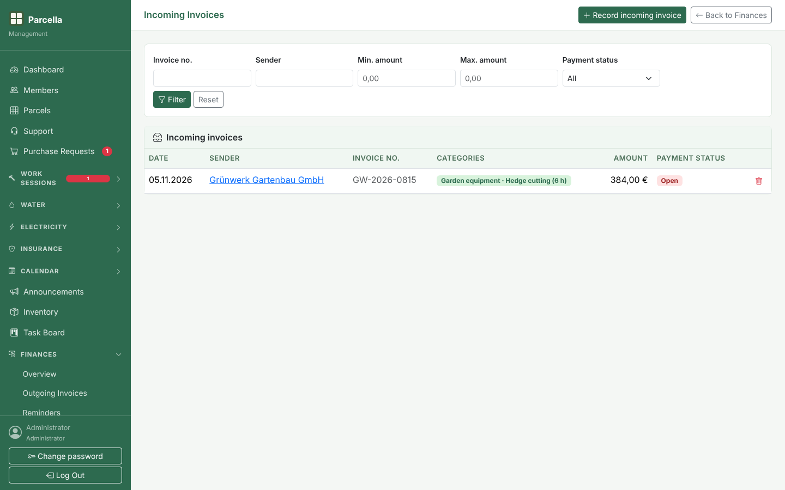

# Inkomende facturen {#incoming-invoices}

!!! note "Machinevertaling"
    Deze pagina is machinaal vertaald uit het Engels en nog niet nagekeken. Als iets onduidelijk is, geldt de Engelse versie (taal wisselt u bovenaan).

Inkomende facturen zijn de rekeningen die de vereniging ontvangt: het
waterbedrijf, de verzekeraar, de bouwmarkt. Ze hier vastleggen, verdeeld
over posten met elk een boekhoudcategorie, en noteren wanneer ze zijn
betaald, geeft u de uitgavenkant van het
[boekhoudkundig overzicht](bookkeeping.md#accounting-statement).

!!! info "Wie kan dit gebruiken"
    Onderdeel van de module **Financiën** (standaard uit). Bekijken
    vraagt leesrecht op **Financiën**; facturen vastleggen, contacten
    koppelen en betalingen toevoegen vraagt schrijfrecht; een factuur of
    betaling verwijderen vraagt verwijderrecht. De gescande rekening
    (bijlage) uploaden en downloaden kan alleen voor bestuursleden en
    beheerders, en alleen als de module **Cloudopslag** aan staat en er
    een map voor inkomende facturen is ingericht. Zie
    [Financiën](index.md).

## Lijst met inkomende facturen {#incoming-invoices-list}

Open de lijst met **Financiën → Inkomende facturen** of de kaart
**Inkomende facturen** op het dashboard. De lijst is gesorteerd op
factuurdatum, de nieuwste eerst.

**Bovenbalk**

| Knop | Wat het doet |
|---|---|
| **Inkomende factuur registreren** | Opent het formulier voor een nieuwe inkomende factuur (zie hieronder). Vraagt schrijfrecht. |
| **Terug naar Financiën** | Terug naar het financiële dashboard. |

**Filter**

| Filter | Wat het doet |
|---|---|
| **Factuurnr.** | Facturen waarvan het nummer deze tekst bevat. |
| **Afzender** | Facturen waarvan de afzender deze tekst bevat. |
| **Bedrag vanaf** / **Bedrag tot** | Factuurtotaal minstens / hoogstens dit bedrag. |
| **Betaalstatus** | **Alle**, **Open**, **Gedeeltelijk betaald** of **Betaald**. |
| **Filteren** / **Resetten** | Past het filter toe / wist het. |

**Tabel**

| Kolom / knop | Wat ze toont |
|---|---|
| **Datum** | De factuurdatum. |
| **Afzender** | Wie de rekening stuurde; klik erop om de [inkomende factuur](#incoming-invoice) te openen. |
| **Factuurnr.** | Het factuurnummer van de leverancier, als het is ingevuld. |
| **Categorieën** | Eén regel per post: de categorie (of „Geen categorie“) en de omschrijving. |
| **Bedrag** | Het factuurtotaal (som van alle posten). |
| **Betaalstatus** | **Open**, **Gedeeltelijk betaald** of **Betaald**, op basis van de vastgelegde betalingen. |
| Downloadpictogram | Downloadt de bijgevoegde rekening. Alleen getoond als er een bijlage is en u de cloudopslag mag gebruiken. |
| Prullenbakpictogram | Verwijdert de inkomende factuur, met haar posten en betalingen, na bevestiging. Vraagt verwijderrecht. |

Is er nog niets vastgelegd: „Nog geen inkomende facturen geregistreerd.“

!!! note "Verwijderen houdt de bijlage"
    „Deze inkomende factuur echt verwijderen? De bijlage wordt niet uit
    de cloudmap verwijderd.“ De gescande rekening blijft in de gedeelde
    map; verwijder haar daar met de hand als dat nodig is.

## Inkomende factuur registreren {#record-incoming-invoice}

Klik op **Inkomende factuur registreren**. Er opent een venster:

| Veld | Wat het doet |
|---|---|
| **Contact** | Optioneel. Alleen getoond als de module [Externe contacten](../external-contacts.md) aan staat en u contacten mag lezen. Een leverancier uit uw contacten kiezen vult **Afzender** voor u in („Een contact kiezen vult de afzender in.“), tenzij u er al een hebt getypt. **— geen —** koppelt geen contact. |
| **Afzender** | Verplicht. De naam van de leverancier, zoals u die in lijsten, bij het koppelen van bankregels en in het boekhoudkundig overzicht wilt zien. |
| **Factuurnr.** | Optioneel. Het factuurnummer van de leverancier. |
| **Factuurdatum** | Verplicht, vooraf ingevuld met vandaag. |
| **Notitie** | Optioneel. |
| **Posten** | Eén rij per kostenpost (zie hieronder). |
| **Post toevoegen** | Voegt nog een postrij toe. Elke rij behalve de eerste heeft een verwijderknop. |
| **Bijlage** | Optioneel. De gescande of gefotografeerde rekening. „Wordt geüpload naar de hierboven gedeelde cloudmap.“ Alleen getoond aan bestuursleden en beheerders als cloudopslag en een map voor inkomende facturen zijn ingericht. |
| **Opslaan** | Slaat de factuur op. U ziet „Opgeslagen.“. |
| **Annuleren** | Sluit het venster zonder op te slaan. |

Elke post heeft drie velden:

| Veld | Wat het doet |
|---|---|
| Categorie | Optionele [boekhoudcategorie](bookkeeping.md#bookkeeping-categories). „—“ betekent geen; de post toont dan „Geen categorie“. |
| **Omschrijving (wat is er gekocht)** | Optionele vrije tekst, bijv. „Onderhoud grasmaaier“. Meerdere posten kunnen een categorie delen maar verschillende aankopen beschrijven. |
| Bedrag | Het bedrag van de post, bijv. `249,90`. Een post zonder geldig bedrag wordt weggelaten. |

!!! warning "Controleer vóór het opslaan"
    Afzender, datum, posten en bedragen kunnen na het opslaan niet meer
    worden bewerkt; alleen het gekoppelde contact en de betalingen kunnen
    later worden gewijzigd. Klopt er iets niet, verwijder de inkomende
    factuur dan en leg haar opnieuw vast.

Kan de bijlage niet worden geüpload, dan wordt de factuur toch
opgeslagen en wordt de fout van de cloudopslag bovenaan de lijst
getoond. De bestandsnaam van de bijlage in de cloudmap begint met een
intern nummer, zodat twee rekeningen met dezelfde bestandsnaam elkaar
nooit overschrijven. De map zelf stelt u in onder **Integraties** →
**Map voor inkomende facturen**, zie
[Integraties](../../administration/integrations.md).

## Inkomende factuur {#incoming-invoice}

Opent als u in de lijst op een afzender klikt. De titel is „Inkomende
factuur — *afzender*“.

**Bovenbalk**

| Knop | Wat het doet |
|---|---|
| **Bijlage downloaden** | Downloadt de bijgevoegde rekening uit de cloudmap. Alleen getoond als er een bijlage is en u de cloudopslag mag gebruiken. |
| **Terug naar inkomende facturen** | Terug naar de lijst. |

Kaart **Factuur**

| Veld | Wat het toont |
|---|---|
| **Afzender** | De afzender zoals ingevuld. |
| **Contact** | Het gekoppelde externe contact, als link naar het contact als u contacten mag zien („verwijderd“ als het contact intussen is verwijderd). Met schrijfrecht laten een keuzelijst en **Opslaan** u een ander contact of geen koppelen. Het contact wijzigen verandert de tekst **Afzender** **niet**. |
| **Factuurnr.** | Het factuurnummer van de leverancier. |
| **Datum** | De factuurdatum. |
| **Notitie** | De notitie. |
| **Bedrag** | Het factuurtotaal. |
| **Betaalstatus** | **Open**, **Gedeeltelijk betaald** of **Betaald**. |

Kaart **Posten**: elke post met haar categorie („code · titel“, of „Geen
categorie“), omschrijving en bedrag, en het **Subtotaal**.

Kaart **Betalingen**: elke betaling die voor deze rekening is vastgelegd,
met datum, bedrag, rekening en notitie. Een prullenbakpictogram
verwijdert een betaling (vraagt verwijderrecht, vraagt „Deze betaling
verwijderen?“). Zijn er geen: „Nog geen betalingen geregistreerd.“

Om een betaling vast te leggen (schrijfrecht):

| Veld | Wat het doet |
|---|---|
| **Bedrag** | Verplicht. Wat de vereniging betaalde, als positief getal. Deelbetalingen zijn prima. |
| **Betaald op** | Verplicht, vooraf ingevuld met vandaag. Deze datum bepaalt in welk jaar de uitgave in het boekhoudkundig overzicht telt. |
| **Notitie** | Optioneel. |
| **Rekening** | Optioneel. De [rekening](bank-accounts.md#accounts) waarvan het geld afging; alleen actieve rekeningen worden aangeboden. De betaling verschijnt dan, als negatief bedrag, in de boekingen van die rekening. |
| **Betaling toevoegen** | Slaat de betaling op. |

De status wordt **Betaald** zodra de betalingen het factuurtotaal
bereiken. Inkomende facturen hebben geen herinneringen of kosten.

!!! tip "Betalen vanuit het bankafschrift"
    In plaats van de betaling hier in te voeren, kunt u uw bankafschrift
    importeren op de boekingenpagina van de rekening: een negatieve
    boeking met hetzelfde bedrag als een open inkomende factuur wordt
    als koppeling aangeboden en als haar betaling vastgelegd. Zie
    [Bankrekeningen en boekingen](bank-accounts.md#possible-matching-invoices).

!!! note "Alleen betaalde rekeningen tellen"
    Het boekhoudkundig overzicht en de begroting tellen een uitgave op de
    dag waarop ze is betaald. Een inkomende factuur zonder betaling
    verschijnt daar helemaal niet.

## Gerelateerd {#related}

- [Externe contacten](../external-contacts.md) -- de contactpagina van
  een leverancier toont de inkomende facturen die eraan zijn gekoppeld.
- [Aankoopaanvragen](../purchase-requests.md) -- een aankoop goedkeuren
  gebeurt daar; de rekening die eruit volgt, legt u hier met de hand
  vast.
  <!-- TODO(verify): there is no link between a purchase request and an incoming invoice in the code; confirm this is the intended workflow. -->
- [Categorieën, begroting en overzicht](bookkeeping.md)
- [Integraties](../../administration/integrations.md) -- de gedeelde
  cloudmap voor bijlagen.
