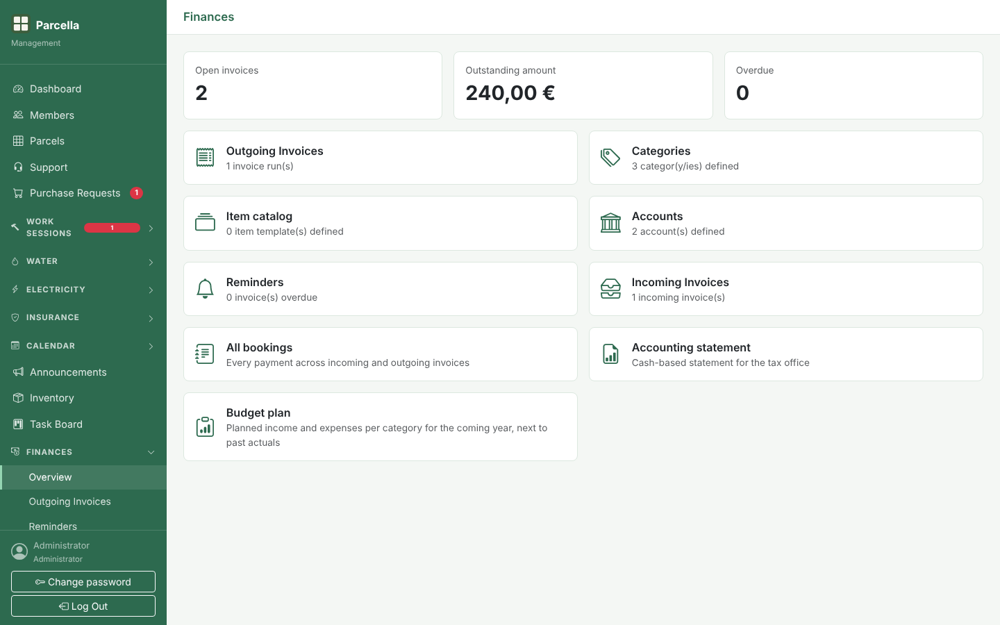

# Finance {#finances}

!!! note "Strojový překlad"
    Tato stránka byla strojově přeložena z angličtiny a dosud nebyla zkontrolována. Pokud je něco nejasné, platí anglická verze (jazyk přepnete nahoře).

Modul Finance je pracovištěm pokladníka. Vytváří roční faktury spolku
pro každou parcelu a člena, sleduje, kdo zaplatil, rozesílá upomínky a
eviduje faktury, které spolek sám přijímá. Vede také jednoduchou
pokladní knihu pro každý bankovní účet. Z toho všeho vytváří účetní
přehled na peněžní bázi pro finanční úřad a rozpočet na další rok.

!!! info "Kdo to může používat"
    - Modul je **ve výchozím stavu vypnutý**. Administrátor ho zapne v
      **Nastavení spolku** (přepínač se jmenuje **Finance**), viz
      [Zapínání a vypínání modulů](../../administration/modules.md).
      Než odešlete první faktury, vyplňte **Finanční nastavení**
      (bankovní údaje, formát čísla faktury) v
      [Nastavení spolku](../../administration/settings.md) -- tisknou se
      v zápatí každé faktury.
    - Členové výboru a administrátoři (a kdokoli ve skupině s plným
      přístupem) mohou vše.
    - Všichni ostatní potřebují [skupinu](../../administration/groups.md),
      která dává oprávnění pro **Finance**:
        - **čtení** -- vidět každou obrazovku, otevírat PDF, exportovat
          soubory CSV;
        - **zápis** -- vytvářet a měnit vyúčtování, položky, platby,
          upomínky, účty, zápisy, přijaté faktury, kategorie a rozpočet;
        - **mazání** -- tyto věci opět mazat.
    - Několik akcí kolem příloh přijatých faktur v cloudovém úložišti je
      jen pro členy výboru a administrátory, viz
      [Přijaté faktury](incoming-invoices.md).

    Viz [Role, skupiny a oprávnění](../../getting-started/roles-and-permissions.md).

## Kde ho najdete {#where-to-find-it}

Když je modul zapnutý a smíte ho číst, postranní panel ukazuje skupinu
**Finance** se čtyřmi položkami:

| Položka menu | Otevře |
|---|---|
| **Přehled** | Finanční přehled popsaný níže. |
| **Vydané faktury** | Seznam vyúčtování, viz [Vyúčtování](invoice-runs.md). |
| **Upomínky** | Seznam faktur po splatnosti, viz [Faktury, platby a upomínky](invoices.md#reminders). |
| **Přijaté faktury** | Faktury, které spolek přijal, viz [Přijaté faktury](incoming-invoices.md). |

Vše ostatní (účty, kategorie, katalog položek, zápisy, přehled,
rozpočet) otevřete z karet přehledu.

## Finanční přehled {#finances-dashboard}

Úvodní stránka modulu. Tři údaje nahoře ukazují na první pohled stav
vašich vydaných faktur. Pod nimi vás na každou oblast modulu vezme jedna
karta.

| Údaj | Co ukazuje |
|---|---|
| **Otevřené faktury** | Kolik vydaných faktur ještě není plně zaplaceno. Částečně zaplacené faktury se zde počítají jako otevřené. |
| **Dlužná částka** | Součet toho, co u těchto faktur zbývá zaplatit (částka faktury minus zaznamenané platby). Poplatky za upomínky v tomto údaji nejsou. |
| **Po splatnosti** | Kolik otevřených faktur je po datu splatnosti svého vyúčtování. Červeně, když je to více než nula. |

| Karta | Nápověda pod názvem | Otevře |
|---|---|---|
| **Vydané faktury** | *n* vyúčtování | [Vyúčtování](invoice-runs.md) |
| **Kategorie** | *n* definovaných kategorií | [Účetní kategorie](bookkeeping.md#bookkeeping-categories) |
| **Katalog položek** | *n* definovaných šablon položek | [Katalog položek](invoice-runs.md#item-catalog) |
| **Účty** | *n* definovaných účtů | [Účty](bank-accounts.md#accounts) |
| **Upomínky** | *n* faktur po splatnosti | [Upomínky](invoices.md#reminders) |
| **Přijaté faktury** | *n* přijatých faktur | [Přijaté faktury](incoming-invoices.md) |
| **Všechny platby** | Každá platba napříč přijatými a vydanými fakturami | [Všechny platby](bookkeeping.md#all-bookings) |
| **Účetní přehled** | Přehled na peněžní bázi pro finanční úřad | [Účetní přehled](bookkeeping.md#accounting-statement) |
| **Rozpočet** | Plánované příjmy a výdaje po kategoriích na příští rok, vedle skutečnosti minulých let | [Rozpočet](bookkeeping.md#budget-plan) |

Většina podstránek má v horní liště tlačítko **Zpět na Finance**, které
vás vrátí sem.

<!-- TODO(verify): finances/coming_soon.html ("This feature is coming soon.") exists, but no route renders it any more, so it is not documented as a screen. -->

## Jak peníze procházejí rokem {#how-the-money-flows-through-a-year}

Typický rok spolku v Parcelle vypadá takto:

1. **Jednou nastavit.** Vytvořte své [účetní kategorie](bookkeeping.md#bookkeeping-categories)
   (nebo importujte účtový rozvrh), své [bankovní a pokladní účty](bank-accounts.md#accounts)
   a opakující se položky faktur v [katalogu položek](invoice-runs.md#item-catalog)
   (nájem za m², členský příspěvek, voda, elektřina, pojištění ...).
2. **Připravit roční faktury.** Vytvořte [vyúčtování](invoice-runs.md)
   za rok, přidejte položky z katalogu, upravte ceny a zkontrolujte
   [náhled](invoice-runs.md#preview-invoices). Odečty měřidel,
   pojištění a pracovní hodiny za daný rok by v tuto chvíli měly být
   kompletní -- položky podle spotřeby je čtou průběžně.
3. **Dokončit a odeslat.** Dokončení přidělí trvalá čísla faktur. Pak
   faktury pošlete e-mailem, nahrajete do cloudových složek parcel a
   stáhnete tiskový balíček pro všechny, kdo dostávají papír.
4. **Zaznamenat platby.** Platby zadávejte ručně v seznamu faktur
   vyúčtování, nebo importujte bankovní výpis na
   [stránce zápisů účtu](bank-accounts.md#bookings-of-an-account) a
   každý řádek přiřaďte k faktuře, kterou platí.
5. **Upomínat opozdilce.** Stránka [Upomínky](invoices.md#reminders)
   vypisuje každou fakturu po splatnosti; první, druhou, třetí upomínku
   pošlete z faktury, s poplatkem nebo bez něj.
6. **Evidovat vlastní faktury spolku** jako [přijaté faktury](incoming-invoices.md)
   a označit je jako zaplacené, když peníze odejdou.
7. **Uzavřít rok.** [Účetní přehled](bookkeeping.md#accounting-statement)
   ukazuje příjmy a výdaje po kategoriích, počítané ke dni, kdy se
   peníze skutečně pohnuly. Použijte ho pro finanční úřad a výroční
   členskou schůzi a příští rok naplánujte v
   [rozpočtu](bookkeeping.md#budget-plan).

Návod [Roční vyúčtování](../../guides/annual-invoicing.md) prochází
kroky 2 až 5 popořadě.

## Kapitoly {#chapters}

- [Vyúčtování](invoice-runs.md) -- roční dávka faktur, její položky a
  jak se počítá každá částka, katalog položek, náhled a dokončení.
- [Faktury, platby a upomínky](invoices.md) -- každá faktura napříč
  všemi vyúčtováními, doručení, platby a upomínací řízení.
- [Bankovní účty a zaúčtování](bank-accounts.md) -- vaše účty, jejich
  zápisy a import bankovního výpisu s párováním faktur.
- [Přijaté faktury](incoming-invoices.md) -- faktury, které spolek
  přijal, a jejich platby.
- [Kategorie, rozpočet a přehled](bookkeeping.md) -- účetní kategorie,
  seznam zápisů celého spolku, účetní přehled a rozpočet.
