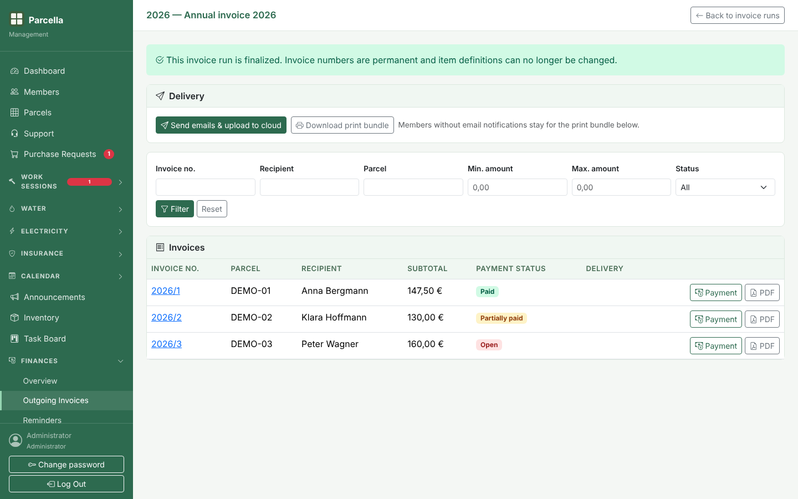

# Factuurrondes {#invoice-runs}

!!! note "Machinevertaling"
    Deze pagina is machinaal vertaald uit het Engels en nog niet nagekeken. Als iets onduidelijk is, geldt de Engelse versie (taal wisselt u bovenaan).

Een factuurronde is één batch facturen, meestal „de jaarfacturen 2026“.
U beschrijft één keer welke regels op de facturen komen en hoe elk
bedrag wordt berekend. Parcella berekent dan de factuur voor elk
perceel (en voor elk lid dat rechtstreeks wordt gefactureerd), laat u
elke factuur als PDF controleren, en kent pas factuurnummers toe als u
afrondt.

!!! info "Wie kan dit gebruiken"
    Onderdeel van de module **Financiën** (standaard uit). Lezen vraagt
    leesrecht op **Financiën**; rondes aanmaken, regels bewerken,
    afronden en versturen vraagt schrijfrecht; een ronde of regel
    verwijderen vraagt verwijderrecht. Bestuursleden en beheerders
    kunnen alles. Zie [Financiën](index.md).

Een ronde is altijd in een van twee toestanden:

| Status | Betekenis |
|---|---|
| **Concept** | De ronde wordt voorbereid. Regels kunnen vrij worden toegevoegd, gewijzigd en verwijderd, het voorbeeld wordt elke keer dat u het opent opnieuw berekend, en de hele ronde kan nog worden verwijderd. Er bestaat nog geen factuur. |
| **Afgerond** | Facturen met blijvende nummers zijn aangemaakt. De regels zijn bevroren, de ronde kan niet meer worden verwijderd, en u verstuurt nu de facturen en legt betalingen vast. Terug naar concept kan niet. |

## Jaarlijkse facturen (lijst met rondes) {#annual-invoices-list-of-runs}

Open de lijst met **Financiën → Uitgaande facturen**, of de kaart
**Uitgaande facturen** op het dashboard. Ze toont elke factuurronde, het
nieuwste jaar eerst.

**Bovenbalk**

| Knop | Wat het doet |
|---|---|
| **Nieuwe factuurronde** | Opent het formulier voor een nieuwe ronde (zie hieronder). Alleen zichtbaar met schrijfrecht. |
| **Alle facturen** | Opent de lijst met elke factuur over alle rondes heen, zie [Facturen](invoices.md#invoices-all-runs). |
| **Terug naar Financiën** | Terug naar het financiële dashboard. |

**Filter**

| Filter | Wat het doet |
|---|---|
| **Jaar** | Toont alleen rondes van precies dit jaar. |
| **Onderwerp** | Toont rondes waarvan het onderwerp deze tekst bevat (hoofd-/kleine letters maken niet uit). |
| **Status** | **Alle**, **Concept** of **Afgerond**. |
| **Filteren** / **Resetten** | Past het filter toe / wist alle filters. |

**Tabel met factuurrondes**

| Kolom / knop | Wat ze toont |
|---|---|
| **Jaar** | Het jaar dat de ronde factureert. |
| **Onderwerp** | Het onderwerp van de ronde, zoals het op de facturen staat. |
| **Status** | **Concept** (geel) of **Afgerond** (groen). |
| **Regels** | Hoeveel regeldefinities (factuurregels) de ronde heeft. |
| **Openen** | Opent de ronde. |
| Prullenbakpictogram | Verwijdert de ronde met al haar regeldefinities, na bevestiging. Alleen getoond bij conceptrondes en met verwijderrecht. Een afgeronde ronde kan nooit worden verwijderd. |

Zijn er nog geen rondes, dan zegt de tabel „Nog geen factuurrondes.“;
past niets bij uw filter, dan „Geen factuurrondes komen overeen met het
filter.“

### Nieuwe factuurronde {#new-invoice-run}

Klik op **Nieuwe factuurronde** in de bovenbalk. Er opent een venster:

| Veld | Wat het doet |
|---|---|
| **Jaar** | Verplicht. Vooraf ingevuld met het huidige jaar. Dit jaar bepaalt welke meterstanden, verzekeringsgegevens en werkurenevaluatie de verbruiksposten gebruiken, en in welk jaar de factuurnummers tellen. |
| **Onderwerp** | Verplicht. De kop van elke factuur, bijv. „Jaarfactuur 2026“. |
| **Factuurdatum** | Verplicht. Vooraf ingevuld met vandaag. Op de facturen afgedrukt als factuurdatum. |
| **Vervaldatum** | Verplicht. Op de facturen afgedrukt. Bepaalt ook wanneer een onbetaalde factuur als achterstallig telt en onder [Herinneringen](invoices.md#reminders) verschijnt. |
| **Voettekst** | Optioneel. Op elke factuur van de ronde onder de factuurregels afgedrukt, bijv. uw betalingsinstructies. U kunt deze plaatshouders gebruiken, die per factuur worden ingevuld: `{invoice_number}`, `{parcel_number}`, `{invoice_address}` (namen en adres van de ontvangers), `{due_date}`. |
| **Aanmaken** | Maakt de ronde als concept aan en opent haar. |
| **Annuleren** | Sluit het venster zonder op te slaan. |

!!! tip "Plaatshouders in de voettekst"
    Een typische voettekst is „Gelieve het bedrag vóór {due_date} over
    te maken onder vermelding van {invoice_number}.“ Bevat de voettekst
    een accolade die niet bij een van de vier plaatshouders hoort, dan
    wordt de tekst precies zo afgedrukt als u hem typte, zonder iets in
    te vullen. Op een ledenfactuur (een factuur zonder perceel) is er
    geen perceelnummer om in te vullen, dus vermijd `{parcel_number}` als
    de ronde ook ledenfacturen maakt.
    <!-- TODO(verify): by the code, a member invoice's footer prints the literal word "None" for {parcel_number}; confirm in a real PDF. -->

Jaar, onderwerp, datums en voettekst kunnen na het aanmaken van de ronde
niet meer worden gewijzigd. <!-- TODO(verify): no edit route for run header fields exists; if a mistake is made in a draft run, the only way is to delete and recreate it. -->

## Factuurronde (concept) {#invoice-run-draft}

De paginatitel toont jaar en onderwerp, bijv. „2026 — Jaarfactuur“.
Zolang de ronde een concept is, stelt u hier haar regels
(„regeldefinities“) samen.

**Bovenbalk**

| Knop | Wat het doet |
|---|---|
| **Voorbeeld** | Opent het [voorbeeld](#preview-invoices). Alleen getoond als de ronde minstens één regel heeft. |
| **Terug naar factuurrondes** | Terug naar de lijst. |

### Regeldefinities {#item-definitions}

Elke rij is één soort regel die op de facturen kan verschijnen. Met
schrijfrecht is elke rij direct bewerkbaar; wijzig de velden en klik op
het vinkpictogram aan het einde van de rij om die rij op te slaan. Zonder
schrijfrecht ziet u dezelfde informatie als gewone tekst.

| Kolom / veld | Wat het doet |
|---|---|
| **Volgorde** | Sorteernummer. Regels verschijnen in deze volgorde op de factuur. Een nieuwe regel krijgt vooraf tien meer dan het hoogste volgnummer tot nu toe, zodat er ruimte is om later een regel tussen te voegen. |
| **Naam** | Verplicht. De tekst van de regel op de factuur, bijv. „Pacht“. |
| **Omschrijving** | Optioneel, het kleine grijze veld onder de naam. In kleine letters onder de naam op de factuur afgedrukt. |
| **Berekening** | Hoe het bedrag wordt berekend, zie [Berekeningsgrondslagen](#calculation-bases) hieronder. Een wijziging bepaalt welke andere velden worden getoond. |
| **Stukprijs** | De prijs per eenheid (per perceel, per persoon, per m² ...). Bij de algemene omslag is het het te verdelen totaal. Verborgen bij de vier automatische berekeningswijzen, die in plaats daarvan „Wordt automatisch berekend“ tonen. Vul in met een decimale komma of punt, bijv. `12,50`. |
| **Geldt voor** | Voor wie de regel is. Afhankelijk van de berekeningswijze is dit een schakelaar **Alle percelen** / *n* perce(e)l(en), een schakelaar **Alle leden** / *n* lid/leden, of een vaste notitie zoals „Automatisch (verzekeringsevaluatie)“. Zie [Wie een regel krijgt](#who-gets-a-line). |
| **Categorie** | Optionele [boekhoudcategorie](bookkeeping.md#bookkeeping-categories). Ze wordt op elke factuurregel gekopieerd, zodat betalingen van deze factuur in het [boekhoudkundig overzicht](bookkeeping.md#accounting-statement) over de juiste categorieën worden verdeeld. |
| Vinkpictogram | Slaat de rij op. Vraagt schrijfrecht. |
| Prullenbakpictogram | Verwijdert de regel na bevestiging („Deze regeldefinitie verwijderen?“). Vraagt verwijderrecht. |

Zet u de schakelaar **Geldt voor** van een rij uit, dan opent eronder een
extra rij met de keuzelijst voor percelen of leden (zie
[De keuzelijst](#the-picker)).

!!! note
    Regels kunnen alleen worden gewijzigd zolang de ronde een concept
    is. Een regel opslaan in een afgeronde ronde wordt geweigerd met
    „Deze factuurronde is al afgerond; de regeldefinities kunnen niet
    meer worden gewijzigd.“

### Toevoegen uit artikelcatalogus {#add-from-item-catalog}

Getoond met schrijfrecht als uw [artikelcatalogus](#item-catalog)
sjablonen bevat die deze ronde nog niet heeft. Elk resterend sjabloon
staat erbij met berekeningswijze, stukprijs en bereik, en **is standaard
aangevinkt**. Vink uit wat u niet wilt en klik op **Geselecteerde items
toevoegen**. Elk aangevinkt sjabloon wordt een nieuwe regel in deze
ronde, met al zijn instellingen, ook een specifieke keuze van percelen of
leden.

**Catalogus beheren** brengt u naar de artikelcatalogus.

Een sjabloon telt als „al toegevoegd“ als de ronde een regel met precies
dezelfde naam heeft. Hernoemt of verwijdert u de regel in de ronde, dan
wordt het sjabloon opnieuw aangeboden; hernoemt u het sjabloon na het
toevoegen, dan ook.

Valt er niets meer aan te bieden, dan ziet u in plaats daarvan een korte
notitie: „Alle catalogusitems zijn al aan deze factuurronde
toegevoegd.“ of, als de catalogus leeg is, „Nog geen catalogusitems --
voeg terugkerende items eenmalig toe en selecteer ze hier elk jaar.“
Beide hebben een knop **Catalogus beheren**.

### Regel toevoegen {#add-item}

Onder de catalogus een formulier om met de hand een eenmalige regel toe
te voegen. Het heeft dezelfde velden als de tabel (**Volgorde**,
**Naam**, **Omschrijving**, **Berekeningswijze**, **Stukprijs**,
**Categorie**), dan de bereikschakelaar (**Geldt voor elk perceel** of
**Geldt voor elk lid**, beide standaard aan) en, als u die uitzet, de
keuzelijst. Klik op de knop **+** om de regel toe te voegen.

## Berekeningsgrondslagen {#calculation-bases}

De **Berekeningswijze** bepaalt hoe Parcella de regel voor elk perceel
of lid berekent. Elk bedrag wordt per regel op de cent afgerond; het
factuurtotaal is de som van de regels.

| Berekeningswijze | Gefactureerd aan | Aantal × prijs | Waar de getallen vandaan komen |
|---|---|---|---|
| **Vast bedrag per perceel** | Elk perceel in het bereik | 1 × stukprijs | U vult het bedrag in, bijv. een verenigingsbijdrage per perceel. |
| **Vast bedrag per persoon** | Elk lid in het bereik, op een eigen factuur | 1 × stukprijs | U vult het bedrag in, bijv. de contributie. Per lid gefactureerd, met of zonder perceel. |
| **Per gehuurde m²** | Elk perceel in het bereik | oppervlakte perceel × stukprijs | De oppervlakte die bij het perceel is opgeslagen. Een perceel zonder oppervlakte krijgt geen regel. |
| **Aandeel in de pacht van het gemeenschappelijk terrein** | Elk perceel in het bereik | (gemeenschappelijke oppervlakte ÷ aantal gefactureerde percelen) × stukprijs | De gemeenschappelijke oppervlakte („Oppervlakte B“) uit [Verenigingsinstellingen](../../administration/settings.md). Het aandeel wordt afgerond op 0,1 m². |
| **Publieke lasten (eigen oppervlakte + aandeel gemeenschappelijk terrein)** | Elk perceel in het bereik | (oppervlakte perceel + aandeel gemeenschappelijk terrein) × stukprijs | Als hierboven, plus de eigen oppervlakte van het perceel, tegen één tarief per m². |
| **Algemene omslag (gelijk verdeeld over alle percelen)** | Elk perceel in het bereik | 1 × (totaal ÷ aantal gefactureerde percelen) | U vult als stukprijs het **totaal** in dat de vereniging moet innen; elk perceel betaalt een gelijk deel, afgerond op de cent. |
| **Waterverbruik (uit module)** | Elk perceel met een watermeter | verbruik van het jaar × prijs per eenheid | Verbruik en prijs komen uit [Water en elektriciteit](../metering.md). |
| **Stroomverbruik (uit module)** | Elk perceel met een elektriciteitsmeter | verbruik van het jaar × prijs per eenheid | Als bij water. |
| **Verzekeringskosten (uit module)** | Elk perceel met een verzekering voor het jaar | één regel per verzekeringsonderdeel | Uit [Verzekering](../insurance.md). |
| **Tekort werkuren (uit module)** | Elk perceel of lid dat geld verschuldigd is voor ontbrekende werkuren | 1 × verschuldigd bedrag | Uit de [werkurenevaluatie](../work-hours.md) van het jaar van de ronde. |

Details per berekeningswijze:

**Vast bedrag per perceel / per persoon.** Laat u **Stukprijs** leeg,
dan factureert de regel niets.

**Per gehuurde m².** Gebruikt de oppervlakte die bij elk perceel is
vastgelegd. Controleer vóór het afronden dat elk perceel een
oppervlakte heeft -- een perceel zonder oppervlakte krijgt zonder
waarschuwing geen pachtregel.

**Aandeel in de pacht van het gemeenschappelijk terrein.** De
gemeenschappelijke oppervlakte wordt gelijk verdeeld over precies de
percelen die deze regel krijgen (die in het bereik die ook iemand hebben
om te factureren). Zo tellen de aandelen op tot de hele gemeenschappelijke
oppervlakte en int de vereniging de volledige pacht. Is de
gemeenschappelijke oppervlakte nul of niet ingericht, dan factureert de
regel helemaal niets. De gemeenschappelijke oppervlakte wordt in de
Verenigingsinstellingen berekend als totale oppervlakte min de
oppervlakte van de percelen min de gemeentelijke oppervlakte.

**Publieke lasten** (zie de [woordenlijst](../../glossary.md)). Als het
gemeenschappelijke aandeel, maar opgeteld bij de eigen oppervlakte van
het perceel en gefactureerd tegen één gecombineerd tarief. Is de
gemeenschappelijke oppervlakte niet ingericht, dan wordt de eigen
oppervlakte van het perceel toch gefactureerd -- het gemeenschappelijke
deel telt dan gewoon als 0 m².

**Algemene omslag** („Umlage“, zie de [woordenlijst](../../glossary.md)).
Gebruik dit voor een eenmalige kostenpost die de vereniging doorbelast,
bijv. advocaatkosten van 1.200,00 verdeeld over 40 percelen = 30,00 per
perceel. Alleen percelen die echt worden gefactureerd tellen mee, dus
onverhuurde percelen „eten“ nooit een aandeel op. Omdat elk aandeel op de
cent wordt afgerond, kan het geïnde totaal een paar cent afwijken van het
ingevulde bedrag.

**Waterverbruik / Stroomverbruik.** Voor elk perceel met een meetpunt
van die soort neemt Parcella het verbruik van de huidige meter in het
jaar van de ronde (de stand van dat jaar min de stand ervoor) en
vermenigvuldigt dat met de prijs per eenheid die in de metermodule voor
dat jaar is ingesteld. U vult hier geen stukprijs in.

- Een perceel zonder stand voor het jaar krijgt geen regel.
- Is er voor dat medium en jaar geen prijs ingesteld, dan wordt niemand
  ervoor gefactureerd.
- Na een meterwissel in de loop van het jaar wordt het verbruik van
  **beide** meters gefactureerd: de oude tot zijn eindstand (ingevuld in
  het wisselformulier) en de nieuwe vanaf zijn beginstand.

!!! warning "Meetpunten met een factor"
    Heeft een meetpunt in de metermodule een factor (vermenigvuldiger),
    dan tonen de meterschermen het vermenigvuldigde verbruik, maar
    factureert de factuur het **ruwe** verschil van de meterstanden.
    Controleer zulke percelen in het voorbeeld.

**Verzekeringskosten.** Gefactureerd voor elk perceel met een
verzekeringsrecord voor het jaar van de ronde. In plaats van één bedrag
toont de factuur één regel per onderdeel dat het perceel echt heeft:
„Opstalverzekering (*pakket*)“, „Ongevallenverzekering (huishouden)“ en,
indien van toepassing, „Ongevallenverzekering (+*n* extra
perso(o)n(en))“. Deze regelteksten liggen vast, in de taal van de
vereniging -- de eigen naam van de regel wordt er niet voor gebruikt.
Bedragen komen uit de verzekeringsprijzen die voor dat jaar zijn
ingericht.

**Tekort werkuren.** Factureert wat de werkurenevaluatie voor het jaar
van de ronde als verschuldigd opgeeft, precies dat bedrag. Vrijgestelde
en voldane percelen of leden worden niet gefactureerd. Of dit op de
perceelfactuur of op een aparte ledenfactuur komt, hangt af van hoe de
werkuren dat jaar worden geteld: per perceel zet het op de factuur van
het perceel, per lid op de eigen factuur van elk lid.

## Wie een regel krijgt {#who-gets-a-line}

**Perceelgebonden wijzen** (vast per perceel, per m², gemeenschappelijk
aandeel, publieke lasten, algemene omslag) gebruiken de schakelaar
**Geldt voor elk perceel**:

- Aan (standaard): elk perceel dat kan worden gefactureerd.
- Uit: alleen de percelen die u in de keuzelijst aanvinkt.

**Vast bedrag per persoon** gebruikt in plaats daarvan **Geldt voor elk
lid**:

- Aan (standaard): elk actief lid.
- Uit: alleen de leden die u aanvinkt.

**De vier automatische wijzen** (water, elektriciteit, verzekering,
tekort werkuren) hebben geen keuzelijst. Wie wordt gefactureerd, volgt
uit de andere module: een meter hebben, een verzekeringsrecord, of een
tekort. In plaats daarvan staat er een notitie zoals „Automatisch
(percelen met een actieve watermeter)“. (Ondanks die formulering wordt
een uitgeschakeld meetpunt toch in de ronde meegenomen.)

Welke percelen überhaupt kunnen worden gefactureerd:

- Een perceel krijgt alleen een factuur als minstens één **huidige**
  huurder is gemarkeerd met **Gebruiken als factuuradres**. Huurders die
  voor een latere datum hebben opgezegd, tellen mee tot ze echt zijn
  vertrokken.
- Een beëindigd perceel wordt toch gefactureerd als het zo'n huurder
  heeft (bijvoorbeeld een nieuwe huurder die overnam voordat de status
  werd teruggezet). Alleen verwijderde percelen worden altijd
  overgeslagen.
- Wonen de huurders met factuuradres op verschillende adressen, dan
  krijgt het perceel toch **één** factuur (één nummer, één bedrag), met
  **een kopie per adres**. Huurders die een adres delen, staan samen op
  één kopie. De kopieën verschillen alleen in het adresvenster.
- Een perceel waarvan alle regels leeg uitvallen, krijgt geen factuur.

Ledenfacturen (uit **Vast bedrag per persoon**, of een tekort aan
werkuren dat per lid wordt geteld) zijn aparte facturen aan het lid op
zijn eigen adres. Ze tonen **Geen perceel (lid)** in plaats van een
perceelnummer. Een huurder die ook een bijdrage per persoon krijgt
gefactureerd, krijgt dus twee facturen: één voor het perceel, één voor
zichzelf. Alle regels per persoon voor hetzelfde lid worden op één
factuur gecombineerd.

### De keuzelijst {#the-picker}

Staat een bereikschakelaar uit, dan verschijnt een keuzelijst met het
label **Percelen** of **Leden**.

| Bediening | Wat het doet |
|---|---|
| **Lijst tonen** / **Lijst verbergen** | Opent of sluit de lijst met vinkjes. |
| **Zoeken…** | Beperkt de lijst tot passende perceelnummers of namen. „Geen resultaten“ verschijnt als niets past. |
| **Alles selecteren** / **Niets selecteren** | Vinkt elk item aan of uit dat **nu zichtbaar** is -- zo kunt u eerst zoeken en dan alleen die selecteren. |

De perceelkeuzelijst toont actieve percelen; de ledenkeuzelijst toont
actieve leden.

!!! tip
    Het bereik blijft bewerkbaar tot u afrondt. U kunt het tijdens het
    voorbereiden van de ronde zo vaak wijzigen als u wilt.

## Facturen voorbeeld {#preview-invoices}

<!-- TODO(verify): no screenshot -- the preview page is two clicks away from a fixed URL (run list -> run -> Preview), which the screenshot tool can't follow, and the sample data has no invoice runs. -->

Klik op **Voorbeeld** bij een conceptronde. Parcella berekent nu elke
factuur die de ronde zou maken, zonder iets op te slaan of te versturen.
De paginatitel is „Voorbeeld — *jaar* *onderwerp*“.

Het blauwe vak bovenaan zegt hoeveel facturen er zouden worden
gegenereerd en herinnert u: „Er is nog niets opgeslagen of verzonden —
bekijk de PDF's hieronder en rond dan af.“

| Kolom / knop | Wat ze toont |
|---|---|
| **Perceel** | Het perceelnummer, of **Geen perceel (lid)** bij een ledenfactuur. |
| **Ontvanger** | De namen waaraan de factuur wordt geadresseerd. |
| **Subtotaal** | Het factuurtotaal. |
| **PDF** | Opent de factuur als PDF in een nieuw tabblad, precies zoals ze eruit zal zien, met „Voorbeeld“ als factuurnummer en een balk „Voorbeeld — nog niet afgerond of verzonden“. |
| **Afronden en factuurnummers toekennen** | Rondt de ronde na bevestiging af. Alleen zichtbaar met schrijfrecht zolang de ronde een concept is. |
| **Terug naar factuurronde** | Terug naar de ronde, om regels te corrigeren. |

Is de lijst leeg, dan zegt de pagina „Er zouden geen facturen worden
gegenereerd — controleer het perceelbereik van de regeldefinities en de
factuuradresvlag van de betrokken leden.“

!!! tip "Het voorbeeld is altijd live"
    Voor het voorbeeld wordt niets opgeslagen. Elke keer dat u het
    opent, leest het de actuele percelen, huurders, meterstanden,
    verzekeringen en werkuren. Corrigeer de gegevens in die modules en
    laad gewoon opnieuw.

### Wat afronden doet {#what-finalizing-does}

Klikt u op **Afronden en factuurnummers toekennen** en bevestigt u
(„Deze factuurronde afronden? Factuurnummers worden definitief toegekend
en regeldefinities kunnen daarna niet meer worden gewijzigd. Dit kan niet
ongedaan worden gemaakt.“), dan:

1. berekent Parcella de facturen een laatste keer, precies zoals het
   voorbeeld.
2. krijgt elke factuur een blijvend nummer, in de volgorde van de
   voorbeeldlijst. Het formaat komt uit **Factuurnummerformaat** in
   [Verenigingsinstellingen](../../administration/settings.md)
   (standaard *jaar*/*nummer*, bijv. `2026/1`). De nummering gaat verder
   vanaf het hoogste nummer dat in hetzelfde jaar al is gebruikt, over
   alle rondes heen, en begint bij 1 voor de eerste factuur van het
   jaar.
3. worden namen en adressen van de ontvangers op de facturen gekopieerd.
   Latere wijzigingen van het adres van een lid herschrijven een al
   uitgegeven factuur niet.
4. wordt de ronde **Afgerond** en worden haar regels bevroren.

Is **Volgend factuurnummer (overschrijven)** ingevuld in de
Verenigingsinstellingen, dan begint deze ronde bij dat nummer, en wordt
de instelling daarna gewist. Zou dat een nummer hergebruiken dat in
hetzelfde jaar al is uitgegeven, dan stopt het afronden met een
foutmelding en wordt er niets aangemaakt.

Een ronde zonder regels kan niet worden afgerond: „Deze factuurronde
heeft nog geen regeldefinities — voeg er minstens één toe voordat u
afrondt.“

## Factuurronde (afgerond) {#invoice-run-finalized}

Na het afronden toont de pagina van de ronde een groene notitie „Deze
factuurronde is afgerond. Factuurnummers zijn definitief en
regeldefinities kunnen niet meer worden gewijzigd.“ De lijst met regels
is weg; in plaats daarvan ziet u verzending en de facturen van de ronde.

### Verzending {#delivery}

Getoond met schrijfrecht.

| Knop | Wat het doet |
|---|---|
| **E-mails versturen & naar cloud uploaden** | E-mailt elke factuur van de ronde die nog niet is gemaild, met de PDF als bijlage, en uploadt elke factuur die nog niet is geüpload naar de cloudmap van haar perceel. Nogmaals uitvoeren pakt alleen op wat nog ontbreekt. |
| **Afdrukbundel downloaden** | Downloadt één PDF met een brief voor elke huurder die geen facturen per e-mail krijgt -- één brief per adres, met de namen van wie daar geen e-mail heeft -- klaar om af te drukken en in vensterenveloppen te steken. Die facturen worden als afgedrukt gemarkeerd. |

**Wie een e-mail krijgt:** elke huurder met factuuradres die op de
factuur staat (of, bij een ledenfactuur, het lid) en die **Mag informatie
per e-mail ontvangen** aan heeft en minstens één e-mailadres heeft
opgeslagen. Ieder krijgt de kopie voor zijn eigen adres; het
hoofd-e-mailadres wordt gebruikt. Alle anderen krijgen een afgedrukte
brief uit de afdrukbundel -- **ook** als een huisgenoot werd gemaild.
Huurders zonder e-mail die een adres delen, krijgen samen één brief:
„Leden zonder e-mailmeldingen blijven over voor de afdrukbundel
hieronder.“

**Uploaden naar de cloud** gebeurt alleen als de cloudopslag is ingericht
en het perceel een cloudmap heeft. Ledenfacturen worden nooit geüpload,
omdat er geen ledenmap is. Mislukte uploads worden zonder melding
overgeslagen en de volgende keer opnieuw geprobeerd.

!!! note "Afdrukbundel"
    De bundel wordt samengesteld op basis van wie per e-mail bereikbaar
    is, niet van wat is verzonden. U kunt hem vóór of na het versturen
    van e-mails downloaden en hij bevat altijd dezelfde kopieën -- ook
    die u de vorige keer al hebt afgedrukt. Kan elke factuur per e-mail,
    dan krijgt u de melding „Bij alle facturen in deze ronde is een lid
    per e-mail bereikbaar -- niets meer om af te drukken.“

### Filter {#filter}

Boven de factuurtabel kunt u de lijst beperken. Het werkt als het filter
op [Alle facturen](invoices.md#invoices-all-runs): **Factuurnr.**,
**Ontvanger**, **Perceel** (bevat deze tekst), **Bedrag vanaf**,
**Bedrag tot** (subtotaal van de factuur) en **Status** (**Alle**,
**Open**, **Gedeeltelijk betaald**, **Betaald**). **Filteren** past het
toe, **Resetten** wist het.

### Facturen {#invoices}

| Kolom / knop | Wat ze toont |
|---|---|
| **Factuurnr.** | Het factuurnummer; klik erop om de [factuur](invoices.md#invoice) te openen. |
| **Perceel** | Perceelnummer, of **Geen perceel (lid)**. |
| **Ontvanger** | De namen van de ontvangers. |
| **Subtotaal** | Het factuurbedrag. |
| **Betaalstatus** | **Open** (rood, niets betaald), **Gedeeltelijk betaald** (geel) of **Betaald** (groen). |
| **Verzending** | Pictogrammen voor wat er is gebeurd: envelop = „Verstuurd per e-mail“, printer = „Opgenomen in een afdrukbundel“, wolk = „Geüpload naar cloudopslag“. Beweeg de muis over een pictogram om de betekenis te zien. |
| **Betaling** | Opent het betalingsvenster voor deze factuur (zie hieronder). Vraagt schrijfrecht. |
| **PDF** | Opent de factuur-PDF in een nieuw tabblad. |

### Betalingsvenster {#payment-dialog}

De snelste manier om betalingen voor veel facturen vast te leggen: klik
op **Betaling** bij een rij, voer de betaling in, en u bent terug op de
pagina van de ronde, klaar voor de volgende. De titel van het venster is
„Betaling — Factuur *nummer*“.

Het toont de tot nu toe geregistreerde betalingen (datum, bedrag,
rekening, notitie), elk met een prullenbakpictogram om haar te
verwijderen (vraagt verwijderrecht, vraagt „Deze betaling
verwijderen?“). Zijn er geen: „Nog geen betalingen geregistreerd.“

| Veld | Wat het doet |
|---|---|
| **Bedrag** | Verplicht. Het ontvangen bedrag, bijv. `45,00`. Deelbetalingen zijn prima; leg elke afzonderlijk vast. |
| **Betaald op** | Verplicht. Vooraf ingevuld met vandaag. Deze datum bepaalt in welk jaar de inkomsten in het boekhoudkundig overzicht tellen. |
| **Notitie** | Optioneel, bijv. „overschrijving“. |
| **Rekening** | Optioneel. De [rekening](bank-accounts.md#accounts) waarop het geld binnenkwam. Alleen actieve rekeningen worden aangeboden. De betaling verschijnt dan in de boekingen van die rekening. |
| **Betaling toevoegen** | Slaat de betaling op. |

De betaalstatus wordt vanzelf bijgewerkt: zodra de betalingen het
factuurbedrag plus eventuele aanmaningskosten bereiken, is de factuur
**Betaald**. Zie [Betalingen](invoices.md#payments).

## Artikelcatalogus {#item-catalog}

Open hem via de kaart **Artikelcatalogus** op het dashboard of met
**Catalogus beheren** bij een conceptronde. De catalogus bevat uw
terugkerende factuurregels („artikelsjablonen“), zodat u ze niet elk jaar
opnieuw hoeft te typen. Sjablonen staan los van elke ronde; u haalt ze in
een ronde met [Toevoegen uit artikelcatalogus](#add-from-item-catalog).

Het scherm heeft dezelfde velden als de regels van een ronde:

- **Nieuw artikelsjabloon** (met schrijfrecht): **Volgorde**, **Naam**,
  **Omschrijving**, **Berekeningswijze**, **Stukprijs**, **Categorie**,
  de bereikschakelaar (**Geldt voor elk perceel** / **Geldt voor elk
  lid**) en de [keuzelijst](#the-picker). Klik op de knop **+** om op te
  slaan.
- **Artikelsjablonen**: één bewerkbare rij per sjabloon met de kolommen
  **Volgorde**, **Naam**, **Berekening**, **Stukprijs**, **Geldt voor**
  en **Categorie**. Wijzig een rij en klik op het vinkpictogram om haar
  op te slaan; het prullenbakpictogram verwijdert haar (vraagt
  verwijderrecht).

Na het opslaan ziet u „Opgeslagen.“. Is de catalogus leeg: „Nog geen
artikelsjablonen -- voeg er hierboven een toe.“

De berekeningswijzen en bereikregels zijn precies die onder
[Berekeningsgrondslagen](#calculation-bases) en
[Wie een regel krijgt](#who-gets-a-line).

!!! note "Sjablonen en rondes staan los van elkaar"
    Een sjabloon aan een ronde toevoegen kopieert het. Een sjabloon later
    wijzigen verandert rondes die het al gebruikten niet, en een sjabloon
    verwijderen laat de regels van die rondes ongemoeid („Dit
    artikelsjabloon verwijderen? Runs die het al gebruikt hebben,
    behouden hun items, alleen zonder koppeling naar het sjabloon.“).
    Prijzen die elk jaar veranderen, past u het best in de catalogus aan
    voordat u de items aan de nieuwe ronde toevoegt.

## Gerelateerd {#related}

- [De jaarfacturen opmaken](../../guides/annual-invoicing.md) -- het hele
  proces stap voor stap.
- [Facturen, betalingen en herinneringen](invoices.md)
- [Water en elektriciteit](../metering.md), [Verzekering](../insurance.md),
  [Werkuren](../work-hours.md) -- waar de automatische bedragen vandaan
  komen.
- [Verenigingsinstellingen](../../administration/settings.md) --
  factuurnummerformaat, bankgegevens, oppervlakten.
