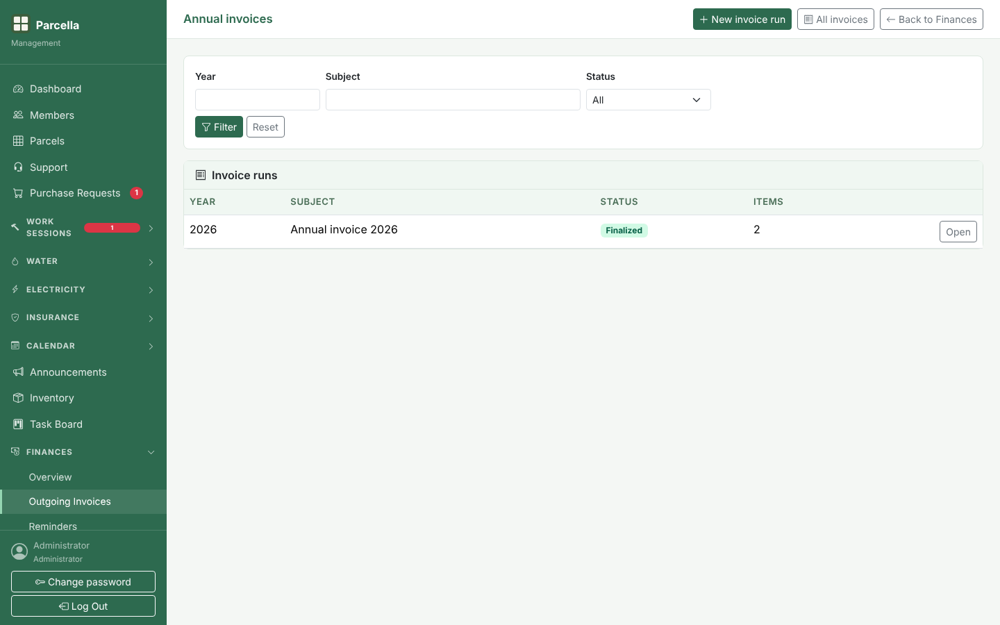
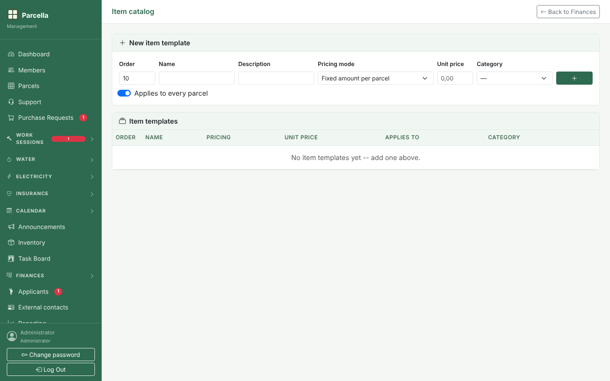

# Serie faktur {#invoice-runs}

!!! note "Tłumaczenie maszynowe"
    Ta strona została przetłumaczona maszynowo z języka angielskiego i nie została jeszcze sprawdzona. Jeśli coś jest niejasne, obowiązuje wersja angielska (język zmienisz u góry).

Seria faktur to jedna partia faktur, zwykle „faktury roczne 2026”.
Raz opisujesz, które pozycje trafiają na faktury i jak obliczana jest
każda kwota. Parcella wylicza potem fakturę dla każdej działki (i dla
każdego członka rozliczanego bezpośrednio), pozwala sprawdzić każdą
jako PDF i nadaje numery faktur dopiero wtedy, gdy zakończysz serię.

!!! info "Kto może z tego korzystać"
    Część modułu **Finanse** (domyślnie wyłączonego). Odczyt wymaga
    prawa odczytu **Finanse**; tworzenie serii, edycja pozycji,
    zakończenie i wysyłka wymagają prawa zapisu; usunięcie serii lub
    pozycji wymaga prawa usuwania. Członkowie zarządu i administratorzy
    mogą wszystko. Zob. [Finanse](index.md).

Seria jest zawsze w jednym z dwóch stanów:

| Status | Znaczenie |
|---|---|
| **Wersja robocza** | Seria jest przygotowywana. Pozycje można dowolnie dodawać, zmieniać i usuwać, podgląd jest przeliczany przy każdym otwarciu, a całą serię wciąż można usunąć. Nie istnieje jeszcze żadna faktura. |
| **Zakończona** | Utworzono faktury ze stałymi numerami. Pozycje są zamrożone, serii nie można już usunąć, a Ty wysyłasz faktury i zapisujesz płatności. Nie ma powrotu do wersji roboczej. |

## Faktury roczne (lista serii) {#annual-invoices-list-of-runs}

Otwierasz ją przez **Finanse → Faktury wychodzące** albo kartę **Faktury
wychodzące** na panelu. Pokazuje każdą serię faktur, od najnowszego
roku.

**Górny pasek**

| Przycisk | Do czego służy |
|---|---|
| **Nowa seria faktur** | Otwiera formularz nowej serii (zob. niżej). Widoczny tylko z prawem zapisu. |
| **Wszystkie faktury** | Otwiera listę wszystkich faktur ze wszystkich serii, zob. [Faktury](invoices.md#invoices-all-runs). |
| **Powrót do Finansów** | Powrót do panelu finansów. |

**Filtr**

| Filtr | Do czego służy |
|---|---|
| **Rok** | Pokazuje tylko serie dokładnie z tego roku. |
| **Temat** | Pokazuje serie, których temat zawiera ten tekst (wielkość liter nie ma znaczenia). |
| **Status** | **Wszystkie**, **Wersja robocza** lub **Zakończona**. |
| **Filtruj** / **Wyczyść** | Stosuje filtr / czyści wszystkie filtry. |

**Tabela serii faktur**

| Kolumna / przycisk | Co pokazuje |
|---|---|
| **Rok** | Rok, za który seria wystawia faktury. |
| **Temat** | Temat serii, drukowany na fakturach. |
| **Status** | **Wersja robocza** (na żółto) lub **Zakończona** (na zielono). |
| **Pozycje** | Ile definicji pozycji (wierszy faktury) ma seria. |
| **Otwórz** | Otwiera serię. |
| Ikona kosza | Po potwierdzeniu usuwa serię ze wszystkimi definicjami pozycji. Widoczna tylko dla wersji roboczych i z prawem usuwania. Zakończonej serii nie można nigdy usunąć. |

Jeśli nie ma jeszcze serii, tabela mówi „Brak serii faktur.”; jeśli
filtr nic nie znajduje, „Żadna seria faktur nie pasuje do filtra.”

### Nowa seria faktur {#new-invoice-run}

Kliknij **Nowa seria faktur** na górnym pasku. Otwiera się okno:

| Pole | Do czego służy |
|---|---|
| **Rok** | Wymagany. Wstępnie wypełniony bieżącym rokiem. Ten rok decyduje, których odczytów liczników, danych ubezpieczeń i rozliczenia prac społecznych używają pozycje zależne od zużycia oraz w którym roku liczone są numery faktur. |
| **Temat** | Wymagany. Nagłówek każdej faktury, np. „Faktura roczna 2026”. |
| **Data wystawienia** | Wymagana. Wstępnie wypełniona dzisiejszą datą. Drukowana na fakturach jako data faktury. |
| **Termin płatności** | Wymagany. Drukowany na fakturach. Decyduje też, kiedy niezapłacona faktura liczy się jako zaległa i pojawia się w [Upomnieniach](invoices.md#reminders). |
| **Tekst stopki** | Opcjonalny. Drukowany pod pozycjami na każdej fakturze serii, np. Twoje instrukcje płatności. Możesz użyć tych symboli zastępczych, wypełnianych dla każdej faktury: `{invoice_number}`, `{parcel_number}`, `{invoice_address}` (nazwy i adres odbiorców), `{due_date}`. |
| **Utwórz** | Tworzy serię jako wersję roboczą i ją otwiera. |
| **Anuluj** | Zamyka okno bez zapisywania. |

!!! tip "Symbole zastępcze w tekście stopki"
    Typowa stopka to „Prosimy o przelew kwoty do {due_date}, z numerem
    {invoice_number} w tytule.” Jeśli tekst stopki zawiera nawias
    klamrowy, który nie jest jednym z czterech symboli zastępczych, tekst
    jest drukowany dokładnie tak, jak go wpisano, bez wypełniania
    czegokolwiek. Na fakturze członkowskiej (bez działki) nie ma numeru
    działki do wypełnienia, więc unikaj `{parcel_number}`, jeśli seria
    utworzy też faktury członkowskie.
    <!-- TODO(verify): by the code, a member invoice's footer prints the literal word "None" for {parcel_number}; confirm in a real PDF. -->

Roku, tematu, dat i tekstu stopki nie można zmienić po utworzeniu serii. <!-- TODO(verify): no edit route for run header fields exists; if a mistake is made in a draft run, the only way is to delete and recreate it. -->

## Seria faktur (wersja robocza) {#invoice-run-draft}

Tytuł strony pokazuje rok i temat, np. „2026 — Faktura roczna”. Dopóki
seria jest wersją roboczą, na tej stronie składasz jej pozycje
(„definicje pozycji”).

**Górny pasek**

| Przycisk | Do czego służy |
|---|---|
| **Podgląd** | Otwiera [podgląd](#preview-invoices). Widoczny, gdy seria ma co najmniej jedną pozycję. |
| **Powrót do serii faktur** | Powrót do listy. |

### Definicje pozycji {#item-definitions}

Każdy wiersz to jeden rodzaj pozycji, która może pojawić się na
fakturach. Z prawem zapisu każdy wiersz można edytować bezpośrednio;
zmień pola i kliknij ikonę haczyka na końcu wiersza, aby go zapisać. Bez
prawa zapisu widzisz te same informacje jako zwykły tekst.

| Kolumna / pole | Do czego służy |
|---|---|
| **Kolejność** | Liczba sortowania. Pozycje pojawiają się na fakturze w tej kolejności. Nowa pozycja jest wstępnie wypełniona liczbą o dziesięć większą od dotychczas najwyższej, zostawiając miejsce na późniejsze wstawienie pozycji pomiędzy. |
| **Nazwa** | Wymagana. Tekst pozycji na fakturze, np. „Dzierżawa”. |
| **Opis** | Opcjonalny, małe szare pole pod nazwą. Drukowany małą czcionką pod nazwą na fakturze. |
| **Naliczanie** | Jak obliczana jest kwota, zob. [Podstawy obliczeń](#calculation-bases) niżej. Zmiana zmienia, które z pozostałych pól są widoczne. |
| **Cena jednostkowa** | Cena za jednostkę (za działkę, za osobę, za m² ...). Dla ogólnej składki to kwota do podziału. Ukryta dla czterech automatycznych sposobów naliczania, które zamiast tego pokazują „Obliczane automatycznie”. Wpisz ją z przecinkiem lub kropką dziesiętną, np. `12,50`. |
| **Dotyczy** | Dla kogo jest pozycja. Zależnie od sposobu naliczania jest to przełącznik **Wszystkie działki** / *n* działek, przełącznik **Wszyscy członkowie** / *n* członków albo stała notka, np. „Automatycznie (na podstawie ewaluacji ubezpieczenia)”. Zob. [Kto dostaje pozycję](#who-gets-a-line). |
| **Kategoria** | Opcjonalna [kategoria księgowa](bookkeeping.md#bookkeeping-categories). Jest kopiowana na każdą pozycję faktury, dzięki czemu płatności tej faktury są dzielone na właściwe kategorie w [zestawieniu księgowym](bookkeeping.md#accounting-statement). |
| Ikona haczyka | Zapisuje wiersz. Wymaga prawa zapisu. |
| Ikona kosza | Usuwa pozycję po potwierdzeniu („Usunąć tę definicję pozycji?”). Wymaga prawa usuwania. |

Gdy wyłączysz przełącznik **Dotyczy** w wierszu, pod nim otwiera się
dodatkowy wiersz z wyborem działek lub członków (zob.
[Wybór](#the-picker)).

!!! note
    Pozycje można zmieniać tylko, dopóki seria jest wersją roboczą.
    Próba zapisu pozycji zakończonej serii jest odrzucana z komunikatem
    „Ta seria faktur jest już zakończona; jej definicji pozycji nie
    można już zmienić.”

### Dodaj z katalogu pozycji {#add-from-item-catalog}

Widoczne z prawem zapisu, gdy [katalog pozycji](#item-catalog) zawiera
szablony, których ta seria jeszcze nie ma. Każdy pozostały szablon jest
pokazany ze sposobem naliczania, ceną jednostkową i zakresem i **jest
domyślnie zaznaczony**. Odznacz to, czego nie chcesz, i kliknij **Dodaj
zaznaczone pozycje**. Każdy zaznaczony szablon staje się nową pozycją
tej serii, ze wszystkimi ustawieniami, łącznie z konkretnym wyborem
działek lub członków.

**Zarządzaj katalogiem** prowadzi do katalogu pozycji.

Szablon liczy się jako „już dodany”, gdy seria ma pozycję o dokładnie
tej samej nazwie. Jeśli więc zmienisz nazwę pozycji w serii lub ją
usuniesz, szablon jest proponowany ponownie; jeśli zmienisz nazwę
szablonu po dodaniu, też jest proponowany ponownie.

Gdy nie ma już nic do zaproponowania, widzisz zamiast tego krótką
notkę: „Wszystkie pozycje z katalogu zostały już dodane do tego
przebiegu rozliczeniowego.” albo, przy pustym katalogu, „Brak jeszcze
pozycji w katalogu -- dodaj powtarzające się pozycje raz i wybieraj je
tutaj co roku.” Obie mają przycisk **Zarządzaj katalogiem**.

### Dodaj pozycję {#add-item}

Pod katalogiem formularz do ręcznego dodania jednorazowej pozycji. Ma
te same pola co tabela (**Kolejność**, **Nazwa**, **Opis**, **Sposób
naliczania**, **Cena jednostkowa**, **Kategoria**), potem przełącznik
zakresu (**Dotyczy każdej działki** lub **Dotyczy każdego członka**,
oba domyślnie włączone) i, gdy go wyłączysz, wybór. Kliknij przycisk
**+**, aby dodać pozycję.

## Podstawy obliczeń {#calculation-bases}

**Sposób naliczania** decyduje, jak Parcella oblicza pozycję dla każdej
działki lub członka. Każda kwota jest zaokrąglana do grosza dla każdej
pozycji; suma faktury to suma jej pozycji.

| Sposób naliczania | Fakturowane dla | Ilość × cena | Skąd pochodzą liczby |
|---|---|---|---|
| **Kwota stała za działkę** | Każda działka w zakresie | 1 × cena jednostkowa | Kwotę wpisujesz sam, np. opłatę stowarzyszenia za działkę. |
| **Kwota stała za osobę** | Każdy członek w zakresie, na własnej fakturze | 1 × cena jednostkowa | Kwotę wpisujesz sam, np. składkę członkowską. Fakturowana dla każdego członka, niezależnie od tego, czy ma działkę. |
| **Za dzierżaw. m²** | Każda działka w zakresie | powierzchnia działki × cena jednostkowa | Powierzchnia zapisana przy działce. Działka bez powierzchni nie dostaje pozycji. |
| **Udział w dzierżawie powierzchni wspólnej** | Każda działka w zakresie | (powierzchnia wspólna ÷ liczba fakturowanych działek) × cena jednostkowa | Powierzchnia wspólna („Powierzchnia B”) z [Ustawień stowarzyszenia](../../administration/settings.md). Udział jest zaokrąglany do 0,1 m². |
| **Obciążenia publiczne (własna powierzchnia + udział w powierzchni wspólnej)** | Każda działka w zakresie | (powierzchnia działki + udział w powierzchni wspólnej) × cena jednostkowa | Jak wyżej, plus własna powierzchnia działki, według jednej stawki za m². |
| **Ogólna składka (podzielona równo na wszystkie działki)** | Każda działka w zakresie | 1 × (suma ÷ liczba fakturowanych działek) | Jako cenę jednostkową wpisujesz **sumę**, którą stowarzyszenie musi zebrać; każda działka płaci równą część, zaokrągloną do grosza. |
| **Zużycie wody (z modułu)** | Każda działka z licznikiem wody | zużycie w roku × cena za jednostkę | Zużycie i cena pochodzą z [Wody i prądu](../metering.md). |
| **Zużycie energii (z modułu)** | Każda działka z licznikiem prądu | zużycie w roku × cena za jednostkę | Jak dla wody. |
| **Koszt ubezpieczenia (z modułu)** | Każda działka z ubezpieczeniem na dany rok | jedna pozycja na składnik ubezpieczenia | Z [Ubezpieczeń](../insurance.md). |
| **Niedobór godzin pracy (z modułu)** | Każda działka lub członek, który jest winien pieniądze za brakujące godziny pracy | 1 × kwota należna | Z [rozliczenia prac społecznych](../work-hours.md) za rok serii. |

Szczegóły dla każdego sposobu:

**Kwota stała za działkę / za osobę.** Jeśli zostawisz **Cena
jednostkowa** pustą, pozycja nic nie fakturuje.

**Za dzierżaw. m².** Używa powierzchni zapisanej dla każdej działki.
Przed zakończeniem sprawdź, czy każda działka ma wpisaną powierzchnię --
działka bez niej po cichu nie dostaje pozycji dzierżawy.

**Udział w dzierżawie powierzchni wspólnej.** Powierzchnia wspólna jest
dzielona równo między dokładnie te działki, które dostają tę pozycję
(te w jej zakresie, które mają też komu wystawić fakturę). Dzięki temu
udziały sumują się do całej powierzchni wspólnej, a stowarzyszenie
zbiera pełną dzierżawę. Jeśli powierzchnia wspólna wynosi zero lub nie
jest ustawiona, pozycja nic nie fakturuje. Powierzchnia wspólna jest
obliczana w Ustawieniach stowarzyszenia jako powierzchnia całkowita
minus powierzchnia działek minus powierzchnia miejska.

**Obciążenia publiczne** (zob. [słowniczek](../../glossary.md)). Jak
udział w powierzchni wspólnej, ale dodany do własnej powierzchni
działki i fakturowany według jednej łącznej stawki. Jeśli powierzchnia
wspólna nie jest ustawiona, własna powierzchnia działki i tak jest
fakturowana -- część wspólna liczy się po prostu jako 0 m².

**Ogólna składka** (zob. [słowniczek](../../glossary.md)). Używaj jej do
jednorazowego kosztu, który stowarzyszenie przenosi na działki, np.
honorarium prawnika 1 200,00 podzielone na 40 działek = po 30,00. Liczą
się tylko działki faktycznie fakturowane, więc wolne działki nigdy nie
„zjadają” udziału. Ponieważ każdy udział jest zaokrąglany do grosza,
zebrana suma może różnić się od wpisanej kwoty o kilka groszy.

**Zużycie wody / Zużycie energii.** Dla każdej działki z punktem
pomiarowym działki danego rodzaju Parcella bierze zużycie obecnego
licznika w roku serii (odczyt z tego roku minus odczyt poprzedni) i
mnoży je przez cenę za jednostkę ustawioną na ten rok w module liczników.
Ceny jednostkowej nie wpisujesz tutaj.

- Działka bez odczytu za dany rok nie dostaje pozycji.
- Jeśli dla danego medium i roku nie ustawiono ceny, nikt nie jest za
  nie fakturowany.
- Po wymianie licznika w ciągu roku fakturowane jest zużycie **obu**
  liczników: starego do jego odczytu końcowego (wpisanego w formularzu
  wymiany) i nowego od jego odczytu początkowego.

!!! warning "Punkty pomiarowe ze współczynnikiem"
    Jeśli punkt pomiarowy ma w module liczników współczynnik (mnożnik),
    ekrany liczników pokazują pomnożone zużycie, ale faktura obejmuje
    **surową** różnicę odczytów licznika. Sprawdź takie działki w
    podglądzie.

**Koszt ubezpieczenia.** Fakturowany dla każdej działki, która ma wpis
ubezpieczenia na rok serii. Zamiast jednej łącznej kwoty faktura pokazuje
jedną pozycję na każdy składnik, który działka faktycznie ma:
„Ubezpieczenie majątkowe (*pakiet*)”, „Ubezpieczenie od następstw
nieszczęśliwych wypadków (gospodarstwo domowe)” i w razie potrzeby
„Ubezpieczenie NNW (+*n* dodatkowa osoba/osoby)”. Te teksty pozycji są
stałe, w języku stowarzyszenia -- własna nazwa pozycji nie jest dla
nich używana. Kwoty pochodzą z cen ubezpieczeń ustawionych na ten rok.

**Niedobór godzin pracy.** Fakturuje dokładnie tę kwotę, którą
rozliczenie prac społecznych za rok serii wskazuje jako należną.
Zwolnione działki lub członkowie oraz ci, którzy wypełnili obowiązek, nie
są fakturowani. To, czy trafi to na fakturę działki, czy na osobną
fakturę członkowską, zależy od sposobu liczenia godzin w tym roku: na
działkę umieszcza to na fakturze działki, na członka na własnej fakturze
każdego członka.

## Kto dostaje pozycję {#who-gets-a-line}

**Sposoby oparte na działce** (stała kwota za działkę, za m², udział w
powierzchni wspólnej, obciążenia publiczne, ogólna składka) używają
przełącznika **Dotyczy każdej działki**:

- Włączony (domyślnie): każda działka, którą można zafakturować.
- Wyłączony: tylko działki zaznaczone w wyborze.

**Kwota stała za osobę** używa zamiast tego **Dotyczy każdego
członka**:

- Włączony (domyślnie): każdy aktywny członek.
- Wyłączony: tylko zaznaczeni członkowie.

**Cztery automatyczne sposoby** (woda, prąd, ubezpieczenie, niedobór
godzin pracy) nie mają wyboru. Kto jest fakturowany, wynika z innego
modułu: posiadanie licznika, wpisu ubezpieczenia lub niedoboru godzin.
Zamiast tego pokazywana jest notka, np. „Automatycznie (działki z
aktywnym licznikiem wody)”. (Wbrew brzmieniu wyłączony punkt pomiarowy
też jest uwzględniany w serii.)

Które działki w ogóle można zafakturować:

- Działka dostaje fakturę tylko wtedy, gdy co najmniej jeden **obecny**
  dzierżawca jest oznaczony **Użyj jako adresu do faktury**. Dzierżawcy,
  którzy złożyli wypowiedzenie na przyszłą datę, liczą się, dopóki
  faktycznie nie odejdą.
- Wypowiedziana działka jest nadal fakturowana, jeśli ma takiego
  dzierżawcę (np. nowego dzierżawcę, który przejął działkę, zanim status
  został zmieniony z powrotem). Zawsze pomijane są tylko usunięte
  działki.
- Jeśli dzierżawcy z adresem do faktury mieszkają pod różnymi adresami,
  działka i tak dostaje **jedną** fakturę (jeden numer, jedna kwota), z
  **egzemplarzem dla każdego adresu**. Dzierżawcy pod jednym adresem są
  wymienieni razem na jednym egzemplarzu. Egzemplarze różnią się tylko
  okienkiem adresowym.
- Działka, której wszystkie pozycje wychodzą puste, nie dostaje faktury.

Faktury członkowskie (z **Kwota stała za osobę** albo niedoboru godzin
pracy liczonego na członka) to osobne faktury wystawiane członkowi na
jego własny adres. Pokazują **Brak działki (członek)** zamiast numeru
działki. Dzierżawca, któremu fakturowana jest też opłata za osobę,
dostaje więc dwie faktury: jedną za działkę, jedną dla siebie. Wszystkie
pozycje za osobę dla tego samego członka są łączone na jednej fakturze.

### Wybór {#the-picker}

Gdy przełącznik zakresu jest wyłączony, pojawia się wybór z etykietą
**Działki** lub **Członkowie**.

| Element | Do czego służy |
|---|---|
| **Pokaż listę** / **Ukryj listę** | Otwiera lub zamyka listę pól wyboru. |
| **Szukaj…** | Zawęża listę do pasujących numerów działek lub nazwisk. Gdy nic nie pasuje, pojawia się „Brak wyników”. |
| **Zaznacz wszystkie** / **Odznacz wszystkie** | Zaznacza lub odznacza każdy wpis **obecnie widoczny** -- możesz więc najpierw wyszukać, a potem zaznaczyć tylko te. |

Wybór działek pokazuje aktywne działki; wybór członków pokazuje aktywnych
członków.

!!! tip
    Zakres można edytować aż do zakończenia serii. Podczas
    przygotowywania możesz go zmieniać dowolnie często.

## Podgląd faktur {#preview-invoices}

<!-- TODO(verify): no screenshot -- the preview page is two clicks away from a fixed URL (run list -> run -> Preview), which the screenshot tool can't follow, and the sample data has no invoice runs. -->

Kliknij **Podgląd** w wersji roboczej. Parcella oblicza każdą fakturę,
którą seria by utworzyła, teraz, niczego nie zapisując ani nie wysyłając.
Tytuł strony to „Podgląd — *rok* *temat*”.

Niebieskie pole na górze mówi, ile faktur zostałoby utworzonych, i
przypomina: „Nic nie zostało jeszcze zapisane ani wysłane — sprawdź
pliki PDF poniżej, a następnie zakończ.”

| Kolumna / przycisk | Co pokazuje |
|---|---|
| **Działka** | Numer działki albo **Brak działki (członek)** dla faktury członkowskiej. |
| **Odbiorca** | Nazwy, na które zostanie wystawiona faktura. |
| **Suma** | Suma faktury. |
| **PDF** | Otwiera fakturę jako PDF w nowej karcie, dokładnie tak, jak będzie wyglądać, z „Podgląd” jako numerem faktury i paskiem „Podgląd — jeszcze niesfinalizowane ani niewysłane”. |
| **Zakończ i nadaj numery faktur** | Po potwierdzeniu kończy serię. Widoczny tylko z prawem zapisu, dopóki seria jest wersją roboczą. |
| **Powrót do serii faktur** | Powrót do serii, aby poprawić pozycje. |

Jeśli lista jest pusta, strona mówi „Nie zostałaby utworzona żadna
faktura — sprawdź zakres działek w definicjach pozycji oraz flagę
adresu do faktury u odpowiednich członków.”

!!! tip "Podgląd jest zawsze aktualny"
    Dla podglądu nic nie jest zapisywane. Przy każdym otwarciu odczytuje
    bieżące działki, dzierżawców, odczyty liczników, ubezpieczenia i
    prace społeczne. Popraw dane w tych modułach, a potem po prostu
    odśwież.

### Co robi zakończenie {#what-finalizing-does}

Gdy klikniesz **Zakończ i nadaj numery faktur** i potwierdzisz
(„Zakończyć tę serię faktur? Numery faktur zostaną trwale nadane, a
definicji pozycji nie będzie już można zmienić. Tej czynności nie można
cofnąć.”):

1. Parcella po raz ostatni oblicza faktury, dokładnie jak podgląd.
2. Każda faktura dostaje stały numer, w kolejności listy podglądu.
   Format pochodzi z **Format numeru faktury** w
   [Ustawieniach stowarzyszenia](../../administration/settings.md)
   (domyślnie *rok*/*numer*, np. `2026/1`). Numeracja kontynuuje od
   najwyższego numeru już użytego w tym samym roku, we wszystkich
   seriach, i zaczyna się od 1 dla pierwszej faktury w roku.
3. Nazwy i adresy odbiorców są kopiowane na faktury. Późniejsze zmiany
   adresu członka nie zmieniają już wystawionej faktury.
4. Seria staje się **Zakończona**, a jej pozycje są zamrożone.

Jeśli w Ustawieniach stowarzyszenia wypełniono **Następny numer faktury
(nadpisanie)**, ta seria zaczyna od tego numeru, a ustawienie jest potem
czyszczone. Jeśli oznaczałoby to ponowne użycie numeru już nadanego w
tym samym roku, zakończenie zatrzymuje się z komunikatem o błędzie i nic
nie zostaje utworzone.

Serii bez żadnej pozycji nie można zakończyć: „Ta seria faktur nie ma
jeszcze żadnych definicji pozycji — dodaj co najmniej jedną przed
zakończeniem.”

## Seria faktur (zakończona) {#invoice-run-finalized}

Po zakończeniu strona serii pokazuje zieloną notkę „Ta seria faktur jest
zakończona. Numery faktur są ostateczne, a definicji pozycji nie można
już zmienić.” Lista pozycji znika; zamiast niej widzisz doręczanie i
faktury serii.

### Doręczanie {#delivery}

Widoczne z prawem zapisu.

| Przycisk | Do czego służy |
|---|---|
| **Wyślij e-maile i prześlij do chmury** | Wysyła e-mailem każdą fakturę serii, której jeszcze nie wysłano, z załączonym PDF, i przesyła każdą fakturę, której jeszcze nie przesłano, do folderu działki w chmurze. Ponowne uruchomienie obejmuje tylko to, czego jeszcze brakuje. |
| **Pobierz pakiet do druku** | Pobiera jeden PDF z listem dla każdego dzierżawcy, który nie dostaje faktur e-mailem -- jeden list na adres, wymieniający osoby tam mieszkające bez e-maila -- gotowy do wydruku i włożenia do kopert z okienkiem. Te faktury są oznaczane jako wydrukowane. |

**Kto dostaje e-mail:** każdy dzierżawca z adresem do faktury wymieniony
na fakturze (albo, przy fakturze członkowskiej, członek), który ma
włączone **Może otrzymywać informacje e-mailem** i co najmniej jeden
zapisany adres e-mail. Każdy dostaje egzemplarz dla swojego adresu;
używany jest główny adres e-mail. Wszyscy pozostali dostają wydrukowany
list z pakietu do druku -- **także** wtedy, gdy ktoś, z kim mieszkają,
dostał e-mail. Dzierżawcy bez e-maila pod wspólnym adresem dostają jeden
wspólny list: „Członkowie bez powiadomień e-mail pozostają do pakietu
do druku poniżej.”

**Przesłanie do chmury** odbywa się tylko wtedy, gdy magazyn w chmurze
jest skonfigurowany, a działka ma folder w chmurze. Faktury członkowskie
nigdy nie są przesyłane, bo nie ma folderu członka. Nieudane przesłania
są po cichu pomijane i ponawiane przy następnej okazji.

!!! note "Pakiet do druku"
    Pakiet jest składany na podstawie tego, kto jest osiągalny e-mailem,
    a nie tego, co już wysłano. Możesz go pobrać przed wysłaniem e-maili
    lub po nim i zawsze zawiera te same egzemplarze -- łącznie z tymi,
    które wydrukowałeś ostatnio. Jeśli każdą fakturę można wysłać
    e-mailem, dostajesz komunikat „Przy wszystkich fakturach z tej serii
    jest osiągalny e-mailowo członek -- nie ma nic do wydrukowania.”

### Filtr {#filter}

Nad tabelą faktur możesz zawęzić listę. Działa jak filtr w
[Wszystkich fakturach](invoices.md#invoices-all-runs): **Nr faktury**,
**Odbiorca**, **Działka** (zawiera ten tekst), **Kwota od**, **Kwota
do** (suma faktury) i **Status** (**Wszystkie**, **Otwarta**,
**Częściowo opłacona**, **Opłacona**). **Filtruj** go stosuje,
**Wyczyść** czyści.

### Faktury {#invoices}

| Kolumna / przycisk | Co pokazuje |
|---|---|
| **Nr faktury** | Numer faktury; kliknij, aby otworzyć [fakturę](invoices.md#invoice). |
| **Działka** | Numer działki albo **Brak działki (członek)**. |
| **Odbiorca** | Nazwy odbiorców. |
| **Suma** | Kwota faktury. |
| **Status płatności** | **Otwarta** (na czerwono, nic nie zapłacono), **Częściowo opłacona** (na żółto) lub **Opłacona** (na zielono). |
| **Doręczenie** | Ikony tego, co się stało: koperta = „Wysłano e-mailem”, drukarka = „Uwzględniono w pakiecie do druku”, chmura = „Przesłano do chmury”. Najedź na ikonę, aby zobaczyć jej znaczenie. |
| **Płatność** | Otwiera okno płatności tej faktury (zob. niżej). Wymaga prawa zapisu. |
| **PDF** | Otwiera PDF faktury w nowej karcie. |

### Okno płatności {#payment-dialog}

Najszybszy sposób zapisania płatności dla wielu faktur: kliknij
**Płatność** w wierszu, wpisz płatność i wracasz na stronę serii,
gotowy na następną. Tytuł okna to „Płatność — Faktura *numer*”.

Pokazuje dotychczas zapisane płatności (data, kwota, konto, notatka),
każdą z ikoną kosza do usunięcia (wymaga prawa usuwania, pyta „Usunąć
tę płatność?”). Jeśli nie ma żadnych: „Nie zarejestrowano jeszcze
żadnych płatności.”

| Pole | Do czego służy |
|---|---|
| **Kwota** | Wymagana. Otrzymana kwota, np. `45,00`. Płatności częściowe są w porządku; zapisuj każdą osobno. |
| **Zapłacono dnia** | Wymagane. Wstępnie wypełnione dzisiejszą datą. Ta data decyduje, w którym roku przychód liczy się w zestawieniu księgowym. |
| **Notatka** | Opcjonalna, np. „przelew bankowy”. |
| **Konto** | Opcjonalne. [Konto](bank-accounts.md#accounts), na które wpłynęły pieniądze. Proponowane są tylko aktywne konta. Płatność pojawia się wtedy w księgowaniach tego konta. |
| **Dodaj płatność** | Zapisuje płatność. |

Status płatności aktualizuje się sam: gdy płatności osiągną kwotę
faktury plus ewentualne opłaty za upomnienia, faktura jest **Opłacona**.
Zob. [Płatności](invoices.md#payments).

## Katalog pozycji {#item-catalog}

Otwierasz go kartą **Katalog pozycji** na panelu albo przyciskiem
**Zarządzaj katalogiem** w wersji roboczej serii. Katalog przechowuje
powtarzające się pozycje faktur („szablony pozycji”), aby nie trzeba
było wpisywać ich co roku na nowo. Szablony są niezależne od serii;
dodajesz je do serii przez [Dodaj z katalogu pozycji](#add-from-item-catalog).

Ekran ma te same pola co pozycje serii:

- **Nowy szablon pozycji** (z prawem zapisu): **Kolejność**, **Nazwa**,
  **Opis**, **Sposób naliczania**, **Cena jednostkowa**, **Kategoria**,
  przełącznik zakresu (**Dotyczy każdej działki** / **Dotyczy każdego
  członka**) i [wybór](#the-picker). Kliknij przycisk **+**, aby zapisać.
- **Szablony pozycji**: jeden edytowalny wiersz na szablon z kolumnami
  **Kolejność**, **Nazwa**, **Naliczanie**, **Cena jednostkowa**,
  **Dotyczy** i **Kategoria**. Zmień wiersz i kliknij jego ikonę
  haczyka, aby zapisać; ikona kosza go usuwa (wymaga prawa usuwania).

Po zapisaniu widzisz „Zapisano.”. Jeśli katalog jest pusty: „Brak
jeszcze szablonów pozycji -- dodaj jeden powyżej.”

Sposoby naliczania i zasady zakresu są dokładnie takie, jak opisano w
[Podstawach obliczeń](#calculation-bases) i
[Kto dostaje pozycję](#who-gets-a-line).

!!! note "Szablony i serie są niezależne"
    Dodanie szablonu do serii kopiuje go. Późniejsza zmiana szablonu nie
    zmienia serii, które już go użyły, a usunięcie szablonu nie rusza
    pozycji tych serii („Usunąć ten szablon pozycji? Serie, które go już
    użyły, zachowują swoje pozycje, tylko bez powiązania z
    szablonem.”). Ceny zmieniające się co roku najlepiej zaktualizować w
    katalogu, zanim dodasz pozycje do nowej serii.

## Powiązane {#related}

- [Roczne fakturowanie](../../guides/annual-invoicing.md) -- cały proces
  krok po kroku.
- [Faktury, płatności i upomnienia](invoices.md)
- [Woda i prąd](../metering.md), [Ubezpieczenia](../insurance.md),
  [Prace społeczne](../work-hours.md) -- skąd pochodzą kwoty automatyczne.
- [Ustawienia stowarzyszenia](../../administration/settings.md) -- format
  numeru faktury, dane bankowe, powierzchnie.
