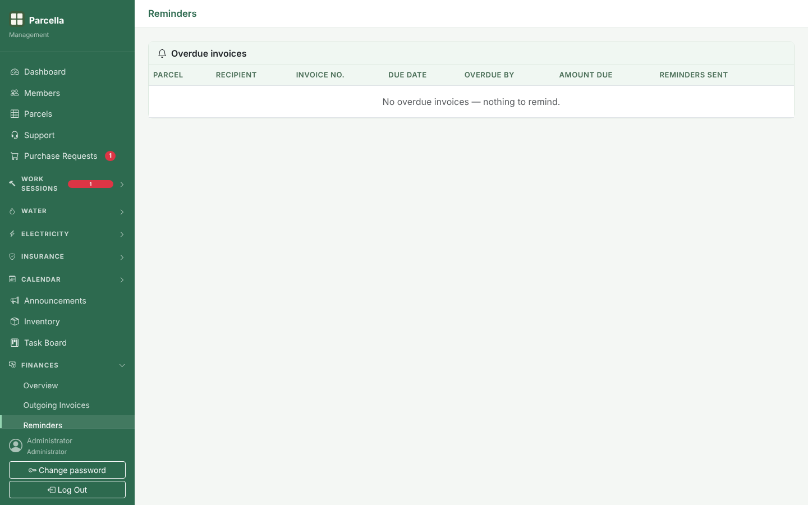

# Invoices, payments and reminders

Once an invoice run is finalized, its invoices live on. This chapter
covers finding an invoice, sending it again, recording what was paid,
and reminding members who haven't paid by the due date.

!!! info "Who can use this"
    Part of the **Finances** module (off by default). Looking at
    invoices, PDFs and the reminder list needs **Finances** read
    permission. Recording payments, resending emails and sending
    reminders need write permission; deleting a payment needs delete
    permission. Board members and administrators can do everything.
    See [Finances](index.md).

Invoices are only ever created by [finalizing an invoice run](invoice-runs.md#what-finalizing-does).
You can't create, edit or delete a single invoice by hand, and there is
no cancellation or credit note function.
<!-- TODO(verify): no cancel/credit-note feature exists in the code; if a finalized invoice is wrong, the club has to handle the correction outside Parcella (e.g. record a payment with a note). Confirm the recommended workaround with the maintainers. -->

## Invoices (all runs)

Open it with **All invoices** on the [Annual invoices](invoice-runs.md#annual-invoices-list-of-runs)
page. It lists every invoice from every finalized run, highest invoice
number first. **Back to invoice runs** in the top bar takes you back.

**Filter**

| Filter | What it does |
|---|---|
| **Parcel** | Invoices whose parcel number contains this text. |
| **Invoice no.** | Invoices whose number contains this text, e.g. `2026/` for all of 2026. |
| **Recipient** | Invoices whose recipient names contain this text. |
| **Min. amount** / **Max. amount** | Invoice amount (subtotal, without reminder fees) at least / at most this much. |
| **Status** | **All**, **Open**, **Partially paid** or **Paid**. |
| **Filter** / **Reset** | Applies the filter / clears all filters. |

**Table**

| Column | What it shows |
|---|---|
| **Invoice no.** | The invoice number; click to open the [invoice](#invoice). |
| **Parcel** | The parcel number, or **No parcel (member)** for an invoice addressed to a member directly. |
| **Recipient** | The names the invoice was addressed to when it was issued. |
| **Subtotal** | The invoice amount. |
| **Paid** | The sum of all payments recorded so far. |
| **Status** | **Open** (red), **Partially paid** (yellow) or **Paid** (green), see [Payment status](#payment-status). |
| **Paid on** | The dates of all payments, separated by commas. |

If nothing matches: "No invoices match these filters."

The same list, limited to one run and with buttons for payments and
PDFs, is on the [finalized run's page](invoice-runs.md#invoice-run-finalized).

## Invoice

Opens when you click an invoice number. The title is "Invoice
*number*".

**Top bar**

| Button | What it does |
|---|---|
| **PDF** | Opens the invoice PDF in a new tab. |
| **Resend email** | Emails the invoice PDF again, even if it was sent before. Needs write permission. If nobody can be reached, you see "No reachable invoice-address member (email notifications + a stored email address) was found for this invoice." |
| **Back to invoices** | Back to the list of all invoices. |

**Invoice** card

| Field | What it shows |
|---|---|
| **Parcel** | Parcel number, or **No parcel (member)**. |
| **Recipient** | Names and address as printed on the invoice. These were fixed when the run was finalized; later address changes don't alter them. |
| **Subtotal** | The invoice amount. |
| **Due date** | The due date of the invoice run. |
| **Status** | The payment status, followed by "paid so far / total owed". The total owed includes any reminder fees. |

**Reminders** card: the reminders sent for this invoice and the form
to send the next one, see [Sending a reminder](#sending-a-reminder).

!!! note "Where are the payments?"
    Payments are recorded in the payment dialog on the run's invoice
    list, see [Payments](#payments). The invoice page shows the result
    in the **Status** line.

### The invoice PDF

The PDF is laid out as a German business letter for window envelopes:
club logo and name at the top, the recipient's address where a window
envelope shows it, then invoice number, date, due date and parcel, a
table of the lines (**Description**, **Qty**, **Unit price**,
**Total**), the **Subtotal**, the run's footer text, and your club's
details (address, bank) in the page footer. Those club details come
from [Club settings](../../administration/settings.md).

The layout follows **DIN 5008 Form B**: the address sits in the window
of a DL or C6/5 window envelope, and short marks on the left edge show
where to fold (at a third and two thirds of the page) and where to
punch. Payment reminders and announcement letters use the same layout.

The file name starts with the issue date and the parcel number (or the
member's last name), followed by the invoice number.

## Payments

A payment is money received for an invoice. You can record it in two
ways:

- **By hand:** on the [finalized run's page](invoice-runs.md#payment-dialog),
  click **Payment** next to the invoice, enter **Amount**, **Paid on**,
  an optional **Note** and **Account**, and click **Add payment**.
- **From the bank statement:** on an [account's bookings page](bank-accounts.md#bookings-of-an-account),
  add a booking or import a CSV file and pick the matching open
  invoice. Parcella then records the payment for you, with the
  account already set.

An invoice can have any number of payments, so partial payments and
instalments are no problem. To correct a wrong payment, delete it (bin
icon in the payment dialog, needs delete permission) and enter it
again.

!!! tip "Paid on decides the year"
    The [accounting statement](bookkeeping.md#accounting-statement)
    counts income on the **Paid on** date, not the invoice date. A 2026
    invoice paid in January 2027 is 2027 income.

### Payment status

The status is worked out from the payments every time, so it's never
out of date:

| Status | When |
|---|---|
| **Open** | Nothing paid yet. |
| **Partially paid** | Something paid, but less than the invoice amount plus all reminder fees. |
| **Paid** | Payments reach the invoice amount plus all reminder fees (or more). |

Overpayments are accepted and simply show as **Paid**; Parcella doesn't
track a credit balance.

## Reminders

Open it with **Finances → Reminders** or the **Reminders** card on the
dashboard. The **Overdue invoices** list shows every invoice that is
not fully paid and whose run's due date has passed, the longest overdue
first. It's a work list for the treasurer: open each invoice and decide
whether to send a reminder.

| Column / button | What it shows |
|---|---|
| **Parcel** | The parcel number. Empty for a member invoice. |
| **Recipient** | The recipient names. |
| **Invoice no.** | The invoice number. |
| **Due date** | The run's due date. |
| **Overdue by** | How many days since the due date, e.g. "14 days". |
| **Amount due** | What's still owed: invoice amount plus reminder fees minus payments. |
| **Reminders sent** | How many reminders have been sent, with the date of the latest, or "None sent yet". |
| **Open** | Opens the invoice, where you send the reminder. |

If nothing is overdue: "No overdue invoices — nothing to remind."

An invoice disappears from this list as soon as it is fully paid.

### Sending a reminder

On the [invoice](#invoice), the **Reminders** card lists every reminder
already sent:

| Column | What it shows |
|---|---|
| "Reminder #*n*" | The reminder's level: the first reminder is #1, the next #2, and so on. |
| Date | When it was created. |
| Delivery | "Emailed", or "For printing/postal" if it couldn't be emailed. |
| Fee | The fee charged with this reminder, if any. |
| PDF icon | Opens the reminder PDF in a new tab -- print it from here for postal delivery. |

If none was sent yet: "No reminders sent yet."

Below the list, as long as the invoice isn't fully paid and you have
write permission:

| Field | What it does |
|---|---|
| **Fee (optional)** | A reminder fee, e.g. `5,00`. It is added to what the invoice owes. Leave empty for no fee. |
| **Message (optional)** | A short text printed at the bottom of the reminder. |
| **Send reminder** | Creates the next reminder and delivers it. |

What **Send reminder** does: "Generates the next reminder as a PDF --
adds the fee (if entered) to the amount owed, emails it if the member
has opted in and has a stored address, or prepares it for
printing/postal delivery otherwise."

- The reminder is always one level higher than the last one. There are
  no fixed dunning stages; your club decides how many reminders to send
  and when.
- Email goes to the same person the invoice would go to (see
  [who gets an email](invoice-runs.md#delivery)), with the subject
  "Payment reminder #*n* for invoice *number* — *club name*" and the PDF
  attached.
- If the email can't be sent, the reminder is kept and marked "For
  printing/postal". Print it via the PDF icon.

The reminder PDF is headed "Payment Reminder #*n*", refers to the
invoice and its date, and lists the **Original amount**, **Paid so
far**, **Previous reminder fees** and **This reminder's fee** (fee rows
only when there is a fee), the amount now due, your message, and a
closing sentence asking for payment.

!!! warning "Fees can't be removed"
    A reminder, and its fee, can't be deleted or changed once sent.
    Double-check the fee before clicking **Send reminder**. If you enter
    something that isn't a number in **Fee (optional)**, the reminder is
    sent without a fee.

## Related

- [Invoice runs](invoice-runs.md) -- where invoices come from.
- [Bank accounts and bookings](bank-accounts.md) -- recording payments
  from your bank statement.
- [Running the annual invoices](../../guides/annual-invoicing.md)
- [E-mail log](../../administration/email-log.md) -- check whether an
  invoice or reminder email was accepted by the mail server.
