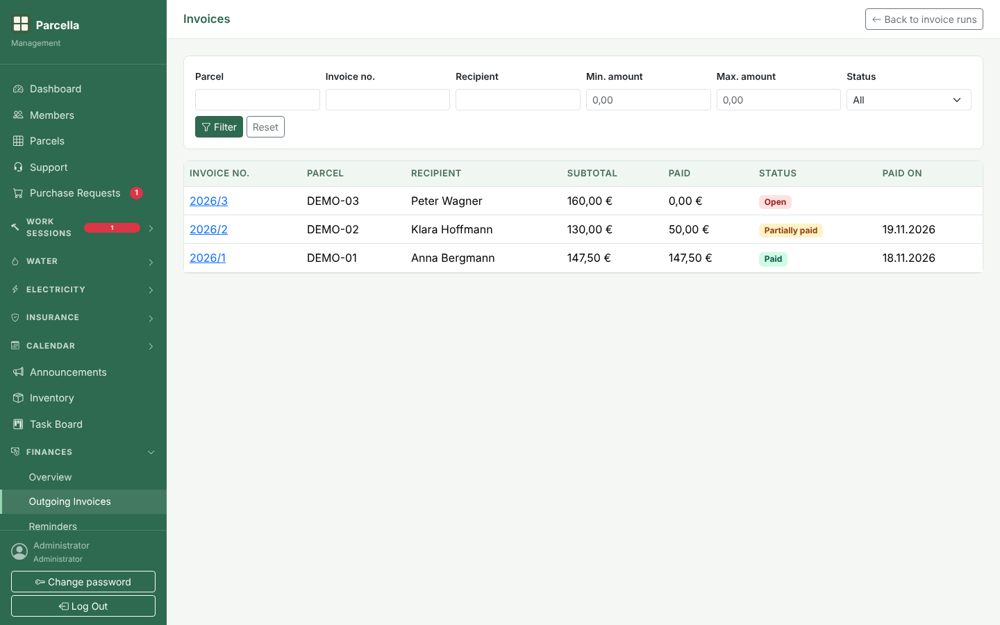

# Facturen, betalingen en herinneringen {#invoices-payments-and-reminders}

!!! note "Machinevertaling"
    Deze pagina is machinaal vertaald uit het Engels en nog niet nagekeken. Als iets onduidelijk is, geldt de Engelse versie (taal wisselt u bovenaan).

Is een factuurronde eenmaal afgerond, dan leven haar facturen verder. Dit
hoofdstuk gaat over een factuur terugvinden, haar opnieuw versturen,
vastleggen wat is betaald, en leden herinneren die niet vóór de
vervaldatum hebben betaald.

!!! info "Wie kan dit gebruiken"
    Onderdeel van de module **Financiën** (standaard uit). Facturen,
    PDF's en de lijst met herinneringen bekijken vraagt leesrecht op
    **Financiën**. Betalingen vastleggen, e-mails opnieuw versturen en
    herinneringen versturen vragen schrijfrecht; een betaling
    verwijderen vraagt verwijderrecht. Bestuursleden en beheerders
    kunnen alles. Zie [Financiën](index.md).

Facturen ontstaan alleen door een
[factuurronde af te ronden](invoice-runs.md#what-finalizing-does). U kunt
geen losse factuur met de hand aanmaken, bewerken of verwijderen, en er is
geen functie voor annuleren of creditnota's.
<!-- TODO(verify): no cancel/credit-note feature exists in the code; if a finalized invoice is wrong, the club has to handle the correction outside Parcella (e.g. record a payment with a note). Confirm the recommended workaround with the maintainers. -->

## Facturen (alle rondes) {#invoices-all-runs}

Open de lijst met **Alle facturen** op de pagina
[Jaarlijkse facturen](invoice-runs.md#annual-invoices-list-of-runs). Ze
toont elke factuur van elke afgeronde ronde, het hoogste factuurnummer
eerst. **Terug naar factuurrondes** in de bovenbalk brengt u terug.

**Filter**

| Filter | Wat het doet |
|---|---|
| **Perceel** | Facturen waarvan het perceelnummer deze tekst bevat. |
| **Factuurnr.** | Facturen waarvan het nummer deze tekst bevat, bijv. `2026/` voor heel 2026. |
| **Ontvanger** | Facturen waarvan de namen van de ontvangers deze tekst bevatten. |
| **Bedrag vanaf** / **Bedrag tot** | Factuurbedrag (subtotaal, zonder aanmaningskosten) minstens / hoogstens dit bedrag. |
| **Status** | **Alle**, **Open**, **Gedeeltelijk betaald** of **Betaald**. |
| **Filteren** / **Resetten** | Past het filter toe / wist alle filters. |

**Tabel**

| Kolom | Wat ze toont |
|---|---|
| **Factuurnr.** | Het factuurnummer; klik om de [factuur](#invoice) te openen. |
| **Perceel** | Het perceelnummer, of **Geen perceel (lid)** bij een factuur die rechtstreeks aan een lid is gericht. |
| **Ontvanger** | De namen waaraan de factuur bij uitgifte was geadresseerd. |
| **Subtotaal** | Het factuurbedrag. |
| **Betaald** | De som van alle tot nu toe geregistreerde betalingen. |
| **Status** | **Open** (rood), **Gedeeltelijk betaald** (geel) of **Betaald** (groen), zie [Betaalstatus](#payment-status). |
| **Betaald op** | De datums van alle betalingen, gescheiden door komma's. |

Past er niets: „Geen facturen komen overeen met deze filters.“

Dezelfde lijst, beperkt tot één ronde en met knoppen voor betalingen en
PDF's, staat op de [pagina van de afgeronde ronde](invoice-runs.md#invoice-run-finalized).

## Factuur {#invoice}

Opent als u op een factuurnummer klikt. De titel is „Factuur *nummer*“.

**Bovenbalk**

| Knop | Wat het doet |
|---|---|
| **PDF** | Opent de factuur-PDF in een nieuw tabblad. |
| **E-mail opnieuw versturen** | E-mailt de factuur-PDF opnieuw, ook als ze al eerder is verstuurd. Vraagt schrijfrecht. Is niemand bereikbaar, dan ziet u „Er is geen bereikbaar lid met factuuradres gevonden voor deze factuur (e-mailmeldingen + opgeslagen e-mailadres).“ |
| **Terug naar facturen** | Terug naar de lijst met alle facturen. |

Kaart **Factuur**

| Veld | Wat het toont |
|---|---|
| **Perceel** | Perceelnummer, of **Geen perceel (lid)**. |
| **Ontvanger** | Namen en adres zoals op de factuur afgedrukt. Die zijn vastgelegd toen de ronde werd afgerond; latere adreswijzigingen veranderen ze niet. Wonen de huurders op verschillende adressen, dan ziet u „*n* exemplaren, één per adres“ en de namen en het adres van elk exemplaar. |
| **Subtotaal** | Het factuurbedrag. |
| **Vervaldatum** | De vervaldatum van de factuurronde. |
| **Status** | De betaalstatus, gevolgd door „tot nu toe betaald / totaal verschuldigd“. Het totaal verschuldigd omvat eventuele aanmaningskosten. |

Kaart **Herinneringen**: de herinneringen die voor deze factuur zijn
verstuurd en het formulier om de volgende te versturen, zie
[Een herinnering versturen](#sending-a-reminder).

!!! note "Waar zijn de betalingen?"
    Betalingen worden vastgelegd in het betalingsvenster op de
    factuurlijst van de ronde, zie [Betalingen](#payments). De
    factuurpagina toont het resultaat in de regel **Status**.

### De factuur-PDF {#the-invoice-pdf}

De PDF is opgemaakt als Duitse zakelijke brief voor vensterenveloppen:
logo en naam van de vereniging bovenaan, het adres van de ontvanger waar
een vensterenvelop het toont, dan factuurnummer, datum, vervaldatum en
perceel, een tabel met de regels (**Omschrijving**, **Aantal**,
**Stukprijs**, **Totaal**), het **Subtotaal**, de voettekst van de ronde,
en de gegevens van uw vereniging (adres, bank) in de paginavoet. Die
verenigingsgegevens komen uit
[Verenigingsinstellingen](../../administration/settings.md).

De opmaak volgt **DIN 5008 formulier B**: het adres staat in het venster
van een DL- of C6/5-vensterenvelop, en korte streepjes aan de linkerrand
tonen waar u vouwt (op een derde en twee derde van de pagina) en waar u
perforeert. Betalingsherinneringen en brieven bij mededelingen gebruiken
dezelfde opmaak.

De bestandsnaam begint met de uitgiftedatum en het perceelnummer (of de
achternaam van het lid), gevolgd door het factuurnummer. Een factuur met
een exemplaar per adres heeft alle exemplaren in haar PDF, elk op eigen
pagina's.

## Betalingen {#payments}

Een betaling is geld dat voor een factuur is ontvangen. U kunt haar op
twee manieren vastleggen:

- **Met de hand:** klik op de
  [pagina van de afgeronde ronde](invoice-runs.md#payment-dialog) op
  **Betaling** naast de factuur, vul **Bedrag**, **Betaald op**, een
  optionele **Notitie** en **Rekening** in, en klik op **Betaling
  toevoegen**.
- **Uit het bankafschrift:** voeg op de
  [boekingenpagina van een rekening](bank-accounts.md#bookings-of-an-account)
  een boeking toe of importeer een CSV-bestand en kies de passende open
  factuur. Parcella legt de betaling dan voor u vast, met de rekening
  al ingesteld.

Een factuur kan willekeurig veel betalingen hebben, dus deelbetalingen en
termijnen zijn geen probleem. Om een foute betaling te corrigeren,
verwijdert u haar (prullenbakpictogram in het betalingsvenster, vraagt
verwijderrecht) en voert u haar opnieuw in.

!!! tip "Betaald op bepaalt het jaar"
    Het [boekhoudkundig overzicht](bookkeeping.md#accounting-statement)
    telt inkomsten op de datum **Betaald op**, niet op de factuurdatum.
    Een factuur van 2026 die in januari 2027 wordt betaald, is inkomsten
    van 2027.

### Betaalstatus {#payment-status}

De status wordt telkens uit de betalingen berekend, dus hij is nooit
verouderd:

| Status | Wanneer |
|---|---|
| **Open** | Nog niets betaald. |
| **Gedeeltelijk betaald** | Er is iets betaald, maar minder dan het factuurbedrag plus alle aanmaningskosten. |
| **Betaald** | Betalingen bereiken het factuurbedrag plus alle aanmaningskosten (of meer). |

Te veel betaald wordt geaccepteerd en toont gewoon **Betaald**; Parcella
houdt geen tegoed bij.

## Herinneringen {#reminders}

Open de pagina met **Financiën → Herinneringen** of de kaart
**Herinneringen** op het dashboard. De lijst **Achterstallige facturen**
toont elke factuur die niet volledig is betaald en waarvan de vervaldatum
van de ronde voorbij is, de langst achterstallige eerst. Het is een
werklijst voor de penningmeester: open elke factuur en beslis of u een
herinnering stuurt.

| Kolom / knop | Wat ze toont |
|---|---|
| **Perceel** | Het perceelnummer. Leeg bij een ledenfactuur. |
| **Ontvanger** | De namen van de ontvangers. |
| **Factuurnr.** | Het factuurnummer. |
| **Vervaldatum** | De vervaldatum van de ronde. |
| **Achterstallig sinds** | Hoeveel dagen sinds de vervaldatum, bijv. „14 dagen“. |
| **Openstaand bedrag** | Wat nog verschuldigd is: factuurbedrag plus aanmaningskosten min betalingen. |
| **Verzonden herinneringen** | Hoeveel herinneringen zijn verstuurd, met de datum van de laatste, of „Nog geen verzonden“. |
| **Openen** | Opent de factuur, waar u de herinnering verstuurt. |

Is niets achterstallig: „Geen achterstallige facturen — niets te
herinneren.“

Een factuur verdwijnt uit deze lijst zodra ze volledig is betaald.

### Een herinnering versturen {#sending-a-reminder}

Op de [factuur](#invoice) toont de kaart **Herinneringen** elke al
verstuurde herinnering:

| Kolom | Wat ze toont |
|---|---|
| „Herinnering nr. *n*“ | Het niveau van de herinnering: de eerste herinnering is nr. 1, de volgende nr. 2, enzovoort. |
| Datum | Wanneer ze is aangemaakt. |
| Verzending | „Per e-mail verzonden“, „Om te printen/per post te versturen“ als ze niet kon worden gemaild, of „Per e-mail verzonden, plus exemplaren om te printen/per post te versturen“ als sommige adressen haar per e-mail kregen en andere een brief nodig hebben. |
| Kosten | De kosten die met deze herinnering in rekening zijn gebracht, als die er zijn. |
| PDF-pictogram | Opent de herinnerings-PDF in een nieuw tabblad -- druk haar van hieruit af voor verzending per post. Ze bevat de brieven die per post moeten, één per adres voor de mensen daar zonder e-mail (alle exemplaren als iedereen is gemaild). |

Is er nog geen verstuurd: „Nog geen herinneringen verzonden.“

Onder de lijst, zolang de factuur niet volledig is betaald en u
schrijfrecht hebt:

| Veld | Wat het doet |
|---|---|
| **Kosten (optioneel)** | Aanmaningskosten, bijv. `5,00`. Ze worden opgeteld bij wat de factuur verschuldigd is. Laat leeg voor geen kosten. |
| **Bericht (optioneel)** | Een korte tekst die onderaan de herinnering wordt afgedrukt. |
| **Herinnering versturen** | Maakt de volgende herinnering aan en verstuurt haar. |

Wat **Herinnering versturen** doet: „Genereert de volgende herinnering
als PDF -- de kosten (indien ingevuld) worden opgeteld bij het
verschuldigde bedrag. Verstuurt deze per e-mail als het lid daarvoor
gekozen heeft en een adres heeft opgeslagen, anders wordt deze
klaargemaakt voor afdrukken/verzending per post.“

- De herinnering is altijd één niveau hoger dan de vorige. Er zijn geen
  vaste aanmaningsstappen; uw vereniging bepaalt hoeveel herinneringen
  ze stuurt en wanneer.
- De e-mail gaat naar dezelfde persoon als de factuur (zie
  [wie een e-mail krijgt](invoice-runs.md#delivery)), met het onderwerp
  „Betalingsherinnering nr. *n* voor factuur *nummer* —
  *verenigingsnaam*“ en de PDF als bijlage.
- Kan de e-mail niet worden verstuurd, dan blijft de herinnering bewaard
  en gemarkeerd als „Om te printen/per post te versturen“. Druk haar af
  via het PDF-pictogram.

De herinnerings-PDF heeft de kop „Betalingsherinnering nr. *n*“,
verwijst naar de factuur en haar datum, en toont het **Oorspronkelijk
bedrag**, **Reeds betaald**, **Kosten eerdere herinneringen** en **Kosten
van deze herinnering** (de kostenregels alleen als er kosten zijn), het
bedrag dat nu verschuldigd is, uw bericht, en een slotzin met het
verzoek om betaling.

!!! warning "Kosten kunnen niet worden verwijderd"
    Een herinnering, en haar kosten, kan na verzending niet worden
    verwijderd of gewijzigd. Controleer de kosten voordat u op
    **Herinnering versturen** klikt. Vult u in **Kosten (optioneel)** iets
    in dat geen getal is, dan wordt de herinnering zonder kosten
    verstuurd.

## Gerelateerd {#related}

- [Factuurrondes](invoice-runs.md) -- waar facturen vandaan komen.
- [Bankrekeningen en boekingen](bank-accounts.md) -- betalingen uit uw
  bankafschrift vastleggen.
- [De jaarfacturen opmaken](../../guides/annual-invoicing.md)
- [E-maillogboek](../../administration/email-log.md) -- controleren of
  een factuur- of herinneringsmail door de mailserver is geaccepteerd.
