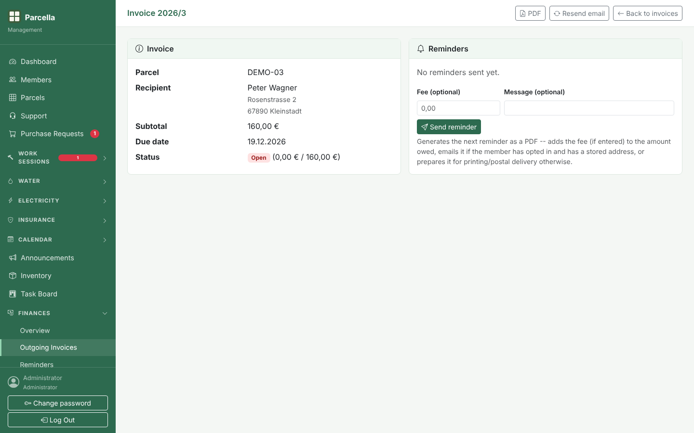

# Faktúry, platby a upomienky {#invoices-payments-and-reminders}

!!! note "Strojový preklad"
    Táto stránka bola strojovo preložená z angličtiny a zatiaľ nebola skontrolovaná. Ak je niečo nejasné, platí anglická verzia (jazyk prepnete hore).

Po dokončení vyúčtovania jeho faktúry žijú ďalej. Táto kapitola opisuje,
ako nájsť faktúru, poslať ju znova, zaznamenať, čo bolo zaplatené, a
upomenúť členov, ktorí do dátumu splatnosti nezaplatili.

!!! info "Kto to môže používať"
    Súčasť modulu **Financie** (predvolene vypnutý). Prezeranie faktúr,
    PDF a zoznamu upomienok potrebuje oprávnenie na čítanie pre
    **Financie**. Zaznamenávanie platieb, opätovné odosielanie e-mailov
    a posielanie upomienok potrebujú oprávnenie na zápis; mazanie
    platby potrebuje oprávnenie na mazanie. Členovia výboru a
    administrátori môžu všetko. Pozri [Financie](index.md).

Faktúry vznikajú vždy len [dokončením vyúčtovania](invoice-runs.md#what-finalizing-does).
Jednotlivú faktúru nemôžete ručne vytvoriť, upraviť ani zmazať a
neexistuje funkcia stornovania ani dobropisu.
<!-- TODO(verify): no cancel/credit-note feature exists in the code; if a finalized invoice is wrong, the club has to handle the correction outside Parcella (e.g. record a payment with a note). Confirm the recommended workaround with the maintainers. -->

## Faktúry (všetky vyúčtovania) {#invoices-all-runs}

Otvoríte ich tlačidlom **Všetky faktúry** na stránke
[Ročné faktúry](invoice-runs.md#annual-invoices-list-of-runs). Uvádza
každú faktúru zo všetkých dokončených vyúčtovaní, najvyššie číslo
faktúry prvé. **Späť na vyúčtovania** v hornom pruhu vás vráti späť.

**Filter**

| Filter | Čo robí |
|---|---|
| **Parcela** | Faktúry, ktorých číslo parcely obsahuje tento text. |
| **Č. faktúry** | Faktúry, ktorých číslo obsahuje tento text, napr. `2026/` pre celý rok 2026. |
| **Príjemca** | Faktúry, ktorých mená príjemcov obsahujú tento text. |
| **Suma od** / **Suma do** | Suma faktúry (medzisúčet, bez poplatkov za upomienky) aspoň / najviac toľko. |
| **Stav** | **Všetky**, **Otvorená**, **Čiastočne uhradená** alebo **Uhradená**. |
| **Filtrovať** / **Zrušiť filter** | Použije filter / zruší všetky filtre. |

**Tabuľka**

| Stĺpec | Čo ukazuje |
|---|---|
| **Č. faktúry** | Číslo faktúry; kliknutím otvoríte [faktúru](#invoice). |
| **Parcela** | Číslo parcely alebo **Bez parcely (člen)** pri faktúre adresovanej priamo členovi. |
| **Príjemca** | Mená, na ktoré bola faktúra pri vystavení adresovaná. |
| **Medzisúčet** | Suma faktúry. |
| **Uhradené** | Súčet všetkých doteraz zaznamenaných platieb. |
| **Stav** | **Otvorená** (červená), **Čiastočne uhradená** (žltá) alebo **Uhradená** (zelená), pozri [Stav platby](#payment-status). |
| **Uhradené dňa** | Dátumy všetkých platieb, oddelené čiarkami. |

Ak nič nevyhovuje: „Žiadne faktúry nezodpovedajú týmto filtrom.“

Ten istý zoznam, obmedzený na jedno vyúčtovanie a s tlačidlami pre
platby a PDF, je na [stránke dokončeného vyúčtovania](invoice-runs.md#invoice-run-finalized).

## Faktúra {#invoice}

Otvorí sa, keď kliknete na číslo faktúry. Názov je „Faktúra *číslo*“.

**Horný pruh**

| Tlačidlo | Čo robí |
|---|---|
| **PDF** | Otvorí PDF faktúry v novej karte. |
| **Znova odoslať e-mail** | Pošle PDF faktúry e-mailom znova, aj keď bolo odoslané predtým. Potrebuje oprávnenie na zápis. Ak nie je nikoho, koho by sa dalo zastihnúť, uvidíte „Pre túto faktúru nebol nájdený žiadny dostupný člen s fakturačnou adresou (e-mailové upozornenia + uložená e-mailová adresa).“ |
| **Späť na faktúry** | Späť do zoznamu všetkých faktúr. |

Karta **Faktúra**

| Pole | Čo ukazuje |
|---|---|
| **Parcela** | Číslo parcely alebo **Bez parcely (člen)**. |
| **Príjemca** | Mená a adresa tak, ako sú vytlačené na faktúre. Boli zafixované pri dokončení vyúčtovania; neskoršie zmeny adresy ich nemenia. Ak nájomcovia bývajú na rôznych adresách, uvidíte „Počet výtlačkov: *n* (jeden na adresu)“ a mená a adresu každého výtlačku. |
| **Medzisúčet** | Suma faktúry. |
| **Dátum splatnosti** | Dátum splatnosti vyúčtovania. |
| **Stav** | Stav platby, za ním „doteraz uhradené / celkom dlžné“. Celková dlžná suma zahŕňa aj poplatky za upomienky. |

Karta **Upomienky**: upomienky odoslané k tejto faktúre a formulár na
odoslanie ďalšej, pozri [Odoslanie upomienky](#sending-a-reminder).

!!! note "Kde sú platby?"
    Platby sa zaznamenávajú v dialógu platby v zozname faktúr
    vyúčtovania, pozri [Platby](#payments). Stránka faktúry ukazuje
    výsledok v riadku **Stav**.

### PDF faktúry {#the-invoice-pdf}

PDF je usporiadané ako nemecký obchodný list pre obálky s okienkom:
logo a názov spolku hore, adresa príjemcu tam, kde ju ukáže okienko
obálky, potom číslo faktúry, dátum, dátum splatnosti a parcela, tabuľka
riadkov (**Popis**, **Množ.**, **Jedn. cena**, **Celkom**), **Medzisúčet**,
text päty vyúčtovania a údaje vášho spolku (adresa, banka) v päte
stránky. Tieto údaje spolku pochádzajú z
[Nastavení spolku](../../administration/settings.md).

Rozloženie zodpovedá norme **DIN 5008 tvar B**: adresa je v okienku
obálky DL alebo C6/5 a krátke značky na ľavom okraji ukazujú, kde
prehnúť (v tretine a dvoch tretinách strany) a kde dierovať. Upomienky
a listy oznamov používajú rovnaké rozloženie.

Názov súboru začína dátumom vystavenia a číslom parcely (alebo
priezviskom člena), nasleduje číslo faktúry. Faktúra s jedným
výtlačkom na adresu má v PDF všetky výtlačky, každý na vlastných
stranách.

## Platby {#payments}

Platba sú peniaze prijaté za faktúru. Zaznamenať ju môžete dvoma
spôsobmi:

- **Ručne:** na [stránke dokončeného vyúčtovania](invoice-runs.md#payment-dialog)
  kliknite na **Platba** vedľa faktúry, zadajte **Suma**, **Uhradené
  dňa**, voliteľnú **Poznámka** a **Účet** a kliknite na **Pridať
  platbu**.
- **Z bankového výpisu:** na [stránke zápisov účtu](bank-accounts.md#bookings-of-an-account)
  pridajte zápis alebo importujte súbor CSV a vyberte zodpovedajúcu
  otvorenú faktúru. Parcella potom platbu zaznamená za vás, už s
  nastaveným účtom.

Faktúra môže mať ľubovoľný počet platieb, takže čiastočné platby a
splátky nie sú problém. Ak chcete opraviť nesprávnu platbu, zmažte ju
(ikona koša v dialógu platby, potrebuje oprávnenie na mazanie) a zadajte
ju znova.

!!! tip "Uhradené dňa rozhoduje o roku"
    [Účtovný prehľad](bookkeeping.md#accounting-statement) započítava
    príjem k dátumu **Uhradené dňa**, nie k dátumu faktúry. Faktúra z
    roku 2026 zaplatená v januári 2027 je príjmom roku 2027.

### Stav platby {#payment-status}

Stav sa zakaždým vypočíta z platieb, takže nikdy nie je zastaraný:

| Stav | Kedy |
|---|---|
| **Otvorená** | Zatiaľ nič nezaplatené. |
| **Čiastočne uhradená** | Niečo zaplatené, ale menej ako suma faktúry plus všetky poplatky za upomienky. |
| **Uhradená** | Platby dosiahnu sumu faktúry plus všetky poplatky za upomienky (alebo viac). |

Preplatky sa prijímajú a jednoducho sa zobrazia ako **Uhradená**;
Parcella nesleduje kreditný zostatok.

## Upomienky {#reminders}

Otvoríte ich cez **Financie → Upomienky** alebo kartou **Upomienky** na
prehľade. Zoznam **Faktúry po splatnosti** ukazuje každú faktúru, ktorá
nie je úplne zaplatená a ktorej dátum splatnosti vyúčtovania uplynul,
najdlhšie po splatnosti prvé. Je to pracovný zoznam pre pokladníka:
otvorte každú faktúru a rozhodnite, či poslať upomienku.

| Stĺpec / tlačidlo | Čo ukazuje |
|---|---|
| **Parcela** | Číslo parcely. Pri faktúre členovi prázdne. |
| **Príjemca** | Mená príjemcov. |
| **Č. faktúry** | Číslo faktúry. |
| **Dátum splatnosti** | Dátum splatnosti vyúčtovania. |
| **Po splatnosti** | Koľko dní od dátumu splatnosti, napr. „14 dní“. |
| **Dlžná suma** | Čo je ešte dlžné: suma faktúry plus poplatky za upomienky mínus platby. |
| **Odoslané upomienky** | Koľko upomienok bolo odoslaných, s dátumom poslednej, alebo „Zatiaľ žiadna odoslaná“. |
| **Otvoriť** | Otvorí faktúru, kde upomienku pošlete. |

Ak nič nie je po splatnosti: „Žiadne faktúry po splatnosti — niet čo
upomínať.“

Faktúra z tohto zoznamu zmizne, hneď ako je úplne zaplatená.

### Odoslanie upomienky {#sending-a-reminder}

Na [faktúre](#invoice) karta **Upomienky** uvádza každú už odoslanú
upomienku:

| Stĺpec | Čo ukazuje |
|---|---|
| „Upomienka č. *n*“ | Stupeň upomienky: prvá upomienka je č. 1, ďalšia č. 2 atď. |
| Dátum | Kedy bola vytvorená. |
| Doručenie | „Odoslané e-mailom“, „Na tlač/poštové odoslanie“, ak sa nedala poslať e-mailom, alebo „Odoslané e-mailom, k tomu výtlačky na poštové odoslanie“, ak ju niektoré adresy dostali e-mailom a iné potrebujú list. |
| Poplatok | Poplatok účtovaný s touto upomienkou, ak nejaký je. |
| Ikona PDF | Otvorí PDF upomienky v novej karte -- odtiaľ ju vytlačíte na poštové doručenie. Obsahuje listy, ktoré treba poslať poštou, jeden na adresu pre ľudí tam bez e-mailu (všetky výtlačky, ak všetci dostali e-mail). |

Ak zatiaľ žiadna nebola odoslaná: „Zatiaľ nebola odoslaná žiadna
upomienka.“

Pod zoznamom, kým faktúra nie je úplne zaplatená a máte oprávnenie na
zápis:

| Pole | Čo robí |
|---|---|
| **Poplatok (voliteľné)** | Poplatok za upomienku, napr. `5,00`. Pripočíta sa k tomu, čo faktúra dlží. Nechajte prázdne pre žiadny poplatok. |
| **Správa (voliteľné)** | Krátky text vytlačený v dolnej časti upomienky. |
| **Odoslať upomienku** | Vytvorí ďalšiu upomienku a doručí ju. |

Čo robí **Odoslať upomienku**: „Vygeneruje ďalšiu upomienku ako PDF --
poplatok (ak je zadaný) sa pripočíta k dlžnej sume. Odošle ju e-mailom,
ak s tým člen súhlasil a má uloženú adresu, inak ju pripraví na tlač a
poštové odoslanie.“

- Upomienka je vždy o stupeň vyššie ako posledná. Pevné stupne
  upomínania neexistujú; váš spolok rozhoduje, koľko upomienok pošle a
  kedy.
- E-mail ide tej istej osobe, ktorej by šla faktúra (pozri
  [kto dostane e-mail](invoice-runs.md#delivery)), s predmetom
  „Upomienka č. *n* k faktúre *číslo* — *názov spolku*“ a priloženým
  PDF.
- Ak sa e-mail nedá odoslať, upomienka sa ponechá a označí ako „Na
  tlač/poštové odoslanie“. Vytlačte ju cez ikonu PDF.

PDF upomienky má nadpis „Upomienka k platbe č. *n*“, odkazuje na
faktúru a jej dátum a uvádza **Pôvodná suma**, **Doteraz uhradené**,
**Predchádzajúce poplatky za upomienky** a **Poplatok za túto
upomienku** (riadky poplatkov len vtedy, keď je poplatok), aktuálne
dlžnú sumu, vašu správu a záverečnú vetu so žiadosťou o zaplatenie.

!!! warning "Poplatky sa nedajú odstrániť"
    Upomienku a jej poplatok po odoslaní nemožno zmazať ani zmeniť.
    Pred kliknutím na **Odoslať upomienku** poplatok ešte raz
    skontrolujte. Ak do **Poplatok (voliteľné)** zadáte niečo, čo nie je
    číslo, upomienka sa pošle bez poplatku.

## Súvisiace {#related}

- [Vyúčtovania](invoice-runs.md) -- odkiaľ faktúry pochádzajú.
- [Bankové účty a zaúčtovania](bank-accounts.md) -- zaznamenávanie
  platieb z bankového výpisu.
- [Ročné vyúčtovanie](../../guides/annual-invoicing.md)
- [Protokol e-mailov](../../administration/email-log.md) -- overte, či
  poštový server prijal e-mail s faktúrou alebo upomienkou.
