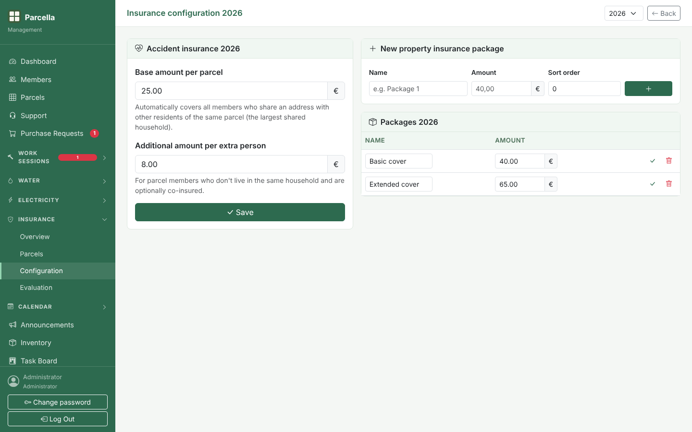

# Pojištění {#insurance}

!!! note "Strojový překlad"
    Tato stránka byla strojově přeložena z angličtiny a dosud nebyla zkontrolována. Pokud je něco nejasné, platí anglická verze (jazyk přepnete nahoře).

Modul pojištění eviduje, které parcely si v daném roce sjednaly skupinové
pojištění spolku -- balíček **pojištění majetku** a/nebo **úrazové
pojištění** -- a počítá, kolik za něj každá parcela dluží. Vše se vede po
letech, takže loňské údaje zůstávají takové, jaké byly, když nastavujete
nový rok.

!!! info "Kdo to může používat"
    Členové výboru a administrátoři mají vždy plný přístup. Ostatní
    uživatelé potřebují skupinu, která dává oprávnění pro **Pojištění**
    (viz [Skupiny](../administration/groups.md)):

    - **Čtení** -- vidět přehled, seznam parcel, stránku pojištění každé
      parcely, konfiguraci a výroční zprávu a stahovat export CSV.
    - **Zápis** -- měnit pojištění parcely, částky úrazového pojištění a
      balíčky.
    - **Mazání** -- smazat balíček pojištění majetku.

    Modul se zapíná přepínačem **Správa pojištění** v části
    [Zapínání a vypínání modulů](../administration/modules.md). Ve
    výchozím stavu je zapnutý.

Modul najdete v navigaci pod **Pojištění** s položkami **Přehled**,
**Parcely**, **Konfigurace** a **Vyhodnocení**.

## Jak se počítají náklady {#how-the-cost-is-calculated}

Náklady každé parcely za rok jsou součtem dvou částí.

**Pojištění majetku:** pokud má parcela pojištění majetku a je vybrán
balíček, platí částku tohoto balíčku. Zapnuté pojištění majetku bez
vybraného balíčku nic nestojí.

**Úrazové pojištění:** pokud má parcela úrazové pojištění a pro daný rok
existuje konfigurace úrazového pojištění, platí:

- **Základní částka na parcelu** jednou, pokud je alespoň jedna osoba z
  domácnosti parcely zaškrtnuta jako pojištěná, plus
- **Dodatečná částka na každou další osobu** za každou zaškrtnutou
  osobu, která do domácnosti *nepatří*.

Pokud není zaškrtnut nikdo z domácnosti, základní částka se neúčtuje, i
když jsou pojištěné další osoby. Bez konfigurace pro daný rok úrazové
pojištění nic nestojí.

**Příklad:** základní částka 3,00, dodatečná částka 3,00. Parcela s
balíčkem „Balíček 2“ (60,00), úrazovým pojištěním pro pár bydlící na
stejné adrese a jedním spolunájemcem bydlícím jinde platí
60,00 + 3,00 + 1 × 3,00 = **66,00**.

### Kdo se počítá do domácnosti {#who-counts-as-the-household}

Parcella se podívá na současné nájemce parcely -- osoby, jejichž nájem
trvá a jejichž členství neskončilo ani nebylo smazáno -- a porovná jejich
adresy (ulice, PSČ a město; na velkých písmenech a nadbytečných mezerách
nezáleží).

- Největší skupina nájemců se stejnou adresou je **domácnost**. Pokud
  jsou dvě skupiny stejně velké, vyhrává ta nalezená první.
- Všichni ostatní jsou uvedeni jako **ostatní členové parcely**, které
  lze navíc pojistit za dodatečnou částku.
- Nájemce bez zadané adresy nikdy netvoří domácnost s nikým, ani s
  jiným nájemcem, který také nemá adresu.
- Parcela s jediným nájemcem: tato osoba je domácnost, s adresou nebo
  bez ní.

!!! tip "Udržujte adresy jednotné"
    „Hlavní 5“ a „Hlavní ul. 5“ jsou pro Parcellu různé adresy. Pokud se
    pár zobrazuje jako domácnost plus „ostatní člen parcely“,
    zkontrolujte pravopis v obou záznamech členů.

Když se pojištění parcely pro daný rok otevře poprvé, je každý člen
domácnosti zaškrtnut jako pojištěný. Od té doby platí zaškrtnutí: člen,
který se později přestěhuje, nemění vyúčtování roku, který je už
nastaven, a nový člen domácnosti, který přibude později, se zobrazí
nezaškrtnutý, dokud ho nezaškrtnete.

Modul faktur používá stejný výpočet, když přidává pojištění do roční
faktury parcely, s jedním řádkem na každou část (balíček majetku,
základní částka domácnosti, další osoby). Viz
[Vyúčtování](finances/invoice-runs.md).

## Přehled {#overview}

Úvodní stránka modulu (**Pojištění → Přehled**). Na první pohled ukazuje
údaje za jeden rok.

| Pole / tlačítko | Co dělá |
|---|---|
| Výběr roku (vpravo nahoře) | Přepne všechny údaje na jiný rok. Uvádí každý rok, který má konfiguraci úrazového pojištění, plus aktuální rok. |
| **Spravovat parcely** | Otevře [seznam parcel](#parcels) pro vybraný rok. |
| Varování „Pro … neexistuje žádná konfigurace pojištění.“ | Zobrazí se, když rok ještě nemá částky úrazového pojištění. **Vytvořit nyní →** otevře [konfiguraci](#configuration) pro daný rok. |
| **Pojištění majetku** | Počet parcel s pojištěním majetku v tomto roce. |
| **Úrazové pojištění** | Počet parcel s úrazovým pojištěním, kde je pojištěn alespoň jeden člen domácnosti. Parcela, kde je pojištěna jen další osoba, se nepočítá. |
| **Příjem z pojištění majetku** | Součet nákladů na pojištění majetku všech parcel za rok. |
| **Příjem z úrazového pojištění** | Součet nákladů na úrazové pojištění všech parcel za rok. |
| **Balíčky pojištění majetku {year}** | Balíčky roku s jejich částkami. Zobrazí se, jen pokud balíčky existují. |
| **Konfigurace** | Otevře [konfiguraci](#configuration). |
| **Spravovat parcely** | Otevře [seznam parcel](#parcels). |
| **Výroční zpráva** | Otevře [výroční zprávu](#annual-report). |

## Parcely {#parcels}

**Pojištění → Parcely** vypisuje parcely se stavem pojištění a náklady
za jeden rok. Otevřete ho z přehledu, chcete-li zachovat tam vybraný
rok; z navigace ukazuje aktuální rok.

Seznam obsahuje každou aktivní parcelu. Uvedeny jsou i ukončené parcely,
označené **ukončená**, protože ukončení nájmu samo o sobě nezruší
pojistnou smlouvu. Ukončená parcela zůstane v seznamu, dokud neotevřete
její stránku pojištění, nevypnete oba druhy pojištění a nekliknete na
**Uložit** -- tím se zaznamená „zkontrolováno, není co pojistit“ a parcela
ze seznamu tohoto roku zmizí.

**Filtry** (nad tabulkou; použijí se, jakmile vyberete hodnotu):

| Filtr | Co dělá |
|---|---|
| **Pojištění majetku** | **Vše**, **Žádné** (parcely bez pojištění majetku) nebo jeden balíček roku (parcely pojištěné přesně tímto balíčkem). |
| **Úrazové pojištění** | **Vše**, **Ano** (úrazové pojištění zapnuto) nebo **Žádné** (vypnuto nebo nikdy nenastaveno). |
| **Zrušit filtr** | Zruší oba filtry. Zobrazí se, jen dokud je filtr aktivní. |

**Sloupce:**

| Sloupec | Co ukazuje |
|---|---|
| **Parcela** | Číslo parcely s odkazem na její stránku pojištění. Kliknutím na záhlaví sloupce seřadíte podle čísla parcely; opětovným kliknutím obrátíte pořadí. |
| **Pojištění majetku** | Název balíčku, **Ano**, pokud je pojištění majetku zapnuto, ale není vybrán balíček, nebo „–“. |
| **Úrazové pojištění** | **Ano**, pokud je úrazové pojištění zapnuto, s počtem dalších osob v závorce, např. **Ano (+1)**; jinak „–“. |
| **Celkové náklady** | Celkové náklady parcely na pojištění za rok. Kliknutím na záhlaví seřadíte podle nákladů. |
| Tlačítko tužky | Otevře stránku pojištění parcely. |

Řádek **Součet** dole počítá parcely s pojištěním majetku a s úrazovým
pojištěním (opět jen ty s alespoň jedním pojištěným členem domácnosti)
a sčítá celkové náklady uvedených parcel. Pod tabulkou vidíte, kolik
parcel je uvedeno.

## Stránka pojištění parcely {#parcel-insurance-page}

Otevírá se ze seznamu parcel nebo z výroční zprávy, s titulkem
**Pojištění pro parcelu {číslo parcely}**. Zde zaznamenáte, co si
parcela sjednala, pro rok uvedený v odkazu, ze kterého jste přišli.

| Pole / tlačítko | Co dělá |
|---|---|
| **Předchozí** / **Další** | Přejde na předchozí nebo další parcelu v pořadí seznamu parcel (podle čísla parcely). Klávesnice: ++ctrl+left++ a ++ctrl+right++. |
| **Zpět** | Vrátí se na seznam parcel za tento rok. |
| Varování „Pro … neexistuje žádná konfigurace pojištění.“ | Rok ještě nemá částky úrazového pojištění, takže úrazové pojištění nic nestojí. **Vytvořit nyní →** otevře konfiguraci. |
| **Pojištění majetku uzavřeno** | Přepínač. Po zapnutí se objeví pole **Balíček**. |
| **Balíček** | Balíček pojištění majetku pro tento rok. Pokud rok nemá žádné balíčky, objeví se místo toho varování s **Vytvořit nyní →**. |
| **Úrazové pojištění uzavřeno** | Přepínač. Po zapnutí se objeví seznamy osob. |
| **Domácnost (sdílejí adresu s ostatními obyvateli):** | Zjištěná domácnost (viz [Kdo se počítá do domácnosti](#who-counts-as-the-household)). Každá zaškrtnutá osoba je pojištěna; odškrtněte toho, kdo odmítá. Základní částka se účtuje jednou, pokud je zde zaškrtnuta alespoň jedna osoba. |
| **Ostatní členové parcely (jiná adresa) …** | Nájemci mimo domácnost. Zaškrtnutím osobu pojistíte za dodatečnou částku za každou. Zobrazí se, jen pokud takoví nájemci jsou. |
| **Náklady {year}** | **Pojištění majetku**, **Úrazové pojištění** a **Celkem** pro tuto parcelu, jak jsou momentálně uloženy. Údaje se aktualizují po uložení. |
| **Uložit** | Uloží pojištění parcely pro tento rok a znovu načte stránku. Zobrazí se jen s oprávněním k zápisu; bez něj jsou všechna pole jen pro čtení. |

!!! warning "Vypnutí úrazového pojištění zruší zaškrtnutí"
    Když uložíte s vypnutým **Úrazové pojištění uzavřeno**, zaškrtnutí
    členů domácnosti a dalších osob se odstraní. Pokud ho později znovu
    zapnete, před uložením osoby znovu zaškrtněte.

!!! note "Poznámka"
    Vypnutím pojištění majetku se také zruší vybraný balíček.

## Konfigurace {#configuration}

**Pojištění → Konfigurace** obsahuje ceny roku. Rok vyberte výběrem
vpravo nahoře; **Zpět** vás vrátí na přehled. Bez oprávnění k zápisu
vidíte jen částky a balíčky.

### Úrazové pojištění (rok) {#accident-insurance}

| Pole / tlačítko | Co dělá |
|---|---|
| **Základní částka na parcelu** | Účtuje se jednou za parcelu s úrazovým pojištěním, za její domácnost. Předvyplněno 3,00, když rok ještě nemá konfiguraci. |
| **Dodatečná částka na každou další osobu** | Účtuje se za každého pojištěného člena parcely mimo domácnost. Předvyplněno 3,00, když rok ještě nemá konfiguraci. |
| **Uložit** | Uloží obě částky pro vybraný rok. Uložením se vytvoří konfigurace roku, pokud neexistuje; od té doby se rok objevuje ve výběrech roku. |

Částky přijímají čárku nebo tečku jako desetinný oddělovač (`3,50` nebo
`3.50`). Částka, kterou Parcella nedokáže přečíst jako číslo, se uloží
jako 0 -- po uložení údaj zkontrolujte.

### Nový balíček pojištění majetku {#new-property-insurance-package}

| Pole / tlačítko | Co dělá |
|---|---|
| **Název** | Název balíčku, např. „Balíček 1“. Povinné. |
| **Částka** | Kolik parcela s tímto balíčkem platí ročně. Povinné. |
| **Pořadí řazení** | Balíčky se řadí podle tohoto čísla, nejnižší první, pak podle částky. Výchozí 0. |
| **+** | Přidá balíček k vybranému roku. |

### Balíčky (rok) {#packages}

Balíčky roku. S oprávněním k zápisu můžete **Název** a **Částka** měnit
přímo v řádku a potvrdit tlačítkem zaškrtnutí. Tlačítko koše po
potvrzení balíček smaže (vyžaduje oprávnění k mazání).

!!! warning "Smazání používaného balíčku"
    Parcely, které smazaný balíček měly, si ponechají „pojištění majetku
    uzavřeno“, ale bez balíčku -- pak za pojištění majetku nic neplatí a
    místo názvu balíčku ukazují **Ano**. U každé z těchto parcel vyberte
    nový balíček.

!!! tip "Nastavení nového roku"
    Balíčky a částky patří k jednomu roku a automaticky se nekopírují.
    Na začátku nového roku otevřete konfiguraci pro tento rok, zadejte
    částky úrazového pojištění a znovu vytvořte balíčky, pak projděte
    seznam parcel. Každá parcela začíná nový rok bez zaznamenaného
    pojištění.

## Výroční zpráva {#annual-report}

**Pojištění → Vyhodnocení** (nebo **Výroční zpráva** na přehledu), s
titulkem **Zpráva o pojištění {year}**, vypisuje každou parcelu, která
má v daném roce pojištění majetku nebo úrazové pojištění, s jejími
náklady. Použijte ji ke kontrole součtů proti vyúčtování pojišťovny.

**Filtry** (použijí se, jakmile vyberete hodnotu):

| Filtr | Co dělá |
|---|---|
| Rok | Rok, za který se zpráva sestavuje. |
| **Všechny typy** / **Pojištění majetku** / **Úrazové pojištění** | Všechny pojištěné parcely, nebo jen ty s daným druhem pojištění. |
| **Všechny balíčky** / balíček | Jen parcely pojištěné tímto balíčkem majetku. |
| **Vše** / **S dalšími osobami** / **Bez dalších osob** | Parcely s alespoň jednou pojištěnou další osobou, nebo parcely s úrazovým pojištěním bez nich. |

| Pole / sloupec | Co ukazuje |
|---|---|
| **Pojištěné parcely** | Počet parcel uvedených podle aktuálních filtrů. |
| **Celkové příjmy** | Součet sloupce **Celkem**. |
| **Parcela** | Číslo parcely s odkazem na její stránku pojištění. |
| **Pojištění majetku** | Název balíčku, nebo „–“. |
| **Náklady na majetek** | Náklady parcely na pojištění majetku. |
| **Úrazové pojištění** | **Ano** nebo „–“. |
| **Další osoby** | Počet pojištěných dalších osob mimo domácnost. |
| **Náklady na úrazy** | Náklady parcely na úrazové pojištění. |
| **Celkem** | Celkové náklady parcely na pojištění. |
| **CSV export** | Stáhne seznam tak, jak je aktuálně vyfiltrovaný, jako soubor oddělený středníky s desetinnými čárkami (otevře se přímo v česky či německy nastaveném tabulkovém procesoru). |
| **Zpět** | Vrátí se na přehled. |

!!! note "Záhlaví sloupců CSV"
    Soubor CSV používá stejná záhlaví sloupců jako tato stránka, v
    jazyce spolku: parcela, pojištění majetku, balíček, náklady na
    majetek (EUR), úrazové pojištění, další osoby, náklady na úrazy
    (EUR), celkem (EUR). Hodnoty ano/ne se zapisují jako „Ano“/„Ne“ také
    v tomto jazyce.

!!! note "Dva způsoby počítání"
    **Pojištěné parcely** zde počítají každou uvedenou parcelu. Dlaždice
    **Úrazové pojištění** na přehledu počítá jen parcely s alespoň jedním
    pojištěným členem domácnosti, takže se obě čísla mohou lišit.

## Související {#related}

- [Parcely](parcels.md) -- nájmy a ukončení, které určují, kdo se
  objeví na stránce pojištění parcely
- [Členové](members.md) -- adresy používané ke zjištění domácnosti
- [Vyúčtování](finances/invoice-runs.md) -- vyúčtování pojištění v roční
  faktuře
- [Skupiny](../administration/groups.md) -- přístup pokladníka k tomuto
  modulu
