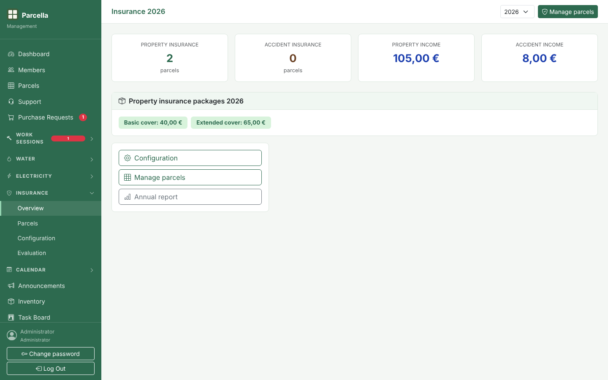

# Versicherungen {#insurance}

Das Versicherungsmodul hält fest, welche Parzellen in einem Jahr die
Gruppenversicherung des Vereins abgeschlossen haben -- ein Paket
**Sachversicherung** und/oder eine **Unfallversicherung** --, und berechnet,
was jede Parzelle dafür schuldet. Alles wird je Jahr geführt; die Zahlen
des Vorjahres bleiben also so, wie sie waren, wenn du das neue Jahr
einrichtest.

!!! info "Wer das nutzen kann"
    Vorstandsmitglieder und Administratoren haben immer vollen Zugriff.
    Andere Benutzer brauchen eine Gruppe, die Rechte für **Versicherungen**
    gewährt (siehe [Gruppen](../administration/groups.md)):

    - **Lesen** -- die Übersicht, die Parzellenliste, die
      Versicherungsseite jeder Parzelle, die Konfiguration und die
      Jahresauswertung sehen und den CSV-Export herunterladen.
    - **Schreiben** -- die Versicherung einer Parzelle, die Beträge der
      Unfallversicherung und die Pakete ändern.
    - **Löschen** -- ein Sachversicherungs-Paket löschen.

    Eingeschaltet wird das Modul mit **Versicherungsverwaltung** unter
    [Module ein- und ausschalten](../administration/modules.md). Es ist
    standardmäßig an.

Du findest das Modul in der Navigation unter **Versicherungen**, mit den
Einträgen **Übersicht**, **Parzellen**, **Konfiguration** und
**Auswertung**.

## Wie die Kosten berechnet werden {#how-the-cost-is-calculated}

Die Kosten einer Parzelle für ein Jahr sind die Summe aus zwei Teilen.

**Sachversicherung:** Hat die Parzelle eine Sachversicherung und ist ein
Paket gewählt, zahlt sie den Betrag dieses Pakets. Eingeschaltete
Sachversicherung ohne gewähltes Paket kostet nichts.

**Unfallversicherung:** Hat die Parzelle eine Unfallversicherung und gibt es
für das Jahr eine Konfiguration der Unfallversicherung, zahlt sie:

- den **Grundbetrag pro Parzelle** einmal, wenn mindestens eine Person aus
  dem Haushalt der Parzelle als versichert angehakt ist, plus
- den **Zusatzbetrag pro weiterer Person** für jede angehakte Person, die
  *nicht* zum Haushalt gehört.

Ist niemand aus dem Haushalt angehakt, wird der Grundbetrag nicht
berechnet, auch wenn weitere Personen versichert sind. Ohne Konfiguration
für das Jahr kostet die Unfallversicherung nichts.

**Beispiel:** Grundbetrag 3,00, Zusatzbetrag 3,00. Eine Parzelle mit dem
Paket „Paket 2“ (60,00), Unfallversicherung für das Paar unter derselben
Adresse und einen Mitpächter, der woanders wohnt, zahlt
60,00 + 3,00 + 1 × 3,00 = **66,00**.

### Wer als Haushalt zählt {#who-counts-as-the-household}

Parcella schaut auf die aktuellen Pächter der Parzelle -- Personen mit
laufendem Pachtverhältnis, deren Mitgliedschaft weder beendet noch gelöscht
ist -- und vergleicht ihre Adressen (Straße, Postleitzahl und Ort; Groß- und
Kleinschreibung und zusätzliche Leerzeichen spielen keine Rolle).

- Die größte Gruppe von Pächtern mit derselben Adresse ist der
  **Haushalt**. Sind zwei Gruppen gleich groß, gewinnt die zuerst
  gefundene.
- Alle anderen stehen als **weitere Parzellenmitglieder** da, die gegen den
  Zusatzbetrag mitversichert werden können.
- Ein Pächter ohne hinterlegte Adresse bildet nie einen Haushalt mit
  jemandem, auch nicht mit einem anderen Pächter ohne Adresse.
- Eine Parzelle mit nur einem Pächter: Diese Person ist der Haushalt, mit
  oder ohne Adresse.

!!! tip "Adressen einheitlich halten"
    „Hauptstraße 5“ und „Hauptstr. 5“ sind für Parcella verschiedene
    Adressen. Taucht ein Paar als Haushalt plus „weiteres
    Parzellenmitglied“ auf, prüf die Schreibweise in beiden
    Mitgliedseinträgen.

Wird die Versicherung einer Parzelle für ein Jahr zum ersten Mal geöffnet,
ist jedes Haushaltsmitglied als versichert angehakt. Ab dann zählen die
Häkchen: Ein Mitglied, das später umzieht, ändert die Rechnung für ein schon
eingerichtetes Jahr nicht, und ein neues Haushaltsmitglied, das später
dazukommt, erscheint ohne Häkchen, bis du es anhakst.

Das Rechnungsmodul nutzt dieselbe Berechnung, wenn es die Versicherung zur
Jahresrechnung einer Parzelle hinzufügt, mit einer Zeile je Teil
(Sachversicherungs-Paket, Grundbetrag des Haushalts, weitere Personen).
Siehe [Rechnungsläufe](finances/invoice-runs.md).

## Übersicht {#overview}

Die Startseite des Moduls (**Versicherungen → Übersicht**). Sie zeigt die
Zahlen eines Jahres auf einen Blick.

| Feld / Schaltfläche | Was es bewirkt |
|---|---|
| Jahresauswahl (oben rechts) | Schaltet alle Zahlen auf ein anderes Jahr. Listet jedes Jahr mit einer Konfiguration der Unfallversicherung und das aktuelle Jahr. |
| **Parzellen verwalten** | Öffnet die [Parzellenliste](#parcels) für das gewählte Jahr. |
| Warnung „Keine Versicherungs-Konfiguration für … vorhanden.“ | Erscheint, wenn das Jahr noch keine Beträge für die Unfallversicherung hat. **Jetzt anlegen →** öffnet die [Konfiguration](#configuration) für dieses Jahr. |
| **Sachversicherung** | Zahl der Parzellen mit Sachversicherung in diesem Jahr. |
| **Unfallversicherung** | Zahl der Parzellen mit Unfallversicherung, bei denen mindestens ein Haushaltsmitglied versichert ist. Eine Parzelle, bei der nur eine weitere Person versichert ist, zählt nicht. |
| **Einnahmen Sach** | Summe der Sachversicherungskosten aller Parzellen im Jahr. |
| **Einnahmen Unfall** | Summe der Unfallversicherungskosten aller Parzellen im Jahr. |
| **Sachversicherungs-Pakete …** | Die Pakete des Jahres mit ihren Beträgen. Erscheint nur, wenn es Pakete gibt. |
| **Konfiguration** | Öffnet die [Konfiguration](#configuration). |
| **Parzellen verwalten** | Öffnet die [Parzellenliste](#parcels). |
| **Jahresauswertung** | Öffnet die [Jahresauswertung](#annual-report). |

## Parzellen {#parcels}

**Versicherungen → Parzellen** listet die Parzellen mit ihrem
Versicherungsstand und ihren Kosten für ein Jahr. Öffnest du sie von der
Übersicht aus, bleibt das dort gewählte Jahr; aus der Navigation zeigt sie
das aktuelle Jahr.

Die Liste enthält jede aktive Parzelle. Gekündigte Parzellen stehen auch
drin, markiert als **gekündigt**, weil das Ende einer Pacht den
Versicherungsvertrag nicht von selbst beendet. Eine gekündigte Parzelle
bleibt in der Liste, bis du ihre Versicherungsseite öffnest, beide
Versicherungsarten ausschaltest und auf **Speichern** klickst -- das hält
„geprüft, nichts mehr zu versichern“ fest, und die Parzelle verschwindet aus
der Liste dieses Jahres.

**Filter** (über der Tabelle; sie wirken, sobald du einen Wert wählst):

| Filter | Was er bewirkt |
|---|---|
| **Sachversicherung** | **Alle**, **Keine** (Parzellen ohne Sachversicherung) oder ein Paket des Jahres (Parzellen, die genau mit diesem Paket versichert sind). |
| **Unfallversicherung** | **Alle**, **Ja** (Unfallversicherung eingeschaltet) oder **Keine** (ausgeschaltet oder nie eingerichtet). |
| **Zurücksetzen** | Setzt beide Filter zurück. Erscheint nur, solange ein Filter aktiv ist. |

**Spalten:**

| Spalte | Was sie zeigt |
|---|---|
| **Parzelle** | Parzellennummer, verlinkt auf die Versicherungsseite der Parzelle. Ein Klick auf die Spaltenüberschrift sortiert nach Parzellennummer, ein zweiter dreht die Reihenfolge um. |
| **Sachversicherung** | Der Paketname, **Ja**, wenn die Sachversicherung an ist, aber kein Paket gewählt ist, oder „–“. |
| **Unfallversicherung** | **Ja**, wenn die Unfallversicherung an ist, mit der Zahl weiterer Personen in Klammern, z. B. **Ja (+1)**; sonst „–“. |
| **Kosten gesamt** | Die gesamten Versicherungskosten der Parzelle im Jahr. Ein Klick auf die Überschrift sortiert nach Kosten. |
| Stift-Schaltfläche | Öffnet die Versicherungsseite der Parzelle. |

Die Zeile **Summe** unten zählt die Parzellen mit Sachversicherung und mit
Unfallversicherung (wieder nur die mit mindestens einem versicherten
Haushaltsmitglied) und addiert die Gesamtkosten der gelisteten Parzellen.
Unter der Tabelle siehst du, wie viele Parzellen gelistet sind.

## Versicherungsseite einer Parzelle {#parcel-insurance-page}

Geöffnet aus der Parzellenliste oder der Jahresauswertung, mit dem Titel
**Versicherung Parzelle …**. Hier hältst du fest, was eine Parzelle für das
Jahr abgeschlossen hat, das im Link steht, über den du gekommen bist.

| Feld / Schaltfläche | Was es bewirkt |
|---|---|
| **Vorherige** / **Nächste** | Zur vorherigen oder nächsten Parzelle in der Reihenfolge der Parzellenliste (nach Parzellennummer). Tastatur: ++ctrl+left++ und ++ctrl+right++. |
| **Zurück** | Führt zur Parzellenliste für dieses Jahr zurück. |
| Warnung „Keine Versicherungs-Konfiguration für … vorhanden.“ | Das Jahr hat noch keine Beträge für die Unfallversicherung; sie kostet also nichts. **Jetzt anlegen →** öffnet die Konfiguration. |
| **Sachversicherung abgeschlossen** | Schalter. Ist er an, erscheint das Feld **Paket**. |
| **Paket** | Das Sachversicherungs-Paket für dieses Jahr. Hat das Jahr keine Pakete, erscheint stattdessen eine Warnung mit **Jetzt anlegen →**. |
| **Unfallversicherung abgeschlossen** | Schalter. Ist er an, erscheinen die Personenlisten. |
| **Haushalt (teilen sich eine Adresse mit anderen Bewohnern):** | Der erkannte Haushalt (siehe [Wer als Haushalt zählt](#who-counts-as-the-household)). Jede angehakte Person ist versichert; nimm den Haken bei jemandem weg, der ablehnt. Der Grundbetrag wird einmal berechnet, wenn hier mindestens eine Person angehakt ist. |
| **Weitere Parzellenmitglieder (andere Adresse) …** | Pächter außerhalb des Haushalts. Hak eine Person an, um sie für den Zusatzbetrag zu versichern. Erscheint nur, wenn es solche Pächter gibt. |
| **Kosten …** | **Sachversicherung**, **Unfallversicherung** und **Gesamt** für diese Parzelle, wie gerade gespeichert. Die Zahlen aktualisieren sich nach dem Speichern. |
| **Speichern** | Speichert die Versicherung der Parzelle für dieses Jahr und lädt die Seite neu. Erscheint nur mit Schreibrecht; ohne es sind alle Felder schreibgeschützt. |

!!! warning "Unfallversicherung ausschalten entfernt die Häkchen"
    Speicherst du mit ausgeschalteter **Unfallversicherung abgeschlossen**,
    werden die angehakten Haushaltsmitglieder und weiteren Personen
    entfernt. Schaltest du sie später wieder ein, hak die Personen vor dem
    Speichern erneut an.

!!! note
    Sachversicherung ausschalten entfernt auch das gewählte Paket.

## Konfiguration {#configuration}

**Versicherungen → Konfiguration** enthält die Preise des Jahres. Wähl das
Jahr mit der Auswahl oben rechts; **Zurück** führt zur Übersicht. Ohne
Schreibrecht siehst du nur Beträge und Pakete.

### Unfallversicherung … {#accident-insurance}

| Feld / Schaltfläche | Was es bewirkt |
|---|---|
| **Grundbetrag pro Parzelle** | Einmal je Parzelle mit Unfallversicherung berechnet, für ihren Haushalt. Vorbelegt mit 3,00, wenn das Jahr noch keine Konfiguration hat. |
| **Zusatzbetrag pro weiterer Person** | Für jedes versicherte Parzellenmitglied außerhalb des Haushalts berechnet. Vorbelegt mit 3,00, wenn das Jahr noch keine Konfiguration hat. |
| **Speichern** | Speichert beide Beträge für das gewählte Jahr. Das Speichern legt die Konfiguration des Jahres an, falls es sie noch nicht gibt; ab dann erscheint das Jahr in den Jahresauswahlen. |

Beträge nehmen Komma oder Punkt als Dezimaltrenner (`3,50` oder `3.50`).
Ein Betrag, den Parcella nicht als Zahl lesen kann, wird als 0 gespeichert
-- prüf die Zahl nach dem Speichern.

### Neues Sachversicherungs-Paket {#new-property-insurance-package}

| Feld / Schaltfläche | Was es bewirkt |
|---|---|
| **Bezeichnung** | Der Name des Pakets, z. B. „Paket 1“. Pflicht. |
| **Betrag** | Was eine Parzelle mit diesem Paket im Jahr zahlt. Pflicht. |
| **Reihenfolge** | Pakete werden nach dieser Zahl gelistet, die kleinste zuerst, dann nach Betrag. Vorgabe 0. |
| **+** | Fügt das Paket dem gewählten Jahr hinzu. |

### Pakete … {#packages}

Die Pakete des Jahres. Mit Schreibrecht änderst du **Bezeichnung** und
**Betrag** direkt in der Zeile und bestätigst mit der Häkchen-Schaltfläche.
Die Papierkorb-Schaltfläche löscht das Paket nach einer Bestätigung (braucht
Löschrecht).

!!! warning "Ein Paket löschen, das verwendet wird"
    Parzellen mit dem gelöschten Paket behalten „Sachversicherung
    abgeschlossen“, aber ohne Paket -- sie kosten dann nichts für die
    Sachversicherung und zeigen **Ja** statt eines Paketnamens. Wähl bei
    jeder dieser Parzellen ein neues Paket.

!!! tip "Ein neues Jahr einrichten"
    Pakete und Beträge gehören zu einem Jahr und werden nicht automatisch
    übernommen. Öffne zu Beginn eines neuen Jahres die Konfiguration für
    dieses Jahr, trag die Beträge der Unfallversicherung ein und leg die
    Pakete neu an; geh dann die Parzellenliste durch. Jede Parzelle beginnt
    das neue Jahr ohne erfasste Versicherung.

## Jahresauswertung {#annual-report}

**Versicherungen → Auswertung** (oder **Jahresauswertung** auf der
Übersicht), mit dem Titel **Versicherungsauswertung …**, listet jede
Parzelle mit Sach- oder Unfallversicherung in einem Jahr, mit ihren Kosten.
Damit prüfst du die Summen gegen die Rechnung des Versicherers.

**Filter** (wirken, sobald du einen Wert wählst):

| Filter | Was er bewirkt |
|---|---|
| Jahr | Das Jahr der Auswertung. |
| **Alle Typen** / **Sachversicherung** / **Unfallversicherung** | Alle versicherten Parzellen oder nur die mit dieser Versicherungsart. |
| **Alle Pakete** / ein Paket | Nur Parzellen, die mit diesem Sachversicherungs-Paket versichert sind. |
| **Alle** / **Mit Zusatzpersonen** / **Ohne Zusatzpersonen** | Parzellen mit mindestens einer versicherten weiteren Person oder unfallversicherte Parzellen ohne. |

| Feld / Spalte | Was es zeigt |
|---|---|
| **Versicherte Parzellen** | Zahl der unter den aktuellen Filtern gelisteten Parzellen. |
| **Gesamteinnahmen** | Summe der Spalte **Gesamt**. |
| **Parzelle** | Parzellennummer, verlinkt auf die Versicherungsseite der Parzelle. |
| **Sachversicherung** | Der Paketname oder „–“. |
| **Sach-Kosten** | Die Sachversicherungskosten der Parzelle. |
| **Unfallversicherung** | **Ja** oder „–“. |
| **Zusatzpersonen** | Zahl der versicherten weiteren Personen außerhalb des Haushalts. |
| **Unfall-Kosten** | Die Unfallversicherungskosten der Parzelle. |
| **Gesamt** | Die gesamten Versicherungskosten der Parzelle. |
| **CSV Export** | Lädt die Liste so herunter, wie sie gerade gefiltert ist, als Datei mit Semikolons und Dezimalkommas (öffnet sich direkt in einer deutschsprachigen Tabellenkalkulation). |
| **Zurück** | Führt zur Übersicht zurück. |

!!! note "Spaltenüberschriften der CSV-Datei"
    Die CSV-Datei nutzt dieselben Spaltenüberschriften wie diese Seite, in
    der Sprache des Vereins: Parzelle, Sachversicherung, Paket, Sach-Kosten
    (EUR), Unfallversicherung, Zusatzpersonen, Unfall-Kosten (EUR), Gesamt
    (EUR). Ja/Nein-Werte stehen ebenfalls in dieser Sprache als „Ja“/„Nein“
    da.

!!! note "Zwei Arten zu zählen"
    **Versicherte Parzellen** zählt hier jede gelistete Parzelle. Die
    Kachel **Unfallversicherung** der Übersicht zählt nur Parzellen mit
    mindestens einem versicherten Haushaltsmitglied; die beiden Zahlen
    können sich also unterscheiden.

## Siehe auch {#related}

- [Parzellen](parcels.md) -- Pachtverhältnisse und Kündigung, die bestimmen,
  wer auf der Versicherungsseite einer Parzelle erscheint
- [Mitglieder](members.md) -- die Adressen, an denen der Haushalt erkannt
  wird
- [Rechnungsläufe](finances/invoice-runs.md) -- die Versicherung mit der
  Jahresrechnung abrechnen
- [Gruppen](../administration/groups.md) -- einer Kassiererin oder einem
  Kassierer Zugriff auf dieses Modul geben
