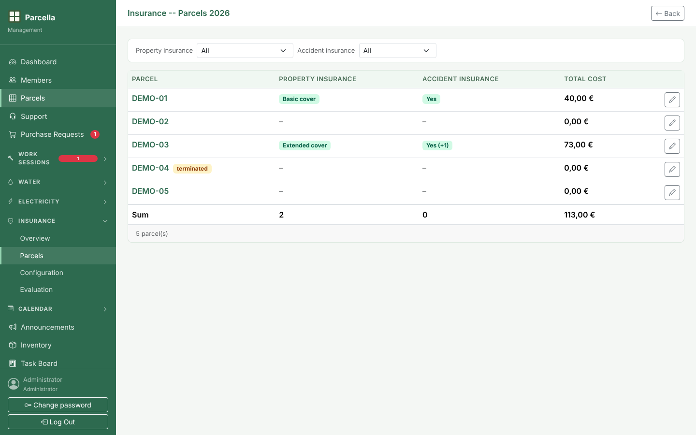

# Insurance

The insurance module keeps track of which parcels have taken out the
club's group insurance in a given year -- a **property insurance**
package and/or **accident insurance** -- and works out what each parcel
owes for it. Everything is kept per year, so last year's figures stay
as they were when you set up the new year.

!!! info "Who can use this"
    Board members and administrators always have full access. Other
    users need a group that grants **Insurance** permissions (see
    [Groups](../administration/groups.md)):

    - **Read** -- see the overview, the parcel list, each parcel's
      insurance page, the configuration and the annual report, and
      download the CSV export.
    - **Write** -- change a parcel's insurance, the accident insurance
      amounts and the packages.
    - **Delete** -- delete a property insurance package.

    The module is switched on with **Insurance management** under
    [Turning modules on and off](../administration/modules.md). It is
    on by default.

You find the module in the navigation under **Insurance**, with the
entries **Overview**, **Parcels**, **Configuration** and **Evaluation**.

## How the cost is calculated

Each parcel's cost for a year is the sum of two parts.

**Property insurance:** if the parcel has property insurance and a
package is chosen, it pays that package's amount. Property insurance
switched on but no package chosen costs nothing.

**Accident insurance:** if the parcel has accident insurance and an
accident insurance configuration exists for that year, it pays:

- the **Base amount per parcel** once, if at least one person in the
  parcel's household is ticked as covered, plus
- the **Additional amount per extra person** for each ticked person
  who does *not* belong to the household.

If nobody in the household is ticked, the base amount is not charged,
even if extra persons are insured. Without a configuration for the
year, accident insurance costs nothing.

**Example:** base amount 3.00, additional amount 3.00. A parcel with
package "Package 2" (60.00), accident insurance for the couple living
at the same address and one co-tenant living elsewhere pays
60.00 + 3.00 + 1 × 3.00 = **66.00**.

### Who counts as the household

Parcella looks at the parcel's current tenants -- people whose tenancy
is current and whose membership hasn't ended or been deleted -- and
compares their addresses (street, postal code and city; capital letters
and extra spaces don't matter).

- The largest group of tenants who share the same address is the
  **household**. If two groups are the same size, the first one found
  wins.
- Everyone else is listed as an **other parcel member** who can be
  insured additionally for the extra amount.
- A tenant without any address on file never forms a household with
  anyone, even with another tenant who also has no address.
- A parcel with only one tenant: that person is the household, address
  or not.

!!! tip "Keep addresses consistent"
    "Main Street 5" and "Main St. 5" are different addresses to
    Parcella. If a couple shows up as household plus "other parcel
    member", check the spelling in both member records.

When a parcel's insurance is opened for a year for the first time,
every household member is ticked as covered. From then on, the ticks
are what counts: a member who moves later doesn't change the bill for
a year that is already set up, and a new household member who joins
later appears unticked until you tick them.

The invoice module uses the same calculation when it adds insurance to
a parcel's annual invoice, with one line per part (property package,
household base amount, extra persons). See
[Invoice runs](finances/invoice-runs.md).

## Overview

The starting page of the module (**Insurance → Overview**). It shows
the figures for one year at a glance.

| Field / button | What it does |
|---|---|
| Year selector (top right) | Switches all figures to another year. It lists every year that has an accident insurance configuration, plus the current year. |
| **Manage parcels** | Opens the [parcel list](#parcels) for the selected year. |
| Warning "No insurance configuration exists for …" | Shown when the year has no accident insurance amounts yet. **Create now →** opens the [configuration](#configuration) for that year. |
| **Property insurance** | Number of parcels with property insurance in this year. |
| **Accident insurance** | Number of parcels with accident insurance where at least one household member is covered. A parcel where only an extra person is insured is not counted. |
| **Property income** | Sum of all parcels' property insurance cost for the year. |
| **Accident income** | Sum of all parcels' accident insurance cost for the year. |
| **Property insurance packages {year}** | The year's packages with their amounts. Only shown if packages exist. |
| **Configuration** | Opens the [configuration](#configuration). |
| **Manage parcels** | Opens the [parcel list](#parcels). |
| **Annual report** | Opens the [annual report](#annual-report). |

## Parcels

**Insurance → Parcels** lists the parcels with their insurance status
and cost for one year. Open it from the overview to keep the year you
selected there; from the navigation it shows the current year.

The list contains every active parcel. Terminated parcels are listed
too, marked **terminated**, because ending a lease doesn't cancel the
insurance contract by itself. A terminated parcel stays in the list
until you open its insurance page, switch both insurance types off and
click **Save** -- that records "checked, nothing left to insure", and
the parcel disappears from this year's list.

**Filters** (above the table; they apply as soon as you pick a value):

| Filter | What it does |
|---|---|
| **Property insurance** | **All**, **None** (parcels without property insurance), or one package of the year (parcels insured with exactly that package). |
| **Accident insurance** | **All**, **Yes** (accident insurance switched on) or **None** (switched off or never set up). |
| **Reset** | Clears both filters. Only shown while a filter is active. |

**Columns:**

| Column | What it shows |
|---|---|
| **Parcel** | Plot number, linked to the parcel's insurance page. Click the column heading to sort by plot number; click again to reverse. |
| **Property insurance** | The package name, **Yes** if property insurance is on but no package is chosen, or "–". |
| **Accident insurance** | **Yes** if accident insurance is on, with the number of extra persons in brackets, e.g. **Yes (+1)**; otherwise "–". |
| **Total cost** | The parcel's total insurance cost for the year. Click the heading to sort by cost. |
| Pencil button | Opens the parcel's insurance page. |

The **Sum** row at the bottom counts the parcels with property
insurance and with accident insurance (again only those with at least
one covered household member) and adds up the total cost of the
listed parcels. Below the table you see how many parcels are listed.

## Parcel insurance page

Opened from the parcel list or the annual report, titled **Insurance
for parcel {plot number}**. This is where you record what a parcel has
taken out for the year shown in the link you came from.

| Field / button | What it does |
|---|---|
| **Previous** / **Next** | Go to the previous or next parcel in the order of the parcel list (by plot number). Keyboard: ++ctrl+left++ and ++ctrl+right++. |
| **Back** | Returns to the parcel list for this year. |
| Warning "No insurance configuration exists for …" | The year has no accident insurance amounts yet, so accident insurance costs nothing. **Create now →** opens the configuration. |
| **Property insurance taken out** | Switch. When on, the **Package** field appears. |
| **Package** | The property insurance package for this year. If the year has no packages, a warning with **Create now →** appears instead. |
| **Accident insurance taken out** | Switch. When on, the people lists appear. |
| **Household (share an address with other residents):** | The detected household (see [Who counts as the household](#who-counts-as-the-household)). Each ticked person is covered; untick someone who declines. The base amount is charged once if at least one person here is ticked. |
| **Other parcel members (different address) …** | Tenants outside the household. Tick a person to insure them for the additional amount each. Only shown if there are such tenants. |
| **Costs {year}** | **Property insurance**, **Accident insurance** and **Total** for this parcel, as currently saved. The figures update after you save. |
| **Save** | Saves the parcel's insurance for this year and reloads the page. Only shown with write permission; without it, all fields are read-only. |

!!! warning "Switching accident insurance off clears the ticks"
    When you save with **Accident insurance taken out** switched off,
    the ticked household members and extra persons are removed. If
    you switch it back on later, tick the people again before saving.

!!! note
    Switching property insurance off also clears the chosen package.

## Configuration

**Insurance → Configuration** holds the year's prices. Pick the year
with the selector at the top right; **Back** returns to the overview.
Without write permission you only see the amounts and packages.

### Accident insurance {year}

| Field / button | What it does |
|---|---|
| **Base amount per parcel** | Charged once per parcel with accident insurance, for its household. Pre-filled with 3,00 when the year has no configuration yet. |
| **Additional amount per extra person** | Charged for each insured parcel member outside the household. Pre-filled with 3,00 when the year has no configuration yet. |
| **Save** | Saves both amounts for the selected year. Saving creates the year's configuration if it doesn't exist; from then on the year appears in the year selectors. |

Amounts accept a comma or a point as decimal separator (`3,50` or
`3.50`). An amount Parcella can't read as a number is saved as 0 --
check the figure after saving.

### New property insurance package

| Field / button | What it does |
|---|---|
| **Name** | The package's name, e.g. "Package 1". Required. |
| **Amount** | What a parcel with this package pays per year. Required. |
| **Sort order** | Packages are listed by this number, lowest first, then by amount. Default 0. |
| **+** | Adds the package to the selected year. |

### Packages {year}

The year's packages. With write permission you can change **Name** and
**Amount** directly in the row and confirm with the tick button. The
bin button deletes the package after a confirmation (needs delete
permission).

!!! warning "Deleting a package that is in use"
    Parcels that had the deleted package keep "property insurance
    taken out", but without a package -- they then cost nothing for
    property insurance and show **Yes** instead of a package name.
    Choose a new package on each of those parcels.

!!! tip "Setting up a new year"
    Packages and amounts belong to one year and are not copied
    automatically. At the start of a new year, open the configuration
    for that year, enter the accident insurance amounts and create the
    packages again, then go through the parcel list. Each parcel starts
    the new year with no insurance recorded.

## Annual report

**Insurance → Evaluation** (or **Annual report** on the overview),
titled **Insurance report {year}**, lists every parcel that has
property or accident insurance in a year, with its costs. Use it to
check the totals against the insurer's bill.

**Filters** (apply as soon as you pick a value):

| Filter | What it does |
|---|---|
| Year | The year to report on. |
| **All types** / **Property insurance** / **Accident insurance** | All insured parcels, or only those with that insurance type. |
| **All packages** / a package | Only parcels insured with that property package. |
| **All** / **With additional persons** / **Without additional persons** | Parcels with at least one insured extra person, or accident-insured parcels without any. |

| Field / column | What it shows |
|---|---|
| **Insured parcels** | Number of parcels listed under the current filters. |
| **Total income** | Sum of the **Total** column. |
| **Parcel** | Plot number, linked to the parcel's insurance page. |
| **Property insurance** | The package name, or "–". |
| **Property cost** | The parcel's property insurance cost. |
| **Accident insurance** | **Yes** or "–". |
| **Additional persons** | Number of insured extra persons outside the household. |
| **Accident cost** | The parcel's accident insurance cost. |
| **Total** | The parcel's total insurance cost. |
| **CSV Export** | Downloads the list as it is currently filtered, as a semicolon-separated file with decimal commas (opens directly in a German-language spreadsheet). |
| **Back** | Returns to the overview. |

!!! note "CSV column headings"
    The CSV file always has German column headings: Parcel,
    Sachversicherung (property insurance), Sach-Paket (package),
    Sach-Kosten (property cost), Unfallversicherung (accident
    insurance), Zusatzpersonen (additional persons), Unfall-Kosten
    (accident cost), Gesamt (total). Yes/no values are written as
    "Ja"/"Nein".
<!-- TODO(verify): CSV headers are hardcoded German in the router regardless of UI language -- confirm this is intended or should be translated. -->

!!! note "Two ways of counting"
    **Insured parcels** here counts every listed parcel. The overview's
    **Accident insurance** tile only counts parcels with at least one
    covered household member, so the two numbers can differ.

## Related

- [Parcels](parcels.md) -- tenancies and termination, which decide who
  appears on a parcel's insurance page
- [Members](members.md) -- the addresses used to detect the household
- [Invoice runs](finances/invoice-runs.md) -- billing the insurance
  with the annual invoice
- [Groups](../administration/groups.md) -- giving a treasurer access to
  this module
