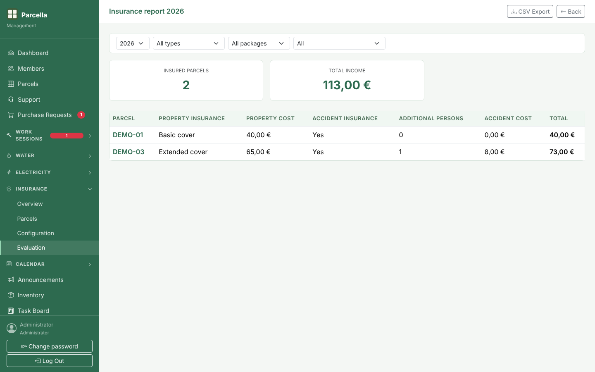

# Ubezpieczenia {#insurance}

!!! note "Tłumaczenie maszynowe"
    Ta strona została przetłumaczona maszynowo z języka angielskiego i nie została jeszcze sprawdzona. Jeśli coś jest niejasne, obowiązuje wersja angielska (język zmienisz u góry).

Moduł ubezpieczeń śledzi, które działki w danym roku skorzystały z
ubezpieczenia grupowego stowarzyszenia -- pakietu **ubezpieczenia
mienia** i/lub **ubezpieczenia NNW** (od następstw nieszczęśliwych
wypadków) -- i oblicza, ile każda działka jest za to winna. Wszystko
jest prowadzone dla każdego roku osobno, więc zeszłoroczne liczby
zostają takie, jakie były, gdy konfigurujesz nowy rok.

!!! info "Kto może z tego korzystać"
    Członkowie zarządu i administratorzy zawsze mają pełny dostęp. Inni
    użytkownicy potrzebują grupy, która nadaje uprawnienia do
    **Ubezpieczenia** (zob. [Grupy](../administration/groups.md)):

    - **Odczyt** -- oglądanie przeglądu, listy działek, strony
      ubezpieczenia każdej działki, konfiguracji i rozliczenia rocznego
      oraz pobieranie eksportu CSV.
    - **Zapis** -- zmiana ubezpieczenia działki, kwot ubezpieczenia NNW
      i pakietów.
    - **Usuwanie** -- usunięcie pakietu ubezpieczenia mienia.

    Moduł włącza się przełącznikiem **Zarządzanie ubezpieczeniami** w
    [Włączaniu i wyłączaniu modułów](../administration/modules.md).
    Domyślnie jest włączony.

Moduł znajdziesz w nawigacji pod **Ubezpieczenia**, z pozycjami
**Przegląd**, **Działki**, **Konfiguracja** i **Rozliczenie**.

## Jak obliczany jest koszt {#how-the-cost-is-calculated}

Koszt każdej działki za rok to suma dwóch części.

**Ubezpieczenie mienia:** jeśli działka ma ubezpieczenie mienia i
wybrano pakiet, płaci kwotę tego pakietu. Włączone ubezpieczenie mienia
bez wybranego pakietu nic nie kosztuje.

**Ubezpieczenie NNW:** jeśli działka ma ubezpieczenie NNW i dla tego
roku istnieje konfiguracja ubezpieczenia NNW, płaci:

- **Kwota podstawowa na działkę** raz, jeśli co najmniej jedna osoba z
  gospodarstwa domowego działki jest zaznaczona jako objęta, plus
- **Kwota dodatkowa za kolejną osobę** za każdą zaznaczoną osobę, która
  *nie* należy do gospodarstwa domowego.

Jeśli nikt z gospodarstwa domowego nie jest zaznaczony, kwota
podstawowa nie jest naliczana, nawet jeśli ubezpieczone są osoby
dodatkowe. Bez konfiguracji na dany rok ubezpieczenie NNW nic nie
kosztuje.

**Przykład:** kwota podstawowa 3,00, kwota dodatkowa 3,00. Działka z
pakietem „Pakiet 2” (60,00), ubezpieczeniem NNW dla pary mieszkającej
pod tym samym adresem i jednym współdzierżawcą mieszkającym gdzie
indziej płaci 60,00 + 3,00 + 1 × 3,00 = **66,00**.

### Kto liczy się jako gospodarstwo domowe {#who-counts-as-the-household}

Parcella patrzy na obecnych dzierżawców działki -- osoby, których
dzierżawa jest obecna, a członkostwo nie zakończyło się ani nie zostało
usunięte -- i porównuje ich adresy (ulica, kod pocztowy i miejscowość;
wielkie litery i dodatkowe spacje nie mają znaczenia).

- Największa grupa dzierżawców pod tym samym adresem to **gospodarstwo
  domowe**. Jeśli dwie grupy są tej samej wielkości, wygrywa pierwsza
  znaleziona.
- Wszyscy pozostali są wymienieni jako **pozostali członkowie działki**,
  których można dodatkowo ubezpieczyć za kwotę dodatkową.
- Dzierżawca bez zapisanego adresu nigdy nie tworzy gospodarstwa
  domowego z nikim, nawet z innym dzierżawcą, który też nie ma adresu.
- Działka z tylko jednym dzierżawcą: ta osoba jest gospodarstwem
  domowym, z adresem czy bez.

!!! tip "Utrzymuj spójne adresy"
    „Główna 5” i „ul. Główna 5” to dla Parcelli różne adresy. Jeśli para
    pojawia się jako gospodarstwo domowe plus „pozostały członek
    działki”, sprawdź pisownię w obu rekordach członków.

Gdy ubezpieczenie działki zostaje po raz pierwszy otwarte dla danego
roku, każdy członek gospodarstwa domowego jest zaznaczony jako objęty.
Od tej chwili liczą się zaznaczenia: członek, który później się
przeprowadzi, nie zmienia rachunku za rok już skonfigurowany, a nowy
członek gospodarstwa domowego, który dołączy później, pojawia się
niezaznaczony, dopóki go nie zaznaczysz.

Moduł faktur używa tego samego obliczenia, gdy dodaje ubezpieczenie do
rocznej faktury działki, z jedną pozycją na część (pakiet mienia, kwota
podstawowa gospodarstwa domowego, osoby dodatkowe). Zob.
[Serie faktur](finances/invoice-runs.md).

## Przegląd {#overview}

Strona startowa modułu (**Ubezpieczenia → Przegląd**). Pokazuje liczby
za jeden rok w jednym miejscu.

| Pole / przycisk | Do czego służy |
|---|---|
| Wybór roku (u góry po prawej) | Przełącza wszystkie liczby na inny rok. Pokazuje każdy rok, który ma konfigurację ubezpieczenia NNW, plus bieżący rok. |
| **Zarządzaj działkami** | Otwiera [listę działek](#parcels) dla wybranego roku. |
| Ostrzeżenie „Brak konfiguracji ubezpieczeń dla …” | Pokazywane, gdy rok nie ma jeszcze kwot ubezpieczenia NNW. **Utwórz teraz →** otwiera [konfigurację](#configuration) dla tego roku. |
| **Ubezpieczenie mienia** | Liczba działek z ubezpieczeniem mienia w tym roku. |
| **Ubezpieczenie NNW** | Liczba działek z ubezpieczeniem NNW, w których objęty jest co najmniej jeden członek gospodarstwa domowego. Działka, w której ubezpieczona jest tylko osoba dodatkowa, nie jest liczona. |
| **Przychody – mienie** | Suma kosztów ubezpieczenia mienia wszystkich działek w roku. |
| **Przychody – NNW** | Suma kosztów ubezpieczenia NNW wszystkich działek w roku. |
| **Pakiety ubezpieczenia mienia {year}** | Pakiety roku z kwotami. Widoczne tylko, jeśli istnieją pakiety. |
| **Konfiguracja** | Otwiera [konfigurację](#configuration). |
| **Zarządzaj działkami** | Otwiera [listę działek](#parcels). |
| **Rozliczenie roczne** | Otwiera [rozliczenie roczne](#annual-report). |

## Działki {#parcels}

**Ubezpieczenia → Działki** pokazuje działki ze statusem ubezpieczenia
i kosztem za jeden rok. Otwórz ją z przeglądu, aby zachować wybrany tam
rok; z nawigacji pokazuje bieżący rok.

Lista zawiera każdą aktywną działkę. Wypowiedziane działki też są na
liście, oznaczone **wypowiedziana**, bo zakończenie dzierżawy samo nie
wypowiada umowy ubezpieczenia. Wypowiedziana działka pozostaje na
liście, dopóki nie otworzysz jej strony ubezpieczenia, nie wyłączysz
obu rodzajów ubezpieczenia i nie klikniesz **Zapisz** -- zapisuje to
„sprawdzone, nic do ubezpieczenia”, a działka znika z listy tego roku.

**Filtry** (nad tabelą; działają od razu po wyborze wartości):

| Filtr | Do czego służy |
|---|---|
| **Ubezpieczenie mienia** | **Wszystkie**, **Brak** (działki bez ubezpieczenia mienia) albo jeden pakiet roku (działki ubezpieczone dokładnie tym pakietem). |
| **Ubezpieczenie NNW** | **Wszystkie**, **Tak** (ubezpieczenie NNW włączone) lub **Brak** (wyłączone albo nigdy nieskonfigurowane). |
| **Wyczyść** | Czyści oba filtry. Widoczny tylko, gdy filtr jest aktywny. |

**Kolumny:**

| Kolumna | Co pokazuje |
|---|---|
| **Działka** | Numer działki, z linkiem do strony ubezpieczenia działki. Kliknij nagłówek kolumny, aby sortować według numeru działki; kliknij ponownie, aby odwrócić. |
| **Ubezpieczenie mienia** | Nazwa pakietu, **Tak**, jeśli ubezpieczenie mienia jest włączone, ale nie wybrano pakietu, albo „–”. |
| **Ubezpieczenie NNW** | **Tak**, jeśli ubezpieczenie NNW jest włączone, z liczbą osób dodatkowych w nawiasie, np. **Tak (+1)**; w przeciwnym razie „–”. |
| **Koszt całkowity** | Całkowity koszt ubezpieczenia działki za rok. Kliknij nagłówek, aby sortować według kosztu. |
| Przycisk ołówka | Otwiera stronę ubezpieczenia działki. |

Wiersz **Suma** na dole liczy działki z ubezpieczeniem mienia i z
ubezpieczeniem NNW (znowu tylko te z co najmniej jednym objętym
członkiem gospodarstwa domowego) i sumuje całkowity koszt wymienionych
działek. Pod tabelą widzisz, ile działek jest na liście.

## Strona ubezpieczenia działki {#parcel-insurance-page}

Otwierana z listy działek lub z rozliczenia rocznego, z tytułem
**Ubezpieczenie działki {numer działki}**. Tutaj zapisujesz, co działka
wykupiła na rok pokazany w linku, z którego przyszedłeś.

| Pole / przycisk | Do czego służy |
|---|---|
| **Poprzedni** / **Następny** | Przechodzi do poprzedniej lub następnej działki w kolejności listy działek (według numeru działki). Klawiatura: ++ctrl+left++ i ++ctrl+right++. |
| **Wstecz** | Wraca do listy działek dla tego roku. |
| Ostrzeżenie „Brak konfiguracji ubezpieczeń dla …” | Rok nie ma jeszcze kwot ubezpieczenia NNW, więc ubezpieczenie NNW nic nie kosztuje. **Utwórz teraz →** otwiera konfigurację. |
| **Zawarto ubezpieczenie mienia** | Przełącznik. Gdy jest włączony, pojawia się pole **Pakiet**. |
| **Pakiet** | Pakiet ubezpieczenia mienia na ten rok. Jeśli rok nie ma pakietów, zamiast tego pojawia się ostrzeżenie z **Utwórz teraz →**. |
| **Zawarto ubezpieczenie NNW** | Przełącznik. Gdy jest włączony, pojawiają się listy osób. |
| **Gospodarstwo domowe (dzielą adres z innymi mieszkańcami):** | Wykryte gospodarstwo domowe (zob. [Kto liczy się jako gospodarstwo domowe](#who-counts-as-the-household)). Każda zaznaczona osoba jest objęta; odznacz kogoś, kto rezygnuje. Kwota podstawowa jest naliczana raz, jeśli co najmniej jedna osoba tutaj jest zaznaczona. |
| **Pozostali członkowie działki (inny adres) …** | Dzierżawcy spoza gospodarstwa domowego. Zaznacz osobę, aby ubezpieczyć ją za kwotę dodatkową. Widoczne tylko, jeśli są tacy dzierżawcy. |
| **Koszty {year}** | **Ubezpieczenie mienia**, **Ubezpieczenie NNW** i **Razem** dla tej działki, według obecnego zapisu. Liczby aktualizują się po zapisaniu. |
| **Zapisz** | Zapisuje ubezpieczenie działki na ten rok i przeładowuje stronę. Widoczny tylko z prawem zapisu; bez niego wszystkie pola są tylko do odczytu. |

!!! warning "Wyłączenie ubezpieczenia NNW czyści zaznaczenia"
    Gdy zapiszesz z wyłączonym **Zawarto ubezpieczenie NNW**, zaznaczeni
    członkowie gospodarstwa domowego i osoby dodatkowe zostają usunięci.
    Jeśli później włączysz je z powrotem, zaznacz osoby ponownie przed
    zapisaniem.

!!! note
    Wyłączenie ubezpieczenia mienia czyści też wybrany pakiet.

## Konfiguracja {#configuration}

**Ubezpieczenia → Konfiguracja** zawiera ceny na dany rok. Wybierz rok
selektorem u góry po prawej; **Wstecz** wraca do przeglądu. Bez prawa
zapisu widzisz tylko kwoty i pakiety.

### Ubezpieczenie NNW {year} {#accident-insurance}

| Pole / przycisk | Do czego służy |
|---|---|
| **Kwota podstawowa na działkę** | Naliczana raz na działkę z ubezpieczeniem NNW, za jej gospodarstwo domowe. Wstępnie wypełniona wartością 3,00, gdy rok nie ma jeszcze konfiguracji. |
| **Kwota dodatkowa za kolejną osobę** | Naliczana za każdego ubezpieczonego członka działki spoza gospodarstwa domowego. Wstępnie wypełniona wartością 3,00, gdy rok nie ma jeszcze konfiguracji. |
| **Zapisz** | Zapisuje obie kwoty dla wybranego roku. Zapisanie tworzy konfigurację roku, jeśli nie istnieje; od tej chwili rok pojawia się w wyborach roku. |

Kwoty akceptują przecinek lub kropkę jako separator dziesiętny (`3,50`
lub `3.50`). Kwota, której Parcella nie potrafi odczytać jako liczby,
jest zapisywana jako 0 -- sprawdź liczbę po zapisaniu.

### Nowy pakiet ubezpieczenia mienia {#new-property-insurance-package}

| Pole / przycisk | Do czego służy |
|---|---|
| **Nazwa** | Nazwa pakietu, np. „Pakiet 1”. Wymagana. |
| **Kwota** | Ile działka z tym pakietem płaci rocznie. Wymagana. |
| **Kolejność** | Pakiety są wymieniane według tej liczby, od najniższej, potem według kwoty. Domyślnie 0. |
| **+** | Dodaje pakiet do wybranego roku. |

### Pakiety {year} {#packages}

Pakiety roku. Z prawem zapisu możesz zmieniać **Nazwa** i **Kwota**
bezpośrednio w wierszu i potwierdzić przyciskiem haczyka. Przycisk
kosza usuwa pakiet po potwierdzeniu (wymaga prawa usuwania).

!!! warning "Usuwanie używanego pakietu"
    Działki, które miały usunięty pakiet, zachowują „zawarto
    ubezpieczenie mienia”, ale bez pakietu -- nic wtedy nie kosztują za
    ubezpieczenie mienia i pokazują **Tak** zamiast nazwy pakietu.
    Wybierz nowy pakiet na każdej z tych działek.

!!! tip "Konfiguracja nowego roku"
    Pakiety i kwoty należą do jednego roku i nie są kopiowane
    automatycznie. Na początku nowego roku otwórz konfigurację dla tego
    roku, wpisz kwoty ubezpieczenia NNW i utwórz pakiety na nowo, a
    potem przejdź przez listę działek. Każda działka zaczyna nowy rok bez
    zapisanego ubezpieczenia.

## Rozliczenie roczne {#annual-report}

**Ubezpieczenia → Rozliczenie** (albo **Rozliczenie roczne** w
przeglądzie), z tytułem **Rozliczenie ubezpieczeń {year}**, pokazuje
każdą działkę, która w danym roku ma ubezpieczenie mienia lub NNW, z jej
kosztami. Użyj go, aby porównać sumy z rachunkiem ubezpieczyciela.

**Filtry** (działają od razu po wyborze wartości):

| Filtr | Do czego służy |
|---|---|
| Rok | Rok, którego dotyczy rozliczenie. |
| **Wszystkie typy** / **Ubezpieczenie mienia** / **Ubezpieczenie NNW** | Wszystkie ubezpieczone działki albo tylko te z danym rodzajem ubezpieczenia. |
| **Wszystkie pakiety** / pakiet | Tylko działki ubezpieczone tym pakietem mienia. |
| **Wszystkie** / **Z osobami dodatkowymi** / **Bez osób dodatkowych** | Działki z co najmniej jedną ubezpieczoną osobą dodatkową albo działki z ubezpieczeniem NNW bez żadnej. |

| Pole / kolumna | Co pokazuje |
|---|---|
| **Ubezpieczone działki** | Liczba działek na liście przy bieżących filtrach. |
| **Przychody całkowite** | Suma kolumny **Razem**. |
| **Działka** | Numer działki, z linkiem do strony ubezpieczenia działki. |
| **Ubezpieczenie mienia** | Nazwa pakietu albo „–”. |
| **Koszt – mienie** | Koszt ubezpieczenia mienia działki. |
| **Ubezpieczenie NNW** | **Tak** albo „–”. |
| **Osoby dodatkowe** | Liczba ubezpieczonych osób dodatkowych spoza gospodarstwa domowego. |
| **Koszt – NNW** | Koszt ubezpieczenia NNW działki. |
| **Razem** | Całkowity koszt ubezpieczenia działki. |
| **Eksport CSV** | Pobiera listę w obecnym przefiltrowaniu jako plik rozdzielany średnikami z przecinkami dziesiętnymi (otwiera się bezpośrednio w niemieckojęzycznym arkuszu kalkulacyjnym). |
| **Wstecz** | Wraca do przeglądu. |

!!! note "Nagłówki kolumn CSV"
    Plik CSV używa tych samych nagłówków kolumn co ta strona, w języku
    stowarzyszenia: działka, ubezpieczenie mienia, pakiet, koszt mienia
    (EUR), ubezpieczenie NNW, osoby dodatkowe, koszt NNW (EUR), razem
    (EUR). Wartości tak/nie też są zapisywane w tym języku.

!!! note "Dwa sposoby liczenia"
    **Ubezpieczone działki** liczy tu każdą wymienioną działkę. Kafelek
    **Ubezpieczenie NNW** w przeglądzie liczy tylko działki z co najmniej
    jednym objętym członkiem gospodarstwa domowego, więc obie liczby mogą
    się różnić.

## Powiązane {#related}

- [Działki](parcels.md) -- dzierżawy i wypowiedzenia, które decydują,
  kto pojawia się na stronie ubezpieczenia działki
- [Członkowie](members.md) -- adresy używane do wykrywania gospodarstwa
  domowego
- [Serie faktur](finances/invoice-runs.md) -- fakturowanie ubezpieczenia
  z roczną fakturą
- [Grupy](../administration/groups.md) -- nadanie skarbnikowi dostępu do
  tego modułu
