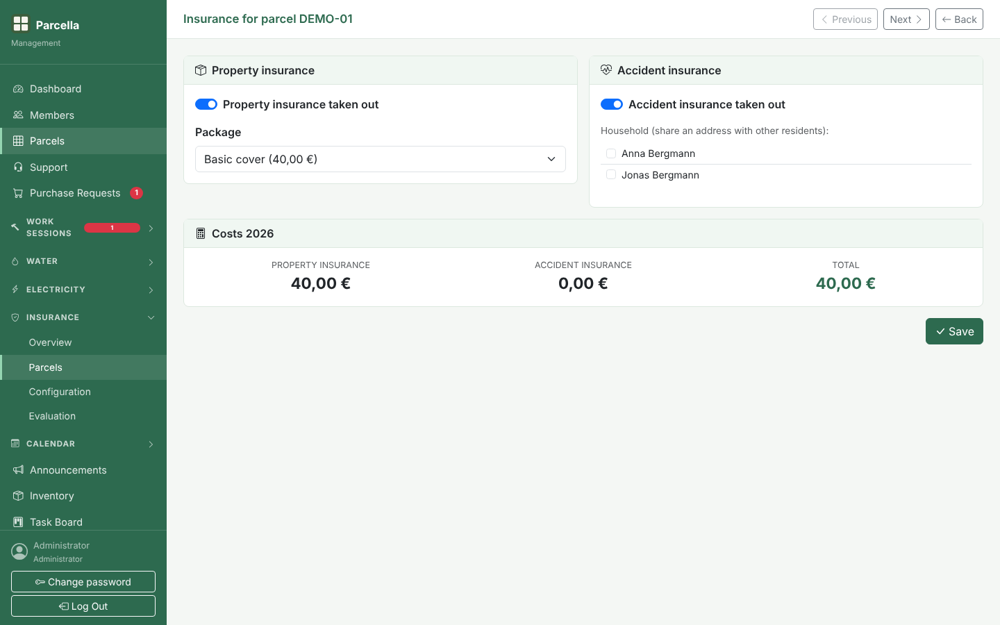

# Poistenie {#insurance}

!!! note "Strojový preklad"
    Táto stránka bola strojovo preložená z angličtiny a zatiaľ nebola skontrolovaná. Ak je niečo nejasné, platí anglická verzia (jazyk prepnete hore).

Modul poistenia sleduje, ktoré parcely si v danom roku uzatvorili
skupinové poistenie spolku -- balík **poistenia majetku** a/alebo
**úrazové poistenie** -- a vypočíta, koľko za to každá parcela dlží.
Všetko sa vedie po rokoch, takže čísla minulého roka zostanú také, aké
boli, keď nastavíte nový rok.

!!! info "Kto to môže používať"
    Členovia výboru a administrátori majú vždy plný prístup. Ostatní
    používatelia potrebujú skupinu, ktorá udeľuje oprávnenia pre
    **Poistenie** (pozri [Skupiny](../administration/groups.md)):

    - **Čítanie** -- vidieť prehľad, zoznam parciel, stránku poistenia
      každej parcely, konfiguráciu a výročnú správu a sťahovať export
      CSV.
    - **Zápis** -- meniť poistenie parcely, sumy úrazového poistenia a
      balíky.
    - **Mazanie** -- mazať balík poistenia majetku.

    Modul sa zapína prepínačom **Správa poistení** v časti
    [Zapínanie a vypínanie modulov](../administration/modules.md).
    Predvolene je zapnutý.

Modul nájdete v navigácii pod **Poistenie** s položkami **Prehľad**,
**Parcely**, **Konfigurácia** a **Hodnotenie**.

## Ako sa počítajú náklady {#how-the-cost-is-calculated}

Náklady každej parcely za rok sú súčtom dvoch častí.

**Poistenie majetku:** ak má parcela poistenie majetku a je vybraný
balík, platí sumu tohto balíka. Zapnuté poistenie majetku bez
vybraného balíka nestojí nič.

**Úrazové poistenie:** ak má parcela úrazové poistenie a pre daný rok
existuje konfigurácia úrazového poistenia, platí:

- **Základná suma na parcelu** raz, ak je aspoň jedna osoba z
  domácnosti parcely zaškrtnutá ako poistená, plus
- **Dodatočná suma na každú ďalšiu osobu** za každú zaškrtnutú osobu,
  ktorá *nepatrí* do domácnosti.

Ak nie je zaškrtnutý nikto z domácnosti, základná suma sa neúčtuje,
ani keď sú poistené ďalšie osoby. Bez konfigurácie pre daný rok
úrazové poistenie nestojí nič.

**Príklad:** základná suma 3,00, dodatočná suma 3,00. Parcela s balíkom
„Balík 2“ (60,00), úrazovým poistením pre pár bývajúci na rovnakej
adrese a jedného spolunájomcu bývajúceho inde platí
60,00 + 3,00 + 1 × 3,00 = **66,00**.

### Kto sa počíta do domácnosti {#who-counts-as-the-household}

Parcella sa pozrie na súčasných nájomcov parcely -- ľudí, ktorých nájom
je aktuálny a ktorých členstvo neskončilo ani nebolo zmazané -- a
porovná ich adresy (ulica, PSČ a mesto; veľké písmená a medzery navyše
nezáležia).

- Najväčšia skupina nájomcov so spoločnou adresou je **domácnosť**. Ak
  sú dve skupiny rovnako veľké, vyhráva prvá nájdená.
- Všetci ostatní sú uvedení ako **ostatní členovia parcely**, ktorí sa
  môžu dodatočne poistiť za dodatočnú sumu.
- Nájomca bez uloženej adresy nikdy netvorí domácnosť s nikým, ani s
  iným nájomcom, ktorý tiež nemá adresu.
- Parcela s jediným nájomcom: táto osoba je domácnosť, s adresou aj
  bez nej.

!!! tip "Udržujte adresy jednotné"
    „Hlavná 5“ a „Hlavná ul. 5“ sú pre Parcellu rôzne adresy. Ak sa pár
    zobrazí ako domácnosť plus „ostatný člen parcely“, skontrolujte
    pravopis v oboch záznamoch členov.

Keď sa poistenie parcely pre daný rok otvorí prvýkrát, každý člen
domácnosti je zaškrtnutý ako poistený. Odvtedy platia zaškrtnutia:
člen, ktorý sa neskôr presťahuje, nemení vyúčtovanie za rok, ktorý je
už nastavený, a nový člen domácnosti, ktorý pribudne neskôr, sa zobrazí
nezaškrtnutý, kým ho nezaškrtnete.

Modul faktúr používa ten istý výpočet, keď pridáva poistenie na ročnú
faktúru parcely, s jedným riadkom na každú časť (balík poistenia
majetku, základná suma domácnosti, ďalšie osoby). Pozri
[Vyúčtovania](finances/invoice-runs.md).

## Prehľad {#overview}

Úvodná stránka modulu (**Poistenie → Prehľad**). Na prvý pohľad ukazuje
čísla za jeden rok.

| Pole / tlačidlo | Čo robí |
|---|---|
| Výber roka (vpravo hore) | Prepne všetky čísla na iný rok. Uvádza každý rok, ktorý má konfiguráciu úrazového poistenia, plus aktuálny rok. |
| **Spravovať parcely** | Otvorí [zoznam parciel](#parcels) pre vybraný rok. |
| Varovanie „Pre … neexistuje žiadna konfigurácia poistenia.“ | Zobrazí sa, keď daný rok ešte nemá sumy úrazového poistenia. **Vytvoriť teraz →** otvorí [konfiguráciu](#configuration) pre tento rok. |
| **Poistenie majetku** | Počet parciel s poistením majetku v tomto roku. |
| **Úrazové poistenie** | Počet parciel s úrazovým poistením, kde je poistený aspoň jeden člen domácnosti. Parcela, kde je poistená len ďalšia osoba, sa nepočíta. |
| **Príjem z poistenia majetku** | Súčet nákladov všetkých parciel na poistenie majetku za rok. |
| **Príjem z úrazového poistenia** | Súčet nákladov všetkých parciel na úrazové poistenie za rok. |
| **Balíky poistenia majetku {year}** | Balíky roka s ich sumami. Zobrazí sa len, ak balíky existujú. |
| **Konfigurácia** | Otvorí [konfiguráciu](#configuration). |
| **Spravovať parcely** | Otvorí [zoznam parciel](#parcels). |
| **Výročná správa** | Otvorí [výročnú správu](#annual-report). |

## Parcely {#parcels}

**Poistenie → Parcely** uvádza parcely s ich stavom poistenia a
nákladmi za jeden rok. Otvorte ho z prehľadu, aby ste zachovali rok,
ktorý ste tam vybrali; z navigácie ukazuje aktuálny rok.

Zoznam obsahuje každú aktívnu parcelu. Uvedené sú aj ukončené parcely,
označené **ukončená**, pretože ukončenie nájmu samo osebe nezruší
poistnú zmluvu. Ukončená parcela zostáva v zozname, kým neotvoríte jej
stránku poistenia, nevypnete oba druhy poistenia a nekliknete na
**Uložiť** -- tým sa zaznamená „skontrolované, nič na poistenie“ a
parcela zo zoznamu tohto roka zmizne.

**Filtre** (nad tabuľkou; použijú sa hneď po výbere hodnoty):

| Filter | Čo robí |
|---|---|
| **Poistenie majetku** | **Všetky**, **Žiadne** (parcely bez poistenia majetku) alebo jeden balík roka (parcely poistené presne týmto balíkom). |
| **Úrazové poistenie** | **Všetky**, **Áno** (úrazové poistenie zapnuté) alebo **Žiadne** (vypnuté alebo nikdy nenastavené). |
| **Zrušiť filter** | Zruší oba filtre. Zobrazí sa len, kým je filter aktívny. |

**Stĺpce:**

| Stĺpec | Čo ukazuje |
|---|---|
| **Parcela** | Číslo parcely s odkazom na stránku poistenia parcely. Kliknutím na nadpis stĺpca zoradíte podľa čísla parcely; ďalším kliknutím obrátite poradie. |
| **Poistenie majetku** | Názov balíka, **Áno**, ak je poistenie majetku zapnuté, ale nie je vybraný balík, alebo „–“. |
| **Úrazové poistenie** | **Áno**, ak je úrazové poistenie zapnuté, s počtom ďalších osôb v zátvorke, napr. **Áno (+1)**; inak „–“. |
| **Celkové náklady** | Celkové náklady parcely na poistenie za rok. Kliknutím na nadpis zoradíte podľa nákladov. |
| Tlačidlo ceruzky | Otvorí stránku poistenia parcely. |

Riadok **Súčet** na konci počíta parcely s poistením majetku a s
úrazovým poistením (opäť len tie s aspoň jedným poisteným členom
domácnosti) a sčíta celkové náklady uvedených parciel. Pod tabuľkou
vidíte, koľko parciel je uvedených.

## Stránka poistenia parcely {#parcel-insurance-page}

Otvorí sa zo zoznamu parciel alebo z výročnej správy, s nadpisom
**Poistenie pre parcelu {číslo parcely}**. Tu zaznamenáte, čo si
parcela uzatvorila na rok uvedený v odkaze, z ktorého ste prišli.

| Pole / tlačidlo | Čo robí |
|---|---|
| **Predchádzajúci** / **Ďalší** | Prejde na predchádzajúcu alebo ďalšiu parcelu v poradí zoznamu parciel (podľa čísla parcely). Klávesnica: ++ctrl+left++ a ++ctrl+right++. |
| **Späť** | Vráti sa do zoznamu parciel pre tento rok. |
| Varovanie „Pre … neexistuje žiadna konfigurácia poistenia.“ | Rok ešte nemá sumy úrazového poistenia, takže úrazové poistenie nestojí nič. **Vytvoriť teraz →** otvorí konfiguráciu. |
| **Poistenie majetku uzatvorené** | Prepínač. Keď je zapnutý, objaví sa pole **Balík**. |
| **Balík** | Balík poistenia majetku pre tento rok. Ak rok nemá žiadne balíky, objaví sa namiesto neho varovanie s **Vytvoriť teraz →**. |
| **Úrazové poistenie uzatvorené** | Prepínač. Keď je zapnutý, objavia sa zoznamy osôb. |
| **Domácnosť (zdieľajú adresu s ostatnými obyvateľmi):** | Zistená domácnosť (pozri [Kto sa počíta do domácnosti](#who-counts-as-the-household)). Každá zaškrtnutá osoba je poistená; odškrtnite niekoho, kto odmieta. Základná suma sa účtuje raz, ak je tu zaškrtnutá aspoň jedna osoba. |
| **Ostatní členovia parcely (iná adresa) …** | Nájomcovia mimo domácnosti. Zaškrtnite osobu, ak ju chcete poistiť, každú za dodatočnú sumu. Zobrazí sa len, ak takí nájomcovia sú. |
| **Náklady {year}** | **Poistenie majetku**, **Úrazové poistenie** a **Celkom** pre túto parcelu, ako sú aktuálne uložené. Čísla sa aktualizujú po uložení. |
| **Uložiť** | Uloží poistenie parcely pre tento rok a znova načíta stránku. Zobrazí sa len s oprávnením na zápis; bez neho sú všetky polia len na čítanie. |

!!! warning "Vypnutie úrazového poistenia vymaže zaškrtnutia"
    Keď uložíte s vypnutým **Úrazové poistenie uzatvorené**,
    zaškrtnutí členovia domácnosti a ďalšie osoby sa odstránia. Ak ho
    neskôr znova zapnete, pred uložením osoby znova zaškrtnite.

!!! note
    Vypnutie poistenia majetku vymaže aj vybraný balík.

## Konfigurácia {#configuration}

**Poistenie → Konfigurácia** obsahuje ceny roka. Rok vyberiete výberom
vpravo hore; **Späť** vás vráti na prehľad. Bez oprávnenia na zápis
vidíte len sumy a balíky.

### Úrazové poistenie (rok) {#accident-insurance}

| Pole / tlačidlo | Čo robí |
|---|---|
| **Základná suma na parcelu** | Účtuje sa raz za parcelu s úrazovým poistením, za jej domácnosť. Predvyplnené 3,00, keď rok ešte nemá konfiguráciu. |
| **Dodatočná suma na každú ďalšiu osobu** | Účtuje sa za každého poisteného člena parcely mimo domácnosti. Predvyplnené 3,00, keď rok ešte nemá konfiguráciu. |
| **Uložiť** | Uloží obe sumy pre vybraný rok. Uloženie vytvorí konfiguráciu roka, ak neexistuje; odvtedy sa rok objavuje vo výberoch rokov. |

Sumy prijímajú čiarku alebo bodku ako desatinný oddeľovač (`3,50` alebo
`3.50`). Suma, ktorú Parcella nedokáže prečítať ako číslo, sa uloží ako
0 -- po uložení číslo skontrolujte.

### Nový balík poistenia majetku {#new-property-insurance-package}

| Pole / tlačidlo | Čo robí |
|---|---|
| **Názov** | Názov balíka, napr. „Balík 1“. Povinné. |
| **Suma** | Koľko platí parcela s týmto balíkom za rok. Povinné. |
| **Poradie zoradenia** | Balíky sa uvádzajú podľa tohto čísla, najnižšie prvé, potom podľa sumy. Predvolene 0. |
| **+** | Pridá balík do vybraného roka. |

### Balíky (rok) {#packages}

Balíky roka. S oprávnením na zápis môžete **Názov** a **Suma** meniť
priamo v riadku a potvrdiť tlačidlom s fajkou. Tlačidlo koša po
potvrdení balík zmaže (potrebuje oprávnenie na mazanie).

!!! warning "Mazanie balíka, ktorý sa používa"
    Parcely, ktoré mali zmazaný balík, si ponechajú „poistenie majetku
    uzatvorené“, ale bez balíka -- za poistenie majetku potom nič
    nestoja a namiesto názvu balíka ukazujú **Áno**. Pri každej z týchto
    parciel vyberte nový balík.

!!! tip "Nastavenie nového roka"
    Balíky a sumy patria k jednému roku a automaticky sa nekopírujú. Na
    začiatku nového roka otvorte konfiguráciu pre tento rok, zadajte
    sumy úrazového poistenia a znova vytvorte balíky, potom prejdite
    zoznam parciel. Každá parcela začína nový rok bez zaznamenaného
    poistenia.

## Výročná správa {#annual-report}

**Poistenie → Hodnotenie** (alebo **Výročná správa** v prehľade), s
nadpisom **Správa o poistení {year}**, uvádza každú parcelu, ktorá má v
danom roku poistenie majetku alebo úrazové poistenie, s jej nákladmi.
Použite ju na porovnanie súčtov s vyúčtovaním poisťovne.

**Filtre** (použijú sa hneď po výbere hodnoty):

| Filter | Čo robí |
|---|---|
| Rok | Rok, za ktorý sa správa robí. |
| **Všetky typy** / **Poistenie majetku** / **Úrazové poistenie** | Všetky poistené parcely alebo len tie s týmto druhom poistenia. |
| **Všetky balíky** / balík | Len parcely poistené týmto balíkom poistenia majetku. |
| **Všetky** / **S ďalšími osobami** / **Bez ďalších osôb** | Parcely s aspoň jednou poistenou ďalšou osobou alebo parcely s úrazovým poistením bez nich. |

| Pole / stĺpec | Čo ukazuje |
|---|---|
| **Poistené parcely** | Počet parciel uvedených pri aktuálnych filtroch. |
| **Celkové príjmy** | Súčet stĺpca **Celkom**. |
| **Parcela** | Číslo parcely s odkazom na stránku poistenia parcely. |
| **Poistenie majetku** | Názov balíka alebo „–“. |
| **Náklady na majetok** | Náklady parcely na poistenie majetku. |
| **Úrazové poistenie** | **Áno** alebo „–“. |
| **Ďalšie osoby** | Počet poistených ďalších osôb mimo domácnosti. |
| **Náklady na úrazy** | Náklady parcely na úrazové poistenie. |
| **Celkom** | Celkové náklady parcely na poistenie. |
| **CSV export** | Stiahne zoznam tak, ako je aktuálne vyfiltrovaný, ako súbor oddelený bodkočiarkou s desatinnými čiarkami (otvorí sa priamo v nemeckom tabuľkovom procesore). |
| **Späť** | Vráti sa na prehľad. |

!!! note "Nadpisy stĺpcov v CSV"
    Súbor CSV používa rovnaké nadpisy stĺpcov ako táto stránka, v jazyku
    spolku: Parcela, Poistenie majetku, Balík, Náklady na majetok (EUR),
    Úrazové poistenie, Ďalšie osoby, Náklady na úrazy (EUR), Celkom
    (EUR). Hodnoty áno/nie sa zapisujú ako „Áno“/„Nie“ tiež v tomto
    jazyku.

!!! note "Dva spôsoby počítania"
    **Poistené parcely** tu počíta každú uvedenú parcelu. Dlaždica
    **Úrazové poistenie** v prehľade počíta len parcely s aspoň jedným
    poisteným členom domácnosti, takže obe čísla sa môžu líšiť.

## Súvisiace {#related}

- [Parcely](parcels.md) -- nájmy a ukončenie, ktoré rozhodujú, kto sa
  objaví na stránke poistenia parcely
- [Členovia](members.md) -- adresy používané na zistenie domácnosti
- [Vyúčtovania](finances/invoice-runs.md) -- fakturácia poistenia s
  ročnou faktúrou
- [Skupiny](../administration/groups.md) -- prístup pokladníka k tomuto
  modulu
