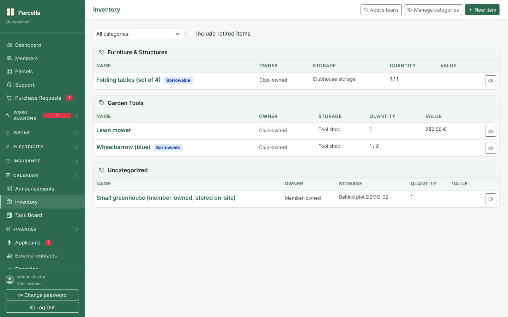

# Inventory

The inventory is the club's asset register: everything the club owns,
and things members own personally but keep on club property. Items are
grouped into categories you define yourself, carry their purchase
price, current value and replacement cost, and can be lent to members
with a simple check-out and return system.

!!! info "Who can use this"
    Board members and administrators always have full access. Other
    users need a group that grants **Inventory** permissions (see
    [Groups](../administration/groups.md)):

    - **Read** -- see the item list, item pages and active loans.
    - **Write** -- create, edit and retire items, manage categories,
      check items out and mark them returned.
    - **Delete** -- permanently delete items and categories.

    The module is switched on with **Inventory** under
    [Turning modules on and off](../administration/modules.md). It is
    on by default.

## Inventory list

**Inventory** in the navigation lists all items, grouped into one card
per category in alphabetical order. Items without a category come last
under **Uncategorized**. Within a card, items are sorted by name.

| Field / button | What it does |
|---|---|
| **Active loans** | Opens the [list of everything currently lent out](#active-loans). |
| **Manage categories** | Opens the [categories](#inventory-categories). Only shown with write permission. |
| **New item** | Opens an empty [item form](#item-form). Only shown with write permission. |
| **All categories** / a category | Shows only the items of one category. |
| **Include retired items** | Also lists [retired](#retiring-and-deleting) items, shown in grey with a **Retired** badge. Off by default. |

| Column | What it shows |
|---|---|
| **Name** | The item, linked to its page. Badges: **Retired**, **Borrowable**. |
| **Owner** | **Club-owned** or **Member-owned**. |
| **Storage** | The storage location. |
| **Quantity** | For borrowable items, available / owned (e.g. **1 / 2** when one of two is lent out); otherwise the quantity owned. |
| **Value** | The current value, if entered. |
| Eye button | Opens the item. |

## Item page

Click an item's name to open its page.

### Buttons

| Button | What it does |
|---|---|
| **Edit** | Opens the [item form](#item-form). Needs write permission. |
| **Retire** | Marks the item as no longer owned or in service, after a confirmation. Needs write permission; not shown once the item is retired. See [Retiring and deleting](#retiring-and-deleting). |
| **Delete** | Deletes the item and its whole loan history for good, after a confirmation. Needs delete permission. |
| **Back** | Returns to the inventory list. |

A retired item shows the notice "This item is retired -- no longer
owned/in service." at the top.

### Overview

| Field | What it shows |
|---|---|
| **Category** | The category, or **Uncategorized**. |
| **Owner** | **Club-owned**, or the name of the member who owns it. |
| **Storage location** | Where the item is kept, or "-". |
| **Quantity** | For borrowable items "available / owned **available**", otherwise the quantity owned. |
| **Description**, **Notes** | Only shown if filled in. |

### Financials

| Field | What it shows |
|---|---|
| **Purchase date** | When it was bought. |
| **Purchase price** | What it cost. |
| **Current value** | The board's current estimate, with "as of" and the date it was last checked, if entered. |
| **Replacement cost** | What it would cost to replace. |

Empty fields show "-".

### Check out

Only shown for items marked as borrowable. If nothing is available,
it says **None available to borrow right now.** The form needs write
permission.

| Field / button | What it does |
|---|---|
| **Member** | Who borrows the item. Lists current members. Required. |
| **Quantity** | How many units. At least 1, at most the number currently available. Default 1. |
| **Date** | The day it was borrowed. Defaults to today. |
| **Fee** | Optional. A number only, e.g. `5` or `2,50` -- no currency sign or text. Left empty, the item's **Suggested loan fee** is charged (the hint below the field shows it). |
| **Note** | Optional free text, e.g. "back by Sunday". |
| **Check out** | Records the loan. The available quantity goes down accordingly. |

If something is wrong -- no member chosen, more units than available
("Only 1 of 2 available right now."), a fee with text in it, an invalid
date -- the page shows the message above the form and keeps what you
typed.

!!! note "Fees are recorded, not invoiced"
    The fee is stored with the loan so the board knows what was
    agreed. Parcella doesn't create an invoice or booking for it.

### Loan history

Every loan of this item, newest first.

| Column | What it shows |
|---|---|
| **Member** | Who borrowed it. |
| **Qty** | How many units. |
| **Borrowed** | The check-out date. |
| **Returned** | The return date, or an **Outstanding** badge while it's still out. |
| **Fee** | The fee charged, or "-". |
| **Mark returned** | Records the return with today's date. Shown for outstanding loans with write permission. |

## Item form

The same form is used for **New item** and **Edit**, titled **Inventory
Item**.

### General

| Field | What it does |
|---|---|
| **Name** | What the item is. Required. |
| **Category** | One of your [categories](#inventory-categories), or **No category**. |
| **Description** | Optional longer description. |
| **Storage location** | Where it's kept, e.g. "Tool shed". |

### Ownership

| Field | What it does |
|---|---|
| **Owned by the club** | The default. |
| **Owned personally by a member** | For things members keep on club property but own themselves -- worth recording for insurance and liability. Shows **Owning member**. |
| **Owning member** | The member who owns it. Required when the item is member-owned; lists current members. |

### Financials

The current value is entered by hand whenever someone checks it.
Parcella doesn't depreciate anything automatically.

| Field | What it does |
|---|---|
| **Purchase date** | Optional. |
| **Purchase price** | Optional. |
| **Current value** | Optional. Your current best estimate. |
| **Replacement cost** | Optional. |
| **Value last checked on** | Optional date, so everyone can see how up to date the current value is. |

Amounts are numbers only: `5`, `2,50` or `2.50`. Text, a currency sign
or a negative amount is refused with a message.

### Lending

| Field | What it does |
|---|---|
| **Quantity owned** | How many identical units this entry stands for -- three wheelbarrows can be one item with quantity 3. A whole number of 1 or more; default 1. |
| **Members can borrow this** | Switches on check-out and return for this item. Shows **Suggested loan fee**. |
| **Suggested loan fee** | Optional. Used as the fee when a loan is checked out without one; can be changed per loan. |

### Notes

Free text for anything else.

Click **Save** to store the item and open its page, or **Cancel**.

!!! tip "One entry per kind of thing"
    Record identical things as one item with a quantity, not as
    separate items. Lending then shows "2 of 3 available", and a price
    change is made once.

## Retiring and deleting

- **Retire** an item that really existed and is now sold, scrapped or
  lost. It stays on record with its prices and loan history, but is
  hidden from the list unless you tick **Include retired items**.
  There is no button to undo retiring.
- **Delete** only a genuine mistake, e.g. an item entered twice. It
  removes the item and all its loans permanently.
<!-- TODO(verify): a retired borrowable item still shows the Check out form and can still be lent; and there is no way in the web UI to un-retire an item. Confirm both are intended. -->

## Inventory categories

**Manage categories** on the inventory list opens this page. It needs
write permission. **Back** returns to the list.

| Field / button | What it does |
|---|---|
| Name (e.g. "Playground, Fences, Locks & Keys") | The new category's name. Required; must not exist yet ("A category with this name already exists."). |
| **Optional description** | A short description. |
| **Add** | Creates the category. |
| **Name**, **Description** columns | The existing categories. |
| Bin button | Deletes the category after a confirmation. Its items are **not** deleted -- they become **Uncategorized**. Needs delete permission. |

Categories can't be renamed on this page. To rename one, create the
new category, move the items over by editing them, and delete the old
one.

## Active loans

**Active loans** on the inventory list shows everything that is
currently lent out, across all items, oldest loan first. Use it to see
who has what before a work session or at the end of the season.

| Column / button | What it shows |
|---|---|
| **Item** | The item, linked to its page. |
| **Member** | Who has it. |
| **Qty** | How many units. |
| **Since** | The check-out date. |
| **Fee** | The fee charged, or "-". |
| **Mark returned** | Records the return with today's date and opens the item's page. Needs write permission. |

If nothing is out, the page says **Nothing currently on loan.**

!!! tip "Seeing availability in the calendar"
    If the calendar module is on, **Calendar → My calendars → Resources**
    lists the club-owned borrowable items (retired ones left out) with
    their status -- **Available**, **Lent out** or "1 of 2 available" --
    and who has them since when. It needs read permission for the
    inventory as well. See [Calendar](calendar.md).

## Related

- [Members](members.md) -- borrowers and owners of member-owned items
- [Purchase requests](purchase-requests.md) -- getting approval before
  buying something new
- [Groups](../administration/groups.md) -- giving someone access to the
  inventory without full board rights
