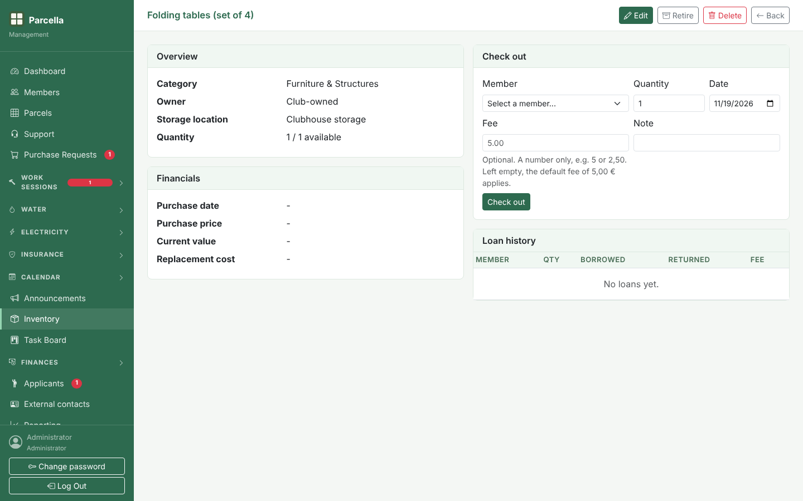
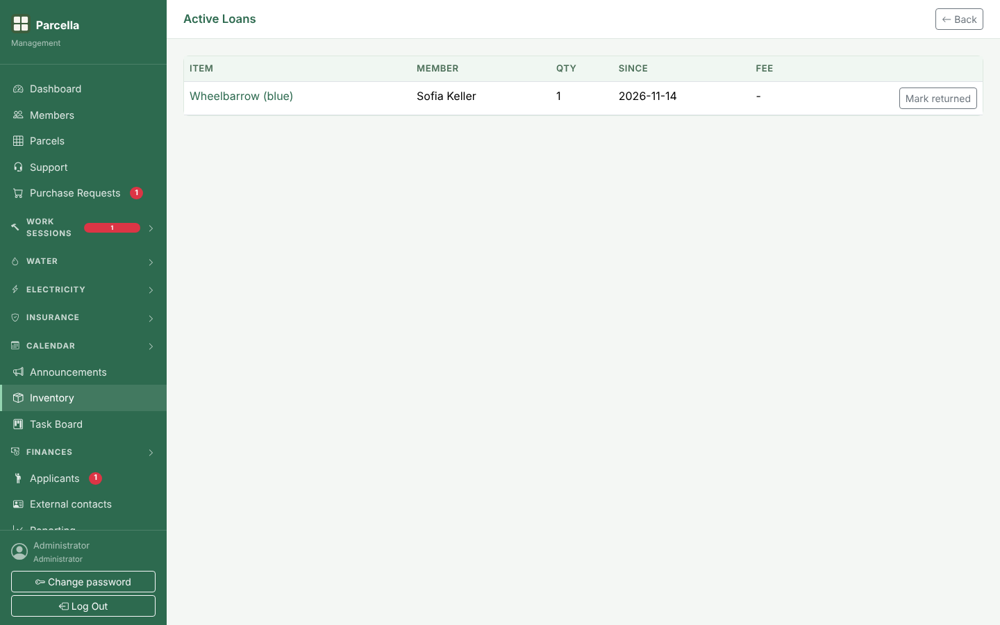

# Inventaris {#inventory}

!!! note "Machinevertaling"
    Deze pagina is machinaal vertaald uit het Engels en nog niet nagekeken. Als iets onduidelijk is, geldt de Engelse versie (taal wisselt u bovenaan).

De inventaris is het bezitsregister van de vereniging: alles wat de
vereniging bezit, en spullen die leden persoonlijk bezitten maar op
verenigingsgrond bewaren. Items worden gegroepeerd in categorieën die u
zelf vastlegt, hebben een aankoopprijs, huidige waarde en
vervangingswaarde, en kunnen met een eenvoudig uitleen- en
retoursysteem aan leden worden uitgeleend.

!!! info "Wie kan dit gebruiken"
    Bestuursleden en beheerders hebben altijd volledige toegang. Andere
    gebruikers hebben een groep nodig die rechten op **Inventaris** geeft
    (zie [Groepen](../administration/groups.md)):

    - **Lezen** -- de lijst met items, de itempagina's en de actieve
      uitleningen zien.
    - **Schrijven** -- items aanmaken, bewerken en uitfaseren,
      categorieën beheren, items uitlenen en als geretourneerd markeren.
    - **Verwijderen** -- items en categorieën definitief verwijderen.

    De module wordt ingeschakeld met **Inventaris** onder
    [Modules in- en uitschakelen](../administration/modules.md). Ze staat
    standaard aan.

## Inventarislijst {#inventory-list}

**Inventaris** in de navigatie toont alle items, gegroepeerd in één kaart
per categorie in alfabetische volgorde. Items zonder categorie komen als
laatste onder **Zonder categorie**. Binnen een kaart zijn de items op naam
gesorteerd.

| Veld / knop | Wat het doet |
|---|---|
| **Actieve uitleningen** | Opent de [lijst van alles wat nu is uitgeleend](#active-loans). |
| **Categorieën beheren** | Opent de [categorieën](#inventory-categories). Alleen zichtbaar met schrijfrecht. |
| **Nieuw item** | Opent een leeg [itemformulier](#item-form). Alleen zichtbaar met schrijfrecht. |
| **Alle categorieën** / een categorie | Toont alleen de items van één categorie. |
| **Uitgefaseerde items meenemen** | Toont ook [uitgefaseerde](#retiring-and-deleting) items, grijs met een badge **Uitgefaseerd**. Standaard uit. |

| Kolom | Wat ze toont |
|---|---|
| **Naam** | Het item, gelinkt aan de pagina ervan. Badges: **Uitgefaseerd**, **Uitleenbaar**. |
| **Eigenaar** | **Eigendom van vereniging** of **Eigendom van lid**. |
| **Opslag** | De opslaglocatie. |
| **Aantal** | Bij uitleenbare items beschikbaar / in bezit (bijv. **1 / 2** als een van de twee is uitgeleend); anders het aantal in bezit. |
| **Waarde** | De huidige waarde, als die is ingevuld. |
| Oogknop | Opent het item. |

## Itempagina {#item-page}

Klik op de naam van een item om de pagina ervan te openen.

### Knoppen {#buttons}

| Knop | Wat het doet |
|---|---|
| **Bewerken** | Opent het [itemformulier](#item-form). Vraagt schrijfrecht. |
| **Uitfaseren** | Markeert het item na bevestiging als niet meer in bezit of gebruik. Vraagt schrijfrecht; niet zichtbaar als het item al is uitgefaseerd. Zie [Uitfaseren en verwijderen](#retiring-and-deleting). |
| **Verwijderen** | Verwijdert het item en de volledige uitleengeschiedenis na bevestiging definitief. Vraagt verwijderrecht. |
| **Terug** | Terug naar de inventarislijst. |

Een uitgefaseerd item toont bovenaan de melding „Dit item is
uitgefaseerd -- niet meer in bezit/gebruik.“

### Overzicht {#overview}

| Veld | Wat het toont |
|---|---|
| **Categorie** | De categorie, of **Zonder categorie**. |
| **Eigenaar** | **Eigendom van vereniging**, of de naam van het lid dat het bezit. |
| **Opslaglocatie** | Waar het item wordt bewaard, of „-“. |
| **Aantal** | Bij uitleenbare items „beschikbaar / in bezit **beschikbaar**“, anders het aantal in bezit. |
| **Beschrijving**, **Notities** | Alleen getoond als ze zijn ingevuld. |

### Financiën {#financials}

| Veld | Wat het toont |
|---|---|
| **Aankoopdatum** | Wanneer het is gekocht. |
| **Aankoopprijs** | Wat het kostte. |
| **Huidige waarde** | De huidige schatting van het bestuur, met „per“ en de datum waarop ze voor het laatst is gecontroleerd, als die is ingevuld. |
| **Vervangingswaarde** | Wat vervangen zou kosten. |

Lege velden tonen „-“.

### Uitlenen {#check-out}

Alleen getoond bij items die als uitleenbaar zijn gemarkeerd. Is er niets
beschikbaar, dan staat er **Momenteel niets beschikbaar om te lenen.**
Het formulier vraagt schrijfrecht.

| Veld / knop | Wat het doet |
|---|---|
| **Lid** | Wie het item leent. Toont huidige leden. Verplicht. |
| **Aantal** | Hoeveel stuks. Minstens 1, hoogstens het aantal dat nu beschikbaar is. Standaard 1. |
| **Datum** | De dag waarop het is geleend. Standaard vandaag. |
| **Vergoeding** | Optioneel. Alleen een getal, bijv. `5` of `2,50` -- geen valutateken of tekst. Leeg gelaten wordt de **Voorgestelde uitleenvergoeding** van het item gerekend (de hint onder het veld toont die). |
| **Notitie** | Optionele vrije tekst, bijv. „zondag terug“. |
| **Uitlenen** | Legt de uitlening vast. Het beschikbare aantal daalt overeenkomstig. |

Klopt er iets niet -- geen lid gekozen, meer stuks dan beschikbaar
(„Slechts 1 van 2 nu beschikbaar.“), een vergoeding met tekst erin, een
ongeldige datum --, dan toont de pagina de melding boven het formulier
en houdt ze vast wat u hebt getypt.

!!! note "Vergoedingen worden vastgelegd, niet gefactureerd"
    De vergoeding wordt bij de uitlening opgeslagen, zodat het bestuur
    weet wat is afgesproken. Parcella maakt er geen factuur of boeking
    voor aan.

### Uitleengeschiedenis {#loan-history}

Elke uitlening van dit item, de nieuwste eerst.

| Kolom | Wat ze toont |
|---|---|
| **Lid** | Wie het leende. |
| **Aantal** | Hoeveel stuks. |
| **Geleend** | De uitleendatum. |
| **Geretourneerd** | De retourdatum, of een badge **Openstaand** zolang het nog uit is. |
| **Vergoeding** | De gerekende vergoeding, of „-“. |
| **Markeren als geretourneerd** | Legt de retour vast met de datum van vandaag. Getoond bij openstaande uitleningen met schrijfrecht. |

## Itemformulier {#item-form}

Hetzelfde formulier wordt gebruikt voor **Nieuw item** en **Bewerken**,
met de titel **Inventarisitem**.

### Algemeen {#general}

| Veld | Wat het doet |
|---|---|
| **Naam** | Wat het item is. Verplicht. |
| **Categorie** | Een van uw [categorieën](#inventory-categories), of **Geen categorie**. |
| **Beschrijving** | Optionele langere beschrijving. |
| **Opslaglocatie** | Waar het wordt bewaard, bijv. „Gereedschapsschuur“. |

### Eigendom {#ownership}

| Veld | Wat het doet |
|---|---|
| **Eigendom van de vereniging** | De standaard. |
| **Persoonlijk eigendom van een lid** | Voor spullen die leden op verenigingsgrond bewaren maar zelf bezitten -- het waard om vast te leggen voor verzekering en aansprakelijkheid. Toont **Eigenaar (lid)**. |
| **Eigenaar (lid)** | Het lid dat het bezit. Verplicht als het item eigendom van een lid is; toont huidige leden. |

### Financiën {#financials_1}

De huidige waarde wordt met de hand ingevuld telkens wanneer iemand haar
controleert. Parcella schrijft niets automatisch af.

| Veld | Wat het doet |
|---|---|
| **Aankoopdatum** | Optioneel. |
| **Aankoopprijs** | Optioneel. |
| **Huidige waarde** | Optioneel. Uw huidige beste schatting. |
| **Vervangingswaarde** | Optioneel. |
| **Waarde laatst gecontroleerd op** | Optionele datum, zodat iedereen ziet hoe actueel de huidige waarde is. |

Bedragen zijn alleen getallen: `5`, `2,50` of `2.50`. Tekst, een
valutateken of een negatief bedrag wordt met een melding geweigerd.

### Uitlenen {#lending}

| Veld | Wat het doet |
|---|---|
| **Aantal in bezit** | Voor hoeveel identieke stuks dit item staat -- drie kruiwagens kunnen één item met aantal 3 zijn. Een geheel getal van 1 of meer; standaard 1. |
| **Leden kunnen dit lenen** | Zet uitlenen en retour voor dit item aan. Toont **Voorgestelde uitleenvergoeding**. |
| **Voorgestelde uitleenvergoeding** | Optioneel. Gebruikt als vergoeding als een uitlening zonder vergoeding wordt vastgelegd; per uitlening aan te passen. |

### Notities {#notes}

Vrije tekst voor al het andere.

Klik op **Opslaan** om het item op te slaan en de pagina ervan te
openen, of op **Annuleren**.

!!! tip "Eén item per soort ding"
    Leg identieke dingen vast als één item met een aantal, niet als
    aparte items. Het uitlenen toont dan „2 van 3 beschikbaar“, en een
    prijswijziging doet u één keer.

## Uitfaseren en verwijderen {#retiring-and-deleting}

- **Faseer** een item **uit** dat echt bestond en nu verkocht, gesloopt
  of verloren is. Het blijft vastgelegd met prijzen en
  uitleengeschiedenis, maar is in de lijst verborgen tenzij u
  **Uitgefaseerde items meenemen** aanvinkt. Er is geen knop om
  uitfaseren ongedaan te maken.
- **Verwijder** alleen een echte vergissing, bijv. een dubbel ingevoerd
  item. Dat haalt het item en al zijn uitleningen definitief weg.
<!-- TODO(verify): a retired borrowable item still shows the Check out form and can still be lent; and there is no way in the web UI to un-retire an item. Confirm both are intended. -->

## Inventariscategorieën {#inventory-categories}

**Categorieën beheren** in de inventarislijst opent deze pagina. Ze
vraagt schrijfrecht. **Terug** brengt u naar de lijst.

| Veld / knop | Wat het doet |
|---|---|
| Naam (bijv. „Speeltuin, Hekken, Sloten & sleutels“) | De naam van de nieuwe categorie. Verplicht; mag nog niet bestaan („Er bestaat al een categorie met deze naam.“). |
| **Optionele beschrijving** | Een korte beschrijving. |
| **Toevoegen** | Maakt de categorie aan. |
| Kolommen **Naam**, **Beschrijving** | De bestaande categorieën. |
| Prullenbakknop | Verwijdert de categorie na bevestiging. De items erin worden **niet** verwijderd -- ze komen onder **Zonder categorie**. Vraagt verwijderrecht. |

Categorieën kunnen op deze pagina niet worden hernoemd. Om er een te
hernoemen, maakt u de nieuwe categorie aan, verplaatst u de items door
ze te bewerken, en verwijdert u de oude.

## Actieve uitleningen {#active-loans}

**Actieve uitleningen** in de inventarislijst toont alles wat nu is
uitgeleend, over alle items heen, de oudste uitlening eerst. Gebruik het
om voor een werksessie of aan het einde van het seizoen te zien wie wat
heeft.

| Kolom / knop | Wat ze toont |
|---|---|
| **Item** | Het item, gelinkt aan de pagina ervan. |
| **Lid** | Wie het heeft. |
| **Aantal** | Hoeveel stuks. |
| **Sinds** | De uitleendatum. |
| **Vergoeding** | De gerekende vergoeding, of „-“. |
| **Markeren als geretourneerd** | Legt de retour vast met de datum van vandaag en opent de pagina van het item. Vraagt schrijfrecht. |

Is er niets uit, dan zegt de pagina **Momenteel niets uitgeleend.**

!!! tip "Beschikbaarheid in de kalender zien"
    Staat de kalendermodule aan, dan toont **Kalender → Eigen agenda's →
    Middelen** de uitleenbare items van de vereniging (zonder
    uitgefaseerde) met hun status -- **Beschikbaar**, **Uitgeleend** of
    „1 van 2 beschikbaar“ -- en wie ze sinds wanneer heeft. Daarvoor is
    ook leesrecht op de inventaris nodig. Zie [Kalender](calendar.md).

## Gerelateerd {#related}

- [Leden](members.md) -- leners en eigenaars van items in eigendom van
  leden
- [Aankoopaanvragen](purchase-requests.md) -- goedkeuring krijgen voordat
  u iets nieuws koopt
- [Groepen](../administration/groups.md) -- iemand toegang tot de
  inventaris geven zonder volledige bestuursrechten
