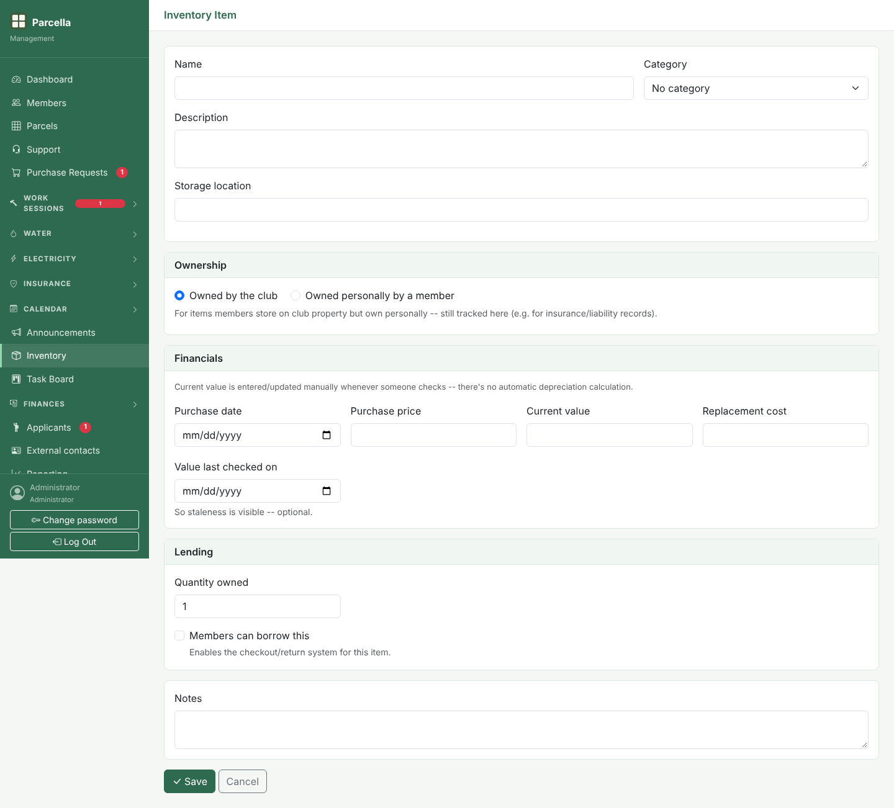
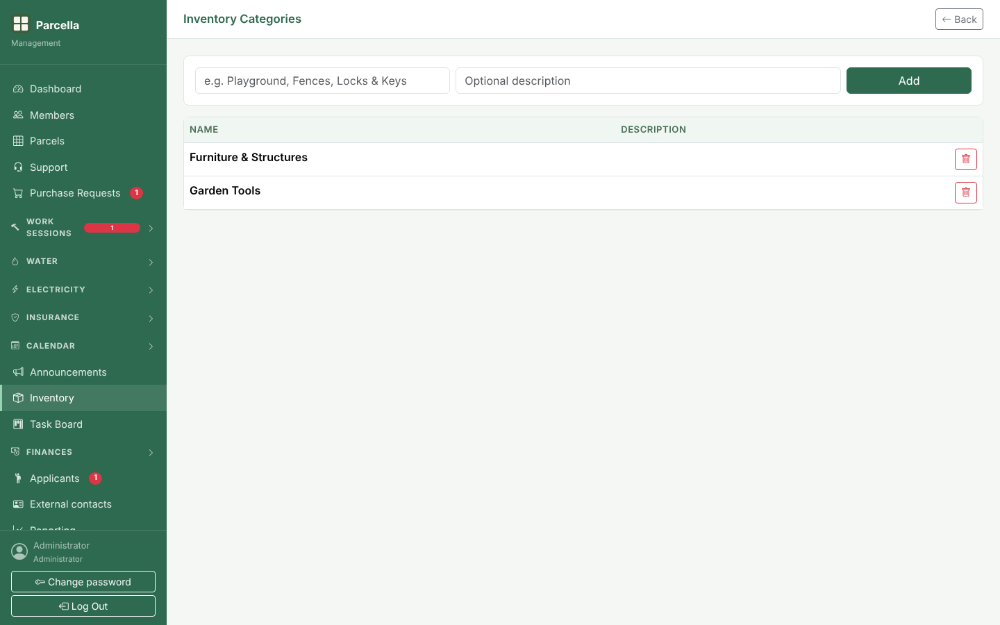

# Inventár {#inventory}

!!! note "Strojový preklad"
    Táto stránka bola strojovo preložená z angličtiny a zatiaľ nebola skontrolovaná. Ak je niečo nejasné, platí anglická verzia (jazyk prepnete hore).

Inventár je evidencia majetku spolku: všetko, čo spolok vlastní, a
veci, ktoré členovia vlastnia osobne, ale majú ich na pozemku spolku.
Položky sú zoskupené do kategórií, ktoré si definujete sami, majú
nákupnú cenu, aktuálnu hodnotu a cenu za náhradu a dajú sa požičiavať
členom pomocou jednoduchého systému požičania a vrátenia.

!!! info "Kto to môže používať"
    Členovia výboru a administrátori majú vždy plný prístup. Ostatní
    používatelia potrebujú skupinu, ktorá udeľuje oprávnenia pre
    **Inventár** (pozri [Skupiny](../administration/groups.md)):

    - **Čítanie** -- vidieť zoznam položiek, stránky položiek a aktívne
      výpožičky.
    - **Zápis** -- vytvárať, upravovať a vyraďovať položky, spravovať
      kategórie, požičiavať položky a označovať ich ako vrátené.
    - **Mazanie** -- natrvalo mazať položky a kategórie.

    Modul sa zapína prepínačom **Inventár** v časti
    [Zapínanie a vypínanie modulov](../administration/modules.md).
    Predvolene je zapnutý.

## Zoznam inventára {#inventory-list}

**Inventár** v navigácii uvádza všetky položky, zoskupené do jednej
karty na kategóriu v abecednom poradí. Položky bez kategórie sú na
konci v **Bez kategórie**. V rámci karty sú položky zoradené podľa
názvu.

| Pole / tlačidlo | Čo robí |
|---|---|
| **Aktívne výpožičky** | Otvorí [zoznam všetkého, čo je momentálne požičané](#active-loans). |
| **Spravovať kategórie** | Otvorí [kategórie](#inventory-categories). Zobrazí sa len s oprávnením na zápis. |
| **Nová položka** | Otvorí prázdny [formulár položky](#item-form). Zobrazí sa len s oprávnením na zápis. |
| **Všetky kategórie** / kategória | Ukáže len položky jednej kategórie. |
| **Zahrnúť vyradené položky** | Uvedie aj [vyradené](#retiring-and-deleting) položky, zobrazené sivo s odznakom **Vyradené**. Predvolene vypnuté. |

| Stĺpec | Čo ukazuje |
|---|---|
| **Názov** | Položka s odkazom na jej stránku. Odznaky: **Vyradené**, **Na požičanie**. |
| **Vlastník** | **Vlastníctvo klubu** alebo **Vlastníctvo člena**. |
| **Uloženie** | Miesto uloženia. |
| **Množstvo** | Pri položkách na požičanie dostupné / vlastnené (napr. **1 / 2**, keď je jeden z dvoch požičaný); inak vlastnené množstvo. |
| **Hodnota** | Aktuálna hodnota, ak bola zadaná. |
| Tlačidlo s okom | Otvorí položku. |

## Stránka položky {#item-page}

Kliknutím na názov položky otvoríte jej stránku.

### Tlačidlá {#buttons}

| Tlačidlo | Čo robí |
|---|---|
| **Upraviť** | Otvorí [formulár položky](#item-form). Potrebuje oprávnenie na zápis. |
| **Vyradiť** | Po potvrdení označí položku ako už nevlastnenú alebo mimo prevádzky. Potrebuje oprávnenie na zápis; po vyradení sa už nezobrazuje. Pozri [Vyradenie a zmazanie](#retiring-and-deleting). |
| **Zmazať** | Po potvrdení natrvalo zmaže položku a celú jej históriu výpožičiek. Potrebuje oprávnenie na mazanie. |
| **Späť** | Vráti sa do zoznamu inventára. |

Vyradená položka ukazuje hore upozornenie „Táto položka je vyradená --
už nie je vo vlastníctve/prevádzke.“

### Prehľad {#overview}

| Pole | Čo ukazuje |
|---|---|
| **Kategória** | Kategória alebo **Bez kategórie**. |
| **Vlastník** | **Vlastníctvo klubu** alebo meno člena, ktorý ju vlastní. |
| **Miesto uloženia** | Kde je položka uložená, alebo „-“. |
| **Množstvo** | Pri položkách na požičanie „dostupné / vlastnené **k dispozícii**“, inak vlastnené množstvo. |
| **Popis**, **Poznámky** | Zobrazia sa len, ak sú vyplnené. |

### Financie {#financials}

| Pole | Čo ukazuje |
|---|---|
| **Dátum nákupu** | Kedy bola kúpená. |
| **Nákupná cena** | Koľko stála. |
| **Aktuálna hodnota** | Aktuálny odhad výboru, s „ku dňu“ a dátumom poslednej kontroly, ak bol zadaný. |
| **Cena za náhradu** | Koľko by stála náhrada. |

Prázdne polia ukazujú „-“.

### Požičať {#check-out}

Zobrazí sa len pri položkách označených na požičanie. Ak nie je nič
dostupné, hovorí **Momentálne nič na požičanie k dispozícii.** Formulár
potrebuje oprávnenie na zápis.

| Pole / tlačidlo | Čo robí |
|---|---|
| **Člen** | Kto si položku požičiava. Uvádza súčasných členov. Povinné. |
| **Množstvo** | Koľko kusov. Aspoň 1, najviac počet práve dostupných. Predvolene 1. |
| **Dátum** | Deň požičania. Predvolene dnes. |
| **Poplatok** | Voliteľné. Len číslo, napr. `5` alebo `2,50` -- bez symbolu meny alebo textu. Ak zostane prázdne, účtuje sa **Navrhovaný poplatok za požičanie** položky (nápoveda pod poľom ho ukazuje). |
| **Poznámka** | Voliteľný voľný text, napr. „späť do nedele“. |
| **Požičať** | Zaznamená výpožičku. Dostupné množstvo sa zodpovedajúco zníži. |

Ak je niečo nesprávne -- nie je vybraný člen, viac kusov, než je
dostupných („Momentálne je k dispozícii iba 1 z 2.“), poplatok s textom,
neplatný dátum --, stránka ukáže hlásenie nad formulárom a zachová, čo
ste napísali.

!!! note "Poplatky sa evidujú, nefakturujú"
    Poplatok sa uloží s výpožičkou, aby výbor vedel, čo bolo dohodnuté.
    Parcella preň nevytvorí faktúru ani zaúčtovanie.

### História výpožičiek {#loan-history}

Každá výpožička tejto položky, najnovšie prvé.

| Stĺpec | Čo ukazuje |
|---|---|
| **Člen** | Kto si ju požičal. |
| **Množ.** | Koľko kusov. |
| **Požičané** | Dátum požičania. |
| **Vrátené** | Dátum vrátenia alebo odznak **Nevrátené**, kým je ešte vonku. |
| **Poplatok** | Účtovaný poplatok alebo „-“. |
| **Označiť ako vrátené** | Zaznamená vrátenie s dnešným dátumom. Zobrazí sa pri nevrátených výpožičkách s oprávnením na zápis. |

## Formulár položky {#item-form}

Ten istý formulár sa používa pre **Nová položka** aj **Upraviť**, s
nadpisom **Položka inventára**.

### Všeobecné {#general}

| Pole | Čo robí |
|---|---|
| **Názov** | Čo je položka. Povinné. |
| **Kategória** | Jedna z vašich [kategórií](#inventory-categories) alebo **Bez kategórie**. |
| **Popis** | Voliteľný dlhší popis. |
| **Miesto uloženia** | Kde je uložená, napr. „Kôlňa na náradie“. |

### Vlastníctvo {#ownership}

| Pole | Čo robí |
|---|---|
| **Vlastníctvo klubu** | Predvolené. |
| **Osobné vlastníctvo člena** | Pre veci, ktoré členovia majú na pozemku spolku, ale vlastnia ich sami -- oplatí sa ich evidovať kvôli poisteniu a zodpovednosti. Zobrazí **Vlastniaci člen**. |
| **Vlastniaci člen** | Člen, ktorý ju vlastní. Povinné, keď je položka vo vlastníctve člena; uvádza súčasných členov. |

### Financie {#financials_1}

Aktuálna hodnota sa zadáva ručne vždy, keď ju niekto skontroluje.
Parcella nič automaticky neodpisuje.

| Pole | Čo robí |
|---|---|
| **Dátum nákupu** | Voliteľné. |
| **Nákupná cena** | Voliteľné. |
| **Aktuálna hodnota** | Voliteľné. Váš aktuálny najlepší odhad. |
| **Cena za náhradu** | Voliteľné. |
| **Hodnota naposledy skontrolovaná** | Voliteľný dátum, aby každý videl, aká aktuálna je aktuálna hodnota. |

Sumy sú len čísla: `5`, `2,50` alebo `2.50`. Text, symbol meny alebo
záporná suma sa odmietne s hlásením.

### Požičiavanie {#lending}

| Pole | Čo robí |
|---|---|
| **Vlastnené množstvo** | Koľko rovnakých kusov tento záznam predstavuje -- tri fúriky môžu byť jedna položka s množstvom 3. Celé číslo 1 alebo viac; predvolene 1. |
| **Členovia si to môžu požičať** | Zapne pre túto položku požičanie a vrátenie. Zobrazí **Navrhovaný poplatok za požičanie**. |
| **Navrhovaný poplatok za požičanie** | Voliteľné. Použije sa ako poplatok, keď sa výpožička zaznamená bez neho; pri každej výpožičke sa dá zmeniť. |

### Poznámky {#notes}

Voľný text na čokoľvek iné.

Kliknite na **Uložiť**, aby ste položku uložili a otvorili jej stránku,
alebo na **Zrušiť**.

!!! tip "Jeden záznam na druh veci"
    Rovnaké veci evidujte ako jednu položku s množstvom, nie ako
    samostatné položky. Požičiavanie potom ukazuje „K dispozícii 2 z
    3“ a zmena ceny sa urobí raz.

## Vyradenie a zmazanie {#retiring-and-deleting}

- **Vyraďte** položku, ktorá naozaj existovala a teraz je predaná,
  zošrotovaná alebo stratená. Zostáva v evidencii s cenami a históriou
  výpožičiek, ale v zozname je skrytá, pokiaľ nezaškrtnete **Zahrnúť
  vyradené položky**. Tlačidlo na zrušenie vyradenia neexistuje.
- **Zmažte** len skutočnú chybu, napr. položku zadanú dvakrát. Natrvalo
  odstráni položku a všetky jej výpožičky.
<!-- TODO(verify): a retired borrowable item still shows the Check out form and can still be lent; and there is no way in the web UI to un-retire an item. Confirm both are intended. -->

## Kategórie inventára {#inventory-categories}

**Spravovať kategórie** v zozname inventára otvorí túto stránku.
Potrebuje oprávnenie na zápis. **Späť** vás vráti do zoznamu.

| Pole / tlačidlo | Čo robí |
|---|---|
| Názov (napr. „Ihrisko, ploty, zámky a kľúče“) | Názov novej kategórie. Povinné; ešte nesmie existovať („Kategória s týmto názvom už existuje.“). |
| **Voliteľný popis** | Krátky popis. |
| **Pridať** | Vytvorí kategóriu. |
| Stĺpce **Názov**, **Popis** | Existujúce kategórie. |
| Tlačidlo koša | Po potvrdení zmaže kategóriu. Jej položky sa **nezmažú** -- stanú sa **Bez kategórie**. Potrebuje oprávnenie na mazanie. |

Na tejto stránke sa kategórie nedajú premenovať. Ak chcete niektorú
premenovať, vytvorte novú kategóriu, presuňte do nej položky ich
úpravou a starú zmažte.

## Aktívne výpožičky {#active-loans}

**Aktívne výpožičky** v zozname inventára ukazujú všetko, čo je
momentálne požičané, zo všetkých položiek, najstaršia výpožička prvá.
Použite to, aby ste pred pracovnou zmenou alebo na konci sezóny videli,
kto má čo.

| Stĺpec / tlačidlo | Čo ukazuje |
|---|---|
| **Položka** | Položka s odkazom na jej stránku. |
| **Člen** | Kto ju má. |
| **Množ.** | Koľko kusov. |
| **Od** | Dátum požičania. |
| **Poplatok** | Účtovaný poplatok alebo „-“. |
| **Označiť ako vrátené** | Zaznamená vrátenie s dnešným dátumom a otvorí stránku položky. Potrebuje oprávnenie na zápis. |

Ak nie je nič vonku, stránka hovorí **Momentálne nič nie je požičané.**

!!! tip "Dostupnosť v kalendári"
    Ak je zapnutý modul kalendára, **Kalendár → Vlastné kalendáre →
    Zdroje** uvádza požičiavateľné položky vo vlastníctve klubu (bez
    vyradených) s ich stavom -- **K dispozícii**, **Zapožičané** alebo
    „K dispozícii 1 z 2“ -- a kto ich má a odkedy. Potrebuje aj
    oprávnenie na čítanie inventára. Pozri [Kalendár](calendar.md).

## Súvisiace {#related}

- [Členovia](members.md) -- dlžníci a vlastníci položiek vo
  vlastníctve členov
- [Žiadosti o nákup](purchase-requests.md) -- získanie schválenia pred
  kúpou niečoho nového
- [Skupiny](../administration/groups.md) -- prístup k inventáru pre
  niekoho bez plných práv výboru
